# Agents and code

> **Archived 2026-10-24** — the living research notes moved to [RSI_NOTES.md](../RSI_NOTES.md) (taxonomy of the 1,250-paper RSI survey, arXiv 2607.07663). This page and catalog.json are frozen and no longer updated. / 2026-10-24 起归档：研究笔记已迁移至 [RSI_NOTES.md](../RSI_NOTES.md)；本页与 catalog.json 冻结，不再更新。

[← Research map](README.md)

## Mechanism families

| Family | Records |
| --- | ---: |
| [Skill-file optimization & libraries](#family-skill-file-optimization) | 31 |
| [Harness search & evolution](#family-harness-search) | 28 |
| [Self-modifying meta-agents & lineages](#family-self-modifying-meta-agents) | 14 |
| [Program evolution & evolutionary search](#family-program-evolution) | 10 |
| [Feedback review & orchestration](#family-feedback-orchestration) | 6 |
| [Safety & governance](#family-safety-governance) | 6 |

## Skill-file optimization & libraries (31)

### Trackable Skill Library Lifecycle Management for Agentic Reinforcement Learning

**2026-10-20** · paper · Direct bounded loop

**Publication date** — arXiv v1 submitted 2026-10-18; announced in the 2026-10-20 batch, recorded as first public date.

**Institutional relationship** — Xi Zhu, Yuanlin Duan, Kai Mei, Riyang Bao, Dimitris N. Metaxas (Rutgers University), Changyi Yang (Carnegie Mellon University), Shichao Zhu (TikTok Inc.) - read from the PDF title page (the HTML author block renders affiliation placeholders).

**What changes and how feedback is reused** — Skill lifecycle management driven by per-skill randomized controlled evidence inside agentic RL. Within each GRPO group, grouped sampling is turned into online randomized controlled experiments: independent random injection of skills plus within-group contrasts on the same task isolate each skill's true contribution (addressing free-riding among co-retrieved skills and difficulty confounding), with reliability-weighted aggregation across groups. Skill utility (causal contribution as external scaffolding) and model mastery (how far the capability is internalized) are tracked continuously, and the skill library is managed by evidence-gated state transitions (retain, retire, remove, evict).

**Author-reported result** — Outperforms recent skill-augmented RL baselines in both skill-assisted and skill-free evaluation (main testbed ALFWorld plus further suites), including reflection-model variants; analyses show how skill value shifts as the policy learns and how evidence-driven transitions shape library composition, with library growth kept controlled under cold and warm starts.

**Evidence limits** — Requires an RL training loop (utility estimates are tied to GRPO-style groups); evidence accumulates only as fast as retrieval exposes each skill; benchmark scope limited to the evaluated suites.

**Code / weights / data / license** — Repository github.com/xizhu1022/TrackRL printed in the paper but 404 at verification (announced, not live); paper CC BY 4.0.

**Possible nanoRSI experiment — not implemented here** — Extends ADOPTION 59's causal attribution line with a lifecycle output: per-skill treatment/control injection inside evaluation panels yields causal utility, and a utility-vs-mastery two-axis ledger turns existing accept/reject bookkeeping into evidence-gated retain/retire decisions on evolved skills.

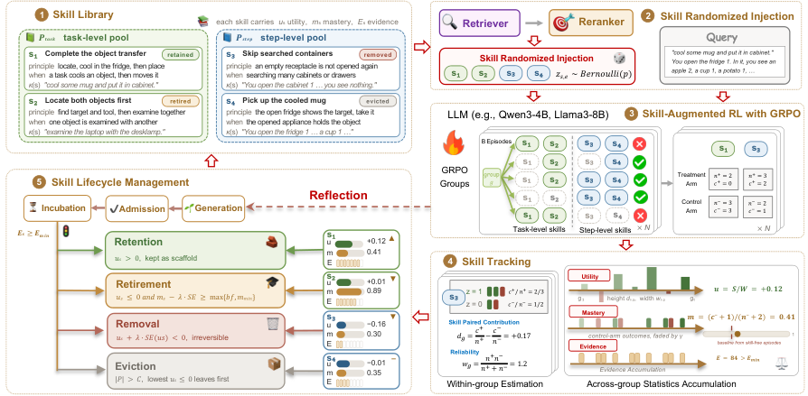

**Source figure / official image** — Original Figure 2 overview: the skill library's task- and step-level skills are randomly injected within GRPO groups to create per-skill treatment and control arms; tracked utility, mastery and evidence drive skill lifecycle management. · Figure 2 (TrackRL.png), arXiv HTML 2610.25126v1 · [source](https://arxiv.org/html/2610.25126v1/TrackRL.png)

**nanoRSI reproduction** — not-run. Last source check: 2026-10-21.

**Open code / weights / data links** — No verified public code/asset link in the audited sources.

**Primary sources** — [arXiv abs 2610.25126](https://arxiv.org/abs/2610.25126) · [arXiv HTML v1](https://arxiv.org/html/2610.25126v1)

### One Skill Takes Over: Clashing Agent Skills and a One-File Fix

**2026-10-20** · paper · Enabling technique / evaluation

**Publication date** — arXiv v1 submitted 2026-10-18; announced in the 2026-10-20 batch, recorded as first public date; repository committed 2026-10-18.

**Institutional relationship** — Parsa Razmara (corresponding), Seyedarmin Azizi, Ardalan Aryashad - University of Southern California, Los Angeles, read from the HTML author block.

**What changes and how feedback is reused** — An empirical anatomy of skill interference. SkillClash is 16 pairs of same-job skills in which code checks every rule and a reference output shows the best achievable result; loading two same-job skills into one context produces takeover - outputs follow every exclusive rule of one skill and drop the other's - driven by the worked examples inside the files. Fixes tested: telling the model which skill has priority (does not recover the dropped skill), telling it to apply both (helps only on the two strongest models), ending each file with one shared correct worked example (takeover falls to 1-15% on six models), and one merged meta-skill file written by Claude Opus 5.5.

**Author-reported result** — Across seven models from five families (4B open to Qwen3-235B and GPT-4.1), a skill's rules are followed 93-99% when loaded alone but 61-62% when a same-job skill is loaded next to it; the merged file restores 96-99% of achievable rules on all seven models (68-94% of outputs fully correct), and its correct worked example alone is worth +12-17 points - an incorrect example adds little or nothing.

**Evidence limits** — Instruction-file skills only (no tool/skill scripts); 16 job pairs with code-checkable rules; the strongest merge was written by a frontier model outside the loop rather than evolved; same-job pairs may overstate clashes across loosely related skills.

**Code / weights / data / license** — Repository github.com/prazmara/skillclash live (benchmark, code and results, committed 2026-10-18) with NO license file at verification - treat as all-rights-reserved; paper CC BY 4.0.

**Possible nanoRSI experiment — not implemented here** — Skills-template hygiene for multi-skill workspaces: before a run, audit active skill files for same-job rule overlap (clash check); when overlap exists, require a shared correct worked example or a merged single file - a cheap pre-gate check for the skills line that directly matches this repo's per-workspace skill surfaces.

**Source figure / official image** — Original Figure 2: (a) share of a skill's rules followed on seven models when loaded alone versus beside a same-job skill; (b-d) outputs with both skills loaded, counted by exclusive rules of each skill followed - most outputs sit in the two takeover corners. · Figure 2 (fig_takeover.png), arXiv HTML 2610.25064v1 · [source](https://arxiv.org/html/2610.25064v1/fig_takeover.png)

**nanoRSI reproduction** — not-run. Last source check: 2026-10-21.

**Open code / weights / data links** — [prazmara/skillclash (no license file)](https://github.com/prazmara/skillclash)

**Primary sources** — [arXiv abs 2610.25064](https://arxiv.org/abs/2610.25064) · [arXiv HTML v1](https://arxiv.org/html/2610.25064v1) · [prazmara/skillclash (no license file)](https://github.com/prazmara/skillclash)

### Compile Once, Run Cheap: Frozen, Portable Skills for Embodied Agents, and What Recursive Self-Improvement Adds

**2026-10-20** · paper · Direct bounded loop

**Publication date** — arXiv v1 submitted 2026-10-18 (manuscript version 3.6 dated 2026-10-17); announced in the 2026-10-20 batch, recorded as first public date; repository v1.0 released 2026-10-17.

**Institutional relationship** — Jingwen Bai, Canbo Zhang, Shuang Liu (Beijing Ou Rui Ling Shi Technology Co., Ltd. - Orillusion; corresponding shuang.liu@orillusion.com), Guochao Bai, Weichun Huang (ChangingTek Robotics Technology (Suzhou)), Shuangqi Li, Minchao Hu (Shanghai Yunfan Intelligent Control Robot Technology) - read from the HTML header block.

**What changes and how feedback is reused** — Skill-level recursive self-improvement with an explicit compile protocol. A strong general model acts only as an isolated, audited offline author that writes, runs, diagnoses and repairs a manipulation skill in simulation until it passes an exam on layouts drawn AFTER freezing; the frozen skill (SKILL.md, skills.py, perception.py plus a MANIFEST with hashes, seeds, environment fingerprint, exam outcome and compile cost) then runs as code alone or under a cheap caller that reads only its description. Controlled comparisons run throughout: a no-feedback control draft beside every repair round, an inherit-only control, hidden validation layouts never fed back, and a reuse protocol running identical files under executors from another model family.

**Author-reported result** — On 7 RoboTwin 2.0 tasks, Claude Code compiled 4 tasks into 7 frozen skills (5 from a first draft needing only qualification) at USD 4.29-8.22 author cost each (USD 55 per skill counting the 13 failed campaigns); the other 3 tasks did not compile in 18 campaigns (including five with GPT-6 and a pre-registered 150-layout run) - on the hardest task every campaign scored 78-95/100 but had 3-16 safety aborts, failing the 95%-success-zero-aborts gate; repair inheriting earlier evidence beats rewriting on hidden layouts; frozen skills transfer across executor model families.

**Evidence limits** — Simulation-compiled skills with a small task set; author cost accounting honestly includes failures; safety-abort bounds from 100-episode exams are wide; three non-compiling tasks are reported as failures, not smoothed over.

**Code / weights / data / license** — Repository github.com/Orillusion/embodied-skill-rsi live under Apache-2.0 (LICENSE read from raw.githubusercontent.com; release v1.0 2026-10-17); paper arXiv non-exclusive license.

**Possible nanoRSI experiment — not implemented here** — The compile protocol is this repo's freeze doctrine mirrored onto embodied skills: adopt the per-repair-round paired no-feedback control draft and the inherit-only control as standard arms, and ship accepted candidates with a release MANIFEST (hashes, seeds, environment fingerprint, exam outcome, compile cost) as the packaging standard.

**Source figure / official image** — Original Figure 1 (rendered from PDF): Protocol A compiles offline with an isolated, audited strong author and freezes the skill through an independent gate; Protocol B runs the same files with executors that never see the skill code on new layouts; both share one non-bypassable runtime and a hash-chained manifest. · Figure 1 cropped from PDF page 2 (HTML figure assets absent); gs 150dpi render, bbox (77,99,1199,700) · [source](https://arxiv.org/pdf/2610.25114)

**nanoRSI reproduction** — not-run. Last source check: 2026-10-21.

**Open code / weights / data links** — [Orillusion/embodied-skill-rsi (Apache-2.0)](https://github.com/Orillusion/embodied-skill-rsi) · [embodied-skill-rsi LICENSE (Apache-2.0)](https://raw.githubusercontent.com/Orillusion/embodied-skill-rsi/main/LICENSE)

**Primary sources** — [arXiv abs 2610.25114](https://arxiv.org/abs/2610.25114) · [arXiv HTML v1](https://arxiv.org/html/2610.25114v1) · [Orillusion/embodied-skill-rsi (Apache-2.0)](https://github.com/Orillusion/embodied-skill-rsi) · [embodied-skill-rsi LICENSE (Apache-2.0)](https://raw.githubusercontent.com/Orillusion/embodied-skill-rsi/main/LICENSE)

### EvoSkill v2: Fully Agentic Skill Evolution from Benchmark Adaptation to a Stateful Evolver

**2026-10-20** · paper · Direct bounded loop

**Publication date** — arXiv v1 submitted 2026-10-19; announced in the 2026-10-20 batch, recorded as first public date.

**Institutional relationship** — Dastin Huang, Baran Nama, Salaheddin Alzubi - all Sentient Labs (author block lists sentient.xyz addresses), read from the HTML author block.

**What changes and how feedback is reused** — Three-agent skill evolution that edits instruction files only (model and harness stay intact). A benchmark adaptor turns a user-described benchmark plus grader into a frozen plug-in; a solver attempts every training and validation task three times per epoch; the evolver is ONE stateful coding agent with a bash tool that persists across the whole run - unlike per-call optimizers (SkillOpt) or agents restarted each round (SkillBoost). The evolver measures how much the solver's rollouts vary between attempts, gets several attempts per training task, and accepts every epoch's skills instead of selecting among them on noisy scores.

**Author-reported result** — With fine-grained ground truth, EvoSkill v2's skills raise held-out pass rates above the stronger of SkillOpt and SkillBoost by 7.7 points on SpreadsheetBench v2 and 5.4 on tau3-bench banking; in both benchmarks and both feedback settings its evolver costs less per point of held-out pass rate than either baseline's optimizer; a less capable model improving its own skills gains up to 21.5 points on tau3.

**Evidence limits** — Instruction-file surface only; two benchmarks with user-supplied graders; accepting every epoch trades measurement budget for selection robustness (no per-epoch filtering), so the held-out comparison carries the whole burden; rollout-variance handling is heuristic.

**Code / weights / data / license** — No code repository link located in the paper at verification (the surveyed SkillOpt/SkillBoost ecosystems are cited as prior systems); paper CC BY 4.0.

**Possible nanoRSI experiment — not implemented here** — Two protocol inputs for the selector study (ADOPTION 38/53): a stateful proposer session that carries memory across generations instead of per-attempt statelessness, and an accept-every-epoch arm whose final held-out panel compares all epochs' artifacts against gated selection at matched budget - directly testing whether per-edit gating discards optima (cf. AtomSearch's 67% non-best-ancestor finding).

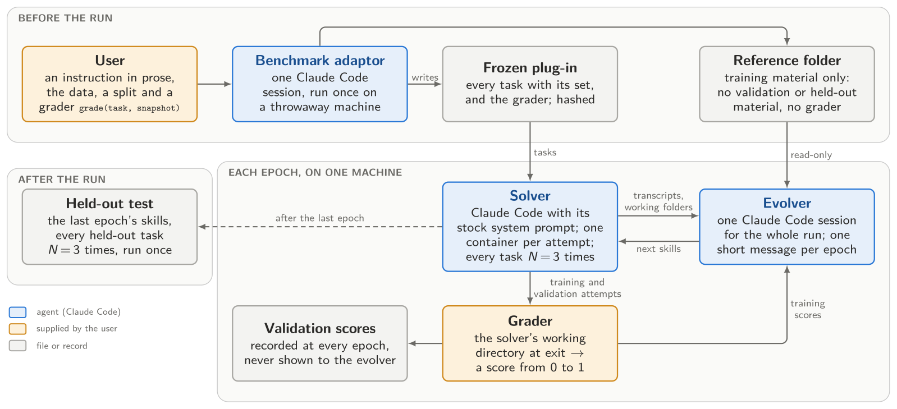

**Source figure / official image** — Original Figure 1: before the run the benchmark adaptor freezes the user's benchmark and grader into a plug-in; each epoch the solver attempts training and validation tasks while the stateful evolver agent rewrites the skills. · Figure 1 (figArch.svg), arXiv HTML 2610.25931v1, rendered to PNG · [source](https://arxiv.org/html/2610.25931v1/figArch.svg)

**nanoRSI reproduction** — not-run. Last source check: 2026-10-21.

**Open code / weights / data links** — No verified public code/asset link in the audited sources.

**Primary sources** — [arXiv abs 2610.25931](https://arxiv.org/abs/2610.25931) · [arXiv HTML v1](https://arxiv.org/html/2610.25931v1)

### From Trajectories to Differentiated Skills: Cognitive Differentiation for Self-Improving Agents

**2026-10-19** · paper · Direct bounded loop

**Publication date** — arXiv v1 submitted 2026-10-16; announced in the 2026-10-19 batch (OAI-PMH datestamp 2026-10-19), recorded as first public date.

**Institutional relationship** — Yewei Zhao, Derong Xu, Wei Chen, Yin Xu, Mingjun Xiao (University of Science and Technology of China); Derong Xu also Meituan; several coauthors (Peilun Zhou, Xiaohan Wang, Guojun Yin, Wei Lin) carry no machine-readable affiliation in the HTML block, with City University of Hong Kong appearing among listed institutions - affiliations read from the HTML author block.

**What changes and how feedback is reused** — Cognitive Differentiation in Skill Evolution (CDSE): a unified skill evolves through four functionally distinct, coordinated components - Meta, Experience, Tool and Script. Evidence-grounded semantic gradients are extracted from successful and failed trajectories, consolidated by functional role under a retention gate, then applied as component-specific updates with validation, cross-component coordination, and adaptive invocation that decides which components enter context for a task.

**Author-reported result** — An analysis of 500 widely used skill packages finds 96.8% span at least two functional roles. Across six benchmarks (OfficeQA, SpreadsheetBench2, SealQA, LiveMathBench, SWE-Pro, AutomationBench), three agent models (GLM-5.2, DeepSeek-V4-Flash, MiniMax-M3) and two execution harnesses (Claude Code, Codex), CDSE scores highest in all 36 settings (2:7 train/test split): +7.6 points over the Base agent on average and +2.6 over the strongest competing skill-evolution method per setting (Trace2Skill, SkillOpt-lite, EvoSkill); single-round token costs comparable across methods.

**Evidence limits** — The four-component taxonomy is a cognitive-science-inspired design commitment rather than a derived necessity; margins over strong undifferentiated baselines are moderate (+2.6); evaluation uses closed harnesses and fixed models, with skill evolution trained on a 2/9 training split per benchmark.

**Code / weights / data / license** — No repository link found in the paper HTML (checked 2026-10-20); paper CC BY 4.0.

**Possible nanoRSI experiment — not implemented here** — Split nanoRSI skill files into the four CDSE roles with component-wise edit budgets (extends ADOPTION #53's textual learning rate) and per-component acceptance checks; adaptive invocation maps to loading only the components a task needs, directly testable on the skills template's minimal tasks.

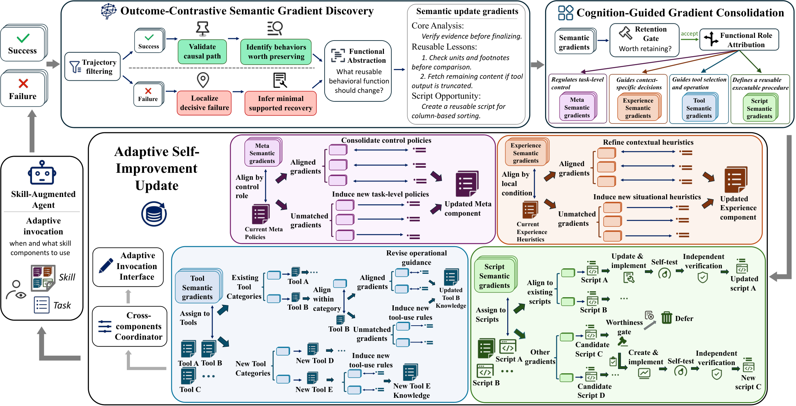

**Source figure / official image** — Original Figure 3 pipeline: semantic gradients are discovered from successful and failed executions, consolidated by functional role, and applied to update the four components (Meta, Experience, Tool, Script) with validation and adaptive invocation. · Figure 3 (method-shao.png), arXiv HTML 2610.23599v1 · [source](https://arxiv.org/html/2610.23599v1/method-shao.png)

**nanoRSI reproduction** — not-run. Last source check: 2026-10-20.

**Open code / weights / data links** — No verified public code/asset link in the audited sources.

**Primary sources** — [arXiv abs 2610.23599](https://arxiv.org/abs/2610.23599) · [arXiv HTML v1](https://arxiv.org/html/2610.23599v1)

### SkillNEO: Non-Elitist Evolutionary Optimization of Agent Skills

**2026-10-15** · paper · Direct bounded loop

**Publication date** — arXiv 2610.20926 v1 submitted 2026-10-15, announced in the 2026-10-16 batch; 21 authors across UIC/MBZUAI/UCSD/UCLA/UT Arlington + one independent researcher.

**Institutional relationship** — Enze Ma, Chunyu Miao, Yankai Chen, Jie Yang, Liancheng Fang, Kening Zheng, Hanrong Zhang, Muyao Xu, Xinle Yu, Chengze Li, Wei-Chieh Huang, Ziwei Ren, Yunhao Du, Zhixiang Shen, Xue Liu, Philip S. Yu, Zhen Wang et al. - University of Illinois at Chicago; Mohamed bin Zayed University of Artificial Intelligence; University of California, San Diego; University of California, Los Angeles; University of Texas at Arlington; Independent Researcher (institution set as rendered in the HTML author block).

**What changes and how feedback is reused** — Non-elitist skill evolution: separately selects the version to USE from the versions to KEEP EDITING - improvement may require several interdependent edits, so a low-scoring revision can still carry usable parts. By observing how related versions carry out the same task it identifies working steps to preserve and remaining failures to fix; it can return to earlier versions and revise them using what later attempts reveal.

**Author-reported result** — Across 86 SkillsBench tasks spanning software engineering, office work and six other domains, SkillNEO raises GPT-5.4 Mini's average reward from 49.1% to 66.4%, bringing it into GPT-5.5 and GPT-5.6 Luna's original-skill performance range. The same evolved skills improve stronger models without further editing: on the 41 tasks with modified skills, reuse improves Luna by 10.5 percentage points and places GPT-5.5 10.6 points above its published original-skill reference.

**Evidence limits** — No code URL for SkillNEO itself found in the HTML (only a SkillsBench trajectories data link); evaluation is on the authors' SkillsBench suite; gains concentrate on the weaker editing model with transfer measured on a 41-task subset.

**Code / weights / data / license** — No dedicated repository found in the HTML; SkillsBench trajectory data referenced at github.com/benchflow-ai/skillsbench-trajectories.

**Possible nanoRSI experiment — not implemented here** — Non-elitist use-vs-edit separation is the missing half of ADOPTION item 53: keeping low-scoring versions editable (while never serving them) captures interdependent-edit gains that strict gating discards - directly complementary to AtomSearch's retained-but-unpromoted states (same batch, independent teams). Upward transfer (+10.5pp to a stronger model) is the skill-side answer to our cross-panel migration question.

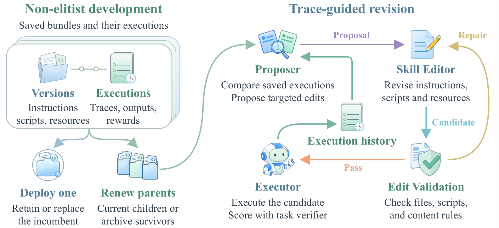

**Source figure / official image** — Original Figure 2: SkillNEO separates choosing a skill to use from choosing versions to improve - a version can receive further edits (green) while another is served, and related versions are compared to identify working steps and remaining failures. · Figure 2 (skillneo_method_artwork.png), arXiv HTML 2610.20926v1 · [source](https://arxiv.org/html/2610.20926v1/skillneo_method_artwork.png)

**nanoRSI reproduction** — not-run. Last source check: 2026-10-17.

**Open code / weights / data links** — No verified public code/asset link in the audited sources.

**Primary sources** — [arXiv abs 2610.20926](https://arxiv.org/abs/2610.20926) · [HTML full text v1](https://arxiv.org/html/2610.20926v1)

### CausalEvo: Causal Skill Self-Evolution for Health LLM Agents

**2026-10-14** · paper · Direct bounded loop

**Publication date** — arXiv v1 submitted 2026-10-14; accepted to the GenAI for Health Workshop @ NeurIPS 2026, Sydney (workshop acceptance is not a first-publication date).

**Institutional relationship** — Sole author Yuchen Zhang - The University of Texas Health Science Center at Houston (UTH.TMC email in the HTML author block).

**What changes and how feedback is reused** — A frozen LLM proposes two new skill rules per step, pooled with the four incumbents into a candidate set where the incumbent always remains selectable. Skill value is estimated causally rather than by raw panel scores: for each directed edge of a randomly relabeled cycle over the pool, the same feedback case is run twice with a shared background of k-1 rules, swapping only the exchanged rule (equal rule counts separate content from size effects); a zero-sum constrained least-squares solve turns the paired score differences into relative skill values, and selection is lexicographic - highest summed value, ties resolved toward overlap with the incumbent set. A decision-loss bound decomposes error into candidate support, approximation (rule interactions beyond a first-order projection) and estimation terms, with an explicit counterexample where exact coefficients still select suboptimally under complementarity.

**Author-reported result** — On six MedCalc-Bench-Verified tasks (120 held-out cases, 20 per task, thinking-off DeepSeek V4 Flash 0731): CausalEvo 60.00% vs SkillOpt 55.83% vs no-skill 51.67%, with 55.6% fewer training tokens (2.203M vs 4.961M; 336 vs 839 requests) and a 180-word final skill versus SkillOpt’s 999. Credit-assignment ablation on a separate 24-case set: 70.83% vs 62.50% with shuffled credit (+8.33pp, interval includes zero).

**Evidence limits** — Gains concentrate almost entirely in Cockcroft-Gault (+9 cases) while the other five tasks net -4; Child-Pugh regresses 50%->30% and no-skill beats both methods there; not significant after Holm correction (paired intervals include zero, vs SkillOpt [-5.00, 13.33]); immediate learning acquisition is negative (-3.33pp); single training trajectory per method with differing budgets/backends/skill lengths; possible overfitting to the 3-case feedback panels; disputed reference labels; no clinical validation.

**Code / weights / data / license** — Repository github.com/txbrook/CausalEvo exists (live 2026-10-18) but ships the manuscript source and a math checker only - the paper states complete training code and raw responses are not currently included; no license file (treat as all-rights-reserved); paper CC BY 4.0; MedCalc-Bench-Verified under CC-BY-SA-4.0.

**Possible nanoRSI experiment — not implemented here** — Paired exchanges against a shared background are a cheap attribution layer for the skills gate: score candidate edits in matched pairs instead of trusting raw panel deltas, so a skill is promoted for its marginal contribution rather than panel noise; the paper’s reporting pattern (per-task concentration named, Holm correction applied, single-trajectory caveat) is the honesty standard the selector study should match.

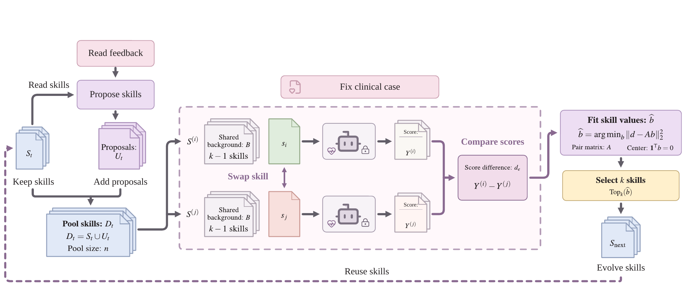

**Source figure / official image** — Original Figure 1: the method pipeline - candidate rule pool, fixed-capacity paired exchanges against shared backgrounds, least-squares credit estimation, incumbent-favouring top-k selection. · Figure 1 (figures/causalevo_overview.png), arXiv HTML 2610.21016v1 · [source](https://arxiv.org/html/2610.21016v1/figures/causalevo_overview.png)

**nanoRSI reproduction** — not-run. Last source check: 2026-10-18.

**Open code / weights / data links** — [CausalEvo code](https://github.com/txbrook/CausalEvo)

**Primary sources** — [arXiv abs 2610.21016](https://arxiv.org/abs/2610.21016) · [arXiv HTML v1](https://arxiv.org/html/2610.21016v1) · [CausalEvo code](https://github.com/txbrook/CausalEvo)

### AtomSearch: Evidence-Grounded Tree Search for Agent Skill Optimization

**2026-10-14** · paper · Direct bounded loop

**Publication date** — arXiv 2610.19951 v1 submitted 2026-10-14, announced in the 2026-10-15 batch.

**Institutional relationship** — Jia Tong, Senyou Deng, Min Peng, Jianfeng Pan - 360 Security Technology Inc., Beijing (three 360.cn author emails; shared affiliation line).

**What changes and how feedback is reused** — Keeps skill-revision actions local while using subsequent skill states to guide search. Contrastive Atomic Editing links each primitive rule edit to failed and successful executions, a behavioral hypothesis, and an intended scope. Skill-State Tree Search (STS) evaluates short edit compositions and selectively retains them as executable states that can be revisited and extended. Outcome Memory supplies later proposals with observed repair and regression statistics.

**Author-reported result** — Across four tasks and five target models: with deepseek-v4-flash it exceeds SkillOpt on three of four tasks including a 9.68-percentage-point gain on LiveMathematicianBench, while SkillOpt's final skills contain 2.3-19.7 times as many characters. In 67% of completed searches, the best validation state passes through an ancestor that was not highest-scoring at its depth - immediate-score greedy selection would discard the path to the optimum.

**Evidence limits** — No code link found; the comparison set centers on SkillOpt at 4 tasks / 5 models; repair/regression statistics were described but not re-derived by this verification.

**Code / weights / data / license** — No code or repository link found in the HTML full text.

**Possible nanoRSI experiment — not implemented here** — The 67% ancestor finding is direct external evidence against pure strict-gating skill adoption (ADOPTION item 53): a bounded skill-state tree that retains-but-does-not-promote states is the missing middle ground between single-edit strict validation and multi-edit proposals; outcome memory (observed repair/regression per rule) maps one-to-one onto evidence-ledger fields for the skills track.

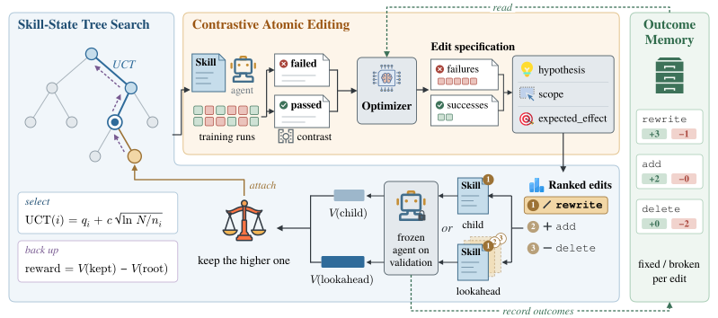

**Source figure / official image** — Original Figure 1: contrastive atomic editing turns failed/passed execution pairs into scoped edit specifications; skill-state tree search retains executable intermediate states; outcome memory feeds repair/regression statistics to later proposals. · Figure 1 (fig_overview.svg), arXiv HTML 2610.19951v1 · [source](https://arxiv.org/html/2610.19951v1/fig_overview.svg)

**nanoRSI reproduction** — not-run. Last source check: 2026-10-17.

**Open code / weights / data links** — No verified public code/asset link in the audited sources.

**Primary sources** — [arXiv abs 2610.19951](https://arxiv.org/abs/2610.19951) · [HTML full text v1](https://arxiv.org/html/2610.19951v1)

### Knowledge Graphs as Files: An Agent Harness Where Tool Creation and Tool Use Co-Evolve

**2026-10-13** · paper · Direct bounded loop

**Publication date** — arXiv v1 submitted 2026-10-13, announced in the double-size 2026-10-14 batch; primary-verified 2026-10-16.

**Institutional relationship** — Yuyang Bai (Texas A&M University), Yu Wang (University of Oregon), Yu Zhang (Texas A&M University), from the stated affiliation lines; the HTML's email links are garbled (Wang's address renders as Yu Zhang's), recorded as-is.

**What changes and how feedback is reused** — DKGI (direct knowledge graph interaction) exports a KG as files - node JSONL shards, per-relation TSV edge lists, schema.json, candidate_ids.txt - and lets a ReAct-style agent in a coding CLI (Pi or Codex) interleave shell search with writing and executing Python directly over those files, with no predefined graph API or subgraph retriever. Each turn the agent may add a program p_t to its toolbox T_t and a saved output file l_t to L_t; execution feedback (candidate ids, intermediate node sets, empty matches, error messages, plus head-and-tail truncated views of large outputs) selects which traversals, filters or revisions come next, so tool creation and tool use co-evolve within the task. Reuse is measured: 48.4% of programs embed node ids seen in earlier outputs; 36.5% revise an earlier program (88.6% of revisions follow a failure); later programs read earlier output files.

**Author-reported result** — Training-free DKGI on STaRK synthetic tests (Amazon 1,642 / MAG 2,665 / Prime 2,801 queries): with GPT-6-Astra, Hit@1 margins over GRASP (strongest trained baseline) of +8.2 / +9.0 / +6.7 - 'at least 6.7 Hit@1 points on every graph'; overall H@1 71.5 (Luna/Pi), 73.1 (Luna/Codex), 82.1 (Astra/Pi). Ablations (test subset, GPT-6-Luna): Full DKGI 75.2 vs shell-only 68.3, predefined graph tools 72.8, graph tools + code 74.2, one-program 69.0, retrieval-only 47.7, no edges 44.2 - adding Python to raw files gains +6.9 but only +1.4 on top of predefined graph tools.

**Evidence limits** — Scope: STaRK's three KGs (<=10 entity types, 18 relation types, 1.9M nodes, 39.8M edges); Freebase/Wikidata-scale schemas, aggregation questions and a Cypher/SPARQL agent in the same harness left to future work. Proprietary backbones only (GPT-6-Luna/Astra, Sept-Oct 2026 API access); open-weight models untested. Baseline numbers come from the literature with differing backbones/budgets; programs are discarded after each query; arbitrary shell execution requires sandboxing. Largest error source is ranking (gold node returned but not ranked first in 58/46/55% of wrong answers); shell-only access underperforms even predefined graph tools.

**Code / weights / data / license** — MIT-licensed code at github.com/leopoldwhite/DKGI; exported graphs, prompts and all trajectories CC BY 4.0; paper CC BY 4.0 (verified from the HTML statement 2026-10-16).

**Possible nanoRSI experiment — not implemented here** — The co-evolution measurement is the transfer: instrument nanoRSI skill evolution with 'what fraction of new programs reuse earlier outputs (embedded ids), what fraction revise an earlier program, and how many revisions follow a failure' - cheap, per-trajectory statistics that distinguish genuine accumulation from re-derivation. The ablation also argues for raw-file surfaces over predefined tool APIs when giving agents task data: direct file access plus code beat curated interfaces by more than either alone.

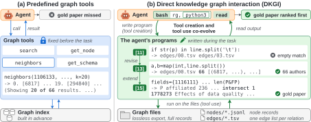

**Source figure / official image** — Original Figure 1: on a STaRK-MAG query, a truncated predefined-neighbors call misses the gold paper, while DKGI's agent-written code (scan, merge, filter over the exported node/edge files) co-evolves tool creation with tool use and retrieves it. · Figure 1 (S1.F1), arXiv HTML v1 · [source](https://arxiv.org/html/2610.18616v1/fig1_image.svg)

**nanoRSI reproduction** — not-run. Last source check: 2026-10-16.

**Open code / weights / data links** — [DKGI code](https://github.com/leopoldwhite/DKGI)

**Primary sources** — [arXiv abstract](https://arxiv.org/abs/2610.18616) · [arXiv HTML v1](https://arxiv.org/html/2610.18616v1) · [DKGI code](https://github.com/leopoldwhite/DKGI)

### Small but Mighty: Test Suites as Improvement Signals for Self-Evolving Agents

**2026-10-11** · paper · Direct bounded loop

**Publication date** — arXiv v1 submitted 2026-10-11, announced in the double-size 2026-10-14 batch; primary-verified 2026-10-15.

**Institutional relationship** — Yutong Cheng (Virginia Tech; internship work at NEC Labs America), Wei Cheng, Wenchao Yu, Haifeng Chen (NEC Laboratories America), Dawei Zhou (Virginia Tech). The HTML's email-to-author mapping is inconsistent, so affiliations follow the stated affiliation lines.

**What changes and how feedback is reused** — Evolves small executable test suites as the accept/reject signal for self-editing harness code. Quality-diversity search keeps a Pareto front of (coverage, mutation score) per suite-size niche, so small-but-strong suites survive; the delivered suite is the smallest of maximal hypervolume. A learned landing kernel compensates the LLM's noisy instruction-following on suite size (log-normal model, online-estimated count bias) and weights bandit credit by where a request actually lands; size-annealed UCB penalizes size only after quality passes a threshold. Gating: the suite runs against the unmodified module first; a revised module is rejected if the previously-passing suite now fails - catching behavior-changing self-edits with no model call.

**Author-reported result** — On 129 TestGenEval Python modules with 3 backbones (GPT-5.4, Claude Opus 4.8, Gemini 3.1 Pro): divergent (behavior-changing) rewrite rejection 59.9% vs 25.3% for repository tests, better on every module; false-alarm rate on equivalent rewrites 4.0% (10/253); decision time 3.5s vs 5.9s, no model call; highest hypervolume on every backbone (7.0-8.5 above best baseline) with the smallest suites among LLM methods (e.g. hv 0.976 at size 29.1). Self-evolution study: 8 mini-swe-agent harness modules, 470 verified revisions, inter-rater kappa 0.74.

**Evidence limits** — 4.0% false-alarm rate means equivalent rewrites are occasionally blocked (repository tests have 0%); evaluation is Python-only (TestGenEval modules); the self-evolution study covers 8 harness modules; email-author mapping in the HTML is inconsistent (recorded above).

**Code / weights / data / license** — MIT-licensed code/data at github.com/ccsnow127/TeSearch (LICENSE verified 2026-10-15). Paper CC BY 4.0.

**Possible nanoRSI experiment — not implemented here** — The core transfer for nanoRSI: gate self-edits with a purpose-evolved small suite instead of the task's own tests - the suite must pass on the parent before judging the child, giving a behavior-preservation check with a measured false-block rate (TeSearch's 4.0% is the reference number). The size-niche Pareto archive is also a concrete pattern for keeping evaluator artifacts small enough to run per-attempt within episode budget.

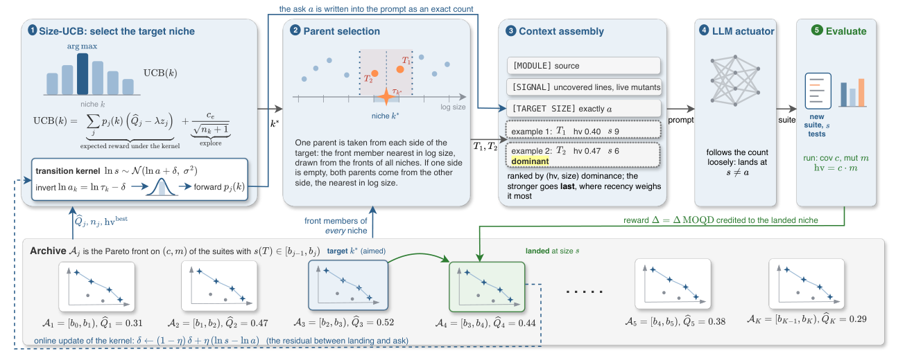

**Source figure / official image** — Original Figure 1: TeSearch's quality-diversity archive maintains a Pareto front over coverage and mutation score for each suite-size niche; the delivered small suite then gates behavior-changing rewrites of self-evolving harness code. · Figure 1 (fig1_overview.png): the TeSearch archive keeping a Pareto front on (coverage, mutation score) per size niche, feeding suite-gated harness rewrites · [source](https://arxiv.org/html/2610.15964v1)

**nanoRSI reproduction** — not-run. Last source check: 2026-10-15.

**Open code / weights / data links** — [ccsnow127/TeSearch (MIT)](https://github.com/ccsnow127/TeSearch)

**Primary sources** — [arXiv abstract](https://arxiv.org/abs/2610.15964) · [arXiv HTML v1](https://arxiv.org/html/2610.15964v1) · [ccsnow127/TeSearch (MIT)](https://github.com/ccsnow127/TeSearch)

### ViSkill: Reinforcing VLM Agents with Evolving Visual-Native Skills

**2026-10-08** · paper · Direct bounded loop

**Publication date** — arXiv v1 submitted 2026-10-08; no revisions.

**Institutional relationship** — All authors from Zhejiang University (ZJU-REAL lab); corresponding author Yongliang Shen.

**What changes and how feedback is reused** — Skill-augmented agents usually linearize spatial layouts into text; ViSkill instead stores successful interactions as visual skill cards that VLM agents retrieve to guide both inference and reward shaping, while the policy is trained with PPO on those trajectories; eligible trajectories are distilled back into the skill library, closing a mutually reinforcing loop between skill evolution and policy optimization. An optional cold-start mechanism seeds the library.

**Author-reported result** — On Sokoban / FrozenLake / PrimitiveSkill the base method reaches 0.82 / 0.84 / 1.00 success (overall 0.89) and with cold start 0.88 / 0.85 / 1.00 (overall 0.91), above AtlasVA 0.87, VAGEN 0.80, GPT-5 0.70, o3 0.69, Claude 4.5 Sonnet 0.58, Qwen2.5-VL-72B 0.40 and Qwen2.5-VL-3B 0.09 overall, converging faster than standard PPO. Ablations: removing policy optimization drops Sokoban to 0.29; a text-skill variant drops to 0.63; retrieval threshold 0.8 and distillation diversity 0.9 are the reported optima; evolved skill libraries transfer to the unoptimized base model.

**Evidence limits** — Evaluation is limited to VAGEN-framework environments; benefit in more complex or open-ended settings is unvalidated. The skill-guided reward assumes partial progress reaches states present in the retrieved skill, giving limited guidance when valid solutions traverse disjoint state paths.

**Code / weights / data / license** — Code: github.com/ZJU-REAL/ViSkill, MIT license (raw LICENSE verified, copyright RAGEN.AI). Data: environments from the VAGEN framework. License: MIT; paper CC BY 4.0.

**Possible nanoRSI experiment — not implemented here** — The modality point generalizes beyond vision: nanoRSI skills are text files, and this is measured evidence that storing experience in the native representation the executor operates on (not a lossy serialization) changes what skill evolution can express - worth a minimal A/B on a digits/panel task where skill artifacts can be data files instead of prose.

**Source figure / official image** — Original Figure 2: overview of ViSkill - the agent retrieves a visual skill card from the library to guide interaction and reward shaping, collects the trajectory, and distills eligible trajectories into new skills, with the policy jointly optimized by PPO. · Figure 2 (method.png): the agent retrieves a visual skill from the library to guide interaction, collects trajectories, and distills eligible trajectories into new skills while PPO optimizes the policy · [source](https://arxiv.org/html/2610.12403v1)

**nanoRSI reproduction** — not-run. Last source check: 2026-10-13.

**Open code / weights / data links** — [GitHub repository (MIT)](https://github.com/ZJU-REAL/ViSkill)

**Primary sources** — [arXiv abstract](https://arxiv.org/abs/2610.12403) · [arXiv HTML v1](https://arxiv.org/html/2610.12403v1) · [GitHub repository (MIT)](https://github.com/ZJU-REAL/ViSkill)

### Trajectory-Guided Fault Localization for Agent Skill Evolution

**2026-10-08** · paper · Direct bounded loop

**Publication date** — arXiv v1 submitted 2026-10-08 (2610.11858); no venue or page count beyond '20 pages, 3 figures' as of 2026-10-12.

**Institutional relationship** — Four authors at Nanjing University (Zhong Li and Tian Zhang corresponding) and one at The Hong Kong Polytechnic University; the kernel-generation deployment is with an AI operator-development team in the Ascend CANN ecosystem, evaluated on NPUKernelBench.

**What changes and how feedback is reused** — SkillMorph evolves agent skills by grounding revisions in behavioral evidence: it abstracts execution trajectories, compares failure versus success evidence across repeated runs and tasks, uses the diffs between evolution loops to identify suspicious actions, then localizes edit sites within the responsible skills and generates targeted revisions - rather than rewriting whole skills from outcome feedback alone.

**Author-reported result** — On 490 SWE-Skills-Bench tasks (1,470 runs): SkillMorph 95.51% pass@3 / 92.24% trial-level accuracy / 88.37% pass3, versus base skills 82.45/75.44/67.96 and the best of four skill-evolution baselines (CAP-Evolve) 92.24/89.39/84.90. On the 15-task CannBot AscendC kernel benchmark: 93.33 on all three metrics versus base 80.00/66.67/46.67 and CAP-Evolve 93.33/84.44/73.33. Ablations: removing localization drops SWE overall to 91.22/87.35/82.24; single-run variant 90.20. Six skill-revision pull requests from the kernel-generation deployment were accepted by the development team.

**Evidence limits** — No public code, benchmark or skill corpus was found (GitHub links in the HTML point to baselines such as cap-evolve); CannBot has 15 tasks so its 93.33 ceiling sits on a small panel; trial-level accuracy and pass@3 are computed on the authors' own harness; the six accepted PRs are counted as deployment evidence without a controlled before/after on operator quality.

**Code / weights / data / license** — Code: none found on the arXiv page or HTML. Weights: not applicable. Data: SWE-Skills-Bench is described as public curated skills; CannBot and NPUKernelBench release status not verified beyond citations. License: paper under arXiv default licensing.

**Possible nanoRSI experiment — not implemented here** — The idea nanoRSI can test on its skills track: before rewriting a skill, diff abstracted failure versus success trajectories across repeated runs, rank suspicious actions, and restrict the edit to the skill region those actions trace to - comparing against whole-skill rewrite with the same evaluation budget and reporting edit-site precision as an honest extra metric.

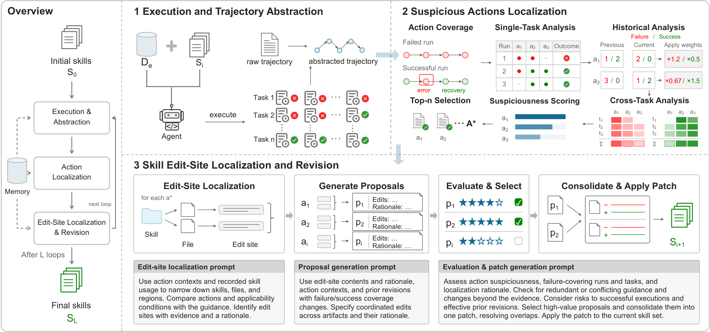

**Source figure / official image** — Original Figure 3: the SkillMorph loop abstracts execution trajectories, contrasts failure and success evidence across runs, isolates suspicious actions and localizes the revision to the responsible skill region. · Figure 3 (overview-final.png): SkillMorph overview - trajectory abstraction, failure/success comparison, suspicious-action ranking and localized skill revision · [source](https://arxiv.org/html/2610.11858v1)

**nanoRSI reproduction** — not-run. Last source check: 2026-10-12.

**Open code / weights / data links** — No verified public code/asset link in the audited sources.

**Primary sources** — [arXiv abstract](https://arxiv.org/abs/2610.11858) · [arXiv HTML v1](https://arxiv.org/html/2610.11858v1)

### RoboRSI: Stable, efficient, and reusable robot self-evolution in complex real-world environments

**2026-10-08** · paper · Direct bounded loop

**Publication date** — arXiv v1 submitted 2026-10-08 (2610.12424, cs.RO cross cs.AI). The official project page is dated September 2026 and the companion repository was created 2026-08-29; following the catalogue's paper convention the record date is the arXiv v1 date.

**Institutional relationship** — Eleven authors with Cewu Lu and Chuan Wen as corresponding authors; the project page and BibTeX credit the Noematrix Team (lab.noematrix.ai). The arXiv HTML prints no university affiliations, so institutional detail beyond Noematrix Lab is not independently verified here.

**What changes and how feedback is reused** — Top-Down Skill Refinement (TSR) decomposes tasks into compound, atomic and base skills with scoped responsibilities and explicit input-output contracts, so an execution failure is attributed to the responsible branch and revision is restricted to that branch. A Manager organizes the skill hierarchy, a Planner composes execution plans, an Engineer executes, and a Reviewer validates before release, with humans steering via objectives and corrections; stable sequences are consolidated into reusable compound skills.

**Author-reported result** — On a physical mobile manipulator, multi-object household cleanup develops over 104 self-evolution rounds, with roughly one day of iteration contrasting with the project page's 2024 reference of two engineers, about a month and 2,000-3,000 lines of task code. In simulation, top success rates on LIBERO, LIBERO-PRO, LIBERO-Plus and RoboTwin, beating the strongest baseline by 2.7-11.0 percentage points; LIBERO cumulative 95/120 from 32/120, RoboTwin 36/50 from 9/50. On 840 LIBERO-Plus perturbation instances the fixed system passes 261 (31.1%) versus adaptive pass@2 398 (47.4%). A 600-episode consolidation ablation improves pass rate 21.5% to 29.0% (+7.5 points) with median tokens down 29.4%.

**Evidence limits** — Physical results are one mobile-manipulator platform on a two-scene cleanup task set; humans steer via objectives and corrections, so autonomy is bounded; baseline margins (2.7-11.0 points) are author-reported under their own evaluation; the one-day-versus-one-month comparison references the team's own 2024 practice rather than a controlled study; a figure filename suggests an ICLR 2027 submission, but no acceptance is claimed or verified.

**Code / weights / data / license** — Code: github.com/nssmd/RoboRSI, Apache-2.0 verified in the repository (123 stars, created 2026-08-29, last push 2026-10-10); project page with full tool-trace videos at lab.noematrix.ai/blog/2-roborsi/. Weights: robot policy checkpoints not verified as released. Data: skill hierarchies and evaluation logs not verified as released. License: Apache-2.0.

**Possible nanoRSI experiment — not implemented here** — The portable discipline for nanoRSI is contract-scoped revision: give each skill an explicit input-output contract so failures attribute to a branch, restrict edits to that branch, and require a Reviewer-style validation before a skill re-enters the library - then measure whether scoped edits beat whole-file rewrites on the same panel with fewer regressions, mirroring the counterfactual panel already in place.

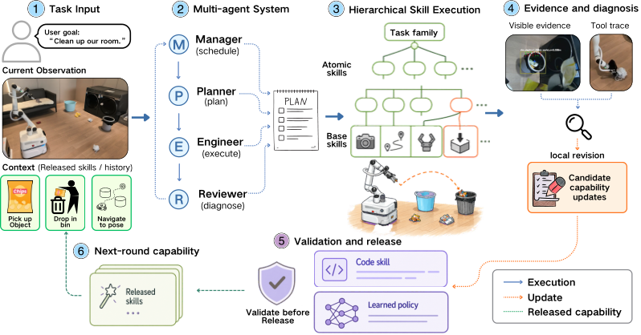

**Source figure / official image** — Original Figure 2: the RoboRSI framework - the Manager organizes the task's skill hierarchy, the Planner composes an execution plan, the Engineer runs it, and the Reviewer gates validated skill revisions back into the library. · Figure 2 (2027_ICLR_Framework2.0.png): Manager organizes the skill hierarchy, Planner composes the plan, Engineer executes, Reviewer validates before release · [source](https://arxiv.org/html/2610.12424v1)

**nanoRSI reproduction** — not-run. Last source check: 2026-10-12.

**Open code / weights / data links** — [Apache-2.0 code release](https://github.com/nssmd/RoboRSI) · [Apache-2.0 license](https://github.com/nssmd/RoboRSI/blob/main/LICENSE)

**Primary sources** — [arXiv abstract](https://arxiv.org/abs/2610.12424) · [arXiv HTML v1](https://arxiv.org/html/2610.12424v1) · [Apache-2.0 code release](https://github.com/nssmd/RoboRSI) · [Apache-2.0 license](https://github.com/nssmd/RoboRSI/blob/main/LICENSE) · [Noematrix Lab project page](https://lab.noematrix.ai/blog/2-roborsi/)

### SkillAA: Attribution-Guided Skill-Graph Updating with Targeted Validation and Rollback

**2026-09-17** · paper · Direct bounded loop

**Publication date** — arXiv v1 2026-09-17; the repository was created the same day.

**Institutional relationship** — Academic (National Key Laboratory for Novel Software Technology and School of Intelligence Science and Technology, Nanjing University).

**What changes and how feedback is reused** — On a frozen model, contrasting successful and failed rollouts attributes each failure to specific skill-graph objects; repairs edit only the selected local structure, and Local and Big Gates validate candidate changes (with rollback units) before commitment.

**Author-reported result** — With gpt-5.6-sol, SkillAA reaches 81.5% SearchQA, 66.7% LiveMath and 91.2% DocVQA, the highest observed mean in every main setting; ablations support structured representation, attribution-conditioned editing and Local-Gate regression control.

**Evidence limits** — Author-reported without external baseline numbers in the abstract; comparators live in the paper tables; code repository has no license file (all-rights-reserved by default).

**Code / weights / data / license** — Code at github.com/Ziqiao-Shang/SkillAA (no license file at verification — reference only); paper CC BY 4.0.

**Possible nanoRSI experiment — not implemented here** — nanoRSI evidence cards already store diagnosis and diffs; SkillAA adds the missing half — attribute each regression to the exact skill section before editing, then gate the edit against rollback units instead of whole-skill rewrites.

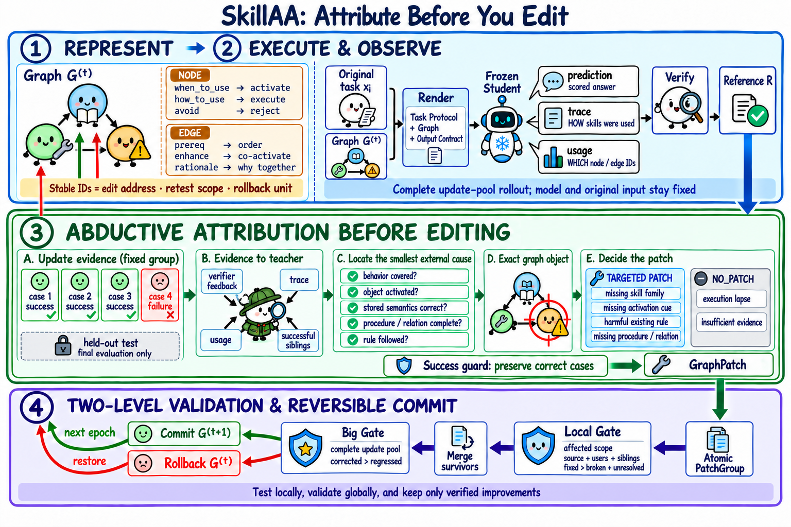

**Source figure / official image** — How SkillAA learns from errors: each skill node states when to use it and when not; attribution routes a repair to the specific failing object before gated editing. · Figure 2 (images/2.png) · [source](https://arxiv.org/html/2609.20455v1)

**nanoRSI reproduction** — not-run. Last source check: 2026-09-19.

**Open code / weights / data links** — [Code repository](https://github.com/Ziqiao-Shang/SkillAA)

**Primary sources** — [arXiv abstract](https://arxiv.org/abs/2609.20455) · [Paper HTML (affiliations, Figure 2, results)](https://arxiv.org/html/2609.20455v1) · [Code repository](https://github.com/Ziqiao-Shang/SkillAA)

### FINSKILLOPS: A Self-Evolving Multi-Agent System for SEC Filing QA

**2026-09-17** · paper · Direct bounded loop

**Publication date** — arXiv v1 2026-09-17; 28 authors across a company and eleven universities; HTML uses an EMNLP template but no venue is claimed.

**Institutional relationship** — Industry-academic consortium led by SimpleWay.AI with McGill/Toronto/UCLA/CUHK/Mila and others.

**What changes and how feedback is reused** — Typed, evidence-grounded failure diagnoses are converted into scoped skill patches that pass targeted validation, regression checks and negative controls before versioned replacement or retirement in a serving/evolution loop for SEC-filing QA.

**Author-reported result** — Evolved skills raise judge-scored correctness from 3.70 to 4.55 on the enhanced benchmark; a separate 12-round operational study promotes only 6 of 33 proposed skills while the monitoring non-correct rate falls from 20.0% to 12.5%.

**Evidence limits** — Author-reported on an in-house financial QA setting with LLM-judge scores; the 6/33 promotion rate is the honest headline — most proposed skills do not survive gating; no code release located.

**Code / weights / data / license** — arXiv paper public; no code release located at verification.

**Possible nanoRSI experiment — not implemented here** — The negative-control admission step (a proposed skill must beat a do-nothing control on the failing slice) and explicit retirement are the two gates nanoRSI skill streams lack; the 6/33 rate is a realistic promotion prior.

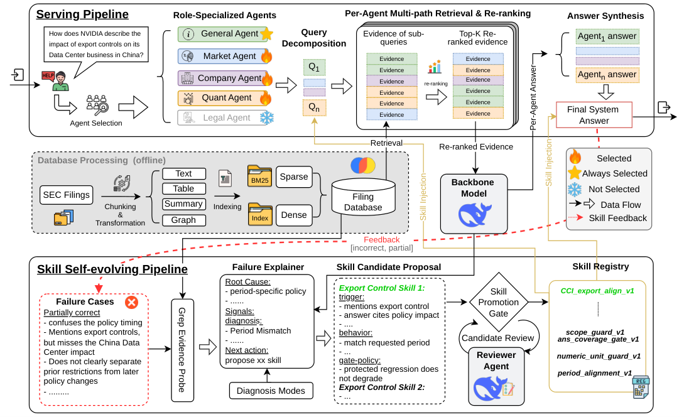

**Source figure / official image** — FinSkillOps: the serving pipeline draws on curated filing indexes while the evolution loop turns failed answers into gated registry updates that re-enter serving. · Figure 1 (emnlp-FinEvo-Final.png) · [source](https://arxiv.org/html/2609.19680v1)

**nanoRSI reproduction** — not-run. Last source check: 2026-09-19.

**Open code / weights / data links** — No verified public code/asset link in the audited sources.

**Primary sources** — [arXiv abstract](https://arxiv.org/abs/2609.19680) · [Paper HTML (affiliations, Figure 1, abstract numbers)](https://arxiv.org/html/2609.19680v1)

### Reflect, Revise, Reuse: Training-Free Skill Evolution for GUI Agents

**2026-09-15** · paper · Direct bounded loop

**Publication date** — v1 2026-09-15; affiliation list read from the paper HTML (one co-author is UESTC, the rest ZJU).

**Institutional relationship** — Academic (ZJU-led); no company affiliation shown.

**What changes and how feedback is reused** — Skills are living multi-file packages revised at deployment time in a reflect-revise-reuse loop: an isolated critic diagnoses failures, a restricted edit interface confines which skill files may change, and revisions are gated before reuse — no weight updates anywhere.

**Author-reported result** — Training-free gains up to +16.2% (MobileWorld), +6.0% (AndroidWorld) and +10.5% (OSWorld), the last being a cross-benchmark transfer setting.

**Evidence limits** — Author-reported; GUI domain only; revision-budget and critic-error effects not fully quantified in the abstract.

**Code / weights / data / license** — arXiv paper public; code not verified at last check.

**Possible nanoRSI experiment — not implemented here** — The restricted-edit-interface (only named skill files writable) plus isolated critic matches nanoRSI's contract guard; adding deployment-time revision as a control condition would separate 'skill improved' from 'skill was fine, execution drifted'.

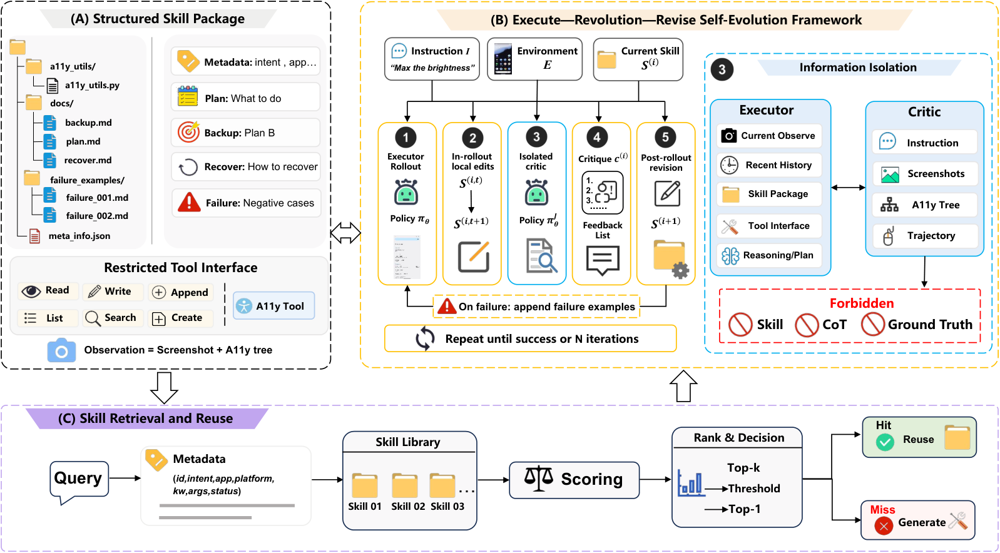

**Source figure / official image** — The reflect-revise-reuse loop: failures trigger an isolated critic and a restricted edit of the multi-file skill package before gated reuse. · Method figure (method.png) · [source](https://arxiv.org/html/2609.17653v1)

**nanoRSI reproduction** — not-run. Last source check: 2026-09-18.

**Open code / weights / data links** — No verified public code/asset link in the audited sources.

**Primary sources** — [arXiv abstract](https://arxiv.org/abs/2609.17653) · [Paper HTML (affiliations, method figure)](https://arxiv.org/html/2609.17653v1)

### SkillLift: Learning Dense Rubrics from Sparse Oracles for Efficient Skill Evolution

**2026-09-14** · paper · Direct bounded loop

**Publication date** — arXiv v1: 2026-09-14. Code repository created 2026-08-08. No later revision recorded at verification time.

**Institutional relationship** — Paper v1: Haoxiang Kang is an independent researcher; Ming Wen is at Fudan University (corresponding).

**What changes and how feedback is reused** — Reframes skill self-evolution as bilevel optimization to escape the oracle-rollout bottleneck (every candidate edit normally needs a full agent rollout). A structured rubric R - M binary criteria with signed weights over the skill's behavior - is learned as a cheap oracle-aligned surrogate. Inner loop: R is frozen and guides skill revision, scoring candidates with one LLM call instead of a rollout. Outer loop: a few oracle rollouts on frozen skills re-align R via Kendall's tau rank correlation, so only relative order matters, not score calibration. The alternating loop amortizes oracle cost while keeping the surrogate honest.

**Author-reported result** — On WildClawBench and SkillsBench with three backbone models (SkillsBench uses GPT-5.4-mini, WildClawBench GPT-5.4, matching official setups), SkillLift beats human-written skills, one-shot LLM-written skills, SkillOpt and CoEvoSkills while spending 40-70% less token cost than frontier evolving methods. Table 2 per-category cells show overall deltas of +5.4 to +14.0 (WildClawBench) and +9.6 to +28.3 (SkillsBench) over the strongest baselines per model group; a pilot study shows oracle rollout cost dominates cumulative tokens for direct oracle-guided search.

**Evidence limits** — Two-author paper; benchmark categories and rubric quality depend on the oracle existing and being rankable. Baselines receive 2x SkillLift's default token budget, which favors SkillLift in cost comparisons. All numbers are authors' own runs; the repository is new (2 stars at verification).

**Code / weights / data / license** — Code released under MIT at github.com/WalteR-MittY-pro/SkillLift (repo created 2026-08-08, 2 stars at verification). No weights or data release located.

**Possible nanoRSI experiment — not implemented here** — For nanoRSI's skill loop: replace per-edit full rollouts with a learned rubric surrogate re-aligned by rank correlation on periodic oracle rollouts - directly testable on the minimal task as a cheaper acceptance signal for candidate skills.

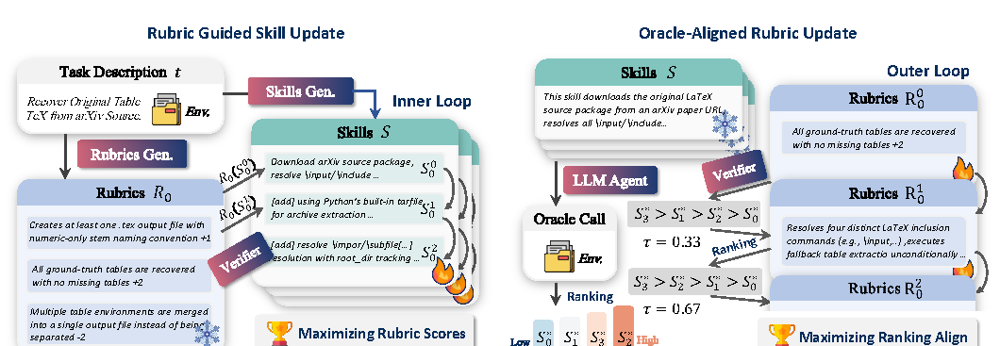

**Source figure / official image** — Figure 2: SkillLift overview - the inner loop revises skills against the frozen rubric at no oracle cost, while the outer loop re-aligns the rubric with a few oracle rollouts via Kendall's tau. · Figure 2, PDF page 3 · [source](https://arxiv.org/pdf/2609.15396)

**nanoRSI reproduction** — not-run. Last source check: 2026-09-16.

**Open code / weights / data links** — [Code repository (MIT)](https://github.com/WalteR-MittY-pro/SkillLift)

**Primary sources** — [arXiv abstract](https://arxiv.org/abs/2609.15396) · [Paper v1 PDF (affiliations, Figure 2, Table 2, protocol)](https://arxiv.org/pdf/2609.15396) · [Code repository (MIT)](https://github.com/WalteR-MittY-pro/SkillLift)

### SkillAdam: Stable and Efficient Skill Evolution for Agents

**2026-09-08** · paper · Direct bounded loop

**Publication date** — arXiv v1: September 8, 2026 (2609.08944). The official repository was created September 6 and announced the paper on September 8; these later repository events are not used as the original publication date.

**Institutional relationship** — The paper lists Renmin University of China and Tencent affiliations for the author group; the releasing repository is ruc-datalab/SkillAdam. This is an academic–industry report of the authors' own method.

**What changes and how feedback is reused** — Optimizes a persistent natural-language skill while the target model stays frozen. Each iteration rolls out the current skill on a sampled mini-batch, records case-level issues and outcomes in an Evolving Issue Tracker (direction memory), estimates recent improvement volatility, and lets both states constrain the next patch's scope. Candidates are accepted only when designated metrics improve without protected-metric regressions; the accepted skill and optimizer states feed the next iteration.

**Author-reported result** — Author-reported: seven benchmarks covering short- and long-horizon tasks show state-of-the-art results with fewer optimization iterations and lower cost than the listed baselines. The paper reports a cumulative ablation where adding optimization memory raises DeepPlanning average from 19.2% to 21.7%; the main protocol uses GPT-5.5 for six benchmarks, Claude Sonnet 4.5 for DeepPlanning, and seed 42 for controlled sampling.

**Evidence limits** — The reported loop is bounded and benchmark-native: six benchmarks make one pass through an optimization pool, the acceptance decision has no additional validation set, and the final test partition is evaluated once. The memory ablation is cumulative rather than an isolated interaction analysis; cross-task transfer, repeated compounding under a fixed budget, and independent external gating are not demonstrated.

**Code / weights / data / license** — Official code is released at github.com/ruc-datalab/SkillAdam under the repository's MIT license. No new model weights are released; the target models are frozen third-party systems. Benchmark data and any third-party components retain their own terms, and the audited repository does not establish a redistributable data bundle.

**Possible nanoRSI experiment — not implemented here** — For nanoRSI: add a small persistent optimizer-state record to the skills surface — issue history plus bounded edit budget — while keeping the existing evaluator frozen. Compare stateless editing, issue-memory-only, volatility-budget-only and the combined state at matched rollout budgets; report accepted edits, regressions, edit size, tokens and held-out transfer. This is an experiment proposal, not an implementation or local reproduction.

**Source figure / official image** — Figure 2: Functional correspondence between Adam and SkillAdam — rollout feedback updates an issue-memory state and a volatility-driven edit budget, which constrain the next skill patch. · Figure 2 · [source](https://arxiv.org/html/2609.08944v1)

**nanoRSI reproduction** — not-run. Last source check: 2026-09-17.

**Open code / weights / data links** — [Official implementation (MIT)](https://github.com/ruc-datalab/SkillAdam) · [Repository license (MIT)](https://raw.githubusercontent.com/ruc-datalab/SkillAdam/main/LICENSE)

**Primary sources** — [arXiv abstract](https://arxiv.org/abs/2609.08944) · [Paper HTML v1 (Figure 2, protocol, results)](https://arxiv.org/html/2609.08944v1) · [Official implementation (MIT)](https://github.com/ruc-datalab/SkillAdam) · [Repository license (MIT)](https://raw.githubusercontent.com/ruc-datalab/SkillAdam/main/LICENSE)

### From Interaction Traces to Persistent Skills: Online Evolution for Computer-Use Agents

**2026-09-04** · paper · Direct bounded loop

**Publication date** — arXiv v1: 2026-09-04. No later revision recorded at verification time.

**Institutional relationship** — Paper v1 lists first author Longtao Hu (UESTC) and Xiao Liang plus corresponding author Linchao Zhu (Zhejiang University). Independent academic work; no company affiliation is stated.

**What changes and how feedback is reused** — Each iteration executes GUI tasks against a frozen snapshot of a persistent skill library. An extractor turns the rollout trajectory into structured facts; a proposer diagnoses them into candidate edits (create, edit, delete, or explicit no-op); a builder materializes accepted skills as versioned SKILL.md files with edit history. Evaluator outcomes and trace evidence are the feedback; the skill library is the only thing that mutates — model weights stay frozen.

**Author-reported result** — Against a configuration-matched empty-library control (identical action-generation and GUI-grounding stack, task sets and iteration horizons) on four OSWorld application domains, the full system posts a higher post-warm-up (t>=5) mean evaluator score in all four domains, with mean differences from +5.7 to +18.6 percentage points. A GIMP provenance analysis records cross-origin skill retrieval and 'revision churn': repeatedly accepted edits can still fail to recover the originating task — the negative observation is kept.

**Evidence limits** — Evidence covers four OSWorld domains with the authors' own evaluator; gains depend on evaluator signal quality, and absolute scores remain far from saturation. No third-party replication yet.

**Code / weights / data / license** — Code public at github.com/LongtaoHu/Skill-Evo4GUI (live 2026-09-15); no license file was located on the repository page, so reuse permission is not established. No trained weights; OSWorld task sets are used, not re-released.

**Possible nanoRSI experiment — not implemented here** — Port the frozen-snapshot + versioned-SKILL.md + explicit no-op discipline into nanoRSI's skills loop: candidate edits land in a versioned store, each episode runs against a frozen snapshot, and provenance logs reveal which skills are actually retrieved and whether they still solve their origin task.

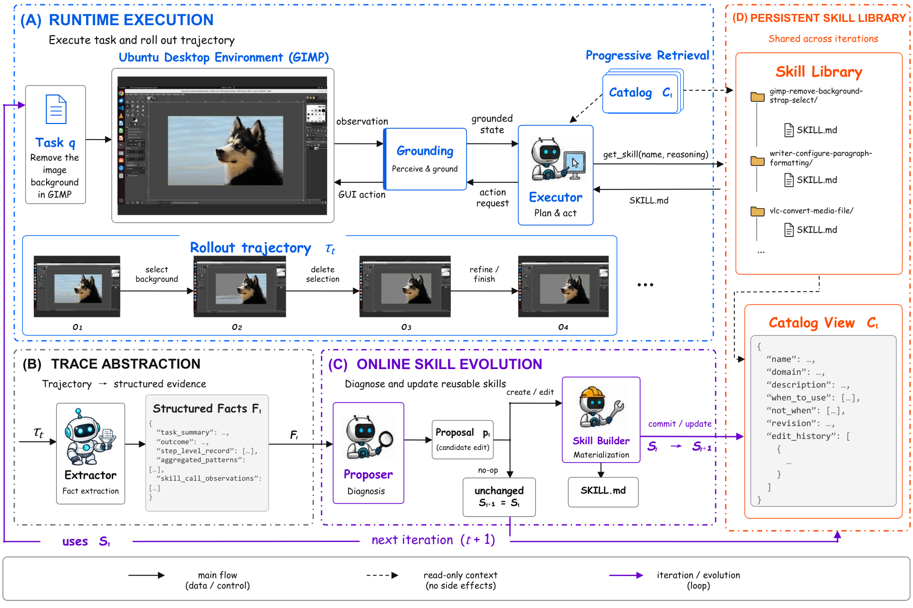

**Source figure / official image** — Figure 1: the online skill-evolution loop — runtime execution and trace abstraction feed a proposer/builder pair that commits versioned skills into a persistent library shared across iterations. · Figure 1 · [source](https://arxiv.org/html/2609.04869v1)

**nanoRSI reproduction** — not-run. Last source check: 2026-09-15.

**Open code / weights / data links** — [Author code repository](https://github.com/LongtaoHu/Skill-Evo4GUI)

**Primary sources** — [arXiv abstract](https://arxiv.org/abs/2609.04869) · [Paper v1 (affiliations, Figures 1-2, Tables 1-2)](https://arxiv.org/html/2609.04869v1) · [Author code repository](https://github.com/LongtaoHu/Skill-Evo4GUI)

### SimSkill: A Self-Evolving LLM Agent for Skill and Knowledge Accumulation in Traffic Simulation

**2026-09-03** · paper · Direct bounded loop

**Publication date** — arXiv v1: 2026-09-03; latest recorded revision v3: 2026-09-11. Figures are cited from v3; the mechanism description follows v1/v3 abstracts.

**Institutional relationship** — Paper v3 lists Qi Liu, Qinzheng Wang and Yiming Bie at the School of Transportation, Jilin University, and Can Li and Wanjing Ma at the Key Laboratory of Road and Traffic Engineering (Ministry of Education), College of Transportation, Tongji University.

**What changes and how feedback is reused** — Built on the SUMO traffic simulator with a Claude-style skill runtime. In Learn mode the agent identifies its own capability gaps, generates and solves environment-grounded tasks, verifies solutions through an action-critic loop, and distills outcomes into three memory stores: episodic (dated task experiences), procedural (.claude/skills-style executable skills) and semantic (curated knowledge pages). In Infer mode it retrieves from those stores; dedicated memory-management skills handle retrieval, ingestion and linting. Its self-evolving loop is Propose Task, Plan & Retrieve, Act in SUMO, Evaluate & Reflect, Distill & Ingest.

**Author-reported result** — Evaluated on two held-out benchmarks across three backbone LLMs with independently verified results (the authors' stated verification protocol): verified success improves by up to +25 percentage points over the no-memory baseline. Ablations show procedural and semantic memory contribute in complementary ways; benefits depend on the backbone and compute budget — memory does not help every model and does not always lower inference cost, which the authors keep as a caveat.

**Evidence limits** — Domain-specific to SUMO traffic simulation; 'independently verified' refers to the authors' in-paper verification protocol, not an external audit; v3 revised twice within eight days, so numbers should be re-checked against any later version.

**Code / weights / data / license** — Code and experimental data public at github.com/qiliuchn/SimSkill-V1 under the Apache-2.0 license (verified 2026-09-15).

**Possible nanoRSI experiment — not implemented here** — Gap-driven task generation at nano scale: let nanoRSI's proposer maintain an explicit capability-gap list, generate environment-grounded probe tasks against it, and store verified solutions as reusable skills — the same Propose, Act, Evaluate, Distill circuit on the minimal task.

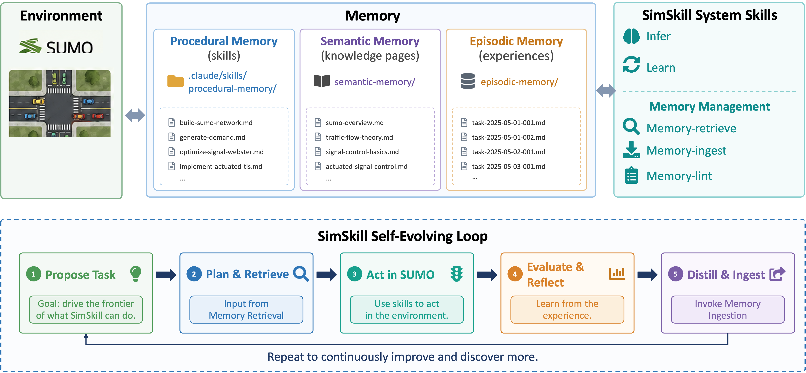

**Source figure / official image** — Figure 1: SimSkill architecture and its self-evolving loop over SUMO — propose task, plan and retrieve, act, evaluate and reflect, then distill into episodic, procedural and semantic memory. · Figure 1 · [source](https://arxiv.org/html/2609.03753v3)

**nanoRSI reproduction** — not-run. Last source check: 2026-09-15.

**Open code / weights / data links** — [Author code repository (Apache-2.0)](https://github.com/qiliuchn/SimSkill-V1)

**Primary sources** — [arXiv abstract](https://arxiv.org/abs/2609.03753) · [Paper v3 (affiliations, Figure 1, memory listings)](https://arxiv.org/html/2609.03753v3) · [Author code repository (Apache-2.0)](https://github.com/qiliuchn/SimSkill-V1)

### SkillGLoW: Procedural-Family Skill Consolidation for Self-Improving Agents on Long-Horizon Task Streams

**2026-09-02** · paper · Direct bounded loop

**Publication date** — arXiv v1: 2026-09-02. No later revision recorded at verification time.

**Institutional relationship** — Paper v1 lists affiliation 1 as the National University of Singapore and affiliation 2 as the Institute of Advanced Intelligence and Computing (IAIC), Singapore; the corresponding author is Joey Tianyi Zhou.

**What changes and how feedback is reused** — Each task's execution yields a local skill card. Embedding-based clustering groups cards into procedural families; a compressor condenses each family into a de-instantiated global prior. A verifier-grounded commit gate admits a prior only when real downstream execution shows it does not degrade the deployed library (measured against the history-best value). At execution time the frozen prior is woven with a freshly regenerated local skill, so instance detail is regenerated per task instead of being stored.

**Author-reported result** — Across 12 continual-improvement runs spanning 4 benchmarks (math reasoning, terminal automation, software repair, embodied ALFWorld) and 3 models, consolidated priors add +17.2 hard points over the no-skill baseline on average (+18.0 with local regeneration); gains are positive in 12/12 runs. The prior library is 3.6x more compact than the per-task pool and leads a published single-document optimizer on 15 of 21 cells. Unmodified priors lift unseen ALFWorld success from 73.9% to 83.9%.

**Evidence limits** — No code or data release; the single-document-optimizer comparison is a re-run aligned in the appendix (task sets, models, prompts), and all numbers come from the authors' own runs. Model-family-dependent variance is reported.

**Code / weights / data / license** — No code or data release located; paper plus appendix only. Experiments call commercial models (MiniMax-M3 and GPT-5.4-mini are named in the tables).

**Possible nanoRSI experiment — not implemented here** — For nanoRSI's skill library: consolidate related tasks into families and compress per-family priors instead of one global document, and require a real-execution commit gate — a candidate prior is admitted only if current library scores do not degrade.

**Source figure / official image** — Figure 2: GLoW overview — local evidence becomes skill cards, cards are clustered into procedural families and compressed into candidate priors, and only the verifier-grounded commit gate admits them; execution weaves the frozen prior with a regenerated local skill. · Figure 2 · [source](https://arxiv.org/html/2609.02217v1)

**nanoRSI reproduction** — not-run. Last source check: 2026-09-15.

**Open code / weights / data links** — No verified public code/asset link in the audited sources.

**Primary sources** — [arXiv abstract](https://arxiv.org/abs/2609.02217) · [Paper v1 (affiliations, Figure 2, Tables 1-4)](https://arxiv.org/html/2609.02217v1)

### Scientific Agent Skills: A Library of Procedural Knowledge for Research Agents

**2026-08-30** · paper · Enabling technique / evaluation

**Publication date** — arXiv v1: 2026-08-30; v2: 2026-09-02. The repository (45K stars at verification) predates and outgrew the paper.

**Institutional relationship** — Paper: Timothy Kassis, Vinayak Agarwal, Yuhuan He, Darshil Patel, Aubrey M. Brueckner - affiliations not rendered on the abstract page; the repository sits under the K-Dense AI organization.

**What changes and how feedback is reused** — Not a loop: an openly licensed library of 163 procedural-knowledge skills across 16 areas of scientific practice (genomics, cheminformatics, medical imaging, study design, scientific communication). Each skill is a directory centered on a versioned, human-readable instruction file loaded only when a task needs it, often with reference material and runnable scripts - encoding which test the field accepts and which identifier namespace is authoritative.

**Author-reported result** — No task-level evaluation or baselines; the quantitative content is budget accounting: always-resident descriptions of all 163 skills cost 7.1% of a 200K-token window; the median documented workflow fits within 23.9% of it; 29 of 46 workflows would overflow if every reference file were loaded - hence lazy, on-demand loading.

**Evidence limits** — A curated static library: no evolution mechanism, no task benchmarks; skill quality is human-curated; the entry is catalogued as enabling infrastructure for skill-based agents, not a self-improvement result.

**Code / weights / data / license** — Code/library at github.com/K-Dense-AI/scientific-agent-skills (MIT, 45,207 stars at verification). Paper CC BY 4.0.

**Possible nanoRSI experiment — not implemented here** — For nanoRSI: the token-budget accounting (always-resident descriptions vs lazy loading vs overflow) is the right format for reporting skill-library cost - and a curated seed library is a legitimate cold-start baseline for skill-evolution experiments.

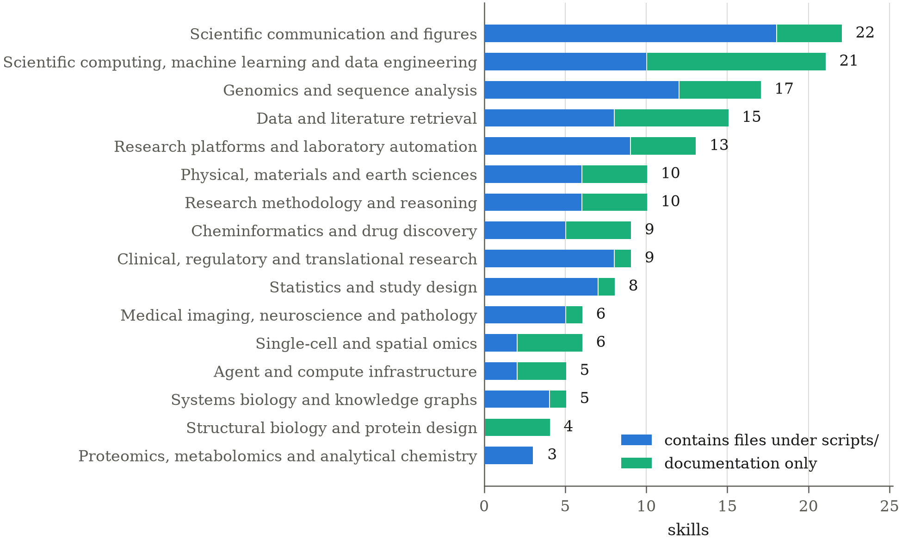

**Source figure / official image** — Figure 2: the skill library overview - 163 versioned procedural-knowledge skills across 16 areas of practice, each loaded only when a task needs it (always-resident descriptions cost 7.1% of a 200K-token window). · Figure 2 · [source](https://arxiv.org/html/2609.00065v2)

**nanoRSI reproduction** — not-run. Last source check: 2026-09-17.

**Open code / weights / data links** — [Library repository (MIT)](https://github.com/K-Dense-AI/scientific-agent-skills)

**Primary sources** — [arXiv abstract](https://arxiv.org/abs/2609.00065) · [Paper v2 (Figure 2, budget figures)](https://arxiv.org/html/2609.00065v2) · [Library repository (MIT)](https://github.com/K-Dense-AI/scientific-agent-skills)

### WikiSkill: Compiling Agent Experience into Persistent Knowledge for Skill Evolution

**2026-08-27** · paper · Direct bounded loop

**Publication date** — arXiv v1: 2026-08-27. No later revision recorded at verification time.

**Institutional relationship** — Paper v1: Google Research (Liyan Tang, Cyrus Rashtchian, Chun-Sung Ferng, Andrew Tomkins, Da-Cheng Juan) with Tu Vu (Google Research + Virginia Tech, corresponding).

**What changes and how feedback is reused** — A three-layer workspace: immutable raw execution traces, a persistent wiki that compounds across iterations (patterns, logs, skill-impact records), and active SKILL.md files. Each iteration the Inference Agent rolls out with skills but no wiki access; a Wiki Maintainer consolidates sampled traces into patterns; a Skill Proposer reads wiki + traces and proposes one atomic skill edit; validation gating accepts or rolls back skills - while the wiki itself is never rolled back, accumulating a ground-truth audit trail of accepted and rejected diffs.

**Author-reported result** — Five benchmarks x five models, 3 runs, paired bootstrap p<0.05: WikiSkill beats no-skill, Trace2Skill, EvoSkill and SkillOpt everywhere (e.g., Gemini-3.5-Flash 68.1 vs SkillOpt 55.9; Qwen-3.6-27B 63.3 vs 50.7). Gains scale with model size (+12.3/+17.5/+23.9 for Qwen 4B/9B/27B); Qwen-3.5-9B + WikiSkill (47.4%) beats Qwen-3.6-27B without skills (39.4%). Ablation: wiki access for the proposer alone +15.0; giving the inference agent wiki access hurts (-7.2).

**Evidence limits** — Full skill injection into prompts (retrieval/triggering unevaluated); strict gating rejects neutral proposals that might enable later gains; no automated wiki pruning; no very long-horizon tasks.

**Code / weights / data / license** — No code release located; paper CC BY 4.0.

**Possible nanoRSI experiment — not implemented here** — For nanoRSI: separate never-rolled-back knowledge (the wiki, with accepted/rejected diffs) from rolled-back executable skills - an audit layer whose monotonic growth makes skill-gate decisions reviewable after the fact.

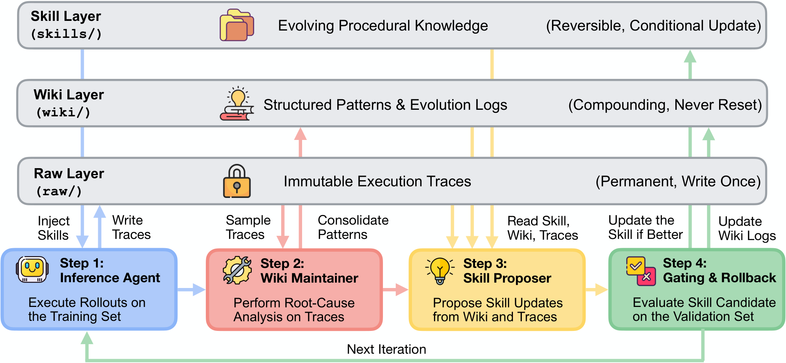

**Source figure / official image** — Figure 2: WikiSkill's three layers - immutable execution traces (raw), a persistent knowledge base that compounds across iterations (wiki), and active procedural instructions (skills), with the wiki never rolled back. · Figure 2 · [source](https://arxiv.org/html/2608.27454v1)

**nanoRSI reproduction** — not-run. Last source check: 2026-09-16.

**Open code / weights / data links** — No verified public code/asset link in the audited sources.

**Primary sources** — [arXiv abstract](https://arxiv.org/abs/2608.27454) · [Paper v1 (affiliations, Figure 2, main table)](https://arxiv.org/html/2608.27454v1)

### SkillOpt: Agent skills as trainable parameters

**2026-06-30** · report · Direct bounded loop

**Publication date** — Microsoft Research blog post published 2026-06-30 (surfaced 2026-10-16 by tracing a third-party writeup back to its primary); a Microsoft publication page exists but no arXiv ID is confirmed - an arXiv number circulating in writeups (2605.23904) did not check out and is not recorded.

**Institutional relationship** — Yifan Yang, Xuemei Gao, Qi Dai, Bei Liu, Kai Qiu, Dongdong Chen, Chong Luo - Microsoft Research (Asia lab).

**What changes and how feedback is reused** — Treats a natural-language skill file as 'a trainable parameter living outside a frozen target model'. A separate optimizer model runs a forward-backward-update loop in text space: forward = the frozen target executes task batches; backward = the optimizer reflects on trajectories in minibatches; update = small add/delete/replace edits, merged, deduplicated, ranked and clipped by a 'textual learning rate' (per-step edit budget). Validation gating is strict: an edit is adopted only if it scores strictly higher than the current skill on the held-out validation split; rejected edits feed a buffer reused as negative feedback, and an epoch-wise slow/meta update consolidates longer-horizon lessons. Weights are never updated and no extra model calls are added at inference; the deliverable is best_skill.md.

**Author-reported result** — Best or tied-best in all 52 reported evaluation cells (blog's claim) spanning six benchmarks (SearchQA, SpreadsheetBench, OfficeQA, DocVQA, LiveMathematicianBench, ALFWorld), seven models (GPT-5.5 down to Qwen3.5-4B) and three execution modes (direct chat, Codex, Claude Code), against human-written skills, one-shot LLM skills, Trace2Skill, TextGrad, GEPA and EvoSkill. GPT-5.4-mini with the skill (64.3) beats GPT-5.4 without (59.7). Edits stay tiny: median final skill ~920 tokens with only 1-4 accepted edits; OfficeQA's +39.0 gain came from a single edit. Cross-harness transfer: a Codex-trained skill dropped into Claude Code lifts 22.1 -> 81.8.

**Evidence limits** — Blog-format evidence: the '52 cells' is the blog's stated count over the 6x7x3 space (a subset of the full cross-product, not itemized publicly); headline averages like GPT-5.5 six-benchmark 58.8 -> 82.3 are stated without variance or seed counts; method applies 'wherever automatic evaluation or a reliable verifier exists'. No arXiv paper verified, so numbers rest on the official report; the 52-cell detail could not be independently recomputed.

**Code / weights / data / license** — MIT-licensed code at github.com/microsoft/SkillOpt (LICENSE verified 2026-10-16); project page aka.ms/skillopt; companion SkillLens at microsoft.github.io/SkillLens/.

**Possible nanoRSI experiment — not implemented here** — The exact pattern nanoRSI's skills template lacks: a textual learning rate (bounded per-step edit count), strict 'adopt only if strictly better on held-out validation' gating, a rejected-edit buffer reused as negative feedback, and an epoch-wise consolidation pass - all implementable in the standard library around the existing skill files. The ~920-token median final skill with 1-4 accepted edits is the reference budget showing small skills suffice.

**Source figure / official image** — Original Figure 1 from the MSR blog: a frozen target model executes tasks while a separate optimizer model trains the skill layer from trajectory feedback - bounded text edits, validation-gated adoption, slow consolidation. · Figure 1, MSR blog 'SkillOpt: Agent skills as trainable parameters' (2026-06-30) · [source](https://www.microsoft.com/en-us/research/wp-content/uploads/2026/06/SkillOpt_EXT_FA_Figure-1.png)

**nanoRSI reproduction** — not-run. Last source check: 2026-10-16.

**Open code / weights / data links** — [SkillOpt code](https://github.com/microsoft/SkillOpt)

**Primary sources** — [MSR blog: SkillOpt](https://www.microsoft.com/en-us/research/blog/skillopt-agent-skills-as-trainable-parameters/) · [SkillOpt code](https://github.com/microsoft/SkillOpt) · [SkillOpt project page](https://aka.ms/skillopt)

### SkillOpt: Executive Strategy for Self-Evolving Agent Skills

**2026-06-30** · report · Direct bounded loop

**Publication date** — Microsoft Research blog post dated June 30, 2026; the accompanying publication page and open-source repository were created the same quarter (repository created 2026-05-08).

**Institutional relationship** — Microsoft Research / MSRA authors (Yifan Yang, Xuemei Gao, Qi Dai, Bei Liu, Kai Qiu, Dongdong Chen, Chong Luo) reporting their own method; blog numbers are author-reported with the paper linked from the same page.

**What changes and how feedback is reused** — Treats an agent's skill file as a trainable parameter in text space: an optimizer model proposes bounded edits in a forward–backward–update cycle, and a candidate is adopted 'only if it scores strictly higher than the current skill on the held-out validation split'; rejected edits are buffered as negative feedback, with epoch-wise slow/meta updates on top.

**Author-reported result** — Author-reported: best or tied-best in all 52 evaluation cells (6 benchmarks × 7 models × 3 execution modes) against human-written skills, one-shot LLM skills, Trace2Skill, TextGrad, GEPA and EvoSkill; with GPT-5.5 in direct chat the six-benchmark average rises from 58.8 to 82.3 (+23.5 points absolute); SpreadsheetBench 41.8→80.7; a spreadsheet skill trained in Codex lifts Claude Code from 22.1 to 81.8 (+59.7); median final skill ~920 tokens with only 1–4 accepted edits; removing meta-skill/slow-update drops SpreadsheetBench from 77.5 to 55.0.

**Evidence limits** — Skill optimization is supervised by held-out validation within fixed benchmarks — the loop optimizes against known test distributions, so gains on shifted or out-of-suite tasks are not demonstrated; cross-harness transfer is shown for one skill family only; execution modes rely on commercial harnesses whose versions are not pinned.

**Code / weights / data / license** — Official implementation verified at github.com/microsoft/SkillOpt (MIT license, created 2026-05-08, ~17k stars); paper page linked from the blog; no new weights (frozen third-party models); benchmark data subject to the original benchmark terms.

**Possible nanoRSI experiment — not implemented here** — Proposed: add a held-out-gate skill editor to nanoRSI's skills surface — bounded diff proposals accepted only on strict validation improvement — compared against ungated self-editing and frozen skills on identical task streams, tracking edit acceptance rates and regressions.

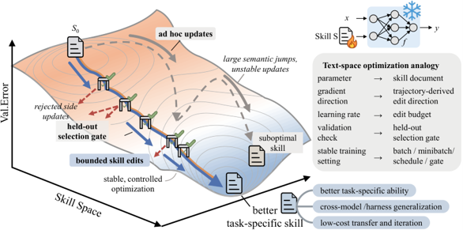

**Source figure / official image** — Figure 1: skill-space optimization analogy — bounded edits with a held-out selection gate descend the validation-error surface where ad-hoc unguarded updates jump; the table maps classic training hyperparameters to their text-space counterparts. · Blog Figure 1 · [source](https://www.microsoft.com/en-us/research/blog/skillopt-agent-skills-as-trainable-parameters/)

**nanoRSI reproduction** — not-run. Last source check: 2026-09-14.

**Open code / weights / data links** — [Official implementation (MIT)](https://github.com/microsoft/SkillOpt)

**Primary sources** — [Official MSR blog post (opened)](https://www.microsoft.com/en-us/research/blog/skillopt-agent-skills-as-trainable-parameters/) · [Official implementation (MIT)](https://github.com/microsoft/SkillOpt) · [Publication page](https://www.microsoft.com/en-us/research/publication/skillopt-executive-strategy-for-self-evolving-agent-skills/)

### SkillHone: A Harness for Continual Agent Skill Evolution Through Persistent Decision History

**2026-06-07** · paper · Direct bounded loop

**Publication date** — arXiv v1 submitted 2026-06-07; later revisions are not used to reset the inclusion date. The paper identifies WeChat, Tencent Inc. affiliations and describes SkillHone as an ongoing research harness.

**Institutional relationship** — The paper lists WeChat, Tencent Inc. for the Tencent authors; one author is described as having worked at WeChat AI, Tencent Inc. during an internship. University affiliations are not treated as Tencent ownership.

**What changes and how feedback is reused** — A persistent decision history stores diagnoses, candidate skill revisions, redacted evaluation evidence and outcomes. Separate optimizer and evaluator agents work against separate skill and evaluation repositories; accepted revisions feed later sessions, so the skill artifact itself is edited and reused across iterations.

**Author-reported result** — On the raw open-web setting with Qwen3.6-35B-A3B, SkillHone reports 64.6 GAIA average versus 48.8 for a curated deep-research agent (+15.8) and 66.4 WebWalkerQA-EN versus 63.2 (+3.2). Internal tool-mediated scenarios report an average +18.8 improvement; these are author-reported, task-specific results.

**Evidence limits** — The paper evaluates English benchmarks and isolates one skill at a time; joint multi-skill evolution is not demonstrated. The original enterprise harness is not the public repository, so the open bundle should not be presented as a full release of Tencent internal infrastructure.

**Code / weights / data / license** — Public Tencent/SkillHone repository verified. Its README and LICENSE state MIT; the GitHub API metadata reports NOASSERTION. The paper harness, internal data and model weights are not released in this repository.

**Possible nanoRSI experiment — not implemented here** — Add a versioned skill directory to nanoRSI: keep decision records, candidate diffs, evaluator evidence and rollback decisions, then compare fixed skills with accepted-revision reuse on held-out tasks.

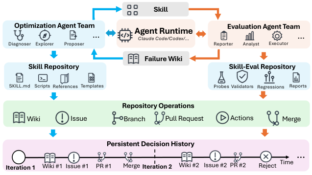

**Source figure / official image** — Figure 2: SkillHone separates persistent decision history, skill optimization and skill evaluation so accepted revisions can be reused. · Figure 2, framework.png · [source](https://ar5iv.labs.arxiv.org/html/2606.08671/assets/framework.png)

**nanoRSI reproduction** — not-run. Last source check: 2026-09-13.

**Open code / weights / data links** — [Tencent SkillHone repository](https://github.com/Tencent/SkillHone) · [SkillHone MIT license](https://github.com/Tencent/SkillHone/blob/main/LICENSE)

**Primary sources** — [arXiv first submission and history](https://arxiv.org/abs/2606.08671) · [Paper v1 and framework figure](https://arxiv.org/html/2606.08671v1) · [Tencent SkillHone repository](https://github.com/Tencent/SkillHone) · [SkillHone MIT license](https://github.com/Tencent/SkillHone/blob/main/LICENSE)

### OpenSkill: Open-World Self-Evolution for LLM Agents

**2026-06-04** · paper · Direct bounded loop

**Publication date** — arXiv v1: 2026-06-04 (2606.06741), day-precision verified on the abs page.

**Institutional relationship** — Paper: Lehigh University (Zhiling Yan, Lichao Sun corresponding) with UIC (Hanrong Zhang, Philip S. Yu), UBC/Vector (Yuxuan Zhang), Salesforce AI Research (Yutong Dai, Ran Xu) and MGH/Harvard Medical School (Xiang Li).

**What changes and how feedback is reused** — Skills and their verification signals are both built from scratch with no target-task supervision: open-world knowledge acquisition retrieves task knowledge and verification anchors from docs, repos, papers and the web (queries filtered to strip benchmark names against leakage); leakage-free skill evolution drafts 1-4 skills from a plan and iteratively refines them (up to 3 rounds) against self-built 'virtual tests' grounded in independently verifiable facts, with a gap-vs-bug classifier triggering targeted retrieval; zero-shot evaluation deploys the final skill artifact to any agent - hidden ground-truth tests are used only there.

**Author-reported result** — SkillsBench: Opus 4.6 43.6% vs best baseline Skill-Creator 34.7% (+8.9; human 44.5%); GPT 5.2 42.1% vs CoT 33.3% (+8.8; human 44.8%) - within 1 point of human skill authors on Opus. Best in all four columns of SocialMaze/ScienceWorld; transfers +5.5-14.8 points to four weaker models. Verifier quality: 56.9% precision, 80.5% recall, covering 88.9% of ground-truth test intents. Cost honestly reported: ~1.14M tokens / ~131 minutes end-to-end (~$1,800 total estimate).

**Evidence limits** — Web sources may be noisy or contradictory (needs provenance tracking); virtual tests may be too easy (overestimating skill quality) or, if derived from hidden answers, reintroduce supervision leakage; open-world research costs latency and tokens.

**Code / weights / data / license** — Code at github.com/OpenLAIR/OpenSkill (Apache-2.0, 92 stars at verification); site openlair.github.io/openskill. Paper CC BY 4.0.

**Possible nanoRSI experiment — not implemented here** — For nanoRSI: when no evaluator exists, build the verification anchor from independently verifiable facts BEFORE building the skill - and strip benchmark names from retrieval queries as standard leakage hygiene.

**Source figure / official image** — Figure 2: OpenSkill - a base agent acquires open-world knowledge to build a skill plan, iteratively generates, executes and refines the skill in a sandbox against self-built virtual tests, with a leakage barrier blocking target supervision during construction. · Figure 2 · [source](https://arxiv.org/html/2606.06741v1)

**nanoRSI reproduction** — not-run. Last source check: 2026-09-17.

**Open code / weights / data links** — [Code repository (Apache-2.0)](https://github.com/OpenLAIR/OpenSkill)

**Primary sources** — [arXiv abstract](https://arxiv.org/abs/2606.06741) · [Paper v1 (affiliations, Figure 2, tables)](https://arxiv.org/html/2606.06741v1) · [Code repository (Apache-2.0)](https://github.com/OpenLAIR/OpenSkill)

### SkillEvolver: Skill Learning as a Meta-Skill

**2026-05-11** · paper · Direct bounded loop

**Publication date** — arXiv v1: 2026-05-11. The work surfaced through a May 2026 media story and was verified against the arXiv original and the official repository on 2026-09-15; recorded under its first-publication date.

**Institutional relationship** — Paper v1 lists Erle Zhu, Jinfeng Zhou and Hongning Wang at Tsinghua University, and Genrui Zhang and Caiyan Jia at Beijing Jiaotong University.

**What changes and how feedback is reused** — Skill self-evolution is packaged as a portable meta-skill any protocol-compliant CLI agent can load; it updates a skill's prose and code, never model weights. One iteration: strategize and spawn K strategy-diverse domain-skill agents to collect success/failure trajectories; analyze the contrast and synthesize a targeted skill patch; then an independent auditor in a fresh session verifies the patched skill before acceptance — a fresh-agent overfit audit that catches leakage and a silent-bypass mode where a skill looks valid but is never invoked at run time. Refinement triggers only after deployment, so the learning signal comes from failures real downstream agents hit, not exploratory traces alone.

**Author-reported result** — SkillsBench (83 tasks, 15+ domains): 56.8% avg@5 versus 43.6% for human-curated skills and 29.9% no-skill; per the official repository README, the R=2 configuration reaches 56.9% and the evolved skill beats or matches human-curated on 74.7% of tasks. KernelBench GPU-kernel optimization: mean speedup 1.16 to 1.51 on H100. Downstream runs use -19% tokens, -15% turns and -24% wall-clock; end-to-end cost about $4 per task (repository README).

**Evidence limits** — Benchmarks use the authors' own task scopes; the deploy-then-refine signal presumes other agents reuse the skill library, leaving cold-start unclear; cost and per-task figures come from the repository README rather than the paper body.

**Code / weights / data / license** — Official code at THU-AICosmos/skillevolver under the MIT license (verified 2026-09-15); README names Claude Opus 4.6 as the working model. No separate dataset release located.

**Possible nanoRSI experiment — not implemented here** — Adopt the fresh-agent overfit audit plus silent-bypass check as a nanoRSI skill-acceptance gate: audit each candidate skill with an agent that has no prior session state, testing both leakage and whether the skill is actually invoked at run time.

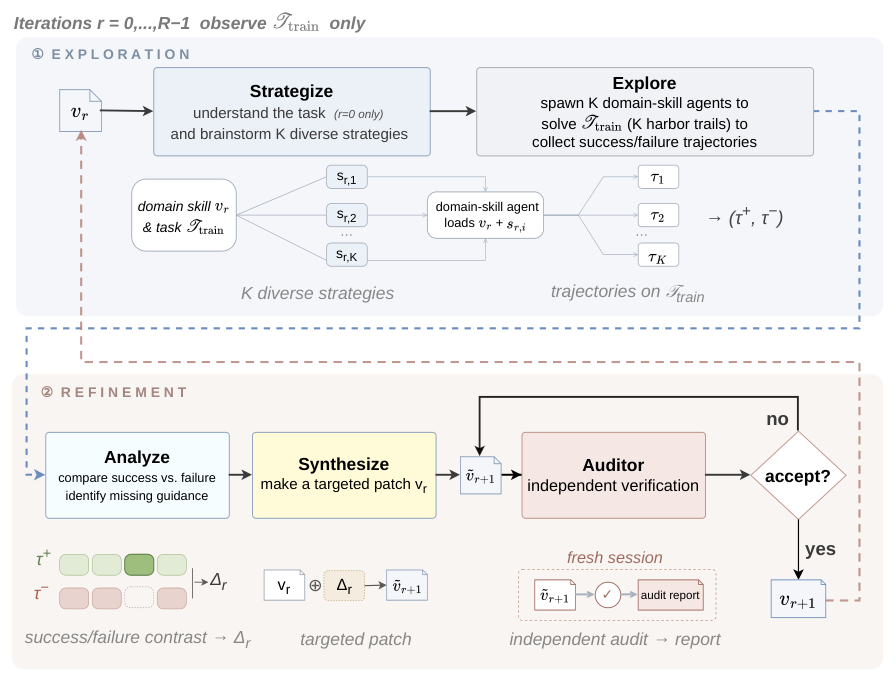

**Source figure / official image** — Figure 2: one SkillEvolver iteration — strategy-diverse exploration collects success/failure trajectories, a targeted patch is synthesized, and an independent fresh-session auditor gates acceptance. · Figure 2 · [source](https://arxiv.org/html/2605.10500v1)

**nanoRSI reproduction** — not-run. Last source check: 2026-09-15.

**Open code / weights / data links** — [Official code repository (MIT)](https://github.com/THU-AICosmos/skillevolver)

**Primary sources** — [arXiv abstract](https://arxiv.org/abs/2605.10500) · [Paper v1 (affiliations, Figure 2, Tables 1-2)](https://arxiv.org/html/2605.10500v1) · [Official code repository (MIT)](https://github.com/THU-AICosmos/skillevolver)

### EmbodiSkill: Skill-Aware Reflection for Self-Evolving Embodied Agents

**2026-05-11** · paper · Direct bounded loop

**Publication date** — arXiv v1: 2026-05-11; v2: 2026-07-11. The metrics and figures cited here come from v2. Surfaced in May via a media lead alongside SkillEvolver; first verified against the original paper on 2026-09-16.

**Institutional relationship** — Paper v2 lists five affiliations: Huazhong University of Science and Technology, University of Science and Technology of China, Microsoft Research, Institute for AI Industry Research (AIR) Tsinghua University, and Nanjing University; Ting Cao (Microsoft Research) is among the authors. Media coverage in May named only NJU x Microsoft x Tsinghua AIR - the full list is broader.

**What changes and how feedback is reused** — A training-free loop that evolves a two-part procedural skill S = (S_body, S_app) for a frozen executor. Each trajectory is interpreted relative to the current skill and split by evidence type: skill-changing evidence (Discovery, Optimization, SkillDefect reflections) is consolidated and applied as targeted edits to the skill body, with the model acting as a constrained editor rather than a free-form rewriter; execution-lapse evidence (the agent failed to follow valid guidance) updates only the appendix, which re-highlights existing valid body content instead of rewriting it. Revision sets larger than a budget trigger no-op.

**Author-reported result** — On ALFWorld (3,553 train / 134 test tasks, K=1, 10 revision stages), a frozen Qwen3.5-27B executor reaches 93.28% task success, 31.58 points above GPT-5.2 used as a direct skill-less agent; on Puttwo it hits 100.00% vs G-Memory's 52.94%. Ablation: no-skill 61.19 -> static skill 73.13 -> skill-unaware reflection 78.36 -> EmbodiSkill 93.28 (awareness delta +14.92). EmbodiedBench: EB-Habitat best average 52.33% (+16.29 over the strongest memory baseline), EB-Navigation 61.33% (+17.94). Gains vary by backbone pairing: with Gemini the Qwen3.5-27B awareness delta shrinks to +1.49.

**Evidence limits** — No dedicated limitations section in v2. The awareness delta is unstable across model pairings (+14.92 with GPT-5.2 vs +1.49 with Gemini on the same backbone), so the reflection channel's value is configuration-dependent. All numbers are authors' own runs; EmbodiedBench training uses 1,000 tasks per environment, which the authors curate themselves.

**Code / weights / data / license** — Code released under MIT at github.com/air-embodied-brain/EmbodiSkill (repo created 2026-07-03, 25 stars at verification). No weights or data release located; experiments call commercial models (Qwen3.5-27B, GPT-5.2, Gemini are named).

**Possible nanoRSI experiment — not implemented here** — For nanoRSI's skill evolution: split update evidence into two channels - defects in skill content trigger edits, while failures to follow valid guidance only re-emphasize that guidance (appendix-style), preventing good skills from being rewritten because of execution noise.

**Source figure / official image** — Figure 2: EmbodiSkill overview - the executor runs the current skill on an embodied task, reflection splits evidence into a Revision Set (Discovery/Optimization/SkillDefect -> skill body) and an Appendix Set (ExecutionLapse -> appendix), and only budget-fitting revision sets are applied. · Figure 2 · [source](https://arxiv.org/html/2605.10332v2)

**nanoRSI reproduction** — not-run. Last source check: 2026-09-16.

**Open code / weights / data links** — [Code repository (MIT)](https://github.com/air-embodied-brain/EmbodiSkill)

**Primary sources** — [arXiv abstract](https://arxiv.org/abs/2605.10332) · [Paper v2 (affiliations, Figure 2, Tables, ablations)](https://arxiv.org/html/2605.10332v2) · [Code repository (MIT)](https://github.com/air-embodied-brain/EmbodiSkill)

### CoEvoSkills: Self-Evolving Agent Skills via Co-Evolutionary Verification

**2026-04-02** · paper · Direct bounded loop

**Publication date** — arXiv v1 2026-04-02 (v3 2026-08-10 current); COLM acceptance stated on the abs page, verified 2026-09-19.

**Institutional relationship** — Academic consortium led by UIC with MBZUAI/McGill, Columbia, Zhejiang and UBC co-authors.

**What changes and how feedback is reused** — A Skill Generator produces multi-file skill packages while a co-evolving Surrogate Verifier filters them using only structured failure feedback; the ground-truth oracle is kept information-isolated (opaque pass/fail only) and its rounds trigger test upgrades, so skill and verifier bootstrap each other without labels.

**Author-reported result** — On SkillsBench with Claude Opus 4.6 + Claude Code: 71.1% pass rate vs 30.6% no-skill (+40.5pp), 53.5% human-curated skills (+17.6pp) and 34.1% for Anthropic Skill-Creator; GPT-5.2 self-evolved 69.8% vs 29.6%; skills evolved by Opus transfer to six other models with +35 to +44pp (e.g. Haiku 4.5: 54.5% vs 10.4%).

**Evidence limits** — Author-reported on one benchmark family; the verifier can be fooled within its feedback budget and the paper measures skill pass rates, not downstream recursive compounding.

**Code / weights / data / license** — Apache-2.0 code at github.com/Zhang-Henry/CoEvoSkills (verified); SkillsBench usage terms follow the paper.

**Possible nanoRSI experiment — not implemented here** — nanoRSI skills starter can adopt the information-isolated verifier pattern: the strict gate sees only structured failure feedback while the oracle emits opaque pass/fail, and oracle invocations trigger verifier test upgrades.

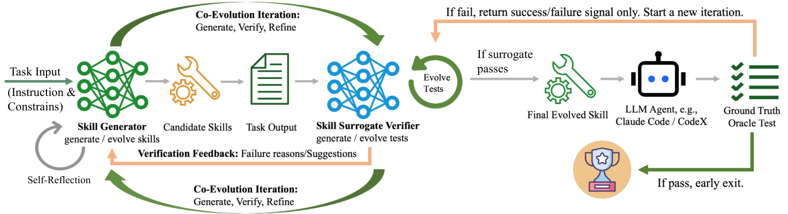

**Source figure / official image** — The Skill Generator and Surrogate Verifier co-evolve through iterative refinement with the ground-truth oracle kept information-isolated. · Figure 3 (process.png) · [source](https://arxiv.org/html/2604.01687v3)

**nanoRSI reproduction** — not-run. Last source check: 2026-09-19.

**Open code / weights / data links** — [Code repository](https://github.com/Zhang-Henry/CoEvoSkills)

**Primary sources** — [arXiv abstract](https://arxiv.org/abs/2604.01687) · [Paper HTML (affiliations, Table 3, Figure 3)](https://arxiv.org/html/2604.01687v3) · [Code repository](https://github.com/Zhang-Henry/CoEvoSkills)

### SkillClaw: Let Skills Evolve Collectively with Agentic Evolver

**2026-04** · paper · Direct bounded loop

**Publication date** — arXiv v1: April 2026 (2604.08377). Exact v1 day not re-verified; month precision used.

**Institutional relationship** — Paper: the DreamX Team of Alibaba's Amap (Ziyu Ma, Shidong Yang, ..., Tongwen Huang, Xiangxiang Chu); repository under the AMAP-ML organization.

**What changes and how feedback is reused** — Collective skill evolution across a fleet of interacting users: cross-user sessions become structured trajectories preserving full action-feedback causal chains; sessions are grouped by referenced skill (a natural ablation isolating each skill's effect); an agentic evolver reasons over success/failure patterns and picks refine / create / skip; candidate updates are validated nightly in idle user environments and only improvements that pass validation are merged and synchronized to all agents (Interaction -> Evidence -> Evolution -> Validation -> Deployment).

**Author-reported result** — WildClawBench (Qwen3-Max backbone, 8 simulated users, 6 days; four of six categories reported): Social Interaction 54.01% -> 60.34% (+6.33), Search & Retrieval 22.73% -> 34.55% (+11.82, +52% relative), Creative Synthesis 11.57% -> 21.80% (+88.41% relative), Safety & Alignment 24.00% -> 32.00%. Controlled 'Skill Evolve Lite' probes: save-report 28.3% -> 100.0%; average 30.4% -> 72.5%. Gains are versus the Day-1 initial skill set, not external systems.

**Evidence limits** — Self-described small-scale test (limited users, feedback signals, interaction depth); results cover only four of six categories; many late-round candidate updates were rejected (evolution plateaus within 6 days); validation adds token cost.

**Code / weights / data / license** — Code at github.com/AMAP-ML/SkillClaw (MIT, 2,613 stars at verification).

**Possible nanoRSI experiment — not implemented here** — For nanoRSI: group execution evidence by the skill it exercised before attributing credit - per-skill session buckets are the cheapest causal isolation available without extra ablation runs.

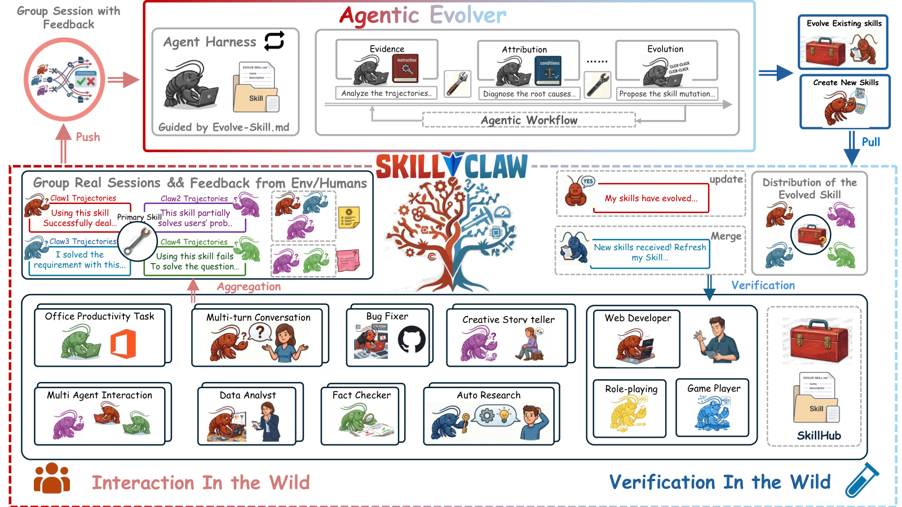

**Source figure / official image** — Figure 1: SkillClaw overview - sessions preserving action-feedback causal chains are grouped by referenced skill, an agentic evolver refines or creates skills, and nightly validation gates what is merged back to every agent. · Figure 1 · [source](https://arxiv.org/html/2604.08377v1)

**nanoRSI reproduction** — not-run. Last source check: 2026-09-16.

**Open code / weights / data links** — [Code repository (MIT)](https://github.com/AMAP-ML/SkillClaw)

**Primary sources** — [arXiv abstract](https://arxiv.org/abs/2604.08377) · [Paper v1 (Figure 1, results)](https://arxiv.org/html/2604.08377v1) · [Code repository (MIT)](https://github.com/AMAP-ML/SkillClaw)

## Harness search & evolution (28)

### HarnessPro: Recursive Harness Self-Improvement with Pareto Optimization for Performance-Cost Trade-offs

**2026-10-20** · paper · Direct bounded loop

**Publication date** — arXiv v1 submitted 2026-10-19; announced in the 2026-10-20 batch; repository initial release also 2026-10-19.

**Institutional relationship** — Zhuoshi Pan, ZhiYuan Feng, Honglin Lin, H. Vicky Zhao, Jie Tang (Tsinghua University), Yukuo Cen (Z.AI Co., Ltd.), Zhongxia Chen, Shuo Yang (Kuaishou Technology), Junru Lu (University of Warwick), plus Shanghai Jiao Tong University - read from the HTML author block.

**What changes and how feedback is reused** — Label-free recursive harness evolution under a performance-cost Pareto objective. Each epoch: specialized agents diagnose execution trajectories, plan updates with different performance-cost priorities, and implement them as candidate harnesses; candidates are evaluated with LLM-generated tests (no ground-truth solutions or official tests), and normalized weighted squared-distance selection returns three representatives - cost-focused (lite), balanced (medium), performance-focused (heavy) - fixed before held-out evaluation; selected harnesses enter the next iteration with execution feedback guiding further updates.

**Author-reported result** — Across Terminal-Bench 2, SWE-Bench Pro and ProgramBench with GPT-5.5 + Codex, heavy mode gains an average +2.0 pass-rate points over RHO while cutting per-task cost 26.1% (mean latency 520s to 412s); the advantage holds with GLM-5.2 + Claude Code; lite mode beats the vanilla harness on all three benchmarks at still lower cost.

**Evidence limits** — Evaluation validity rests on LLM-generated tests (their confusion against graded outcomes is reported but they are not ground truth); absolute gains are modest (~2 points); results are tied to two agent stacks (Codex, Claude Code) and three benchmarks.

**Code / weights / data / license** — Repository github.com/pzs19/HarnessPro live under MIT (initial release 2026-10-19, LICENSE read from raw.githubusercontent.com); live demo pzs19.github.io/HarnessPro; paper CC BY 4.0.

**Possible nanoRSI experiment — not implemented here** — Make cost a first-class selection axis: the evidence ledger already counts tokens per candidate - report a Pareto front (cheap / balanced / expensive generations) fixed before the frozen test instead of a single argmax-score winner.

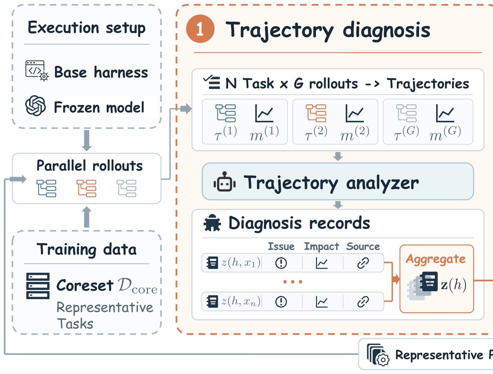

**Source figure / official image** — Original Figure 1 overview: each epoch analyzes rollout trajectories, generates candidate harnesses, and selects representatives on performance and cost. · Figure 1 (HarnessPro_Main_Figure.svg), arXiv HTML 2610.26770v1, rendered to PNG · [source](https://arxiv.org/html/2610.26770v1/HarnessPro_Main_Figure.svg)

**nanoRSI reproduction** — not-run. Last source check: 2026-10-21.

**Open code / weights / data links** — [pzs19/HarnessPro (MIT)](https://github.com/pzs19/HarnessPro) · [HarnessPro LICENSE (MIT)](https://raw.githubusercontent.com/pzs19/HarnessPro/master/LICENSE)

**Primary sources** — [arXiv abs 2610.26770](https://arxiv.org/abs/2610.26770) · [arXiv HTML v1](https://arxiv.org/html/2610.26770v1) · [pzs19/HarnessPro (MIT)](https://github.com/pzs19/HarnessPro) · [HarnessPro LICENSE (MIT)](https://raw.githubusercontent.com/pzs19/HarnessPro/master/LICENSE) · [Live demo](https://pzs19.github.io/HarnessPro/)

### Federation over Harness

**2026-10-20** · paper · Direct bounded loop

**Publication date** — arXiv v1 submitted 2026-10-15; announced in the 2026-10-20 batch, recorded as first public date.

**Institutional relationship** — Dixi Yao (correspondence), Tahseen Rabbani, Tian Li - University of Chicago, read from the HTML author block.

**What changes and how feedback is reused** — Automatic evolution of BOTH harness levels in distributed multi-agent experience sharing. A server agent evolves each client's harness for task solving and self-reflection while simultaneously evolving its own harness for aggregating distributed reflections, maintaining the shared insight library, and updating subsequent client harnesses. Crucially, FoH requires no extra validation signals - no ground-truth labels or validation data - and learns solely from self-generated reflections produced by the distributed agents.

**Author-reported result** — On PinchBench (V1 existing tasks + 124 V2-only held-out tasks) and ClawEval, FoH improves over single-agent baselines with a fixed harness by 53.57% and over single-agent harness self-evolution by 29.76%; on ScienceAgentBench tasks isolated agents fail while FoH-evolved client harnesses solve them with the same LLM, with distinct per-task skill activation patterns; ablations show instability when the guide excludes the insight library or local reflection.

**Evidence limits** — Reflection-only feedback: nothing verifies correctness of consolidated insights, so gains ride on reflection quality (the paper's own framing); everyday-agent benchmarks dominate; server-side harness updates consume almost all output tokens in the breakdown.

**Code / weights / data / license** — Repository github.com/dixiyao/FoH live under MIT (LICENSE read from raw.githubusercontent.com main); paper CC BY 4.0.

**Possible nanoRSI experiment — not implemented here** — The no-validation-signal regime is the honest stress case for this repo's evaluator-frozen doctrine: any reflection-only variant must be labeled unverifiable-by-design and compared against the frozen-evaluator gate; the client/server split of edit surfaces also maps cleanly onto per-workspace skill files versus shared population-level files.

**Source figure / official image** — Original Figure 1: overview of the FoH workflow - distributed client agents solve tasks and reflect under evolving client harnesses, while the server agent evolves its own harness to aggregate reflections, maintain shared knowledge and update subsequent client harnesses. · Figure 1 (workflow.svg), arXiv HTML 2610.24007v1, rendered to PNG · [source](https://arxiv.org/html/2610.24007v1/workflow.svg)

**nanoRSI reproduction** — not-run. Last source check: 2026-10-21.

**Open code / weights / data links** — [dixiyao/FoH (MIT)](https://github.com/dixiyao/FoH) · [FoH LICENSE (MIT)](https://raw.githubusercontent.com/dixiyao/FoH/main/LICENSE)

**Primary sources** — [arXiv abs 2610.24007](https://arxiv.org/abs/2610.24007) · [arXiv HTML v1](https://arxiv.org/html/2610.24007v1) · [dixiyao/FoH (MIT)](https://github.com/dixiyao/FoH) · [FoH LICENSE (MIT)](https://raw.githubusercontent.com/dixiyao/FoH/main/LICENSE)

### Self-Evolving Coding Agents via Harness-Policy Optimization

**2026-10-19** · paper · Direct bounded loop

**Publication date** — arXiv v1 submitted 2026-10-16; announced in the 2026-10-19 batch (OAI-PMH datestamp 2026-10-19), which is recorded as first public date.

**Institutional relationship** — Zhepei Wei (internship at Microsoft Research; University of Virginia), Wenlin Yao, Baolin Peng, Qianhui Wu, Hao Cheng, Jianfeng Gao (Microsoft Research), Danqing Wang (Carnegie Mellon University), Yu Meng (University of Virginia) - read from the HTML author block.

**What changes and how feedback is reused** — Recursive self-improvement alternating two steps over the same agent. H-step: the frozen policy analyzes its own failures on a search set and proposes harness candidates - a Python class subclassing the seed mini-SWE-agent that overrides step, prompts, feedback and submission handling; candidates are selected on that search set. P-step: the policy is updated by RL under the selected harness, and tasks it never solves become the next search set, so harness optimization tracks the policy's evolving failure modes. The evolving policy itself is the harness proposer (no external model required).

**Author-reported result** — Qwen3.5-35B-A3B base, three coding benchmarks (avg@3): SWE-Bench Verified resolve 61.0%->69.5% with self-proposal, 71.6% with an external Opus 4.8 proposer; three-benchmark average 57.8%->64.8% with gains transferring to out-of-distribution SWE-Bench Multilingual (300 tasks) and SWE-Bench Pro V2 (642 tasks); joint harness+policy gain exceeds the sum of individual gains and both components retain gains when cross-paired with base counterparts; ablations: RL 71.6% vs SFT 67.2% / RFT 70.5%, evolving search set 71.6% vs fixed 70.1%.

**Evidence limits** — Coding tasks only, comparisons at fixed compute and rollout budgets within one harness family (mini-SWE-agent subclassing); the strongest 71.6% number depends on an external frontier proposer rather than pure self-proposal; synergy depends on this alternation schedule.

**Code / weights / data / license** — Repository github.com/MSR-Orchard/Self-HPO live under MIT (License read from raw.githubusercontent.com main, 2026-10-20); checkpoints at huggingface.co/self-hpo (200); paper CC BY 4.0.

**Possible nanoRSI experiment — not implemented here** — A minimal-task port of the alternating schedule: after each accepted nanoRSI generation, rebuild the proposal search set from exactly the episodes the current candidate failed, and alternate skill-file edits with a policy-side proxy (e.g. prompt/selection params) to test whether alternation beats either surface alone at matched attempt budget.

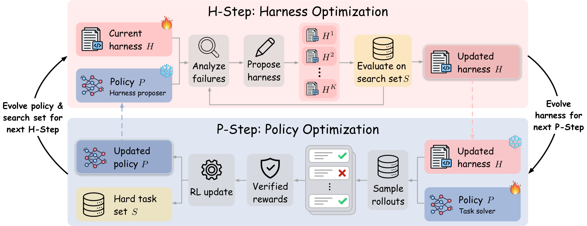

**Source figure / official image** — Original Figure 2 overview: H-step (top) - the frozen policy analyzes failures on the search set and proposes harness candidates; P-step (bottom) - RL updates the policy under the selected harness, and unsolved tasks form the next search set. · Figure 2 (method_overview.png), arXiv HTML 2610.22791v1 · [source](https://arxiv.org/html/2610.22791v1/method_overview.png)

**nanoRSI reproduction** — not-run. Last source check: 2026-10-20.

**Open code / weights / data links** — [MSR-Orchard/Self-HPO (MIT)](https://github.com/MSR-Orchard/Self-HPO) · [Self-HPO LICENSE (MIT)](https://raw.githubusercontent.com/MSR-Orchard/Self-HPO/main/LICENSE)

**Primary sources** — [arXiv abs 2610.22791](https://arxiv.org/abs/2610.22791) · [arXiv HTML v1](https://arxiv.org/html/2610.22791v1) · [MSR-Orchard/Self-HPO (MIT)](https://github.com/MSR-Orchard/Self-HPO) · [Self-HPO LICENSE (MIT)](https://raw.githubusercontent.com/MSR-Orchard/Self-HPO/main/LICENSE) · [Hugging Face checkpoints](https://huggingface.co/self-hpo)

### VideoHarness-SRSI: Structured Recursive Self-Improvement for Video Understanding Harness

**2026-10-14** · paper · Direct bounded loop

**Publication date** — arXiv v1 submitted 2026-10-14, announced in the 2026-10-15 batch; primary-verified 2026-10-16.

**Institutional relationship** — Thirteen authors: Zihao Lin (UC Davis x Meta MRS Research, work done at Meta), Haoyu Dong (Duke), Haobo Xu and Xuying Ning (UIUC), Chi-Chih Chang (Cornell), Yinglong Xia, Shuang Yang, Zhuokai Zhao, Xinying Song, Yang Song and Qifan Wang (Meta MRS Research), Dongfang Liu (Purdue), Lifu Huang (UC Davis).

**What changes and how feedback is reused** — Studies recursive harness evolution around a frozen vision-language model for agentic video understanding. The baseline VideoHarness-BRSI evolves 4,000+ candidates and rivals hand-engineered systems but exhibits three diagnosed failure modes: validation overfitting (reused validation feedback drives both revisions and proposer search toward the validation set), search-budget dilution, and the early-experience trap. VideoHarness-SRSI restructures the search so every decision rests on evidence that is transferable, sufficient, and gathered before the search commits: the proposer sees only content-free feedback; instrumented warm-up experiments measure signal quality in advance; and candidate mechanisms are validated in isolated probe-race branches before factorial composition into the deployed harness.

**Author-reported result** — Across four video understanding benchmarks, VideoHarness-SRSI improves the equally weighted mean held-out score by 6.2% relative to BRSI and reduces the mean validation-test gap by 37.9%.

**Evidence limits** — Domain is agentic video understanding with a frozen VLM (four benchmarks); no code release stated in the Comments ('50 pages, 15 figures'); gains are measured against the authors' own BRSI baseline; per-benchmark variance and seeds not stated in the abstract.

**Code / weights / data / license** — No code or dataset release stated (checked 2026-10-16); arXiv non-exclusive license.

**Possible nanoRSI experiment — not implemented here** — The diagnosis is the mirror of nanoRSI's counterfactual gate: validation feedback reused across revision AND proposer selection overfits - SRSI's fixes (content-free feedback to the proposer, pre-committed warm-up signal audits, mechanism-level probe races in isolated branches before composition) are concrete patterns for the already-planned evaluator-leak work; the val-test gap reduction metric (37.9%) is the number to track, not just held-out gains.

**Source figure / official image** — Original Figure 4 (SRSI overview): every search decision rests on evidence that is transferable, sufficient and gathered before the search commits - content-free proposer feedback, instrumented warm-ups, and probe-race branches before factorial composition. · Figure 4 (S4.F4; asset named Figure2_VideoHarness_SRSI.svg), arXiv HTML v1 · [source](https://arxiv.org/html/2610.19424v1/Figure2_VideoHarness_SRSI.svg)

**nanoRSI reproduction** — not-run. Last source check: 2026-10-16.

**Open code / weights / data links** — No verified public code/asset link in the audited sources.

**Primary sources** — [arXiv abstract](https://arxiv.org/abs/2610.19424) · [arXiv HTML v1](https://arxiv.org/html/2610.19424v1)

### TimeRSI: Towards Self-Improved Agentic Deployment for Time-Series Foundation Models

**2026-10-14** · paper · Direct bounded loop

**Publication date** — arXiv 2610.19725 v1 submitted 2026-10-14; v2 (this verification) revised 2026-10-15. First public date follows the v1 convention.

**Institutional relationship** — Haoxin Liu, Lucheng Fu, Yiqiao Jin, Rushi Qiang, B. Aditya Prakash (Georgia Institute of Technology); Deqing Fu (University of Southern California); Harshavardhan Kamarthi (Georgia Institute of Technology; Samay AI).

**What changes and how feedback is reused** — A self-improving agentic deployment system around frozen time-series foundation models. A coding agent translates task descriptions into executable pipeline changes; it tests each revision on historical forecasting windows and uses observed errors to guide subsequent revisions; during deployment an adaptive selector chooses among the resulting pipelines using completed forecasts under similar conditions. The TSFM weights remain fixed in both stages.

**Author-reported result** — Across 198 tasks on TIME and FEV-bench, TimeRSI outperforms all submissions on six point and probabilistic forecasting metrics (ranks first among compared submissions). Controlled comparisons support the value of feedback-guided revision over non-iterative pipeline search; further experiments verify generalization across different coding agents and forecasting models.

**Evidence limits** — Domain-specific (forecasting deployment); leaderboard-style comparison against prior submissions rather than same-compute re-runs of every baseline; code repository linked but its artifact completeness was not audited in this pass.

**Code / weights / data / license** — Apache-2.0 code at github.com/haoxin1998/TimeRSI (LICENSE verified via raw.githubusercontent.com 2026-10-17).

**Possible nanoRSI experiment — not implemented here** — Historical-window pre-validation before adopting a pipeline edit is train/validation gating in deployment clothing - the same doctrine nanoRSI enforces before promotion; the adaptive selector over an accumulated pipeline portfolio is a lightweight population pattern (no weights, just versioned programs picked by past performance under matched conditions).

**Source figure / official image** — Original Figure 1: from conventional to self-improved TSFM deployment - direct inference leaves task-specific adaptation to the user, hand-tailored pipelines need expert effort, and TimeRSI iterates executable pipeline revisions from observed forecast errors with an adaptive selector at deployment. · Figure 1 (inline SVG with 64 foreignObject blocks; in-browser screenshot of figure#S0.F1 at page-absolute coordinates), arXiv HTML 2610.19725v2 · [source](https://arxiv.org/html/2610.19725v2)

**nanoRSI reproduction** — not-run. Last source check: 2026-10-17.

**Open code / weights / data links** — [TimeRSI code (Apache-2.0)](https://github.com/haoxin1998/TimeRSI)

**Primary sources** — [arXiv abs 2610.19725](https://arxiv.org/abs/2610.19725) · [TimeRSI code (Apache-2.0)](https://github.com/haoxin1998/TimeRSI)

### HarnessTTT: Learn to Optimize Harness at Test-Time for Scientific Discovery

**2026-10-12** · paper · Direct bounded loop

**Publication date** — arXiv v1 submitted 2026-10-12, announced in the double-size 2026-10-14 batch; project page marked 'research preview, paper under review'; primary-verified 2026-10-16.

**Institutional relationship** — Yingzi Ma (UW-Madison), Yulong Cao (NVIDIA), Nanxi Li (Johns Hopkins), Fang Wu (Stanford), Yizhe Zhang (Meta), James Zou (Stanford), Yejin Choi (Stanford), Chaowei Xiao (Johns Hopkins), from the stated affiliation lines.

**What changes and how feedback is reused** — Trains a harness proposer at test time while the executor stays frozen: the proposer (executor model + persistent rank-64 LoRA, 3 epochs per round, PPO-style clipped objective, KL 0.1 to the frozen base) emits executable harnesses - system prompts, reusable skills, tools, middleware, execution controls - each guiding one budgeted discovery rollout whose outcome updates the proposer. The discovery-oriented policy gradient uses gap-normalized rewards g_k = (s_k - b_tau)/Z_tau against the remaining gap to a published reference (positive credit smoothly capped at 3*tanh(g/3), losses floored at -1, invalid candidates -1), RLOO leave-one-out advantages within same-parent groups that deliberately omit division by group std, near-ties (delta 1e-3) collapsed to their mean and all-tied groups excluded, plus max-sharpening (centered softmax, alpha 0.3). Every generated tool passes static checks (import allowlist, forbidden-access screening) and a sandboxed self-test before mounting, with at most 2 repair attempts before being dropped; a restricted ctx interface withholds evaluator code, ground truth and network. Each round retains only the best valid solution (strictly-improving ratchet), the incumbent harness and a fixed-size experience digest.

**Author-reported result** — With a frozen 9B executor: beats OpenEvolve with the same executor on all eleven benchmark tasks (circle packing 1.17 -> 2.64); beats the discovery-fine-tuned Finch-9B by up to 91.7% (Hadamard; abstract rounds to 92%); 9/11 tasks best among open-weight <=10B systems; Erdos minimum-overlap 0.380919, better than the best human reference 0.380927. Scaling the proposer with a frozen 27B executor improves eleven of fourteen tasks; learned harnesses replayed on GPT-5.5 match or exceed the strongest reported system of any backbone on nine of fourteen tasks. Fourteen tasks span math, systems, GPU kernels, heuristics, astrodynamics and biology.

**Evidence limits** — Trails <=10B systems on AC2 (0.934 vs 0.947) and Txn (4,255 vs 4,762), with the AC2 comparison confounded by the initial program; behind frontier on EPLB; the 27B proposer is worse on Hadamard (-12.4%). Reporting is single-campaign rather than means; transfer and replay gains are descriptive point estimates without isolated transfer effects; LLM-SQL and Txn are quarantined with caveats. The released artifact lacks the trusted runtime, sandbox and logs, so the settings 'cannot yet be verified independently' (authors' statement, echoed on the project page).

**Code / weights / data / license** — Project page gray311.github.io/harnessrl links two different GitHub repos (Code button: SaFo-Lab/Self_Adapt_Harness; footer: gray311/SAH - both resolve, the inconsistency recorded); no license statement found on the page, code license not verified 2026-10-16. No weights or dataset release stated.

**Possible nanoRSI experiment — not implemented here** — The reward recipe is directly portable to nanoRSI's noisy small-panel selection: normalize each candidate by (score - parent) over the remaining gap to a reference, cap positive credit smoothly, floor losses and mark invalid attempts -1; compute leave-one-out advantages within same-parent groups without dividing by group std, collapse near-ties, drop all-tied groups. The pre-mount validation ladder (static allowlist -> sandboxed self-test -> at most 2 repairs -> drop) is a concrete attempt-gating pattern for generated skills and evaluators.

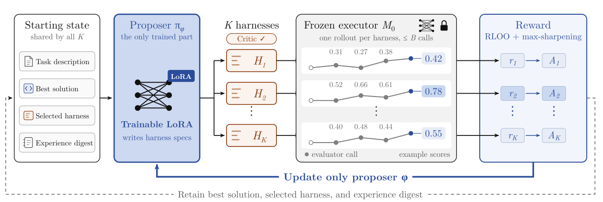

**Source figure / official image** — Original Figure 4 (overview): the proposer (executor + LoRA adapter) emits candidate harnesses, each validated before guiding a budgeted discovery rollout; rollout outcomes train the proposer at test time while the executor stays frozen. · Figure 4 (S3.F4), arXiv HTML v1 · [source](https://arxiv.org/html/2610.17370v1/overview.svg)

**nanoRSI reproduction** — not-run. Last source check: 2026-10-16.

**Open code / weights / data links** — No verified public code/asset link in the audited sources.

**Primary sources** — [arXiv abstract](https://arxiv.org/abs/2610.17370) · [arXiv HTML v1](https://arxiv.org/html/2610.17370v1) · [HarnessTTT project page](https://gray311.github.io/harnessrl/)

### Harness^2: Recursive Agent Harnessing for an Open World

**2026-10-09** · paper · Direct bounded loop

**Publication date** — arXiv v1 submitted 2026-10-09, announced in the double-size 2026-10-14 batch; primary-verified 2026-10-16.

**Institutional relationship** — Eight of nine authors at Google Cloud AI Research (Yanfei Chen, Zhongying CuiZhu, Bhavana Dalvi Mishra, Yifei Ming, Han Yu, Rujun Han, Chen-Yu Lee, Tomas Pfister); corresponding author Ruiyao Xu carries a Northwestern University affiliation line in addition to Google Cloud AI Research. The byline 'Zhongying CuiZhu' looks like a LaTeXML merge artifact of two names; stray LaTeX artifacts appear in the affiliation block.

**What changes and how feedback is reused** — Two levels of recursion over a K=8 editable-component harness (system prompt, guardrails, memory, skills, tool guidance, scripts, subagents, TypeScript middleware). Task level, Propose-Probe-Compose: run the current harness once for a reference execution, then propose an 'invariant' candidate (cross-domain agentic deficiency) and a domain-specific candidate; Probe reruns each under matched configuration and compares trajectory and deliverable against the reference to yield a behavioral contrast (mitigates / neutral / regresses) with no ground-truth verifier; Compose selectively merges supported edits, revises conflicts, adopts one candidate or keeps the harness - every decision tied to a concrete observation rather than a presumed score gain. Parallel recursion probes k candidates and composes from the pool; sequential recursion chains k contrastive steps. Harnessing level: after each task, reflection extracts lessons from the full improvement record, retaining only contrast-supported lessons; the adopted harness plus an EXPERIENCE.md entry joins an indexed improvement library. The default harness editor is Claude Opus 4.8 under OpenCode.

**Author-reported result** — Across three professional benchmarks and four model-harness configurations (frozen GLM-5 and Gemini 3.5 Flash executors x OpenCode and Codex baseline harnesses), a single recursion step gains up to 11.5 points on WorkBuddy-Bench (GLM-5/OpenCode 64.2 -> 75.7), 4.5 on JobBench (Gemini 3.5 Flash/OpenCode) and 11.8pp on LAB partial (GLM-5/OpenCode 59.6 -> 71.4); raising recursion budget k from 1 to 5 improves monotonically for both parallel and sequential forms (parallel higher at k=5), adding roughly +2.6-6.7pp depending on benchmark-configuration.

**Evidence limits** — No correctness or transfer guarantee: contrasts and model judgment are sensitive to execution variability and shared model biases. Negative results: ReasoningBank drops as much as 6.6 points below base on coding; Harness Scaling underperforms base in 7 of 12 benchmark-configuration pairs and regresses from k=2 to k=3; Meta-Harness leads Harness2 on LAB for Gemini 3.5 Flash under Codex. Failure analysis of 9 regressions: weak anonymized-deliverable selection (a score-55 output chosen over 95), propagated incorrect premises (2-11 point losses), unattributable variability. Recursion costs extra executions and editor sessions.

**Code / weights / data / license** — Apache-2.0 code at github.com/google-research/harness2 (LICENSE verified 2026-10-16; 3 commits, no releases, standard 'not an officially supported Google product' notice); project page harness2.github.io; paper CC BY 4.0.

**Possible nanoRSI experiment — not implemented here** — Contrastive probing is the verifier-free gate nanoRSI lacks on open tasks: run the parent once for a reference, rerun each child under matched configuration, and compare trajectories/deliverables to accept only contrast-supported edits - no scores, rubrics or ground truth. The indexed improvement library with per-entry provenance and leave-one-out reuse auditing (their Fig. 10/11) is the memory-surface mirror of nanoRSI's population bookkeeping.

**Source figure / official image** — Original Figure 3 (pipeline): task-level recursion proposes invariant and domain-specific harness candidates, probes them against a reference execution for behavioral contrast, and composes supported edits; harnessing-level recursion distills contrast-supported lessons into an indexed improvement library. · Figure 3 (S2.F3), arXiv HTML v1 · [source](https://arxiv.org/html/2610.14224v1/harness2_main_new.png)

**nanoRSI reproduction** — not-run. Last source check: 2026-10-16.

**Open code / weights / data links** — [harness2 code](https://github.com/google-research/harness2)

**Primary sources** — [arXiv abstract](https://arxiv.org/abs/2610.14224) · [arXiv HTML v1](https://arxiv.org/html/2610.14224v1) · [harness2 code](https://github.com/google-research/harness2) · [harness2 project page](https://harness2.github.io)

### Evo²: Evolving the Evolver through Weight-Harness Co-Evolution

**2026-10-09** · paper · Direct bounded loop

**Publication date** — arXiv v1 submitted 2026-10-09; no revisions. The arXiv HTML renders the shared affiliation of six authors as a LaTeX placeholder ("\thepa"); the PDF title page states Google DeepMind and UIUC.

**Institutional relationship** — Google DeepMind (Shujian Zhang, Wenxuan Zhou, John Lambert, Beck Chen, Andrew Hard, Rajiv Mathews) and UIUC (Bo Li; Chejian Xu as a student researcher at Google DeepMind).

**What changes and how feedback is reused** — One policy serves two roles over the harness: a Proposer writes harness edits and a Reflector diagnoses their effects and guides revision, with crossover moving strategies between search-tree branches. Weight updates close the loop on the evolver itself: EvoTIDE (Tree-guided Interleaved Dual-role Evolution) recovers usable training trajectories via edit extraction and prefix continuation, rewards each role's decisions by the task-performance delta they cause (with negative rewards for malformed outputs and gains credited only with trace evidence the mechanism ran), then trains with an SFT warm start and interleaved GRPO over Proposer and Reflector groups against a frozen counterpart snapshot per round.

**Author-reported result** — With Qwen3.8-27B as both executor and evolver: 82.1% Polyglot and 48.3% SWE-bench Verified vs 62.6% (GEA) and 41.0% (HGM) for the strongest baselines; LiveCodeBench 58.0 vs 56.0; evolved harnesses transfer cross-benchmark without further evolution (5 of 6 transfer directions best, e.g. SWE-evolved harness 72.4 on Polyglot). On a 60-task proprietary SWE subset the framework lifts GPT-5-mini from 24.4% to 48.3% and Claude Haiku 4.5 to 47.8%. Memory tasks: LoCoMo F1 60.4 vs HGM 56.2; LongMemEval 71.5 vs 64.4. Training the evolver matters: trained vs untrained ablation +16.3 Polyglot (p=.001), +5.0 SWE (p=.086), +9.3 LoCoMo, +10.6 LongMemEval; crossover adds ~4.1 Polyglot; the evolved harness also uses fewer calls (36 vs 43).

**Evidence limits** — The SWE-bench ablation gain (+5.0) is not significant at p<.05 (p=.086); the self-evolution tables use one open executor family (Qwen3.8-27B) plus proprietary subsets; the paper carries no explicit limitations section; no code or artifacts are released.

**Code / weights / data / license** — No code, weights or data released with the paper (none linked on arXiv or in the HTML). Paper under arXiv's non-exclusive license (CC BY 4.0 per HTML license block).

**Possible nanoRSI experiment — not implemented here** — The dual-role decomposition maps onto nanoRSI's proposer/gate split: one policy both proposes edits and reflects on gate outcomes, and the per-role performance-delta reward is computable from the existing frozen-panel evidence ledger without new gate behavior. The crossed harness-vs-weights reporting (with the trained-evolver ablation as the control) is the shape ADOPTION item 38 already requires.

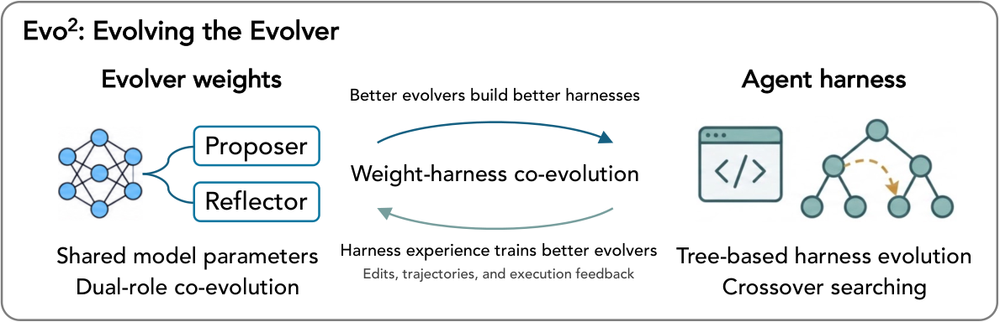

**Source figure / official image** — Original Figure 1: Evo² connects harness evolution with the training of a unified Proposer-Reflector policy - harness edits and their execution outcomes become training data for the evolver, whose updated weights guide subsequent harness search. · Figure 1 (fig1.png): weight-harness co-evolution overview with the shared Proposer-Reflector policy, harness edits and execution outcomes training the evolver weights, and crossover search · [source](https://arxiv.org/html/2610.13025v1)

**nanoRSI reproduction** — not-run. Last source check: 2026-10-14.

**Open code / weights / data links** — No verified public code/asset link in the audited sources.

**Primary sources** — [arXiv abstract](https://arxiv.org/abs/2610.13025) · [arXiv HTML v1](https://arxiv.org/html/2610.13025v1) · [arXiv PDF v1 (affiliations)](https://arxiv.org/pdf/2610.13025)

### Harness Evolution Hits a Ceiling: When Weight Training Should Begin

**2026-10-08** · paper · Direct bounded loop

**Publication date** — arXiv v1 submitted 2026-10-08; no revisions. DOI pending at verification time.

**Institutional relationship** — Two independent researchers (equal contribution, both corresponding), with UC Berkeley, Purdue University and Stanford University co-authors.

**What changes and how feedback is reused** — Trajectories under the seed harness are labelled by first failure signal into a failure composition; process failures (blocked calls, loops, exhausted budgets) are routed to a self-evolving harness loop where an LLM proposes edits and a judge verifies, while content failures are routed to weight training: LoRA or full fine-tuning on trajectories collected under the evolved harness. The two levers are evaluated in a crossed design (seed vs evolved harness x base vs adapter weights) on held-out tasks, with per-round fresh anchors instead of self-reported scores.

**Author-reported result** — On DeepPlanning (48 dev / 72 held-out), harness evolution lifts Qwen3.5-4B held-out score 0.16->0.30 and Qwen3.5-9B 0.32->0.44 (4-rollout means against fresh anchors); LoRA adapters trained on evolved-harness trajectories add +0.13 on the seed harness for both sizes, and the 9B adapter cuts content-failure share from ~25-28% to ~5%. A placebo adapter on answer-shuffled data scores below base. The loop transfers to WebArena-Lite (+0.088 on 117 unseen tasks, 0.256->0.344) where adapters add nothing. Across eight models from six families the harness lever pays nothing on three smaller models and the authors report frontier-model readings (GLM 5.3 0.512 dev / 0.488 held-out, no control).

**Evidence limits** — Diagnosis needs trajectory-level process signals plus a task-level scorer; some ablation cells used only two rollouts; the placebo control exists only for the 9B model; no comparison against matched-budget test-time search baselines; the benchmark LLM-based plan-to-JSON conversion inflates scores by ~0.025 on audited answers; two comparisons cross nights and a few early lines were re-measured; frontier-model runs lack per-run data and noise estimates.

**Code / weights / data / license** — Code: none found on the arXiv page or in the HTML (per-run frontier readings said to be released with code, no repository yet). Weights: LoRA adapters not published. Data: DeepPlanning benchmark not published as far as verified. License: arXiv default licensing.

**Possible nanoRSI experiment — not implemented here** — The diagnose-then-intervene rule is directly testable in nanoRSI: label each episode failure as process vs content, route only process failures to harness/skill edits, and report whether the gate-accepted set changes composition versus an all-failures selector. The crossed evaluation (harness state x weight state) and fresh-anchor re-measurement are the reporting shape items 38-39 already ask for.

**Source figure / official image** — Original Figure 1: trajectories under the seed harness are labelled by first failure signal and the failure composition chooses the lever - a self-evolving harness loop for process failures, weight training (LoRA/full fine-tuning) on evolved-harness trajectories for content failures - evaluated in a crossed seed/evolved x base/adapter design. · Figure 1 (inline TikZ in the arXiv HTML; captured as a browser screenshot of the rendered figure element because the source stores it as an SVG fragment with foreignObject text) · [source](https://arxiv.org/html/2610.11655v1)

**nanoRSI reproduction** — not-run. Last source check: 2026-10-13.

**Open code / weights / data links** — No verified public code/asset link in the audited sources.

**Primary sources** — [arXiv abstract](https://arxiv.org/abs/2610.11655) · [arXiv HTML v1](https://arxiv.org/html/2610.11655v1)

### Safe, Persistent, and Evolving Agent Harness for Understanding Partially Observable Worlds

**2026-10-08** · paper · Direct bounded loop

**Publication date** — arXiv v1 submitted 2026-10-08; no revisions. Repository name E-LEDGER-WorldAbduct.

**Institutional relationship** — HKUST (Yisen Gao, Qing Zong, Yangqiu Song), LIGHTSPEED (Yue Guo) and an independent corresponding researcher (Yiwen Guo).

**What changes and how feedback is reused** — E-Ledger is a multi-agent harness with a code approval layer that checks every action against policy before execution and maintains a ledger of verified hidden rules plus evidence-backed dynamic state. WorldAbduct evolves that harness by abduction: execution trajectories are diagnosed across four views (state consistency, world-observation gap, policy-gate correctness, goal judgment) to hypothesize latent rules, which are verified through targeted abductive interactions before entering the ledger.

**Author-reported result** — On the enterprise World of Workflows benchmark, WorldAbduct achieves the top safe task completion rate across four backbones (DeepSeek-V4-Pro 80 STCR / 85 TCR / 95 PSR; GLM-5.3-Flash 75/80/95; Kimi-K3 70/75/95; GPT-5.6-Terra 65/65/100), beating the strongest evolution baseline MemoHarness by 5-15 percentage points (GLM: 75 vs 65 STCR; DeepSeek: 80 vs 75; GPT-5.6: 65 vs 50). Ablations: removing the static world layer drops GLM STCR 75.0->40.0; removing abduction lowers PSR 95->85. Of 54 frozen ledger facts, 49 fully correct, 5 partially correct, none incorrect. The abductive evolution transfers to ScienceWorld (71.7 success) and DiscoveryWorld (93.8 success, ~1/3 of ReAct steps).

**Evidence limits** — WorldAbduct uses more interaction steps and cost than lighter baselines (GPT-5.6: 22.4 steps / $3.75 vs 13.4 / $1.72 for WorldEvolver); GPT-5.6-Terra conservatism caps task-completion gains; 6 of 64 abduction checks stayed unresolved; enterprise benchmark is self-constructed.

**Code / weights / data / license** — Code: github.com/HKUST-KnowComp/E-LEDGER-WorldAbduct - public but NO license file found in the repository, so treat as all-rights-reserved: ideas only, no code reuse. Data: WOW benchmark in repo under the same no-license condition. License: paper CC BY 4.0; repository unlicensed.

**Possible nanoRSI experiment — not implemented here** — The ledger discipline is the transferable pattern: hypothesized rules enter durable state only after a targeted verification interaction, and the harness revision is driven by a four-view failure diagnosis - a structured version of nanoRSI's fail-then-distill skill loop with an explicit admission check per rule.

**Source figure / official image** — Original Figure 2: overview of E-Ledger (top) - the multi-agent runtime loop with task agent, policy-context agent, code approval gate, state tracking and the world ledger - and WorldAbduct (bottom), the four-view trajectory diagnosis that hypothesizes and verifies latent rules to evolve the harness. · Figure 2 (frame.png): E-Ledger multi-agent runtime with the code approval layer and world ledger (top) and the WorldAbduct four-view abductive evolution pipeline (bottom) · [source](https://arxiv.org/html/2610.11552v1)

**nanoRSI reproduction** — not-run. Last source check: 2026-10-13.

**Open code / weights / data links** — [GitHub repository (no license file)](https://github.com/HKUST-KnowComp/E-LEDGER-WorldAbduct)

**Primary sources** — [arXiv abstract](https://arxiv.org/abs/2610.11552) · [arXiv HTML v1](https://arxiv.org/html/2610.11552v1) · [GitHub repository (no license file)](https://github.com/HKUST-KnowComp/E-LEDGER-WorldAbduct)

### Self-Evaluating Recursive Agents

**2026-10-04** · paper · Direct bounded loop

**Publication date** — arXiv v1 was first publicly announced on 2026-10-04 (2610.04902). The authors' official implementation repository was pushed on 2026-10-03 and was checked separately as an implementation companion, not treated as an earlier paper date.

**Institutional relationship** — The catalogue records the paper's author affiliations as listed in the arXiv source; the GitHub repository is identified by its author account and is not treated as an institutional endorsement.

**What changes and how feedback is reused** — SERA trains one shared recursive policy to decompose tasks, execute subtasks and evaluate them. Before delegation, a parent writes a weighted rubric; rubric-generation training ranks verified successful and failed continuations, execution uses the learned rubric as a dense subtask signal, and leaf-coverage credit rewards useful decomposition. The changing object is the policy's recursive training and evaluation behavior, with rubric-guided tree selection as an inference-time reuse path; this is a bounded recursive-agent method, not evidence of unrestricted model self-replacement.

**Author-reported result** — The paper reports three-run mean success rates of 74.31% on 632 TextCraft-Synth tasks and 65.07% on 1,400 TextWorld-Sync tasks for public checkpoints. It reports gains over recursive-agent baselines of 5.38 and 13.14 points on the two benchmarks, and a further 2.43-point TextWorld-Sync gain from rubric-guided inference-time tree selection. These are author-reported results under the paper's models, tasks, training and compute conditions, not nanoRSI reproductions.

**Evidence limits** — The method depends on substantial training infrastructure (AReaL, Ray, PyTorch/vLLM and optional external judges), and the public repository has no root LICENSE file; only a third-party Platoon MIT notice was visible in the checked tree. The repository bundles benchmark files and links public Hugging Face checkpoints, but dataset/checkpoint terms are not a single project-wide license. The reported gains test recursive-agent training and selection on two task families, not general recursive self-improvement or transfer to nanoRSI.

**Code / weights / data / license** — Code: official implementation at OliverLeeXZ/SERA, with no root project license verified; third-party notices are under Runtime/licenses. Weights: public TextCraft-step250 and TextWorld-step400 checkpoints are linked from the README at Hugging Face. Data: training, validation and evaluation files plus TextWorld generation code are bundled in the repository, with source notices retained where present. License: project-wide code/data licensing remains unverified; do not copy the implementation into nanoRSI without a license review.

**Possible nanoRSI experiment — not implemented here** — Use only the portable control idea: for a future recursive-agent track, compare an external judge, a fixed rubric and a learned rubric under the same executor, task panel, seeds and token budget; separately log rubric-generation cost, decomposition/leaf coverage, execution success, selector decisions and held-out transfer. This can extend the existing verifier/control studies, but the AReaL training stack and SERA code are not a nanoRSI dependency and no default behavior changes here.

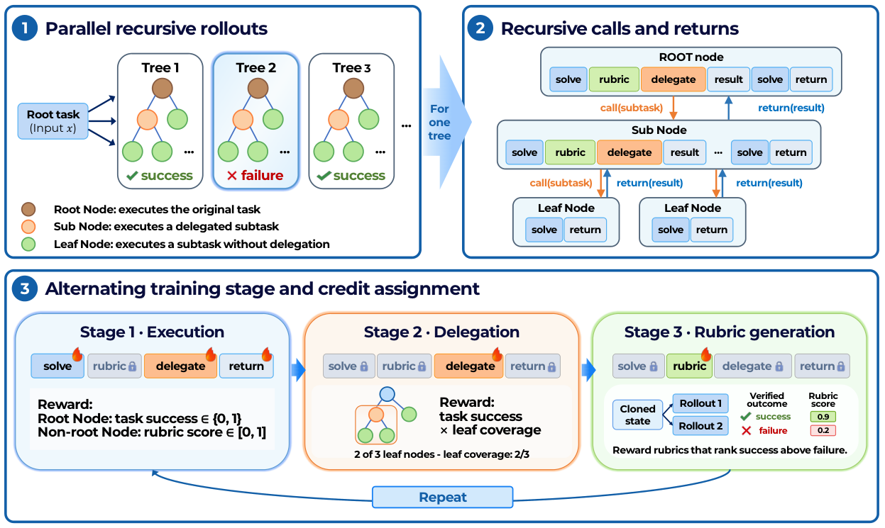

**Source figure / official image** — SERA's original Figure 2: recursive execution and three alternating training stages assign credit to execution, delegation/leaf coverage and rubric generation. · Figure 2 (training.png): recursive execution, leaf-coverage credit and rubric-generation credit assignment · [source](https://arxiv.org/html/2610.04902v1)

**nanoRSI reproduction** — not-run. Last source check: 2026-10-09.

**Open code / weights / data links** — [Official implementation](https://github.com/OliverLeeXZ/SERA) · [Third-party notices in implementation](https://github.com/OliverLeeXZ/SERA/tree/main/Runtime/licenses)

**Primary sources** — [arXiv abstract](https://arxiv.org/abs/2610.04902) · [arXiv HTML v1 and Figure 2](https://arxiv.org/html/2610.04902v1) · [Official implementation](https://github.com/OliverLeeXZ/SERA) · [Official checkpoint page](https://huggingface.co/Litux12138/SERA) · [Third-party notices in implementation](https://github.com/OliverLeeXZ/SERA/tree/main/Runtime/licenses)

### RSI-Master: Structuring Experiments to Guide Autonomous Model Improvement

**2026-09-28** · paper · Direct bounded loop

**Publication date** — arXiv v1 was first publicly announced on 2026-09-28 (2609.35561). The catalogue uses that first-public date rather than later indexing or revision dates.

**Institutional relationship** — The paper's author affiliations span Shanghai Jiao Tong University, University of Science and Technology of China, Shanghai AI Laboratory, Zhejiang University and UC Berkeley; the catalogue records the paper affiliations rather than treating the base model or benchmark as an institutional relationship.

**What changes and how feedback is reused** — RSI-Master changes the research harness around a frozen or separately trained model: an Experiment OS restricts low-level actions to inspectable CLI operations and structured artifacts, while a reviewer-guided research DAG lets workers explore distinct post-training directions and reviewers compare evidence before adding workers or promoting a recipe. The changing object is the experiment/research process and its persistent evidence, not an autonomous general model-weight loop.

**Author-reported result** — On PostTrainBench with Qwen3-4B-Base, the paper reports 54.49 average score versus 46.53 for its strongest agent baseline and a 0.0% hacking rate. At 35B, it reports 41.21 versus 37.36 for a human-developed Instruct model on LiveCodeBench-v6, plus gains on SciCode and a nonzero HorizonMath result. These are author-reported results under the paper's model, benchmark and compute conditions, not nanoRSI reproductions.

**Evidence limits** — The abstract and HTML expose the method and headline metrics, but no independently verified official code repository, released weights or redistributable benchmark-data bundle was located in this pass. The reported hacking rate depends on the authors' action restrictions and evaluator; the paper does not establish general RSI or transfer to nanoRSI. Full reproduction would require the named models, post-training datasets, benchmark environments and substantial compute.

**Code / weights / data / license** — Code: no official public repository verified. Weights: no RSI-Master checkpoint release verified. Data: no bundled PostTrainBench/HorizonMath data release verified; benchmark sources remain external. License: no project code or data license could be audited because no official repository/data bundle was located.

**Possible nanoRSI experiment — not implemented here** — Reuse only the portable control pattern: add an opt-in, offline research-DAG/evidence-ledger comparison around nanoRSI's existing evaluator. Compare a single direction, fixed multi-direction schedule and reviewer-gated direction expansion under matched calls, tokens, seeds and held-out tasks; record every worker proposal, reviewer decision, action restriction and rejected promotion. Do not claim the paper's benchmark gains locally and do not import unlicensed code.

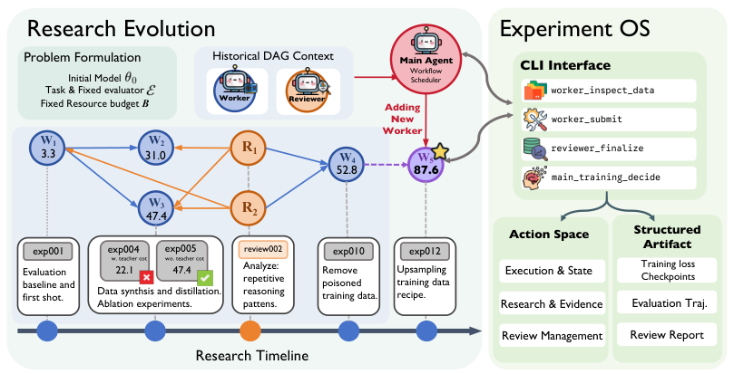

**Source figure / official image** — RSI-Master's original Figure 2: a reviewer-guided research DAG is coupled to an Experiment OS with restricted actions and structured training, evidence, evaluation and review artifacts. · Figure 2: RSI-Master methodology, Research Evolution and Experiment OS · [source](https://arxiv.org/html/2609.35561v2)

**nanoRSI reproduction** — not-run. Last source check: 2026-10-08.

**Open code / weights / data links** — No verified public code/asset link in the audited sources.

**Primary sources** — [arXiv abstract](https://arxiv.org/abs/2609.35561) · [arXiv HTML v2 and Figure 2](https://arxiv.org/html/2609.35561v2)

### RRSI: Regularized Recursive Self-Improvement of Agent Harnesses

**2026-09-21** · paper · Direct bounded loop

**Publication date** — arXiv v1 was first publicly announced on 2026-09-21; the repository was created on 2026-09-16 and its first README update is dated 2026-09-21. The paper date is used for the research record.

**Institutional relationship** — Google Cloud AI Research is the principal research affiliation; the author list also includes Stanford University, Washington University in St. Louis and UNC-Chapel Hill. The paper notes that Peng Xia did this work while a student researcher at Google Cloud AI Research.

**What changes and how feedback is reused** — Evolves a frozen-model agent harness through a bounded proposal→feedback→selection loop. Proposal-side controls anneal the number of bundled edits, use full edit history to assign credit and redirect stalled search toward untried components. Selection-side controls screen benchmark-specific logic, calibrate a noise-adjusted floor from repeated base evaluations, require added inference cost to be paid by measured gain, and prune components with no recent positive contribution. Accepted harness commits become the next incumbent; model weights remain frozen.

**Author-reported result** — With Claude Opus 4.8 frozen as policy and the same evolve budget, RRSI reports Terminal-Bench 2.1 74.2→80.2 (+6.0) and SWE-bench Verified 82.0→83.8 (+1.8), plus JobBench 36.0→40.7, GDPval 48.8→52.3 and APEX-Agents 34.2→37.9 on held-out/out-of-distribution evaluation. The paper reports up to +4.7 points out of distribution and 30% fewer policy tokens than unregularized evolution; with unseen Gemini 3.1 Flash Lite on the evolved coding harness, 11.2→14.6 (+3.4). These are author results, not nanoRSI reproductions.

**Evidence limits** — The backbone, proposer, analyst and leakage critic are provider-hosted models; the benchmarks and several runner environments are external and expensive. The method still depends on a finite evolve set, fixed regularization hyperparameters and noisy automated feedback. The paper explicitly does not study model-weight updates, and the public repository has no released weights or bundled benchmark-data snapshot.

**Code / weights / data / license** — Code: public at google-research/rrsi under Apache-2.0, including the search core and domain adapters. Weights: none released; experiments call hosted Claude/Gemini models. Data: benchmark sources and environment checkouts are external, with pinned commits or setup instructions rather than a redistributable bundle. License: repository Apache-2.0; third-party components retain their own licenses.

**Possible nanoRSI experiment — not implemented here** — Run a small offline ablation on nanoRSI's existing harness/skill candidate gate: compare current strict-improvement selection with a regularized arm that (1) estimates a noise band from repeated frozen evaluations, (2) records component-level edit credit across rounds, (3) caps bundled edits with a decreasing budget and (4) rejects extra measured cost without compensating gain. Keep the current arm, seeds, rejected candidates and held-out fixture panel frozen; report transfer, cost and rejection reasons before considering any default change.

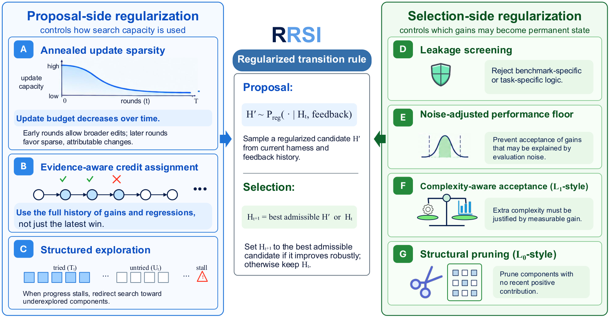

**Source figure / official image** — RRSI's original Figure 2: proposal-side regularization limits and explores harness edits, while selection-side regularization screens leakage, noise, cost and structural persistence before an edit becomes incumbent state. · Figure 2 (pipeline.png): proposal-side and selection-side regularization · [source](https://arxiv.org/html/2609.24972v1)

**nanoRSI reproduction** — not-run. Last source check: 2026-09-29.

**Open code / weights / data links** — [Google Research repository](https://github.com/google-research/rrsi) · [Repository license](https://raw.githubusercontent.com/google-research/rrsi/main/LICENSE)

**Primary sources** — [arXiv paper and HTML](https://arxiv.org/html/2609.24972v1) · [Google Research repository](https://github.com/google-research/rrsi) · [Repository license](https://raw.githubusercontent.com/google-research/rrsi/main/LICENSE) · [Project page](https://regularized-rsi.com/)

### Bad Genius: Counterfactual-Guided Harness Evolution Beyond Task-Specific Shortcuts

**2026-09-16** · paper · Direct bounded loop

**Publication date** — v1 2026-09-16; affiliations read from the paper HTML author block.

**Institutional relationship** — Academic consortium (UCAS × NUS × CAS-IA); no company affiliation shown.

**What changes and how feedback is reused** — A Proposer evolves the target agent's harness (prompts, memory, retrieval, tools, control code); a Challenger searches validity-preserving counterfactual variants of benchmark tasks, and a confirmation archive demotes harness edits whose gains do not survive the counterfactuals, targeting benchmark-wide shortcuts that per-task holdout misses.

**Author-reported result** — On OfficeQA (3 rollouts/question) the evolved harness reaches 68.42% R̂avg,A3 vs 66.23% for the raw harness (+2.19) and 30.37% vs 27.04% on the ProV2 slice (+3.33), with a synthetic benchmark (Syn-Ledger) isolating shortcut behaviour; the HarnessCompass comparison variant without the challenger scores below the raw harness.

**Evidence limits** — Modest absolute gains; evaluation limited to OfficeQA plus a synthetic benchmark; author-reported.

**Code / weights / data / license** — arXiv paper public; code not verified at last check.

**Possible nanoRSI experiment — not implemented here** — Transplant the challenger into nanoRSI's gate: re-score accepted candidates on auto-generated validity-preserving counterfactuals of the minimal task set; gains that vanish there are labelled shortcut, not skill.

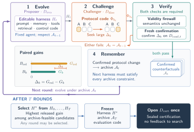

**Source figure / official image** — CHASE overview: a Proposer evolves the harness while a Challenger searches validity-preserving benchmark counterfactuals to neutralize benchmark-wide shortcuts. · Figure 2 (figure2_CHASE_pipeline.svg) · [source](https://arxiv.org/html/2609.18366v1)

**nanoRSI reproduction** — not-run. Last source check: 2026-09-18.

**Open code / weights / data links** — No verified public code/asset link in the audited sources.

**Primary sources** — [arXiv abstract](https://arxiv.org/abs/2609.18366) · [Paper HTML (affiliations, Figure 2, OfficeQA table)](https://arxiv.org/html/2609.18366v1)

### EvolveTrade: Experience-Driven Policy Refinement for Self-Evolving LLM Trading Agents

**2026-09-15** · paper · Direct bounded loop

**Publication date** — arXiv v1 2026-09-15; Sung Ju Hwang is jointly affiliated with KAIST and DeepAuto.ai.

**Institutional relationship** — Academic-led (KAIST) with one company co-author.

**What changes and how feedback is reused** — The trading agent system prompt is treated as a text-parameterized tool-calling policy: an independent Policy Agent rewrites it every five trading days from decision trajectories and portfolio outcomes, with the backbone LLM and tools frozen.

**Author-reported result** — GPT-5-mini, 15 US blue chips, mean of 3 runs: Sharpe 5.12 vs 2.87 and cumulative return 5.10% vs 3.30% for the static tool-calling agent in Nov 2025; 8.43/6.84% in the strongest window; honest negative in Feb 2026 (Sharpe −2.53 vs −1.54 for static); a 50-day long window holds SR 4.00 vs 2.94 with 10 bps fees.

**Evidence limits** — Author-reported backtests on 15 symbols with three seeds; one of three windows loses to the static policy; one backbone (Gemini-2.5-Flash in Apr 2026) shows the static base agent winning outright; no code release located.

**Code / weights / data / license** — arXiv paper public (CC BY 4.0); no code release located at verification.

**Possible nanoRSI experiment — not implemented here** — A minimal self-evolving-agent fixture with honest negatives: policy text changes only every N task batches from accumulated trajectory evidence, and per-window win/loss against the frozen policy is the published readout.

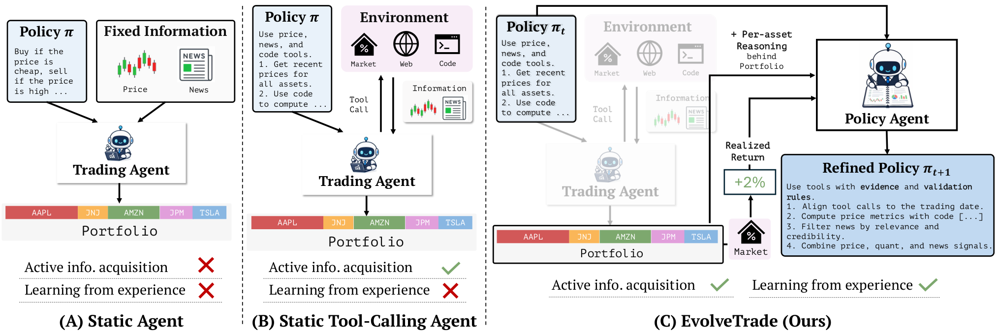

**Source figure / official image** — Concept: the static agent acts on a fixed channel; the static tool-calling agent retrieves but never learns; EvolveTrade closes the loop by refining the prompt-policy from its own experience. · Figure 1 (concept_evolvetrade.png) · [source](https://arxiv.org/html/2609.17632v1)

**nanoRSI reproduction** — not-run. Last source check: 2026-09-19.

**Open code / weights / data links** — No verified public code/asset link in the audited sources.

**Primary sources** — [arXiv abstract](https://arxiv.org/abs/2609.17632) · [Paper HTML (affiliations, Tables 3/4, Figure 1)](https://arxiv.org/html/2609.17632v1)

### ModularRSI: Modular and Generalizable Recursive Harness Self-Improvement

**2026-09-14** · paper · Direct bounded loop

**Publication date** — arXiv v1: 2026-09-14 (2609.14857), verified on the abs page.

**Institutional relationship** — Paper: Beihang University, University of Manchester, IQuest Research, M-A-P, Langboat and Hohai University (six superscript affiliations rendered in the HTML).

**What changes and how feedback is reused** — Contrastive analysis of successful versus failed trajectories on the same task drives independent evolution of five harness modules (Agent Loop, Tool Use, Observation Management, Context Management, Task Completion Detection), each within a restricted scope; a cross-module integration epoch then resolves conflicts (duplicates, responsibility, coordination) before the library is frozen. Evolution uses 2,000 human-curated executable tasks deliberately disjoint from evaluation benchmarks.

**Author-reported result** — TerminalBench 2.0 (DeepSeek-V4-Flash): accuracy 47.57→52.43, Pass@3 58.43→65.17 in-domain; the TB-evolved harness transfers to SWE-bench Verified at 73.40→76.45 in-domain and the SWE-evolved harness reaches 49.40 out-of-domain on TB. Frozen-harness cross-model transfer: GLM-5.2 59.55→61.80, MiniMax-2.5 41.57→44.94. Against baselines: 61.79→67.42 vs AHE 62.54 and Meta-Harness 62.92.

**Evidence limits** — Authors state they did not run a dedicated ablation isolating the contribution of contrastive trajectory analysis, and cost limited evolution experiments to a subset of the 2,000 instances.

**Code / weights / data / license** — No code repository URL located at verification; paper only (arXiv).

**Possible nanoRSI experiment — not implemented here** — For nanoRSI: decompose the harness into named modules with restricted edit scopes, evolve each against contrastive success/failure pairs on benchmark-disjoint executable tasks, and gate the merged library through an explicit conflict-resolution epoch before freezing.

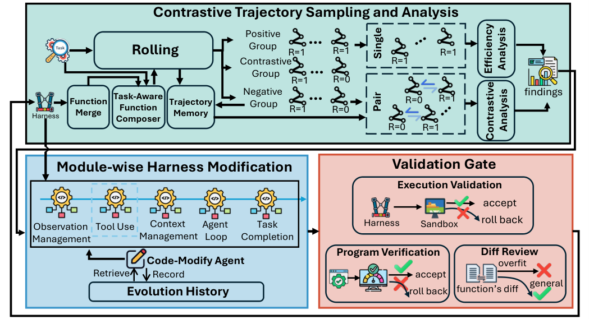

**Source figure / official image** — ModularRSI overview: contrastive trajectories feed independent evolution of five harness modules before conflict-resolving integration. · Figure 1 (S2.F1) · [source](https://arxiv.org/html/2609.14857v1)

**nanoRSI reproduction** — not-run. Last source check: 2026-09-17.

**Open code / weights / data links** — No verified public code/asset link in the audited sources.

**Primary sources** — [arXiv abstract](https://arxiv.org/abs/2609.14857) · [arXiv HTML v1](https://arxiv.org/html/2609.14857v1)

### (Self-Improving)² Coding Agents: Curating High-Quality Trajectories via Recursive Self-Improvement

**2026-09-11** · release · Direct bounded loop

**Publication date** — The official repository README dates the public code and trajectory-data release to 2026-09-11. The repository provides a method PDF and reports paper tables, but no separately verified arXiv or publisher record was found; this entry therefore uses the dated public release rather than inventing a paper date.

**Institutional relationship** — The public materials identify the Self-Improving-Coding-Agents project and contributors, but do not state a separate company or university affiliation. The organization field intentionally preserves that uncertainty.

**What changes and how feedback is reused** — At the turn level, a frozen backend model generates multiple candidate actions and selects them with self-judgement (rubric-weighted scoring with privileged information) or self-likelihood (length-normalized conditional likelihood). A separate recursive strategy-discovery loop reads past proposals, strategies, outcomes and accepted/rejected candidates, proposes when and how to branch, evaluates the strategy on validation tasks, and retains it only when accuracy improves or trajectories become shorter at comparable accuracy. The later SFT stage uses curated trajectories; this is persistent trajectory/strategy state, not an autonomous model-weight update loop.

**Author-reported result** — The README reports author results on SWE-bench Verified (500 tasks): Qwen3.5-35B-A3B self-judgement 70.0% versus 65.8% standard (+4.2) and self-likelihood 66.8%; Qwen3.5-122B-A10B self-judgement 71.0% versus 67.0% (+4.0) and self-likelihood 69.8%. On SWE-bench Pro (731 tasks), 122B self-judgement is 58.5% versus 48.0% (+10.5). On DeepSWE (113 tasks), four Terra runs report 67.5±2.5% versus 64.4±2.0% standard, with mean turns 52.3 versus 59.3. These are project-reported results, not nanoRSI reproductions.

**Evidence limits** — The public source is a release repository with a method diagram and README tables rather than a separately verified paper artifact. Full benchmark execution needs model endpoints or large self-hosted models, Docker-compatible task sandboxes, external benchmark inputs and substantial compute; the README's DeepSWE comparison uses four independent runs for Terra but one run for Luna. The reported gains therefore do not establish general RSI, model-weight self-improvement or transfer to nanoRSI.

**Code / weights / data / license** — Code: public in Self-Improving-Coding-Agents/SI2CA under Apache-2.0. Weights: no project checkpoint release was verified; the instructions use external Qwen checkpoints or API/self-hosted endpoints. Data: SI2CA-Training-Trajectories is public on Hugging Face and its dataset card declares CC-BY-4.0; benchmark task images and source inputs remain external or separately licensed. License: code and data terms are distinct.

**Possible nanoRSI experiment — not implemented here** — Reuse only the inspectable part: add a bounded strategy-discovery arm to nanoRSI's existing evidence ledger, with fixed executor/evaluator and frozen held-out tasks. Compare no strategy search, fixed strategy and recursive proposal of branch timing under matched calls, tokens and seeds; record every accepted/rejected strategy and whether shorter traces preserve held-out success. Do not import SI2CA's training stack or call the reported benchmark gains local evidence.

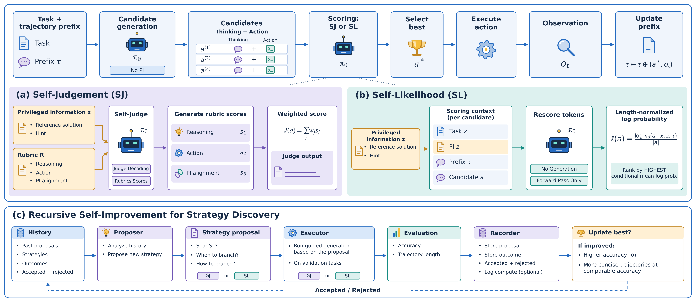

**Source figure / official image** — Official SI2CA Figure 1: turn-level self-judgement/self-likelihood selection and the outer recursive strategy-discovery loop over history, proposals, evaluation and accepted/rejected outcomes. · README Figure 1; linked editable method overview PDF · [source](https://github.com/Self-Improving-Coding-Agents/SI2CA/blob/main/docs/static/images/method.png)

**nanoRSI reproduction** — not-run. Last source check: 2026-10-07.

**Open code / weights / data links** — [Official repository README](https://github.com/Self-Improving-Coding-Agents/SI2CA) · [Repository license](https://raw.githubusercontent.com/Self-Improving-Coding-Agents/SI2CA/main/LICENSE) · [Training trajectories dataset](https://huggingface.co/datasets/Self-Improving-Coding-Agents/SI2CA-Training-Trajectories)

**Primary sources** — [Official repository README](https://github.com/Self-Improving-Coding-Agents/SI2CA) · [Method overview PDF](https://raw.githubusercontent.com/Self-Improving-Coding-Agents/SI2CA/main/data/method_editable.pdf) · [Repository license](https://raw.githubusercontent.com/Self-Improving-Coding-Agents/SI2CA/main/LICENSE) · [Training trajectories dataset](https://huggingface.co/datasets/Self-Improving-Coding-Agents/SI2CA-Training-Trajectories) · [Dataset card](https://huggingface.co/datasets/Self-Improving-Coding-Agents/SI2CA-Training-Trajectories#dataset-card-for-si2ca-training-trajectories)

### HarnessDev: Can LLMs Create and Evolve Their Own Agent Harness?

**2026-09-01** · paper · Direct bounded loop

**Publication date** — arXiv v1: 2026-09-01; shared Self-Developing Agents project page also dated September 1.

**Institutional relationship** — All listed affiliations appear explicitly in the paper, with ByteDance Seed as a research participant.

**What changes and how feedback is reused** — Creation builds a runnable harness from a weak seed; Evolution repeatedly edits that persistent harness using downstream execution feedback. Official versions are frozen and later evaluated on hidden tasks, measuring reuse across tasks rather than single-output repair. Runtime-model controls test portability.

**Author-reported result** — Across nine single evolution trajectories, visible and held-out score directions agree on 34/64 adjacent version switches (53.1%); only 2/9 declared final versions are held-out best. Creation covers six creators, four domains and 2,207 downstream instances.

**Evidence limits** — A benchmark of bounded direct loops, not proof of stable compounding. Selected final artifacts can regress, and gains depend on the executor.

**Code / weights / data / license** — Paper and project page public; paper CC BY-NC-ND 4.0. A downloadable benchmark code/data repository, derived weights and their licenses were not verified. Do not label the project as an open-code release.

**Possible nanoRSI experiment — not implemented here** — Proposed nanoRSI coding study: freeze every candidate, retain the complete score trajectory, and measure development/held-out direction agreement under a fixed executor.

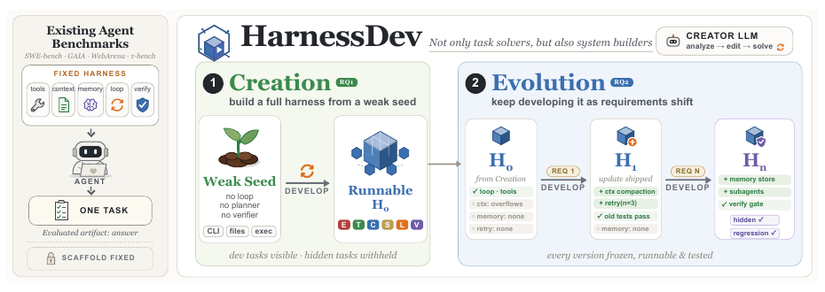

**Source figure / official image** — Figure 1: Creation builds a runnable harness from a weak seed, then Evolution repeatedly edits the persistent harness with execution feedback. · Figure 1, PDF p.2 · [source](https://arxiv.org/html/2609.01437v1)

**nanoRSI reproduction** — not-run. Last source check: 2026-09-13.

**Open code / weights / data links** — No verified public code/asset link in the audited sources.

**Primary sources** — [arXiv first submission](https://arxiv.org/abs/2609.01437) · [Paper v1](https://arxiv.org/html/2609.01437v1) · [Official Self-Developing Agents project](https://self-developing-agents.github.io/)

### HELIX: Model-Harness Co-evolution for Recursive Self-Improvement

**2026-08-14** · paper · Direct bounded loop

**Publication date** — arXiv v1 submitted 2026-08-14; no revisions. Surfaced via lobehub/awesome-rsi (added 2026-10-12) and primary-verified on 2026-10-15; the two-month gap between publication and pickup is recorded rather than hidden.

**Institutional relationship** — Tianyu Fan and Chao Huang, The University of Hong Kong (the paper's code is published under the HKUDS organization).

**What changes and how feedback is reused** — Two coupled timescales. Within a task, a harness mediates context, tool results, permissions and control flow around a fixed model. Across rounds, a portfolio of evolved harnesses (65 candidates) is run on the same tasks so verified sibling trajectories supply the update signal for the next model (SFT, critic, filter and preference records); the updated model's changed capability profile then conditions the next harness rebuild. HELIX itself is an auditable, source-traceable substrate that decomposes agent systems into typed ports, atoms, recipes, shells and policies with retained trajectories and provenance.

**Author-reported result** — On code repair (SWE-bench): the best fixed harness adds 4.0% task coverage over the Pi harness; the full 65-candidate portfolio exposes up to 58.0% more verified coverage through complementary sibling behavior; a 200-slot sibling slice yields 438 verified training records (SFT, critic, filter, preference).

**Evidence limits** — Headline numbers verified at abstract level; the portfolio-vs-single gap (58.0%) is a coverage-exposure metric rather than a benchmark score; evaluation domain shown is code repair only.

**Code / weights / data / license** — MIT-licensed code at github.com/HKUDS/HELIX (LICENSE verified 2026-10-15). Paper under arXiv non-exclusive license (CC BY 4.0 per abs page).

**Possible nanoRSI experiment — not implemented here** — The verified-sibling-slice idea maps directly onto nanoRSI's frozen panels: every gate attempt, accepted or rejected, produces panel trajectories that can be distilled as training data instead of being discarded - the evidence ledger already records them. The typed-port decomposition is also a vocabulary for declaring which surface a candidate edits (ADOPTION item 40's ledger schema).

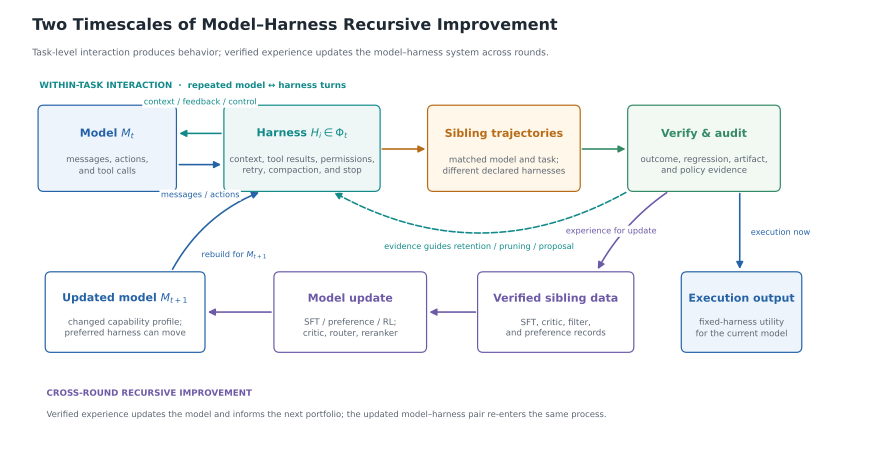

**Source figure / official image** — Original Figure 1: the two timescales of model-harness recursive improvement - within a task the harness guides the model, and across rounds verified sibling trajectories update the model whose new profile conditions the next harness rebuild. · Figure 1 (harness-model-coevolution.svg): two timescales of model-harness recursive improvement - within-task harness/model interaction above, verification-gated update and rebuild below · [source](https://arxiv.org/html/2608.13951v1)

**nanoRSI reproduction** — not-run. Last source check: 2026-10-15.

**Open code / weights / data links** — [HKUDS/HELIX (MIT)](https://github.com/HKUDS/HELIX)

**Primary sources** — [arXiv abstract](https://arxiv.org/abs/2608.13951) · [arXiv HTML v1](https://arxiv.org/html/2608.13951v1) · [HKUDS/HELIX (MIT)](https://github.com/HKUDS/HELIX)

### Qwen3.8-Max: A New Bar for Coding and Cowork (self-evolving harness demonstrations)

**2026-08-03** · report · Direct bounded loop

**Publication date** — Official Qwen team blog post dated 2026/08/03 announcing Qwen3.8-Max (2.4T parameters, 95B active); open weights were promised the following week on this page.

**Institutional relationship** — Alibaba's Qwen team reporting on its own flagship model and demonstration runs; all numbers are self-reported on the official blog.

**What changes and how feedback is reused** — Three long-horizon demonstrations in which the model modifies its own working infrastructure through feedback loops: (1) building the oh-my-cli project from an empty folder over a 10+ day autonomous run with an issue state machine, dispatcher, monitor and watchdog — 'requirements are normalized into issues, automatically claimed and executed by agents, and continuously iterated through code, tests, previews, and logs'; (2) reproducing the paper 'Unified Data Selection for LLM Reasoning' from scratch (~125 hours, ~7,600 lines, 33 GPU training rounds) and then running a hypothesis→code→GPU→analysis self-improvement loop over 18 self-generated ideas in four rounds; (3) competition leaderboard iteration.

**Author-reported result** — Self-reported: the autonomous oh-my-cli run accumulated 265 commits, 127 PRs and 151 issues over ~16 days (as of July 30, 2026); the research-reproduction loop first reproduced the paper's six findings (its selection method beats random +7.7% on AIME24) and then evolved a method beating the paper's own approach by +2.7 points on AIME24.

**Evidence limits** — Demonstrations, not controlled experiments: no baseline harness, fixed-seed comparator or cost control is published for the harness run, and the +2.7 AIME24 gain is a single-model self-reported result without variance or independent verification. Open-weight status at audit time: weights were promised publicly but release was not yet verified in this run.

**Code / weights / data / license** — Official blog post; the demonstration repository github.com/qwen-code-dev-bot/oh-my-cli is public (Apache-2.0, created 2026-07-13) with the full trace; model weights release was announced but not yet verified in this audit.

**Possible nanoRSI experiment — not implemented here** — Proposed: a minimal issue-loop harness in which nanoRSI's improver claims, implements and verifies its own repository issues, comparing accepted-diff yield and regression rate against a fixed-plan control on the same issue stream.

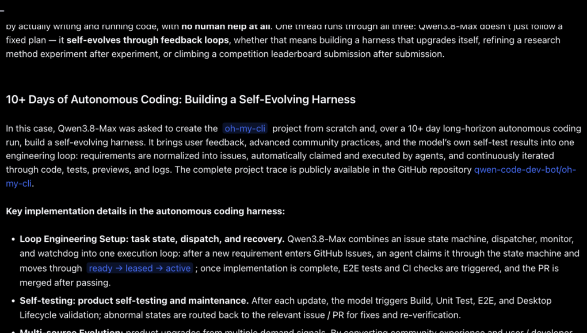

**Source figure / official image** — The blog section describing the 10+ day autonomous run: 'it self-evolves through feedback loops', with the oh-my-cli issue-claiming loop (state machine, dispatcher, monitor, watchdog) and self-testing details. · Section '10+ Days of Autonomous Coding: Building a Self-Evolving Harness' · [source](https://qwen.ai/blog?id=qwen3.8)

**nanoRSI reproduction** — not-run. Last source check: 2026-09-14.

**Open code / weights / data links** — [Demonstration repository with full trace (Apache-2.0)](https://github.com/qwen-code-dev-bot/oh-my-cli)

**Primary sources** — [Official Qwen blog post (opened via browser)](https://qwen.ai/blog?id=qwen3.8) · [Demonstration repository with full trace (Apache-2.0)](https://github.com/qwen-code-dev-bot/oh-my-cli)

### DarwinX: Evolving Agent Harnesses Through Natural Selection

**2026-07-31** · paper · Direct bounded loop

**Publication date** — DarwinX was first submitted on 2026-07-31; the official Beagle implementation was open-sourced on 2026-09-02. The catalogue uses the paper's first-public date and records the later repository release separately.

**Institutional relationship** — The paper and official implementation are from Salesforce AI Research; Beagle is maintained in the SalesforceAIResearch GitHub organization.

**What changes and how feedback is reused** — Beagle treats an agent harness as the evolvable object and provides evaluation/evolution backends, benchmark-native rollout engines and an agent factory. DarwinX freezes model weights, proposes harness variants through an evolver, scores them with each benchmark's verifier, admits preserve-and-extend candidates without regression, and retains alternative lineages for recombination.

**Author-reported result** — Authors report on GPT-5.5 high with Monet: Terminal-Bench 2.1 pass@5 rises 75.5 to 83.2 (+7.7 points), TerminalWorld pass@1 48.8 to 56.1 (+7.3), WebArena-Infinity pass@1 43.5 to 93.0 (+49.5), and SWE-bench Verified pass@1 80.8 to 84.2 (+3.4). TerminalWorld uses a train/test split and the evolved harness transfers unchanged to SWE-bench.

**Evidence limits** — These are author-reported results, not a local reproduction. The largest WebArena delta includes a browser_execute action addition. The release requires Docker, uv, provider credentials and benchmark infrastructure. Weights do not evolve; the demonstrated recursive surface is bounded harness revision and population selection, not open-ended improvement.

**Code / weights / data / license** — Beagle and the official DarwinX implementation are public under Apache-2.0. No model weights or benchmark datasets are released; the system expects benchmark-native task caches and user-provided harness repositories.

**Possible nanoRSI experiment — not implemented here** — Proposed: add a small population mode around nanoRSI's frozen evaluator, preserving raw candidate deltas, rollback-selected deltas and alternative lineage metadata; compare single-lineage reuse with preserve-and-extend selection under the same task stream and budget. Do not vendor Beagle or its dependency stack into the stdlib core.

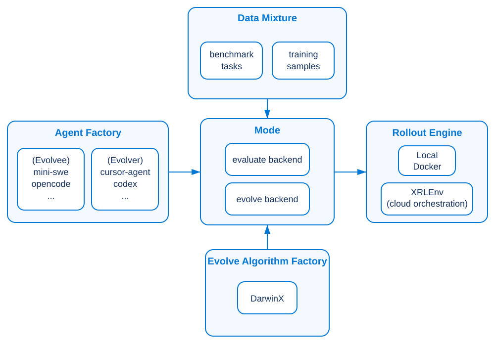

**Source figure / official image** — Official Beagle architecture: benchmark data and agent factories feed evaluation/evolution backends, rollout engines and the DarwinX evolution algorithm. · Official project architecture figure · [source](https://github.com/SalesforceAIResearch/Beagle/blob/main/docs/assets/beagle-architecture.svg)

**nanoRSI reproduction** — not-run. Last source check: 2026-09-21.

**Open code / weights / data links** — [Official Beagle repository](https://github.com/SalesforceAIResearch/Beagle) · [Beagle Apache-2.0 license](https://github.com/SalesforceAIResearch/Beagle/blob/main/LICENSE.txt)

**Primary sources** — [DarwinX paper v1](https://arxiv.org/abs/2608.07545) · [Official Beagle repository](https://github.com/SalesforceAIResearch/Beagle) · [Beagle Apache-2.0 license](https://github.com/SalesforceAIResearch/Beagle/blob/main/LICENSE.txt) · [Official Beagle architecture figure](https://github.com/SalesforceAIResearch/Beagle/blob/main/docs/assets/beagle-architecture.svg)

### AgentDescent: Gradient descent, but the parameters are agents

**2026-07-26** · release · Enabling technique / evaluation

**Publication date** — First PyPI release 0.1.0 on 2026-07-26; 0.5.0 (2026-09-07) is the latest at verification. MIT-licensed, zero-required-dependency core (Python ≥3.9); Zenodo DOI 10.5281/zenodo.22348027 carries the methods write-up. The README self-describes as a research reference implementation, not a production system.

**Institutional relationship** — Independent open-source project (author Danyang Chen per the Zenodo citation); no institutional affiliation stated in README or PyPI at verification.

**What changes and how feedback is reused** — A multi-worker engine for self-evolution algorithms: workers propose diffs to a shared artifact in parallel; an aggregator merges accepted proposals into a git-versioned ledger. The key space of the strategy decides whether concurrent proposals can fuse at all — reflective merge fuses semantically where a keyed union never can. Ships faithful ports of about twenty published self-evolution algorithms (GEPA, ACE, ADAS, DGM and others), with divergences documented and analogues explicitly not citable as benchmarks.

**Author-reported result** — On BBH dyck_languages (GLM-5.2, N=4, four seeds): reflective merge fuses 42 of 48 merge opportunities where a keyed union fuses 0 of 48. At a pinned rollout budget: 40% fewer model calls (95% CI 27–54%, same direction on every seed); median 6.8× wall-clock speedup versus a faithful serial control (three seeds, 3.1–9.5×); one-call path held-out exact match 0.167 → 0.583 (40 HotpotQA items, 12 held out).

**Evidence limits** — Self-run benchmarks reported in README/docs with intervals rather than peer review; scale is small (N=4 rollouts, tens of items); the engine is infrastructure — improvement claims belong to the ported algorithms it reproduces.

**Code / weights / data / license** — MIT-licensed; PyPI package agentdescent; core has zero required dependencies; Zenodo DOI for the methods write-up; GitHub Releases empty (releases via PyPI).

**Possible nanoRSI experiment — not implemented here** — The merge-policy lesson is the transplant for nanoRSI population mode: when parallel candidates edit one shared artifact, a keyed/positional union silently drops overlapping work — candidate merging needs semantic (reflective) fusion, and the fused result should land in a versioned ledger like any other accepted candidate.

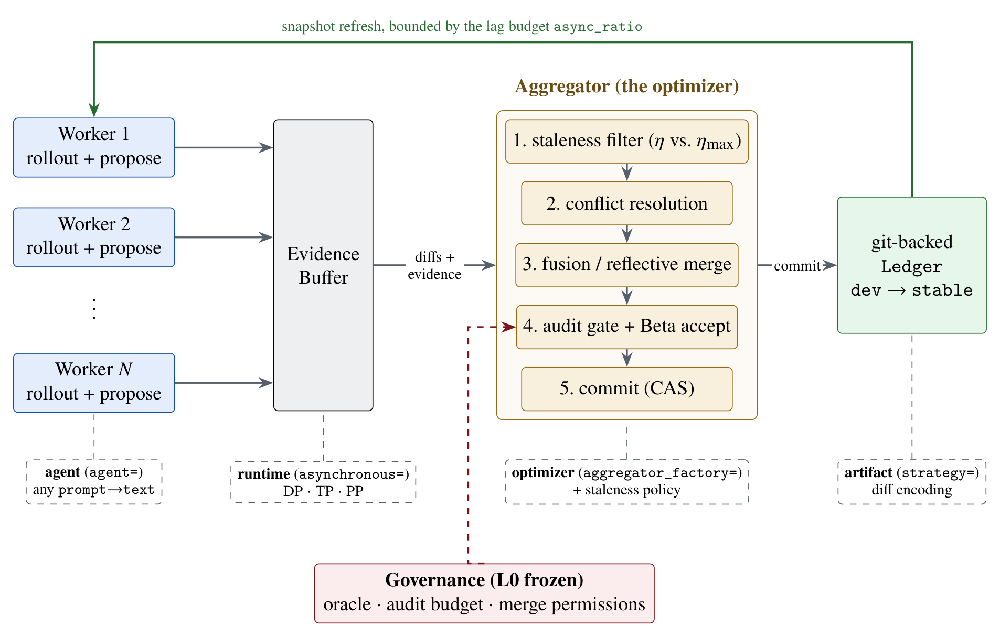

**Source figure / official image** — agentdescent architecture: workers propose diffs in parallel; the ledger versions the shared artifact; the aggregator reflects and merges; evaluation feeds back the next round. · docs/assets/architecture.png in the repository · [source](https://github.com/Birfy/agentdescent/blob/main/docs/assets/architecture.png)

**nanoRSI reproduction** — not-run. Last source check: 2026-09-20.

**Open code / weights / data links** — [GitHub repository](https://github.com/Birfy/agentdescent) · [README (results and license)](https://raw.githubusercontent.com/Birfy/agentdescent/main/README.md) · [PyPI release history](https://pypi.org/pypi/agentdescent/json)

**Primary sources** — [GitHub repository](https://github.com/Birfy/agentdescent) · [README (results and license)](https://raw.githubusercontent.com/Birfy/agentdescent/main/README.md) · [PyPI release history](https://pypi.org/pypi/agentdescent/json)

### PenguinHarness: Harness for RSI. Let AI Build AI

**2026-07-19** · release · Direct bounded loop

**Publication date** — First public release v0.0.1 on 2026-07-19 (self-described first public release, CI-published); v0.2.13 on 2026-09-16 is the latest at verification (a re-cut of a failed v0.2.12). Apache-2.0; team credits Yaowei Zheng (LlamaFactory author) and the PrismShadow AI Team.

**Institutional relationship** — Independent company team (Prism Shadow); no university affiliation claimed.

**What changes and how feedback is reused** — A local-first multi-agent auto-dev platform (desktop app, CLI, npm, Docker; 1000+ models with DeepSeek-class open models as the advertised default) whose native self-evolution engine has an agent evaluate and optimize itself: run the benchmark, find the lost points, ship version N+1, with a snapshot before every round and every request inspectable in a Trace view; agents can also author and optimize their own skills.

**Author-reported result** — Self-reported marketing-grade claims at verification: best accuracy on data analysis at 1/70 of Claude Code’s cost; a chart captioned as leading the data-analysis suite and tying OpenAI Codex on coding; a full RAG demo app generated for $0.02 of tokens on DeepSeek V4 Pro. No benchmark methodology, suite or raw numbers published alongside these claims (public benchmark-suite release is a roadmap item).

**Evidence limits** — Headline numbers are self-reported marketing claims without published methodology; the benchmark suite is not yet public; 2.3k-star project under rapid iteration (release cadence in days); no peer-reviewed evaluation.

**Code / weights / data / license** — Apache-2.0; npm package @prismshadow/penguin-core; Docker images; website penguin.ooo; releases on GitHub (v0.2.13 latest at verification).

**Possible nanoRSI experiment — not implemented here** — The traceability discipline is worth copying even before the claims are verifiable: snapshot before every self-evolution round and keep every request inspectable, so a self-modifying agent’s history is replayable — the same property nanoRSI’s evidence ledger enforces.

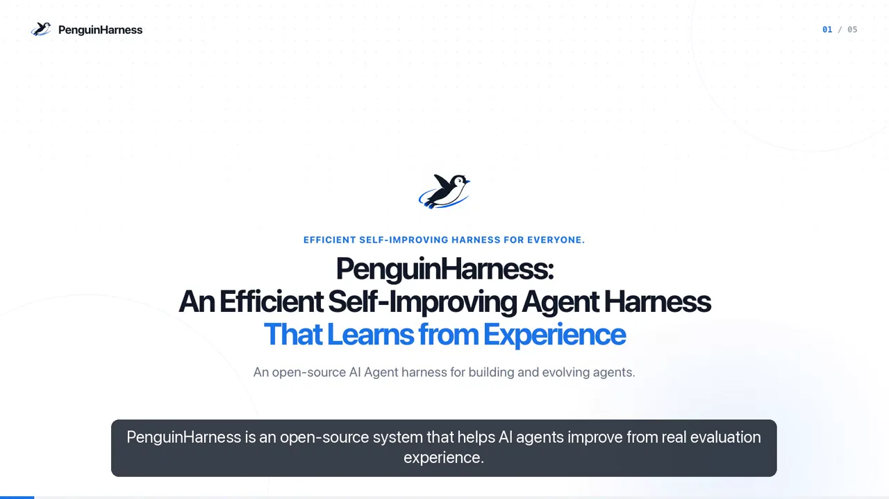

**Source figure / official image** — PenguinHarness self-evolution engine poster: run the benchmark, find the lost points, ship version N+1, with snapshots and inspectable traces. · Official site self-evolution poster (benchmark → find the lost points → ship vN+1) · [source](https://penguin.ooo/assets/evo-poster-en-Bp4EWVlL.webp)

**nanoRSI reproduction** — not-run. Last source check: 2026-09-20.

**Open code / weights / data links** — [GitHub repository](https://github.com/Prism-Shadow/penguin-harness) · [README (mechanism and claims)](https://raw.githubusercontent.com/Prism-Shadow/penguin-harness/main/README.md)

**Primary sources** — [GitHub repository](https://github.com/Prism-Shadow/penguin-harness) · [README (mechanism and claims)](https://raw.githubusercontent.com/Prism-Shadow/penguin-harness/main/README.md) · [Website](https://penguin.ooo/)

### Evolving Agents in the Dark: Retrospective Harness Optimization via Self-Preference

**2026-06-04** · paper · Direct bounded loop

**Publication date** — arXiv v1 2026-06-04; surfaced 2026-09-19 during a catch-up sweep of company lines — a June miss, not a new paper.

**Institutional relationship** — Company-academic (MSRA with City University of Hong Kong).

**What changes and how feedback is reused** — Harness optimization without labels or validation feedback: a DPP-selected coreset of past tasks is re-solved in groups, diagnosis cues are distilled from the trajectories, a full-stack harness (instructions, skills, executable tools) is rewritten, and the agent itself ranks candidates pairwise (self-preference) to pick the best of N=3.

**Author-reported result** — Codex (GPT-5.5 high) one optimization round: SWE-Bench Pro 0.59→0.78, Terminal-Bench 2 0.71→0.76, GAIA-2 0.29→0.37; beats feedback-free baselines (Dynamic Cheatsheet/ReasoningBank/Sleep-time Compute) on all three; validation-feedback Meta-Harness needs 10 rounds (≈3.1× compute, labels) to reach 0.80.

**Evidence limits** — Self-preference can mis-rank (ablation: chosen candidates avoid the worst but not always the empirically best); group rollout assumes cleanly resettable environments; authors warn mistaken self-preferences could amplify unsafe behavior.

**Code / weights / data / license** — MIT code at github.com/wbopan/retro-harness (56 stars at verification, last push 2026-06-12).

**Possible nanoRSI experiment — not implemented here** — nanoRSI run archives already store candidate trees; RHO shows how to reuse them label-free — re-solve a difficulty-diverse coreset under each candidate, then self-rank. This extends ADOPTION 22 with a no-oracle mode.

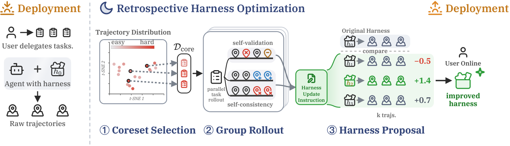

**Source figure / official image** — The RHO pipeline: coreset selection picks a difficulty-diverse subset of past tasks, group rollout re-solves them, and diagnosis plus self-preference ranking rewrite the harness. · Figure 2 (fig2-pipeline.png) · [source](https://arxiv.org/html/2606.05922v1)

**nanoRSI reproduction** — not-run. Last source check: 2026-09-19.

**Open code / weights / data links** — [Code repository](https://github.com/wbopan/retro-harness)

**Primary sources** — [arXiv abstract](https://arxiv.org/abs/2606.05922) · [Paper HTML (affiliations, results, Figure 2)](https://arxiv.org/html/2606.05922v1) · [Code repository](https://github.com/wbopan/retro-harness)

### Combee: Scaling Prompt Learning for Self-Improving Language Model Agents

**2026-04-05** · paper · Enabling technique / evaluation

**Publication date** — arXiv v1 2026-04-05; the COLM 2026 accepted list (verified 2026-09-18) uses a slightly different title wording.

**Institutional relationship** — Academic (Stanford × Berkeley systems/ML groups) with two company co-authors.

**What changes and how feedback is reused** — Parallel scans, an augmented shuffle mechanism and a dynamic batch-size controller let many agents run prompt learning in parallel and learn from combined traces without quality loss — scaling the self-improvement loop horizontally instead of sequentially.

**Author-reported result** — Up to 17× speedup over previous prompt-learning methods with comparable or better accuracy and equivalent cost, on AppWorld, Terminal-Bench, Formula and FiNER (DeepSeek-V3.1 backbone in the headline snapshot).

**Evidence limits** — Author-reported; speedups measured against prior prompt-learning pipelines rather than single-run quality ceilings; agent-task scope only.

**Code / weights / data / license** — arXiv paper public; code not verified at last check.

**Possible nanoRSI experiment — not implemented here** — nanoRSI's population runs already parallelize evaluation; Combee's transferable piece is the mid-run shuffle — candidates periodically exchange learned prompt content before generation boundaries.

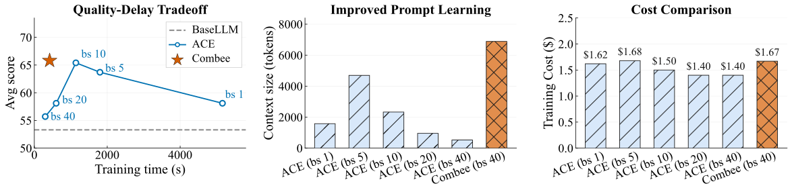

**Source figure / official image** — Combee reaches close-to-optimal prompt quality at significantly reduced training time by raising the content learnt under high parallelism. · Figure 1 (intro_fig.svg) · [source](https://arxiv.org/html/2604.04247v1)

**nanoRSI reproduction** — not-run. Last source check: 2026-09-18.

**Open code / weights / data links** — No verified public code/asset link in the audited sources.

**Primary sources** — [arXiv abstract](https://arxiv.org/abs/2604.04247) · [Paper HTML (affiliations, Figure 1)](https://arxiv.org/html/2604.04247v1)

### GenericAgent: A Token-Efficient Self-Evolving LLM Agent via Contextual Information Density Maximization (V1.0)

**2026-04** · paper · Direct bounded loop

**Publication date** — arXiv v1: April 2026 (2604.17091). Exact v1 day not re-verified; month precision used. The repository (lsdefine/GenericAgent, MIT) reached 14.2K stars by verification time.

**Institutional relationship** — Paper credited to the Advantage AI Agent Lab (A3 Lab), 'a joint research lab with members from Shenzhen Aquaintelling Technology and Fudan University'; no individual authors listed.

**What changes and how feedback is reused** — A unified agent loop (~92-line core inside a ~3,300-line codebase, >160x smaller than OpenClaw) constructs execution context from task plus memory and a two-level skill tree of categories and named skills with usage counters. A curriculum planner scores skill candidates (benefit, difficulty, usage, interest; weights 0.3/0.2/0.3/0.2) and adapts weights by reflection; each task ends with skill consolidation - archiving the Markdown report, updating the tree, incrementing counters - so the deployed artifact grows monotonically while the loop stays small.

**Author-reported result** — Lifelong AgentBench: 100% accuracy at 222K input tokens vs OpenClaw 70% at 1.43M and Claude Code 75% at 800K (~6.4x token advantage - the repository's '6x' claim). Long-horizon tasks 100% at 188.8K tokens vs Claude Code 537K. Self-evolution round #1 -> #9: 222,203 -> 23,010 tokens (-89.6%), 7m30s -> 1m38s, 32 -> 5 LLM calls. Prompt after 20 skills: 2,298 tokens vs Claude Code 22,821, OpenClaw 43,321. Cross-task savings 61.0-92.4% (overall 79.3%).

**Evidence limits** — 30-round context cap forces long research across sessions; the adaptive weight adjustment lacks long-term validation; the self-improvement log is manually curated; skill-tree merging/deprecation is manual.

**Code / weights / data / license** — Code at github.com/lsdefine/GenericAgent (MIT, 14,200 stars at verification).

**Possible nanoRSI experiment — not implemented here** — For nanoRSI: proof that a minimal seed loop with skill consolidation can beat million-line harnesses on token efficiency - nanoRSI's stdlib-only kernel is the same bet; add usage counters and per-skill prompt isolation as the cheapest first step.

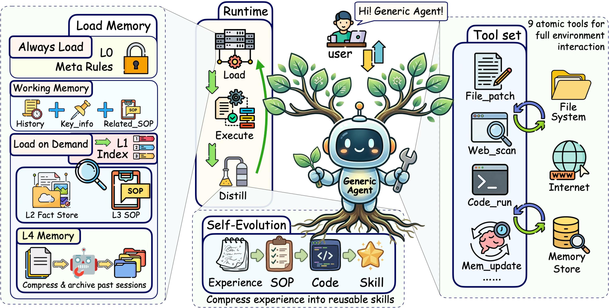

**Source figure / official image** — Figure 2: GenericAgent's unified loop - execution context from task, memory and a two-level skill tree; a curriculum planner scores skills and every task ends with skill consolidation (archive report, update tree, increment counters). · Figure 2 · [source](https://arxiv.org/html/2604.17091v1)

**nanoRSI reproduction** — not-run. Last source check: 2026-09-21.

**Open code / weights / data links** — [Code repository (MIT)](https://github.com/lsdefine/GenericAgent)

**Primary sources** — [arXiv abstract](https://arxiv.org/abs/2604.17091) · [Paper v1 (Figure 2, token/cost tables)](https://arxiv.org/html/2604.17091v1) · [Code repository (MIT)](https://github.com/lsdefine/GenericAgent)

### MiniMax M2.7: Early Echoes of Self-Evolution

**2026-03-18** · report · Direct bounded loop

**Publication date** — Official report dated 2026-03-18. Related M2-series technical paper first appeared 2026-05-26; its July revision is not the original M2.7 event.

**Institutional relationship** — First-party MiniMax report; the related technical paper is the MiniMax-M2 series report.

**What changes and how feedback is reused** — An internal M2.7 agent reads failure trajectories, proposes edits to scaffold code and sampling settings, evaluates them, and keeps or reverts changes for subsequent rounds. A separate research workflow updates memory/skills while helping researchers run RL experiments; that workflow retains human direction and critical decisions.

**Author-reported result** — MiniMax reports over 100 autonomous scaffold iterations and a 30% improvement on internal programming evaluations. Absolute baseline, evaluation-set identity and uncertainty are undisclosed, so the number is not independently comparable.

**Evidence limits** — First-party internal experiment, not a reproduced result. Assisted model R&D and scaffold self-editing do not establish fully autonomous successor-model training.

**Code / weights / data / license** — M2.7 weights are public. Current model LICENSE is custom non-commercial; commercial use requires written authorization. The internal self-evolution harness, evaluation data and complete training pipeline were not verified as public.

**Possible nanoRSI experiment — not implemented here** — Proposed nanoRSI coding experiment: constrain mutations to scaffold files, freeze the executor, and audit keep/revert decisions on a hidden test split.

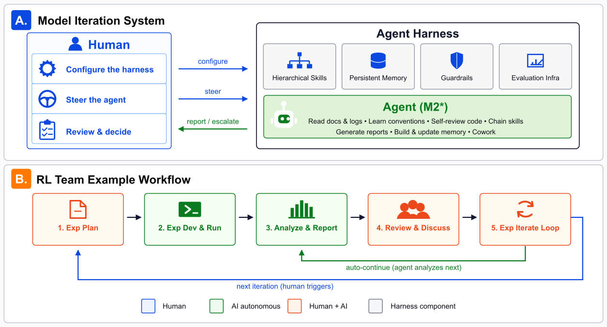

**Source figure / official image** — Figure 8: Model Iteration System and the dual-loop workflow used in M2.7 self-evolution. · Figure 8 · [source](https://arxiv.org/html/2605.26494v1)

**nanoRSI reproduction** — not-run. Last source check: 2026-09-13.

**Open code / weights / data links** — [Official M2.7 model](https://huggingface.co/MiniMaxAI/MiniMax-M2.7) · [Current M2.7 non-commercial license](https://huggingface.co/MiniMaxAI/MiniMax-M2.7/blob/main/LICENSE)

**Primary sources** — [Official M2.7 report](https://www.minimax.io/news/minimax-m27-en) · [Related M2-series technical paper dates](https://arxiv.org/abs/2605.26494) · [Related M2-series paper v1](https://arxiv.org/html/2605.26494v1) · [Official M2.7 model](https://huggingface.co/MiniMaxAI/MiniMax-M2.7) · [Current M2.7 non-commercial license](https://huggingface.co/MiniMaxAI/MiniMax-M2.7/blob/main/LICENSE)

### Meta-Harness: End-to-End Optimization of Model Harnesses

**2026-03** · paper · Direct bounded loop

**Publication date** — arXiv v1: March 2026 (2603.28052); the Terminal-Bench 2.0 artifact repository was created 2026-03-26. Exact v1 day not re-verified; month precision used.

**Institutional relationship** — Paper: Yoonho Lee, Roshen Nair, Qizheng Zhang, Chelsea Finn (Stanford), Kangwook Lee (KRAFTON), Omar Khattab (MIT).

**What changes and how feedback is reused** — An outer search loop over task-harness code: a coding-agent proposer (Claude Code / Opus 4.6) reads a growing filesystem holding every prior candidate's source code, execution traces and scores (via grep/cat tools), proposes a new single-file harness controlling prompting, retrieval, memory and orchestration, evaluates it, and logs everything as a new directory. A Pareto frontier (accuracy vs context cost) replaces hard-coded parent selection; ~60 harnesses over 20 iterations. Ablation: full-trace access is the key ingredient - scores-only search collapses from 56.7 to 41.3 best accuracy, and trace summaries 'may even hurt'.

**Author-reported result** — TerminalBench-2 with Opus 4.6: 76.4% (rank #2 among Opus-4.6 agents; Terminus-KIRA 74.7%; ForgeCode's higher 81.8% could not be reproduced from public code). With Haiku 4.5: 37.6%, #1. Text classification: 48.6% at 11.4K context tokens vs ACE 40.9% at 50.8K (+7.9 at 4x fewer tokens); OOD 73.1% vs 70.2%; matches best prior text optimizers in 0.1x the evaluations.

**Evidence limits** — TerminalBench-2 uses the same 89 tasks for search and final evaluation ('discovery problem' setup), checked only by manual inspection and regex audits for string leakage; one proposer agent studied; ForgeCode's leaderboard score not reproducible.

**Code / weights / data / license** — Project page yoonholee.com/meta-harness; optimized artifact at github.com/stanford-iris-lab/meta-harness-tbench2-artifact (1,213 stars, no license file at verification). Paper CC BY 4.0.

**Possible nanoRSI experiment — not implemented here** — For nanoRSI: keep every candidate's full traces (not summaries) in a queryable store for the proposer - the ablation says trace access, not selection cleverness, is what makes harness search work.

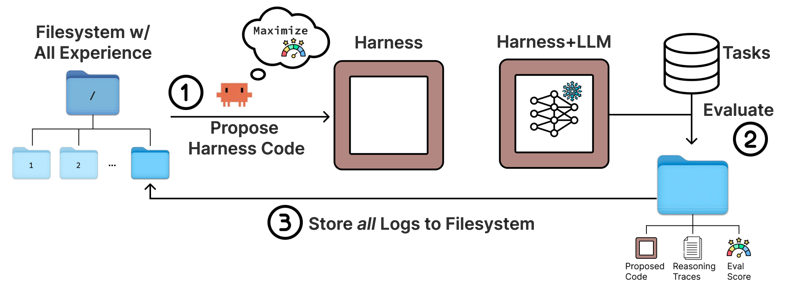

**Source figure / official image** — Figure 2: the Meta-Harness search loop - an agent reads a filesystem of all prior candidates' code, traces and scores, proposes a new harness, evaluates it, and logs everything as a new directory. · Figure 2 · [source](https://arxiv.org/html/2603.28052v1)

**nanoRSI reproduction** — not-run. Last source check: 2026-09-16.

**Open code / weights / data links** — [Artifact repository](https://github.com/stanford-iris-lab/meta-harness-tbench2-artifact)

**Primary sources** — [arXiv abstract](https://arxiv.org/abs/2603.28052) · [Paper v1 (affiliations, Figure 2, results)](https://arxiv.org/html/2603.28052v1) · [Artifact repository](https://github.com/stanford-iris-lab/meta-harness-tbench2-artifact)

## Self-modifying meta-agents & lineages (14)

### RSIFlow: Adaptive Self-Improvement Workflows with an Evolving Meta-Agent

**2026-10-15** · paper · Direct bounded loop

**Publication date** — arXiv v1 submitted 2026-10-15; code repository pushed through 2026-10-13.

**Institutional relationship** — Huan Zhang*, Mingju Chen*, Dongxu Zhou, Can Lv, Sen Cui, Faguo Wu, Shiji Zhou (corresponding) - Beijing Advanced Innovation Center for Future Blockchain and Privacy Computing, School of Artificial Intelligence, Beihang University (*equal contribution; affiliations read from the HTML author block).

**What changes and how feedback is reused** — A Task-Agent (Qwen3-4B/8B) executes tasks and collects trajectories and environmental feedback; a Meta-Agent (GPT-5.6 Sol) diagnoses which component is the current bottleneck and adaptively selects a component-specific improvement workflow - model update (partial LoRA with fixed one-epoch hyperparameters and global batch 8), harness update, or task-artifact revision. The meta-level recursion: workflow outcomes are distilled into component-specific skills plus cross-component principles, which are integrated into the Meta-Harness (the meta-agent’s own orchestration layer) so later rounds diagnose and orchestrate better - meta-agent parameters never update. Five evolution rounds, at most two attempts per round.

**Author-reported result** — Overall averages across six benchmarks (HumanEval+, MBPP+, BFCL-v3, ACEBench, HotpotQA, 2Wiki): Qwen3-4B 51.21 vs SIA 45.15, Hyperagent 41.26, AFlow 40.73 (and SFT 41.12, GRPO 42.04, HarnessForge 41.22, MermaidFlow 43.59); Qwen3-8B 59.86 vs SIA 56.00, AFlow 54.27. Ablations (4B, R=5): +13.72 three-domain average over vanilla; adaptive orchestration beats the best fixed-component routine by 4.13-8.81 on average; disabling meta-agent evolution costs 5.74 points.

**Evidence limits** — Task-agent backbones limited to Qwen3-4B/8B (cluster scale and larger backbones unexplored); the meta loop adds computational overhead and a cheaper meta-agent may compromise evolution gains; stability of experience-driven Meta-Harness updates is not fully investigated (authors name counterfactual analysis and meta-agent parameter optimization as future work); headroom on these benchmarks is crowded with strong baselines.

**Code / weights / data / license** — MIT-licensed code at github.com/1HUAN1/RSI-Flow (license verified via API 2026-10-18).

**Possible nanoRSI experiment — not implemented here** — Bottleneck-diagnosis routing is a selector design for nanoRSI’s loop: before mutating anything, classify which surface (skill text, harness code, evaluator artifact) is the binding constraint and apply surface-specific operators, instead of spending the attempt budget on the wrong surface. Distilling orchestration outcomes into reusable meta-skills mirrors ADOPTION #53 for the skills track, and the paper’s fixed-vs-adaptive ablation is the exact control a surface-routing proposal would need.

**Source figure / official image** — Original Figure 2 overview: task domains and the Task-Agent, trajectory collection, the Meta-Agent adaptively orchestrating component-specific workflows (model / harness / artifacts), and intervention experience distilled into skills that update the Meta-Harness. · Figure 2 (Overview.png), arXiv HTML 2610.21791v1 · [source](https://arxiv.org/html/2610.21791v1/Overview.png)

**nanoRSI reproduction** — not-run. Last source check: 2026-10-18.

**Open code / weights / data links** — [RSI-Flow code](https://github.com/1HUAN1/RSI-Flow)

**Primary sources** — [arXiv abs 2610.21791](https://arxiv.org/abs/2610.21791) · [arXiv HTML v1](https://arxiv.org/html/2610.21791v1) · [RSI-Flow code](https://github.com/1HUAN1/RSI-Flow)

### MetaShare: Failure-Aware Collective Self-Improvement for Open-Ended Agents

**2026-10-15** · paper · Direct bounded loop

**Publication date** — arXiv v1 submitted 2026-10-15; accepted at the NeurIPS 2026 workshop Managing Agents that Manage Agents: Workshop on Responsible Use of Meta-Agents (per abs comments).

**Institutional relationship** — Vishal Bhutani, Prasang Gupta, Sumanth Chundru, Kevin Paul - all PricewaterhouseCoopers (PwC), pwc.com addresses read from the HTML author block.

**What changes and how feedback is reused** — Every evaluated agent modification becomes a signed record (helped -> reuse, hurt -> avoid) in a bounded cross-lineage pool. Before each generation, failure-aware diverse retrieval rebuilds an adopt/avoid/must-try guidance context; K meta-agents then propose patches in parallel at heterogeneous temperatures behind a deterministic four-axis admissibility gate. A task-blind auditor periodically injects absent or underrepresented mechanism classes from a scrubbed digest, and embedding-based de-ranking limits retrieval redundancy.

**Author-reported result** — Against DGM-H (five runs, medians with 95% bootstrap CI): paper review 0.71->0.79, Polyglot full 225 tasks 0.28->0.34, robotics reward design 0.37->0.40, three IMO-grading settings 0.61/0.64/0.60 -> 0.64/0.70/0.67, audit risk 0.45->0.55, while generations-to-best falls 1.7-2.9x (paper review 100->36, audit risk 44->26). On Polyglot small/medium, 0.912 [0.902, 0.922] over five runs within 10 iterations vs GEA's single-run 0.88 - read by the authors as competitive at lower iteration count, not a like-for-like win. Ablations: replacing true failure records with length-matched shuffled failures costs 0.07 (semantics, not tokens); removing the task-blind auditor costs 0.15; a compute-matched reference (pool disabled at k=3) isolates +0.11 validation accuracy and 19 fewer generations for the memory layer; the auditor reproducibly unlocks dynamic model selection (o3-mini -> GPT-4o-mini) that DGM-H, given the identical action, never proposes.

**Evidence limits** — DGM-H numbers on paper review, robotics and IMO are as reported by Zhang et al. (2026), not rerun, so the admissibility gate is not held fixed across arms on those domains; k=3 costs about 3x the self-modification tokens (a quality-and-speed claim, not token efficiency); NMAE regresses on two domains (0.175 vs 0.157 IMO-full, 0.357 vs 0.312 audit risk); the GEA comparison pits a five-run interval against a single point estimate.

**Code / weights / data / license** — No code repository linked in the paper; none found while verifying (not verified to exist).

**Possible nanoRSI experiment — not implemented here** — The signed failure ledger with a shuffled-failure control is directly portable to nanoRSI's rejected_recent pool: store per-proposal signed deltas, retrieve them as avoid-guidance when steering the proposer, and run a length-matched shuffled-rejection arm to prove the ledger carries semantics rather than tokens; the task-blind must-try injection is a diversity mechanism for a proposal stream collapsing onto redundant edits.

**Source figure / official image** — Original Figure 2 architecture: one generation (signed guidance context, K parallel meta-agents, deterministic gate, apply-and-score) above the bounded cross-lineage pool of signed lessons with failure-aware diverse retrieval and the task-blind auditor's must-try injection. · Figure 2 (arch.png), arXiv HTML 2610.21887v1 · [source](https://arxiv.org/html/2610.21887v1/arch.png)

**nanoRSI reproduction** — not-run. Last source check: 2026-10-19.

**Open code / weights / data links** — No verified public code/asset link in the audited sources.

**Primary sources** — [arXiv abs 2610.21887](https://arxiv.org/abs/2610.21887) · [arXiv HTML v1](https://arxiv.org/html/2610.21887v1)

### Drafting Agents, Not Just Tokens: Speculative Recursive Self-Improvement for Agentic Systems

**2026-10-12** · paper · Direct bounded loop

**Publication date** — arXiv v1 submitted 2026-10-12, announced in the double-size 2026-10-14 batch (the Tuesday 10-13 announcement was skipped and folded into Wednesday's); primary-verified on 2026-10-15.

**Institutional relationship** — Xin Xu, Ke Cheng, Yangru Huang, Haibin Lv, Jun Zhang, Jie Jiang (Tencent AMS); Xin Xu also PKU; Ke Cheng also Beihang; Hao Wang (Xiaohongshu); Yanghao Xiao (UCAS); Zhichao Chen (PKU State Key Lab of General AI); Zhisheng Zhong (Tencent Hunyuan); Zhouchen Lin (PKU); corresponding: Jun Zhang, Zhouchen Lin.

**What changes and how feedback is reused** — Applies speculative execution to recursive self-improvement: executable successor agents are drafted before parent verification completes, growing an immutable tree of frozen agent versions with edit edges; adoption still requires complete, admissible verification. VATS (Verification-Aware Tree Search) allocates the remaining budget between drafting and checking - a Solver builds feasible completion bundles (MILP over missing checks, dependencies, shared setups), a Scorer predicts expected verified gain net of future cost, a Policy samples the next draft or verification plan. GVO (Group Verification Optimization) then trains the improver itself: run G>=2 independent complete searches from the same root under a frozen improver, advantage = each search's verified gain minus all costs against the group's leave-one-out mean, scorer trained by regression on realized suffix returns plus pairwise loss, actor updated with a clipped PPO-style objective; the verification contract stays fixed throughout.

**Author-reported result** — Scientific track: beats Janus on all 50 backbone-task pairs, terminal gains +33.3-40.0% and AUBC +30.4-33.7% (pairwise uplifts 17.8-27.6% terminal). Systems track: +1.85-2.38pp macro over MetaRSI-v1 across 20 backbones (TB2.1, SWE-Pro, GPQA-hard100, AIME). Coding validation 69.4% vs HGM's 64.3% at a 20.8% lower cost index (60.8 vs 76.8). Lifecycle total-cost index 106.3 vs MetaRSI-v1's 112.7; scientific runs cost 7.2% more than Janus - the honesty note is that speculation buys time-to-result, not cheaper searches everywhere.

**Evidence limits** — Scientific searches cost ~7% more than Janus; some 10-backbone figures show 0.83-0.90% higher total-cost indices vs MetaRSI-v1; baseline set is recent preprint systems (Janus, MetaRSI-v1, HGM) rather than an established leaderboard; verification contract fixed means the verifier itself is not improved.

**Code / weights / data / license** — MIT-licensed code at github.com/SpecRSI-GPR/SpecRSI (LICENSE verified 2026-10-15). Paper under arXiv perpetual non-exclusive license.

**Possible nanoRSI experiment — not implemented here** — Two transferable pieces: (1) speculative drafting with complete-verification-only adoption is a budget policy for nanoRSI's attempt loop - start the next proposal before the current one's panels finish, but never promote on partial evidence; (2) GVO's group-of-searches, leave-one-out advantage with a frozen improver is precisely an improve-the-improver probe under ADOPTION item 38's controls (frozen improver, matched budget, verified-gain-only rewards).

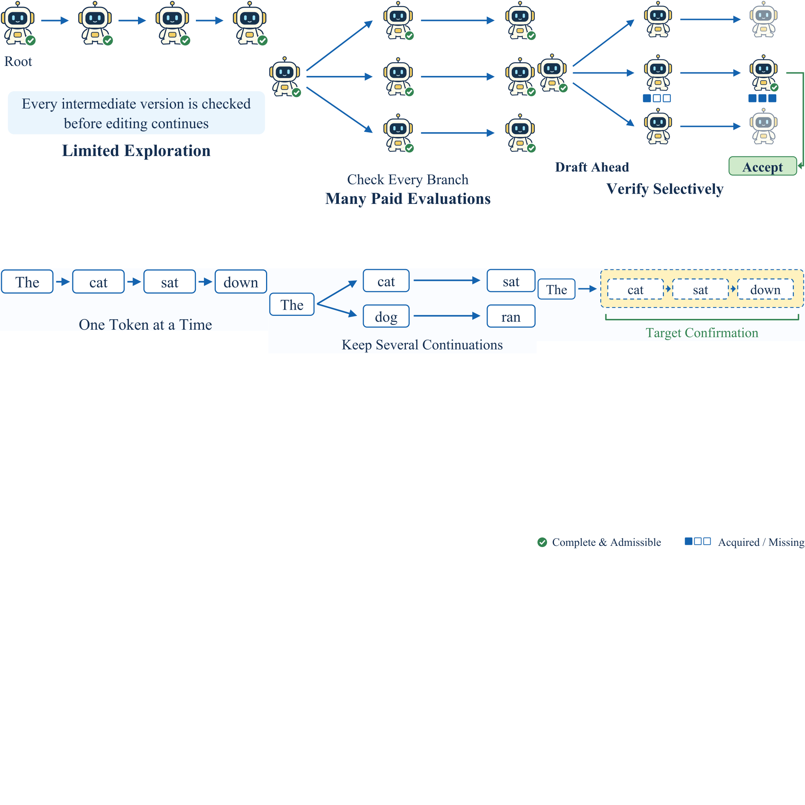

**Source figure / official image** — Original Figure 1 (panels a-f): three RSI execution patterns (single-path, parallel, speculative) and their search-theory analogues (greedy, beam search, speculative decoding) - explore ahead, verify before adoption. · Figure 1 (six panel SVGs trim_f1a-f1f + legend, recomposed into one image): single-path RSI, parallel branches and speculative RSI mapped to greedy, beam search and speculative decoding · [source](https://arxiv.org/html/2610.16491v1)

**nanoRSI reproduction** — not-run. Last source check: 2026-10-15.

**Open code / weights / data links** — [SpecRSI-GPR/SpecRSI (MIT)](https://github.com/SpecRSI-GPR/SpecRSI)

**Primary sources** — [arXiv abstract](https://arxiv.org/abs/2610.16491) · [arXiv HTML v1](https://arxiv.org/html/2610.16491v1) · [SpecRSI-GPR/SpecRSI (MIT)](https://github.com/SpecRSI-GPR/SpecRSI)

### RSI-Anything: Unlocking Recursive Self-Improvement with World Models

**2026-10-09** · paper · Direct bounded loop

**Publication date** — arXiv v1 submitted 2026-10-09; repository created 2026-10-08 and announced with the paper; no revisions.

**Institutional relationship** — PhAI Labs (Zhenfei Yin, Yingcheng Wu), CUHK (Pheng Ann Heng, Taoyong Cui), University of Macau, Shanghai Jiao Tong University, Fudan University, University of Oxford, Stanford University and Peking University; Ling Yang (corresponding).

**What changes and how feedback is reused** — Built on the JEPA-Anything predictive foundation, world-model predictions steer both action selection and the selection of learning data, substituting for costly external feedback. Observed feedback updates the policy/workflow; when the world model's reliability degrades as the policy evolves it is conditionally re-adaptated, and component plus compatibility checks decide whether an updated policy-model pair is retained. Imagined trajectories enter the training set only through a gated indicator (candidate valid, utility above threshold, uncertainty under cap, evidence label in permitted sources) with evidence tiered E0 rule checks / E1 model predictions / E2 simulators / E3 external measurements.

**Author-reported result** — Code repair (200 CodeContests tasks, fixed coder): hidden-test success 26.3% static verifier / 26.0% random selection -> 29.2% with a fixed world model -> 31.2% after world-model adaptation; ranking accuracy 66.5%->72.8%, Brier 0.488->0.358. GUI: click-checkboxes 51%->99%, mean actions down 39.4% (5.30->3.21), repeated clicks 237->0; OSWorld +5.5% relative vs RLAnything, +18.4% vs the initial agent. Lab planning: LabHorizon F200 Level-2 improves 21.80%->46.01% across five 4B policy versions, the final version edging the Actor-Simulator-Selector reference (46.01 vs 45.32) and beating Grok 4.3, Gemini 3.1 Pro, GPT-5.5 and Kimi K2.6. Reaction optimization: 96.15% vs 82.16% mean best observed yield for Bayesian optimization under a 40-experiment LC-MS budget. An end-to-end immune-science application couples workflow evolution with therapeutic hypothesis generation.

**Evidence limits** — Joint multiround evaluation of sustained mutual policy-world-model improvement within a single task is still needed; laboratory results assess protocol-aligned planning, not physical execution; chemistry covers two Suzuki-Miyaura screens at the reported budgets; the immune-science therapeutic hypothesis awaits experimental testing.

**Code / weights / data / license** — Code: github.com/Gen-Verse/RSI-Anything, Apache-2.0 (571 stars at verification; task folders for code repair, GUI, lab planning and reaction optimization, tests and docs). Data: per-domain resources on Hugging Face (Gen-Verse/RSI-Anything datasets). Paper under arXiv non-exclusive license.

**Possible nanoRSI experiment — not implemented here** — The evidence-tiered admission gate for self-generated training data (E0-E3 labels with validity, utility and uncertainty checks) is a concrete schema for nanoRSI's counterfactual-panel discipline; the world model as a cheap pre-verifier with reliability-triggered re-adaptation is directly usable as the low-cost pre-rank arm of the frozen selector study (ADOPTION items 38-39).

**Source figure / official image** — Original Figure 2: the RSI-Anything loop - world-model predictions guide actions and learning-data selection, observed feedback updates policy/workflow and conditionally re-adapts the world model, and component plus compatibility checks decide which policy-model pair is retained. · Figure 2 (figure1_v12_2026-10-09.png): RSI-Anything couples prediction-guided action with retained system updates, with domain instantiations in panel b · [source](https://arxiv.org/html/2610.13912v1)

**nanoRSI reproduction** — not-run. Last source check: 2026-10-14.

**Open code / weights / data links** — [GitHub repository (Apache-2.0)](https://github.com/Gen-Verse/RSI-Anything)

**Primary sources** — [arXiv abstract](https://arxiv.org/abs/2610.13912) · [arXiv HTML v1](https://arxiv.org/html/2610.13912v1) · [GitHub repository (Apache-2.0)](https://github.com/Gen-Verse/RSI-Anything)

### AgentEvolver: System-Wide Self-Evolution Through Task Execution

**2026-10-08** · paper · Direct bounded loop

**Publication date** — arXiv v1 submitted 2026-10-08; no revisions. Project page and repository linked from the title block.

**Institutional relationship** — School of Computing, Nanyang Technological University, Singapore (four authors incl. Bo An) and Singapore Management University (Xinrun Wang).

**What changes and how feedback is reused** — Capabilities are built during task execution with the foundation model fixed: eight entity families (operations, methods, agents, control flow, interfaces and supporting state among them) expose their components to revision through a common versioned lifecycle - structural admission, functional evaluation, then activation. A shared Runtime coordinates task orchestration with persistent planning and recoverable context, and version management links each evaluated change to the active capability set it becomes.

**Author-reported result** — On SWE-bench Pro Public the system reports an 82.08% resolution rate with evolution, above its own non-evolving baseline (author comparison; the paper stresses distinguishing component improvement from final-task success). Six application cases show capabilities carrying over into website, game and research tasks, alongside recorded incomplete objectives and one unsuccessful strategy; independent-task transfer and total development cost are stated as open questions.

**Evidence limits** — The headline number is against the system's own non-evolving configuration, not an external SOTA agent; capability carry-over is examined on six self-selected application cases; independent-task transfer and total development cost are explicitly left open; the paper itself separates component improvement from final-task success.

**Code / weights / data / license** — Code: github.com/DVampire/AgentEvolver, MIT license (verified via raw LICENSE). Project page: dvampire.github.io/AgentEvolver. Data: benchmark usage external. License: MIT.

**Possible nanoRSI experiment — not implemented here** — The versioned-lifecycle-per-entity design is a concrete schema for nanoRSI's skills track: give every edited artifact (skill file, runner, evaluator config) the same admission->evaluation->activation lifecycle with version links recorded in the evidence ledger, so a capability can be traced to the change that produced it - the audit nanoRSI already runs on accepted generations, extended to the activation step.

**Source figure / official image** — Original Figure 2: AgentEvolver system architecture - the Runtime connects task orchestration, eight capability families and the self-evolution loop; version management links evaluated changes to active capabilities, with shared planning, context and evidence infrastructure. · Figure 2, page 5 of the PDF (rendered at 150 dpi and cropped): the Runtime connecting task orchestration, the eight capability families and the self-evolution loop · [source](https://arxiv.org/pdf/2610.11613)

**nanoRSI reproduction** — not-run. Last source check: 2026-10-13.

**Open code / weights / data links** — [GitHub repository (MIT)](https://github.com/DVampire/AgentEvolver)

**Primary sources** — [arXiv abstract](https://arxiv.org/abs/2610.11613) · [arXiv PDF v1 (no HTML rendering exists)](https://arxiv.org/pdf/2610.11613) · [GitHub repository (MIT)](https://github.com/DVampire/AgentEvolver) · [project page](https://dvampire.github.io/AgentEvolver/)

### SoL-Pi: Recursively Scaling Auto-Research Loops for Efficient Agent Harness

**2026-09-17** · paper · Direct bounded loop

**Publication date** — arXiv v1 2026-09-17; code repository created 2026-09-02 and active through 2026-09-18.

**Institutional relationship** — Company-led (NVIDIA, with NTU and MIT co-authors; NVlabs repository and project page).

**What changes and how feedback is reused** — An RSI-inspired auto-research loop recursively improves the agent harness itself: a research AI proposes harness mechanisms from execution trajectories, an agent swarm explores candidates in parallel with independent review, and only mechanisms that survive held-out validation (EdgeBench never enters the search) are retained — four mechanisms survived.

**Author-reported result** — On the 51-task EdgeBench, SoL-Pi matches Pi performance across GPT-5.6 Sol and Opus 5 while cutting recorded token traffic 44.7-49.0% and API cost by about a third; estimated savings $8.75-13.50/hour vs native Codex and Claude Code, $4.36-5.71/hour vs Pi.

**Evidence limits** — Author-reported efficiency gains at matched task performance; the search itself consumed substantial compute (two-hour swarm runs); generalization beyond EdgeBench-class edge tasks not shown.

**Code / weights / data / license** — MIT code at github.com/NVlabs/SoL-Pi (2,244 stars at verification) and project page nvlabs.github.io/SoL-Pi/.

**Possible nanoRSI experiment — not implemented here** — The hard separation between repository-derived search environments and a never-touched held-out benchmark, plus an independent-review gate before mechanism retention, is directly transplantable to nanoRSI population runs.

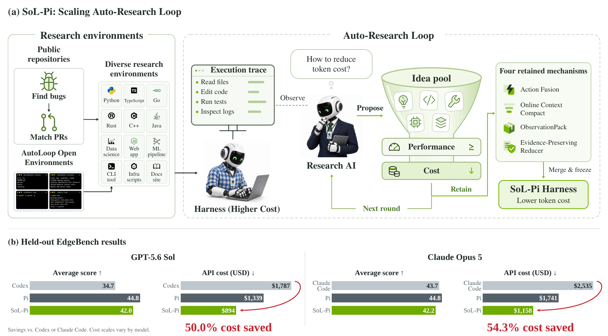

**Source figure / official image** — SoL-Pi discovers a more token-efficient harness through automated research: research environments supply tasks while an AI running the base harness iterates mechanisms. · Figure 1 (teaser-funnel-v10.png) · [source](https://arxiv.org/html/2609.20519v1)

**nanoRSI reproduction** — not-run. Last source check: 2026-09-19.

**Open code / weights / data links** — [Code repository](https://github.com/NVlabs/SoL-Pi)

**Primary sources** — [arXiv abstract](https://arxiv.org/abs/2609.20519) · [Paper HTML (affiliations, Figure 1-2, abstract numbers)](https://arxiv.org/html/2609.20519v1) · [Code repository](https://github.com/NVlabs/SoL-Pi) · [Project page](https://nvlabs.github.io/SoL-Pi/)

### Self Improvement via Fast Tree-search

**2026-09-17** · paper · Direct bounded loop

**Publication date** — arXiv v1 was submitted on 2026-09-17 (2609.19526) with no later versions as of 2026-10-11. Media coverage (VentureBeat, 2026-10-02) appeared later and is used only as a lead; it is not a first-release date.

**Institutional relationship** — The paper HTML lists Xinghong Fu at MIT (corresponding) and Aravinth Kulanthaivelu and Yutaro Yamada at Sakana AI. Media coverage of the same work is treated as a lead, not a source.

**What changes and how feedback is reused** — Coding agents recursively modify their own implementations along a tree search. SIFT adds a cheap supervision signal inside this loop: an LLM-as-a-judge makes pairwise comparisons between a candidate patch and earlier versions, win-loss records are aggregated by a regularized Bradley-Terry model into strength scores, and rank-based parent sampling biases expansion toward stronger nodes. Expensive downstream benchmark evaluations are reserved for the most promising nodes, and a disaggregated pipeline variant expands nodes that already show a strong judge signal before full evaluation completes.

**Author-reported result** — Author-reported on the full Polyglot benchmark: SIFT with an o3-mini agent and a gpt-5.4 judge reaches 35.1%, versus 30.7% for DGM (o3-mini) and 14.2% for the base agent; repeating the o3-mini configuration yields 32.0-35.6%, and a Qwen3-Coder-30B configuration reaches 32.0%. o3-mini runs finish under 50 CPU hours and 5 hours wall clock, and the Qwen3 configuration under 250 CPU hours and 7 hours. The paper also reports that discovered agent harnesses transfer across coding models. These are author-reported numbers under their benchmarks and API budgets, not a nanoRSI reproduction.

**Evidence limits** — The headline gain rides on the judge model: SIFT with judge set to None scores 29.8%, below DGM's 30.7%, and the gpt-5-mini judge configuration scores 31.6%, so judge quality and cost are the load-bearing choice. Evaluation centers on Polyglot with TerminalBench as a secondary suite, and no code, weights or data release was found in the checked paper page. Wall-clock and API-cost numbers depend on the authors' 2026 API pricing and infrastructure.

**Code / weights / data / license** — Code: no repository link found on the checked abstract or HTML page. Weights: not applicable/distributed. Data: no data release found. License: paper is CC BY 4.0 on arXiv; implementation licensing is not verifiable without a release. 'Not verified' is not 'does not exist'.

**Possible nanoRSI experiment — not implemented here** — The portable piece is a cheap pre-gate: pairwise LLM-judge comparisons aggregated by Bradley-Terry as a low-cost ranking of proposals before any full panel evaluation, explicitly compared against full-evaluation gating with false-admit/false-block accounting and judge-cost logging. This slots into the frozen RRSI-style selector study and the counterfactual panel; it is a proposed controlled experiment, not a default nanoRSI behavior.

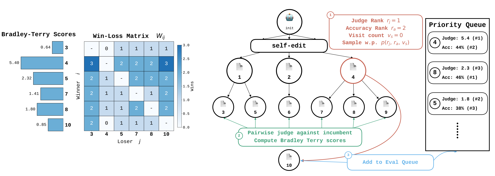

**Source figure / official image** — Original Figure 1: one SIFT expansion step - a sampled node self-improves, the judge compares it against earlier versions, and win-loss records feed Bradley-Terry strength scores used for rank-based parent sampling. · Figure 1 (figures/pipeline_full_bigfont.png): node expansion with judge comparison, Bradley-Terry aggregation and rank-based parent sampling · [source](https://arxiv.org/html/2609.19526v1)

**nanoRSI reproduction** — not-run. Last source check: 2026-10-11.

**Open code / weights / data links** — No verified public code/asset link in the audited sources.

**Primary sources** — [arXiv abstract](https://arxiv.org/abs/2609.19526) · [arXiv HTML v1 and Figure 1](https://arxiv.org/html/2609.19526v1)

### Refactoring Hermes with 1,393 agents

**2026-09-15** · report · Direct bounded loop

**Publication date** — The refactor run itself took place 2026-09-02/04; the page's structured metadata dates publication 2026-09-15T15:00Z.

**Institutional relationship** — Nous Research first-party account written by Teknium.

**What changes and how feedback is reused** — A human sets a /goal; the Hermes orchestrator splits its own ~1.06M-line repository into 36 groups and dispatches worker subagents that edit in separate git worktrees with interface checks (JSON schemas, byte-for-byte CLI --help); lessons are auto-recorded into a hermes-agent-dev Markdown skill and reshared so other agents inherit the learned procedures.

**Author-reported result** — 1,393 subagents (up to 218 concurrent), ~19 active hours, ~$19.3k main-run cost against a manual estimate of $150k-$1.8M; non-test Python 1,063,826 → 698,363 lines (−34.4%); files >5,000 lines 37 → 6; functions >300 lines 192 → 2; longest if/elif chain 92 → 9 branches; on a 4,000-lookup symbol test the average tokens returned fell 2,218 → 993.

**Evidence limits** — No capability control — the measured object is code health, not task performance; reviewers caught regressions the tests missed (removed public names, an exception-handling rewrite across ~65 sites); the first attempt died on auth-token expiry; module count and some import times worsened.

**Code / weights / data / license** — Blog post public; the Hermes Agent repository is public and now has a checked LICENSE file identified by GitHub as MIT. This covers the repository code only; the report's hosted run, models and any generated artifacts are separate and were not audited for redistribution.

**Possible nanoRSI experiment — not implemented here** — nanoRSI already has worktree-per-candidate evaluation; the missing piece to copy is auto-recording postmortem lessons into a skill file that later runs load, closing the loop between one-off failures and persistent procedure memory.

**Source figure / official image** — Official banner of Nous Research's account of Hermes autonomously refactoring its own ~1M-line codebase with 1,393 subagents. · Post banner graphic · [source](https://nousresearch.com/refactoring-hermes-with-1393-agents/)

**nanoRSI reproduction** — not-run. Last source check: 2026-10-16.

**Open code / weights / data links** — [Hermes Agent repository](https://github.com/NousResearch/hermes-agent) · [Repository LICENSE](https://github.com/NousResearch/hermes-agent/blob/main/LICENSE) · [hermes-agent v0.22.2 release](https://github.com/NousResearch/hermes-agent/releases/tag/v0.22.2)

**Primary sources** — [Nous Research blog report](https://nousresearch.com/refactoring-hermes-with-1393-agents/) · [Hermes Agent repository](https://github.com/NousResearch/hermes-agent) · [Repository LICENSE](https://github.com/NousResearch/hermes-agent/blob/main/LICENSE) · [Hermes Agent v0.21.5 release](https://github.com/NousResearch/hermes-agent/releases/tag/v2026.9.24) · [Hermes Agent v0.21.6 release](https://github.com/NousResearch/hermes-agent/releases/tag/v0.21.6) · [hermes-agent v0.22.2 release](https://github.com/NousResearch/hermes-agent/releases/tag/v0.22.2)

### Mendel Gödel Machine: Recursive Self-Improving Coding Agents via Comparative Evolution

**2026-08** · paper · Direct bounded loop

**Publication date** — arXiv v1: August 2026 (2608.07645). Exact v1 day not re-verified; month precision used.

**Institutional relationship** — Paper: Changzhi Liu, Yilun Liu, Sikuan Yan, Volker Tresp, Yunpu Ma - UESTC, LMU Munich and Munich Center for Machine Learning.

**What changes and how feedback is reused** — Extends archive-based self-modification (DGM/HGM) with three Mendelian operators driven by comparative evidence: clonal mutation (single-trajectory edit), reaction-norm mutation (edit from one agent's trajectories across multiple tasks - recurring failures mark genotype defects), and cross-lineage hybridization (extract a transferable behavioral trait from another lineage's successful trajectory and adapt it, without splicing code). A failed-task pool boosts sampling weights so lineages overlap on hard tasks. Proposition 1: under an additive fitness landscape, comparative evidence raises fix probability over single-trajectory mutation.

**Author-reported result** — Qwen3.6-35B-A3B, 200 evaluations + 24 expansions: SWE-bench Verified-60 68.3% -> 78.3% (HGM 73.3%); Polyglot-60 50.8% -> 93.2% (HGM 77.9%); full Polyglot-225 93.3%, 'surpassing closed-source GPT-5 with ~117x fewer parameters'. Cross-benchmark transfer: SWE-bench Pro 16.7% -> 26.7%; Multilingual 41.7% -> 55.0%. Cross-model transfer: DeepSeek-V4-Flash 50.0% -> 66.7%, V4-Pro 45.0% -> 75.0%.

**Evidence limits** — High wall-clock/GPU cost limits seeds and sweeps; operators need multi-trajectory history and cross-lineage task overlap (degenerates toward single-trajectory baselines with small archives); no edit-quality guarantee; claims limited to coding-agent scaffolds on public benchmarks.

**Code / weights / data / license** — Code at github.com/RealLcz/MGM (Apache-2.0, 32 stars at verification); project page reallcz.github.io/MGM.

**Possible nanoRSI experiment — not implemented here** — For nanoRSI: keep per-task trajectories per lineage and admit edits driven by cross-task recurring failures (reaction-norm) and by other candidates' successes on shared tasks (hybridization) - both are selection signals beyond per-candidate scores.

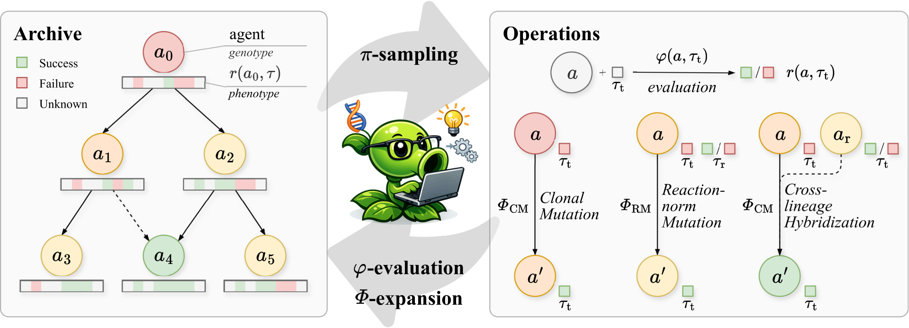

**Source figure / official image** — Figure 1: Mendel Godel Machine - an archive lineage tree where pi-sampling and phi-evaluation feed three comparative operators: clonal mutation, reaction-norm mutation, and cross-lineage hybridization. · Figure 1 · [source](https://arxiv.org/html/2608.07645v1)

**nanoRSI reproduction** — not-run. Last source check: 2026-09-21.

**Open code / weights / data links** — [Code repository (Apache-2.0)](https://github.com/RealLcz/MGM)

**Primary sources** — [arXiv abstract](https://arxiv.org/abs/2608.07645) · [Paper v1 (affiliations, Figure 1, results tables)](https://arxiv.org/html/2608.07645v1) · [Code repository (Apache-2.0)](https://github.com/RealLcz/MGM)

### Meta^n: Recursive Self-Improvement through Emergent Depth

**2026-08** · paper · Direct bounded loop

**Publication date** — arXiv v1: August 2026 (2608.24735); official repository created 2026-08-26. Exact v1 day not re-verified; month precision used.

**Institutional relationship** — Paper: Zae Myung Kim, Young-Jun Lee, Dongyeop Kang (University of Minnesota) and Seungyeon Jwa (Seoul National University).

**What changes and how feedback is reused** — A single fixed meta-operation Omega is applied repeatedly to its own outputs: each call reads the traces of the layers below and (from depth 3) their emitted code, then writes the next layer's code (pre-processor plus code library); wrappers compose so Sd = Md o ... o M2 o S1. Depth grows until Omega stops finding improvements (convergence threshold 0.02), with an evolutionary archive over chains; layer roles emerge unprompted (rollback behavior first appears at depth 3).

**Author-reported result** — Realized meta-depth 3-6 across eight benchmark families (plateau 3-4; depth 6 on materials-science SR), versus prior self-rewriting systems capping at ~2.5. ARC-AGI-2: 0.331 +/- 0.010 vs OpenEvolve 0.003 and Godel Agent 0.054 - the only system to solve any task at all; CO-Bench (GPT-5.2) 0.870 vs OpenEvolve 0.702. Ablation -recursion: -0.131 (Gemma CO); inter-layer context carries ~72% of the gain.

**Evidence limits** — Same model at all layers (a stronger Omega over a weaker base untested); inter-layer context is a free-form string; reasoning capacity at high meta-levels and context saturation from accumulated layer code remain untested ceilings.

**Code / weights / data / license** — Code at github.com/minnesotanlp/meta-n (MIT, 29 stars at verification). Paper CC BY-NC-ND 4.0 (noncommercial terms).

**Possible nanoRSI experiment — not implemented here** — For nanoRSI: measure realized meta-depth (how many nested improvement layers actually help before plateau) as a standard report field - Meta^n shows it is measurable, and ~2.5 is the number to beat for self-rewriting loops.

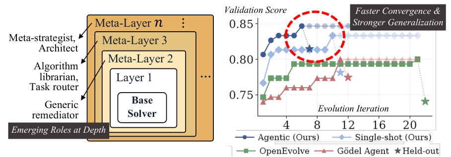

**Source figure / official image** — Figure 1: Meta^n at a glance - one fixed meta-operation repeatedly reads the layers below and writes the next layer's code; realized depth grows to 3-6 versus the ~2.5 cap of self-rewriting systems. · Figure 1 · [source](https://arxiv.org/html/2608.24735v1)

**nanoRSI reproduction** — not-run. Last source check: 2026-09-16.

**Open code / weights / data links** — [Code repository (MIT)](https://github.com/minnesotanlp/meta-n)

**Primary sources** — [arXiv abstract](https://arxiv.org/abs/2608.24735) · [Paper v1 (affiliations, Figures 1-3, tables)](https://arxiv.org/html/2608.24735v1) · [Code repository (MIT)](https://github.com/minnesotanlp/meta-n)

### AIDE²: The First Evidence of Recursive Self-Improvement

**2026-07-14** · report · Direct bounded loop

**Publication date** — The Weco AI first-party blog report was first published on 2026-07-14. The full technical report, titled "Recursive self-improvement of AI research agents," was first publicly posted as arXiv:2609.26457 on 2026-09-22; its date is recorded as a later substantive event rather than replacing the original report date.

**Institutional relationship** — Weco AI's first-party account of its own system; no independent replication.

**What changes and how feedback is reused** — A bi-level loop: an outer-loop agent rewrites the code of an inner-loop research agent; each candidate is graded across heterogeneous AI R&D task families under a fixed per-task budget, with held-out scores aggregated into a private grade before acceptance. The paper reports a 100-node trajectory with seven accepted rewrites; the evolved harness changes search policy, context management and reward-hacking defenses while the underlying model stays fixed within each loop.

**Author-reported result** — One autonomous 8-day run produced seven accepted rewrites and raised the private selection grade from 0.703 to 0.778. On four held-out benchmarks, AIDE₈₅ matched or exceeded the human-engineered baseline under the same protocol, including an out-of-distribution WeatherBench 2 task; on a separate held-out KernelBench-style task family, reward hacking fell from 55% to 32% versus 39% for the human baseline. Two additional complete runs also showed sustained improvements, while the ignition test was not statistically decisive. These are author-reported results, not nanoRSI reproductions.

**Evidence limits** — The main trajectory is one expensive hosted-model run, and the paper notes noisy comparisons, context-window failures in some baseline evaluations and non-monotonic checkpoint gains. The outer-loop ignition result is inconclusive, and the report's "recursive self-improvement" claim concerns harness/search efficiency under fixed evaluation budgets, not self-improving model weights or a general RSI threshold.

**Code / weights / data / license** — Paper and source figures: public in arXiv:2609.26457. AIDE²'s experiment code, weights and benchmark-data bundle were not released or independently verified. The related WecoAI/aideml predecessor repository is MIT, but that license must not be extended to the AIDE² run or its hosted models and artifacts.

**Possible nanoRSI experiment — not implemented here** — Use AIDE² as a protocol reference for the already planned RRSI selector study: keep the inner task budget fixed, separate public feedback from a held-out acceptance grade, and report the full accepted/rejected lineage. Do not copy Weco code or claim the paper's benchmark gains locally; first freeze the three-seed, three-budget nanoRSI protocol and cost ceiling.

**Source figure / official image** — AIDE²'s original Figure 1: the outer loop rewrites a complete research agent, the inner loop grades candidates on AI R&D tasks, and a private held-out grade decides whether the rewrite becomes incumbent. · Figure 1 (figures/fig_system_diagram_light.pdf): one step of recursive self-improvement · [source](https://arxiv.org/html/2609.26457v1)

**nanoRSI reproduction** — not-run. Last source check: 2026-09-29.

**Open code / weights / data links** — [Related AIDE predecessor repository](https://github.com/WecoAI/aideml) · [Related AIDE predecessor license](https://raw.githubusercontent.com/WecoAI/aideml/main/LICENSE)

**Primary sources** — [Weco AI blog report](https://www.weco.ai/blog/first-evidence-of-recursive-self-improvement) · [AIDE² technical report](https://arxiv.org/html/2609.26457v1) · [Related AIDE predecessor repository](https://github.com/WecoAI/aideml) · [Related AIDE predecessor license](https://raw.githubusercontent.com/WecoAI/aideml/main/LICENSE)

### Hyperagents

**2026-03-19** · paper · Direct bounded loop

**Publication date** — arXiv v1: 2026-03-19; Meta publication page: 2026-03-24.

**Institutional relationship** — Paper lists FAIR at Meta and Meta Superintelligence Labs affiliations, alongside academic collaborators.

**What changes and how feedback is reused** — An editable meta agent modifies itself and the task agent. Evaluated valid variants enter an archive and supply later parents and feedback; admission need not require immediate improvement.

**Author-reported result** — After 100 iterations, held-out paper-review accuracy was 0.710 (CI 0.590–0.750), versus static baseline 0.630 and customized DGM 0.590. The customized-DGM difference was not significant; initial 0.0 reflected output-format failure.

**Evidence limits** — Fixed foundation models/evaluators and bounded runs do not demonstrate indefinite self-acceleration.

**Code / weights / data / license** — Official code and linked experiment logs verified; foundation-model weights are not supplied. Code licence is CC BY-NC-SA 4.0, not permissive commercial open source. Linked log payloads/separate data licence were not inspected.

**Possible nanoRSI experiment — not implemented here** — Proposed: separately version task/meta code, preserve evaluated stepping stones, and keep immutable evaluation records.

**Source figure / official image** — Figure 1: DGM-Hyperagents combines a modifiable task agent and meta agent with an archive of stepping stones. · Figure 1 · [source](https://arxiv.org/html/2603.19461v1)

**nanoRSI reproduction** — not-run. Last source check: 2026-09-16.

**Open code / weights / data links** — [Official code](https://github.com/facebookresearch/HyperAgents) · [Code licence](https://github.com/facebookresearch/HyperAgents/blob/main/LICENSE.md)

**Primary sources** — [Paper history](https://arxiv.org/abs/2603.19461) · [Paper v1, authors and section 5.1](https://arxiv.org/html/2603.19461v1) · [Meta publication](https://ai.meta.com/research/publications/hyperagents/) · [Official code](https://github.com/facebookresearch/HyperAgents) · [Code licence](https://github.com/facebookresearch/HyperAgents/blob/main/LICENSE.md)

### Group-Evolving Agents: Open-Ended Self-Improvement via Experience Sharing

**2026-02-04** · paper · Direct bounded loop

**Publication date** — arXiv v1 submitted 2026-02-04; no revisions. Surfaced via lobehub/awesome-rsi (2026-10-12) and primary-verified 2026-10-15. This is the 'GEA' that served as the strongest self-evolving baseline in Evo² (2610.13025) - the baseline itself was not previously catalogued.

**Institutional relationship** — Zhaotian Weng, Antonis Antoniades, Deepak Nathani, Zhen Zhang, Xiao Pu, Xin Eric Wang - University of California, Santa Barbara.

**What changes and how feedback is reused** — Treats a whole group of agents as the evolutionary unit instead of a single lineage: self-improving agents rewrite their own architecture, and members of a group share and reuse experiences during open-ended evolution, so early exploratory diversity survives instead of being lost in isolated tree branches. The best agent integrates experience from many distinct ancestors.

**Author-reported result** — SWE-bench Verified 71.0% vs 56.7% for the strongest self-evolving baseline (DGM); Polyglot 88.3% vs 68.3%. Against top human-designed frameworks: 71.8% (OpenHands+GPT-5) and 52.0% (Aider+GPT-5 high) - matched or exceeded. Robustness: framework-level bugs repaired in 1.4 iterations on average vs 5.0; the best GEA agent draws on 17 unique ancestors vs 9 for DGM; improvements transfer across GPT-series and Claude-series backbones.

**Evidence limits** — No code released; no repository linked on arXiv or in the paper body. The 71.0/88.3 numbers are against self-evolving baselines under the paper's own harness setup; human-framework comparisons use different backbones (GPT-5).

**Code / weights / data / license** — No code, weights or data released; paper under arXiv non-exclusive license (CC BY 4.0).

**Possible nanoRSI experiment — not implemented here** — Population-level experience sharing is the counter-design to nanoRSI's rejected_recent quarantine: failed candidates' diagnostic trajectories can be shared to later proposals instead of only suppressing them, and the 17-ancestor breadth metric is a directly computable selector statistic for ADOPTION 39 (how many distinct prior attempts a surviving candidate draws on).

**Source figure / official image** — Original Figure 1: overview contrasting tree-structured self-evolution (isolated branches lose exploratory diversity) with Group-Evolving Agents (group members share and reuse experience during open-ended evolution). · Figure 1 (pipeline_overall.png): GEA vs tree-structured self-evolution - isolated branches on the left, group-level experience sharing on the right · [source](https://arxiv.org/html/2602.04837v1)

**nanoRSI reproduction** — not-run. Last source check: 2026-10-15.

**Open code / weights / data links** — No verified public code/asset link in the audited sources.

**Primary sources** — [arXiv abstract](https://arxiv.org/abs/2602.04837) · [arXiv HTML v1](https://arxiv.org/html/2602.04837v1)

### Huxley-Gödel Machine: Human-Level Coding Agent Development by an Approximation of the Optimal Self-Improving Machine

**2025-10-24** · paper · Direct bounded loop

**Publication date** — arXiv v1 2025-10-24, v2 2025-10-28, v3 2025-10-29 (current); catalogued at the rolling window's lower edge. Surfaced via lobehub/awesome-rsi (2026-10-12) and primary-verified 2026-10-15.

**Institutional relationship** — Wenyi Wang, Piotr Piękos, Li Nanbo, Firas Laakom, Yimeng Chen, Mateusz Ostaszewski, Mingchen Zhuge, Jürgen Schmidhuber - all at KAUST.

**What changes and how feedback is reused** — Coding agents edit their own codebases, building a tree of self-modifications. The paper identifies a Metaproductivity-Performance Mismatch - an agent's benchmark score does not reliably indicate its potential to produce improved descendants - and proposes CMP (Clade Meta Productivity), which aggregates the benchmark performances of an agent's descendants as the indicator of self-improvement potential. HGM estimates CMP online and uses it to steer search through the self-modification tree; the paper shows that, given certain assumptions, access to the true CMP suffices to simulate a Gödel Machine.

**Author-reported result** — SWE-Verified-60 (800 evaluations, best-belief agent): HGM 56.7 (+16.7) vs DGM 53.3 (+13.3) and SICA 50.0 (+10), at 517 CPU-hours vs DGM's 1231 (2.38x less); Polyglot 30.5 (+10.2) vs 27.1/25.4 at 347h vs 2385h (6.86x less than DGM). The CMP estimator's weighted correlation with realized descendant gain: 0.778 (SWE-Verified-60) and 0.626 (Polyglot) vs DGM 0.285/0.383 and SICA 0.444/0.274. Full SWE-bench Verified reaches 61.4% after 8000 evaluations (initial agent 53.2%), the top GPT-5-mini system on the leaderboard at the time. Transfer: the agent optimized with GPT-5-mini evaluated with GPT-5 on SWE-bench Lite scores 47.8% (filtered; SWE-agent 48.3%) and 57% (standard; 56.7%) - matching the best officially checked human-engineered agents.

**Evidence limits** — Leaderboard 'top at the time' claims age quickly; CMP correlations are measured on weighted evaluation subsets; the paper is CC BY-NC-SA on arXiv (code is Apache-2.0 separately).

**Code / weights / data / license** — Apache-2.0 code at github.com/metauto-ai/HGM (LICENSE verified 2026-10-15). Paper license CC BY-NC-SA 4.0.

**Possible nanoRSI experiment — not implemented here** — CMP is an implementable rival selector for ADOPTION 38/39: rank parents by the aggregated frozen-panel performance of their descendants rather than the parent's own score, computable from the existing lineage store without new model calls. The mismatch finding is also a direct warning for nanoRSI's gate: a candidate's own panel score is a noisy predictor of lineage value.

**Source figure / official image** — Original Figure 1: benchmark performance barely correlates with self-improvement gain (left), motivating CMP - the clade-aggregated performance of descendants - as the steering signal for the tree of self-modifications (right). · Figure 1 (intro_figure_combined_wider.svg): left - the Metaproductivity-Performance Mismatch scatter (benchmark accuracy vs descendant gain); right - HGM's clade-level metric and compute efficiency · [source](https://arxiv.org/html/2510.21614v3)

**nanoRSI reproduction** — not-run. Last source check: 2026-10-15.

**Open code / weights / data links** — [metauto-ai/HGM (Apache-2.0)](https://github.com/metauto-ai/HGM)

**Primary sources** — [arXiv abstract](https://arxiv.org/abs/2510.21614) · [arXiv HTML v3](https://arxiv.org/html/2510.21614v3) · [metauto-ai/HGM (Apache-2.0)](https://github.com/metauto-ai/HGM)

## Program evolution & evolutionary search (10)

### A Self-Improving Agent that Grows its Own DSL: Oracle-Free Operator Induction for Exact Question Answering

**2026-10-14** · paper · Direct bounded loop

**Publication date** — arXiv v1 submitted 2026-10-14 (only version); title recorded verbatim from the abs page.

**Institutional relationship** — Yun-Shiuan Chuang*, Yirou Ge*, Yixi Li* (*equal contribution), Yiming Bian, Zijie Pan, with Jenna L. Ballard, Uma Kona, Linsey Pang, Prakhar Mehrotra - all under a single collective PayPal AI affiliation line in the HTML author block.

**What changes and how feedback is reused** — A single frozen model runs two nested loops over a small exact DSL, with no reward, no judge and no answer key. The inner loop expands the answerable question set inside a fixed operator library: each candidate expression must be matched by a second independently written expression that agrees on every validation record. The outer loop discovers recurring capability gaps, authors new operators as sandboxed method-free Python, and admits one only through a three-part oracle-free gate: differential testing (two independent implementations agree on all records plus fuzzed inputs), a metamorphic conservation law over already-trusted operators, and a round-trip pass through the inner loop’s independent-agreement check.

**Author-reported result** — Answerable-set growth 10->336 (Merchant), 15->162 (BookSQL), 13->248 (EHRSQL over MIMIC-III), with the inner loop alone roughly tripling coverage (mean +18.3 across 13 starting sets). Gate soundness measured on every single-point mutant of the 14 admitted operators: 0/138 buggy variants admitted under an uncorrelated reference (10/138 under the correlated worst case where both implementations carry the same bug), versus admit-if-it-runs 129/138, self-consistency 129/138 and compression 101/138; an LLM judge wrongly rejects 2/14 correct operators. The unmodified mechanism transfers across model families (Qwen3.6-35B-A3B main; Mistral-Small-24B, Llama-3.3-70B, Gemma-3-27B also self-extend).

**Evidence limits** — The mode (most-frequent-value) reducer is permanently unreachable because no conservation law exists for it; only up to 3 induction rounds were tested; 81% of admission rejections come from sandbox-forbidden method calls; one adversarial escape exists (a size-changing merge bug admitted when the witnessing relation names a bare builtin instead of a trusted operator); seeds centre on the per-group aggregation family; Gemma-3-27B self-extends on only one of its seeds (13% DSL compile rate).

**Code / weights / data / license** — Supplementary material promised in the paper (DSL and its tests, both agent loops with exact prompts, generator and study scripts); no separate public repository URL found in the HTML; synthetic corpora regenerate from aggregate parameters without proprietary data; arXiv non-exclusive license only.

**Possible nanoRSI experiment — not implemented here** — A template for oracle-free gates on exact tasks: dual independent implementations plus a conservation law replace held-out labels, directly usable where nanoRSI has verifiable invariants but no gold panel. Equally portable is the audit protocol - generate every single-point mutant of an accepted edit and measure the false-admit rate of the gate - which would give the counterfactual/challenge gate a published-style soundness score.

**Source figure / official image** — Original Figure 1: the two nested loops run by one frozen model with no ground-truth oracle and no judge - the inner loop expands the answerable set inside fixed operators, the outer loop inducts new operators under the oracle-free admission gate. · Figure 1 (method_overview.png), arXiv HTML 2610.20809v1 · [source](https://arxiv.org/html/2610.20809v1/method_overview.png)

**nanoRSI reproduction** — not-run. Last source check: 2026-10-18.

**Open code / weights / data links** — No verified public code/asset link in the audited sources.

**Primary sources** — [arXiv abs 2610.20809](https://arxiv.org/abs/2610.20809) · [arXiv HTML v1](https://arxiv.org/html/2610.20809v1)

### LAGO: Language Agents with Reusable Growing Options

**2026-10-14** · paper · Direct bounded loop

**Publication date** — arXiv 2610.19843 v1 submitted 2026-10-14, announced in the 2026-10-15 batch. Equal contribution: Yuran Wu, Mengkang Hu; corresponding author: Xu Wang.

**Institutional relationship** — Yuran Wu, Qiudan Zhang, Xu Wang (Shenzhen University); Mengkang Hu (University of Hong Kong); Qionglin Qiu (Hunan University); Fanqing Meng (National University of Singapore); Qiguang Chen (Evolvent Research Team); Yuhang Zhou (Fudan University).

**What changes and how feedback is reused** — Treats specialized language agents as reusable temporally extended options. A meta-agent retrieves options from a persistent library or spawns new ones, dispatches sub-tasks, verifies results, and admits successful novel options; the library grows across tasks without updating model weights.

**Author-reported result** — On 500 SWE-bench Verified tasks under single-attempt evaluation with the official Docker evaluator, frozen Qwen3.5-35B-A3B in both meta-agent and option roles resolves 58.6%. On a fixed 150-task controlled subset (identical policy, temperature, task ids, evaluator): mini-SWE-agent 49.3%, Terminus 2 57.3%, LAGO 60.3%. A 50-task component ablation: four fewer resolved without decomposition, two fewer with shuffled reused content, six fewer without the library. Cross-model experiments give evidence consistent with a role for decomposition quality.

**Evidence limits** — No code link found; meta-agent and options share one frozen model (capability ceiling bound); the controlled comparison covers 150 of the 500 tasks.

**Code / weights / data / license** — No code or repository link found in the HTML full text.

**Possible nanoRSI experiment — not implemented here** — Option admission (spawn -> verify -> admit -> reuse) is the skill-library growth loop our skills template could mirror: verified sub-agent programs become first-class reusable units instead of one-shot trajectories. The -6-resolved without-library ablation quantifies what a persistent library is worth on a frozen model - the number to beat for any nanoRSI skill-bank variant.

**Source figure / official image** — Original Figure 1: LAGO turns task decomposition into a reusable action space - a meta-agent retrieves options from a persistent library or spawns new ones, dispatches sub-tasks, verifies results, and admits successful novel options. · Figure 1 (LAGO_editable_no_footer.drawio.png), arXiv HTML 2610.19843v1 · [source](https://arxiv.org/html/2610.19843v1/LAGO_editable_no_footer.drawio.png)

**nanoRSI reproduction** — not-run. Last source check: 2026-10-17.

**Open code / weights / data links** — No verified public code/asset link in the audited sources.

**Primary sources** — [arXiv abs 2610.19843](https://arxiv.org/abs/2610.19843) · [HTML full text v1](https://arxiv.org/html/2610.19843v1)

### EvoAlloc: A Self-Evolving Resource Allocation Agent for Efficient Program Evolution

**2026-10-08** · paper · Enabling technique / evaluation

**Publication date** — arXiv v1 was submitted on 2026-10-08 (2610.12086) and announced in the 2026-10-09 listing. No code or project page is linked from the paper page as of the check date.

**Institutional relationship** — The paper header lists the KAUST Center of Excellence for Generative AI for all authors, with one author (Wenyi Wang) co-affiliated with Sakana AI.

**What changes and how feedback is reused** — EvoAlloc learns to spend evaluation compute inside LLM-based program evolution. An allocation agent decides which candidates receive full evaluation; its strategy is revised by consolidating past search and allocation outcomes into reusable experience, and counterfactual exploration occasionally evaluates candidates it had denied resources to reveal their outcomes and enrich future strategy updates. The mutating surface is the allocator's strategy/experience state within the search loop, not the model weights.

**Author-reported result** — Author-reported across coding and agent-harness optimization benchmarks (including ADAS-AIME and circle-packing setups in the appendix): reaching baseline-level performance requires 59-82% fewer full evaluations and 61-89% fewer total LLM tokens; under the same full-evaluation budget, adaptive allocation achieves 8.7-12.0% higher final performance. These are author-reported numbers under their benchmarks and budgets, not a nanoRSI reproduction.

**Evidence limits** — The study optimizes evaluation cost, not final-state capability ceilings; no public code, weights or data release was found in the checked paper page, so reproduction depends on the authors' materials. Benchmark coverage is the authors' coding and harness suites, and the counterfactual-exploration rate introduces another sensitive hyperparameter the paper analyzes but nanoRSI has not verified.

**Code / weights / data / license** — Code: no repository link found on the checked abstract or HTML page. Weights: not applicable/distributed. Data: no dataset release found. License: not verifiable without a release. 'Not verified' is not 'does not exist'.

**Possible nanoRSI experiment — not implemented here** — Two portable directions for nanoRSI's bounded evaluation budget: (1) an experience-updated allocator that decides which candidate proposals get full panel evaluation, compared against fixed round-robin under matched total tokens and evaluations; (2) counterfactual exploration as a false-block measurement - occasionally evaluate proposals the selector denied, mirroring the counterfactual panel already used for gate validation. Both are opt-in study designs; no scheduler change is made by default.

**Source figure / official image** — Original Figure 1: (a) the allocation agent selects candidates for full evaluation, (b) outcomes are consolidated into strategy-updating experience, and (c) counterfactual exploration evaluates denied candidates to enrich later updates. · Figure 1 (figures/fig1.png): strategy-guided allocation, experience-driven strategy evolution and counterfactual exploration · [source](https://arxiv.org/html/2610.12086v1)

**nanoRSI reproduction** — not-run. Last source check: 2026-10-11.

**Open code / weights / data links** — No verified public code/asset link in the audited sources.

**Primary sources** — [arXiv abstract](https://arxiv.org/abs/2610.12086) · [arXiv HTML v1 and Figure 1](https://arxiv.org/html/2610.12086v1)

### AGAR: a reinforcement learning substrate for LLM program evolution

**2026-10-06** · paper · Direct bounded loop

**Publication date** — arXiv v1 submitted 2026-10-06 (2610.09215, cs.AI cross-listed cs.MA); no later version as of 2026-10-12.

**Institutional relationship** — Author block lists the University of the Chinese Academy of Sciences, Baidu, Tsinghua University, the Institute of Automation of the Chinese Academy of Sciences and Shanghai University; submitted by a Baidu-listed author.

**What changes and how feedback is reused** — LLM program evolution is formalized as a Markov decision process whose action is the modular prefix the model is conditioned on, not the program it emits. The five hand-set constants of usual loops - parent selection, mutation strength, diversity keeping, memory, and a scalar score with no per-part credit - are replaced by RL estimators attached to distinct components (credit assignment, value estimation, adaptive exploration, experience memory). Any estimator can be replaced or switched off without touching the controller, making each transferred mechanism auditable one at a time; the backend model receives no gradient training.

**Author-reported result** — Across 19 tasks, two backends (DeepSeek-V4-Flash, GLM-5.2) and three seeds under one harness, best-at-budget scores normalized per task: with DeepSeek-V4-Flash, OpenEvolve 0.855+-0.193, ShinkaEvolve 0.919+-0.138, AGAR-Base 0.949+-0.107, AGAR-Combo 0.990+-0.024; with GLM-5.2, OpenEvolve 0.897+-0.131, ShinkaEvolve 0.929+-0.093, AGAR-Base 0.979+-0.045, AGAR-Combo 0.972+-0.052. Both AGAR instantiations rank above both baselines on DeepSeek; on GLM Base leads with Combo close behind. Gains concentrate in the competitive-programming family; five near-ceiling tasks suppress variance. The formalization also reads prior systems as implicitly zero-discount because fitness is exogenous.

**Evidence limits** — Three seeds, which the authors themselves say supports qualitative conclusions only; two tasks (ahc015, ahc027) completed fewer than three AGAR seeds; OpenEvolve and ShinkaEvolve ran under their own harnesses with task specifications ported by the AGAR authors, so harness parity is not exact; no public code, weights or data were found, so the transfer-ablation claim cannot be independently re-run.

**Code / weights / data / license** — Code: none found on the arXiv page or in the HTML (the GitHub links in the text reference OpenEvolve, slime and other prior systems, not AGAR). Weights: not applicable (API backends). Data: task suite not published as far as verified. License: paper under arXiv default licensing; no code license to verify.

**Possible nanoRSI experiment — not implemented here** — The directly portable idea for nanoRSI is per-mechanism auditability: split the evolution loop's selector, mutation strength, diversity and memory into separately switchable components and report an ablation where each transferred estimator is switched off one at a time under one harness, instead of porting a whole framework. The zero-discount reading of fitness is also a cheap check to state in study design.

**Source figure / official image** — Original Figure 1: program evolution written as an MDP - the state is a mixed-granularity view of the population, the action is the modular prompt prefix the LLM is conditioned on, and credit assignment, value estimation, adaptive exploration and experience memory attach to distinct substrate components. · Figure 1 (framework_mdp.png, rotated upright for readability): the mixed-granularity state, the policy whose action is the modular prefix, and where RL estimators attach · [source](https://arxiv.org/html/2610.09215v1)

**nanoRSI reproduction** — not-run. Last source check: 2026-10-12.

**Open code / weights / data links** — No verified public code/asset link in the audited sources.

**Primary sources** — [arXiv abstract](https://arxiv.org/abs/2610.09215) · [arXiv HTML v1](https://arxiv.org/html/2610.09215v1)

### Compiled Agency: Frontier General-Purpose Coding Agents Build Winning Game Players from Bare Interaction - from Flappy Bird to StarCraft II and Civilization

**2026-09-17** · paper · Enabling technique / evaluation

**Publication date** — v1 submitted 2026-07-17 but held by arXiv until the 2026-09-17 announcement (OAI datestamp); first public date used, per the held-paper convention.

**Institutional relationship** — Academic: NYU (Joey Xiao) and Princeton (Haonan Huang, corresponding).

**What changes and how feedback is reused** — Gauntlet, a develop-freeze-evaluate framework: a general-purpose coding agent receives only a game description, a raw observation/action interface and an empty policy file — no strategy, algorithm or architecture. In one autonomous session it experiments with the live game and writes a standalone controller, which is frozen and scored on held-out instances with zero model calls during play. The frozen programs are inspectable.

**Author-reported result** — On an unpublished procedural roguelike, held-out success spans 0–86% with a sharp generational threshold: every observed session of a newest-generation system beats the best session of its predecessor. A compiled raw-API StarCraft II controller defeats every fair built-in AI and two cheating variants; single-session programs win complete Civilization (Freeciv) games by total conquest on held-out seeds — modest rates versus novice AI, but claimed as a first for standalone language-agent systems without per-turn model calls or hand-crafted tactical layers.

**Evidence limits** — Freeciv wins are at modest rates against novice AI only; roguelike results depend on an unpublished private game; no code or harness release located; single version at verification.

**Code / weights / data / license** — No code located at verification; CC BY 4.0 paper.

**Possible nanoRSI experiment — not implemented here** — The freeze-then-score contract maps directly onto nanoRSI final testing: once a candidate is frozen, evaluation must run with zero further model calls on held-out seeds, making any runtime self-modification visible as a contract violation.

**Source figure / official image** — Gauntlet Figure 1: in prior work researchers supply observation abstractions, memory, skills and planners; here the intelligence architecture is an output, built by the model from bare interaction. · Figure 1 (x1.png) · [source](https://arxiv.org/html/2609.18996v1)

**nanoRSI reproduction** — not-run. Last source check: 2026-09-20.

**Open code / weights / data links** — No verified public code/asset link in the audited sources.

**Primary sources** — [arXiv abstract](https://arxiv.org/abs/2609.18996) · [arXiv HTML v1](https://arxiv.org/html/2609.18996v1)

### Dream-RSI: Recursive Self-Improvement through Evolving Worlds

**2026-09-14** · paper · Direct bounded loop

**Publication date** — arXiv v1: 2026-09-14; repository created 2026-09-13.

**Institutional relationship** — Paper: University of Maryland (Tong Zheng, Rui Liu, Heng Huang et al.), Google DeepMind (Zhankui He, Benjamin Coleman, Di Bai, Wang-Cheng Kang) and University of Virginia (Haolin Liu).

**What changes and how feedback is reused** — Discovery history is organized as a tree whose nodes store each attempt's workspace, artifact, diagnostics and score; the tree becomes a replay simulator - alternative exploration policies 'navigate' recorded branches with different orders, parallel groupings and stopping points without re-executing the underlying agent. A policy-development LLM iteratively rewrites exploration-policy code, scoring each version by a replay objective balancing best score, execution cost and parallelism; the best policy is redeployed online, and the new history expands the simulator pool.

**Author-reported result** — Algorithm engineering (Lasso, 6 held-out datasets): Dream-RSI with Gemini-3.1-Pro reaches 2,931ms average using 317 calls vs Fixed Exploration 3,587ms at 550; with Gemini-3.7-Flash 2,350.6ms at 1,879 calls vs 2,516.7 at 3,200 (SimpleTES needs 51,200 calls). Kernel engineering: comparable VGG16/LayerNorm results at 2.43x/1.79x fewer generations; ConvDiv +2.09x score at similar budget.

**Evidence limits** — Replay is deterministic on recorded branches - it cannot evaluate truly novel directions; gains shown on 8 tasks across 3 domains; requires a structured discovery tree; offline policy iteration still spends LLM calls.

**Code / weights / data / license** — Code at github.com/zhengkid/Dream-RSI (172 stars, no license file at verification); project site dream-rsi.com.

**Possible nanoRSI experiment — not implemented here** — For nanoRSI: reuse the run archive as a free simulator - score alternative proposer/scheduler policies by replaying them over recorded candidate trees before spending any new evaluations, the cheapest form of policy improvement available to a bounded loop.

**Source figure / official image** — Figure 1: Dream-RSI's three-stage recursive loop - online exploration builds a discovery tree, the tree becomes a replay simulator, and dreaming-based policy improvement rewrites the exploration policy offline. · Figure 1 · [source](https://arxiv.org/html/2609.14858v1)

**nanoRSI reproduction** — not-run. Last source check: 2026-09-21.

**Open code / weights / data links** — [Code repository](https://github.com/zhengkid/Dream-RSI)

**Primary sources** — [arXiv abstract](https://arxiv.org/abs/2609.14858) · [Paper v1 (affiliations, Figure 1, tables)](https://arxiv.org/html/2609.14858v1) · [Code repository](https://github.com/zhengkid/Dream-RSI)

### AlgoEvo: Self-Evolving Agentic Search for Automated Algorithm Discovery

**2026-09-14** · paper · Direct bounded loop

**Publication date** — arXiv v1: 2026-09-14 (2609.15820). Note: a Sept-16 radar process note recorded a garbled listing entry named "AlgoEvo" that resolved to an unrelated XAI paper; this abs page confirms the present title and content are genuine.

**Institutional relationship** — Paper: City University of Hong Kong (Junhao Qiu, Qinglong Hu, Qingfu Zhang), Huawei Noah's Ark Lab (Xialiang Tong, Mingxuan Yuan) and A*STAR (Liyong Lin).

**What changes and how feedback is reused** — An autonomous agent inspects, diagnoses and edits algorithm code from runtime feedback instead of running a fixed search pipeline. A Design Skill Hub externalizes paradigm-specific knowledge as pluggable skills (strategy roles, code interfaces, modification principles, evaluation conventions) so one engine covers single-objective, multi-objective and multi-component design; a hierarchical experience bank (experience cards, a task-level experience tree with situational-UCB selection, cross-task consolidation into skills) accumulates knowledge across tasks, promoting a pattern into a skill after it validates on at least two tasks.

**Author-reported result** — Across six tasks (TSP, CVRP, Bi-TSP, Bi-FJSP, CVRP-DR, FJSP 4-Ops) AlgoEvo matches or surpasses specialized baselines (EoH, ReEvo, MCTS-AHD, FunSearch, MEoH, MOTIF, E2OC and others): best TSP result with about 39 evaluations versus the 500-evaluation allowance and 2.9M tokens versus FunSearch 3.2M; best CVRP at about 35 evaluations (1.9M tokens vs about 4M for EoH/ReEvo/MCTS-AHD); best HV on Bi-TSP and Bi-FJSP at 33-36 evaluations; best both splits on CVRP-DR (139.2M tokens vs MOTIF 317.1M) and best test on FJSP 4-Ops (118.1M vs 584.7M).

**Evidence limits** — Authors report increased token overhead in complex multi-component settings and reduced transfer efficacy outside aligned problem families; no public repository URL is given (source in supplementary materials).

**Code / weights / data / license** — No public repository URL located at verification; paper states source is in supplementary materials and instances/seeds/evaluation scripts are released.

**Possible nanoRSI experiment — not implemented here** — For nanoRSI: promote a reusable skill only after it validates on two or more tasks, and store experience as cards plus a task-level tree with UCB-style selection — evaluation-budget discipline (committing at 35 of 500 evaluations) is the transferable part.

**Source figure / official image** — AlgoEvo overview: the Design Skill Hub activates paradigm skills over a hierarchical experience bank for algorithm discovery. · Figure 2 (S3.F2) · [source](https://arxiv.org/html/2609.15820v1)

**nanoRSI reproduction** — not-run. Last source check: 2026-09-17.

**Open code / weights / data links** — No verified public code/asset link in the audited sources.

**Primary sources** — [arXiv abstract](https://arxiv.org/abs/2609.15820) · [arXiv HTML v1](https://arxiv.org/html/2609.15820v1)

### EvoPolicyGym: Evaluating Autonomous Policy Evolution in Interactive Environments

**2026-07-02** · paper · Enabling technique / evaluation

**Publication date** — arXiv v1: 2026-07-02 (2607.02440). Same author lineage as AgentGym/AgentEvol.

**Institutional relationship** — Paper: USTC, CUHK, University of Macau, Tsinghua, Zhejiang, Soochow, Brown and SJTU.

**What changes and how feedback is reused** — A benchmark of policy-as-code evolution, not a training method: fixed Gymnasium-style environments (MiniGrid, Box2D, MuJoCo families); the agent repeatedly edits an executable Python 'policy system' in a workspace, submits train rollouts (up to 128 episodes total) and receives server-mediated feedback; scoring uses hidden validation-selected checkpoints over held-out episodes, with train feedback visible and validation/held-out hidden server-side. Diagnostics split edits into synthesis (new structure) versus tuning.

**Author-reported result** — Core16 held-out normalized returns: GPT-5.5 (Codex) 0.891 with 9 wins and top-2 on all 16; Claude Opus 4.7 (Claude Code) 0.750; MiniMax-M3 0.531; DeepSeek-V4-Pro 0.359; random 0.109. Strong agents turn synthesis edits into new validation bests at 41-48% rates vs 3-10% for weaker ones. Evolved mechanisms include road-mask lookahead (CarRacing), periodic gaits (HalfCheetah) and BFS mapping (ObstructedMaze).

**Evidence limits** — Diagnostics are 'conservative proxies, not semantic proofs' (AST topology ignores behavioral similarity); the policy-source boundary excludes generated data and learned weights; the 128-episode budget is far below standard-RL sample regimes, so conventional RL baselines are excluded; token use not normalized across harnesses.

**Code / weights / data / license** — Code at github.com/Linzwcs/EvoPolicyGym (MIT, 176 stars at verification); HF dataset EvoPolicyGym-Exp-data; project page linzwcs.github.io/EvoPolicyGym.

**Possible nanoRSI experiment — not implemented here** — For nanoRSI: a ready-made scoring protocol for artifact-track experiments - server-side hidden validation checkpoints over held-out episodes with a hard episode budget, separating synthesis from tuning edits in the ledger.

**Source figure / official image** — Figure 1: EvoPolicyGym - agents edit executable policies, submit episodic rollouts under a finite budget, and receive platform-mediated feedback; validation and held-out scoring stay server-side and hidden. · Figure 1 · [source](https://arxiv.org/html/2607.02440v1)

**nanoRSI reproduction** — not-run. Last source check: 2026-09-17.

**Open code / weights / data links** — [Code repository (MIT)](https://github.com/Linzwcs/EvoPolicyGym)

**Primary sources** — [arXiv abstract](https://arxiv.org/abs/2607.02440) · [Paper v1 (affiliations, Figure 1, Core16 table)](https://arxiv.org/html/2607.02440v1) · [Code repository (MIT)](https://github.com/Linzwcs/EvoPolicyGym)

### WebAggregator: Enhancing Compositional Reasoning Capabilities of Deep Research Agent Foundation Models

**2025-10-16** · paper · Direct bounded loop

**Publication date** — arXiv v1 submitted 2025-10-16 under the Explore-to-Evolve working title; the later title WebAggregator does not change the original date.

**Institutional relationship** — The paper explicitly lists Tencent AI Lab authors alongside The Chinese University of Hong Kong authors. The code and data-construction repository is published under Tencent.

**What changes and how feedback is reused** — An online explorer visits websites and a Compositional Logic Proposer selects, composes and refines high-level aggregation operations. Quality control turns executable aggregation programs into 10K verifiable QA items across 50K websites and 11 domains; the resulting traces and answers then support SFT of WebAggregator models.

**Author-reported result** — The paper reports WebAggregator-8B matching GPT-4.1 and WebAggregator-32B exceeding GPT-4.1 by more than 10% on GAIA-text while approaching Claude-3.7. On its human-annotated WebAggregatorQA test, reported pass@1 is 28.0% for Claude-3.7 and 25.8% for GPT-4.1; the model comparisons use a fixed judge and bounded retries.

**Evidence limits** — The evolving object is a web aggregation program and its generated training data; the downstream foundation model is SFT-trained and then evaluated, not recursively redeployed to improve its own proposer. Website availability, judge quality and generated-data leakage can affect the result.

**Code / weights / data / license** — Tencent/WebAggregator publishes the QA construction engine, queries, trajectories, models and run scripts. LICENSE.txt contains custom WebAggregator terms and states the project is not intended for use within the European Union; GitHub API metadata reports NOASSERTION. Verify data, model and third-party terms separately.

**Possible nanoRSI experiment — not implemented here** — Use a small closed web task set to test nanoRSI program evolution: retain each proposer program, source URLs, verifier outputs and generated examples, then compare fixed-data SFT with refreshed-data iterations.

**Source figure / official image** — Figure 2: Explore-to-Evolve turns web exploration and executable aggregation logic into verified QA and model-training data. · Figure 2, illus.png · [source](https://ar5iv.labs.arxiv.org/html/2510.14438/assets/illus.png)

**nanoRSI reproduction** — not-run. Last source check: 2026-09-13.

**Open code / weights / data links** — [Tencent WebAggregator repository](https://github.com/Tencent/WebAggregator) · [WebAggregator custom license terms](https://github.com/Tencent/WebAggregator/blob/main/LICENSE.txt)

**Primary sources** — [arXiv first submission and history](https://arxiv.org/abs/2510.14438) · [Paper v1 and Explore-to-Evolve figure](https://arxiv.org/html/2510.14438v1) · [Tencent WebAggregator repository](https://github.com/Tencent/WebAggregator) · [WebAggregator custom license terms](https://github.com/Tencent/WebAggregator/blob/main/LICENSE.txt)

### ShinkaEvolve: Towards Open-Ended And Sample-Efficient Program Evolution

**2025-09-17** · paper · Direct bounded loop

**Publication date** — arXiv v1: September 17, 2025; Sakana announcement: September 25. Later repository updates are not the original date.

**Institutional relationship** — Sakana AI develops and releases the framework; its company announcement links the paper and official repository.

**What changes and how feedback is reused** — LLMs mutate archived programs; verifier fitness selects reusable parents. Novelty rejection and bandit-based model selection improve search. Targets include AIME agent scaffolds and MoE load-balancing losses.

**Author-reported result** — Authors report a 26-circle packing solution exceeding AlphaEvolve's solution after 150 samples. MoE loss search used 30 generations; versus Global LBL, the announcement reports 5.81% less inefficient routing and 1.73% higher average performance across seven benchmarks.

**Evidence limits** — Bounded, human-defined objectives and external LLMs; this does not demonstrate an autonomously improving mutation engine or unlimited RSI.

**Code / weights / data / license** — Official code/examples: verified; Apache-2.0. No new foundation weights required. Complete experimental data availability was not audited.

**Possible nanoRSI experiment — not implemented here** — Proposed: add an archive-based scaffold-search example with fixed held-out tests and cost-aware parent selection.

**Source figure / official image** — Figure 1: ShinkaEvolve archive, rejection sampling, program mutation and fitness evaluation loop. · Figure 1 · [source](https://arxiv.org/html/2509.19349v1)

**nanoRSI reproduction** — not-run. Last source check: 2026-09-29.

**Open code / weights / data links** — [Official code and license](https://github.com/SakanaAI/ShinkaEvolve)

**Primary sources** — [arXiv original date](https://arxiv.org/abs/2509.19349) · [Sakana announcement and results](https://sakana.ai/shinka-evolve/) · [Official code and license](https://github.com/SakanaAI/ShinkaEvolve)

## Feedback review & orchestration (6)

### Verifier-Harness Co-Evolution for Training-Free Self-Improvement on Open-Ended Tasks

**2026-10-13** · paper · Direct bounded loop

**Publication date** — arXiv v1 submitted 2026-10-13, announced in the double-size 2026-10-14 batch; primary-verified 2026-10-15. The code URL stated in the paper was a 404 at verification time.

**Institutional relationship** — Tianyi Xu, Joe Nguyen, Huazheng Wang (Oregon State University); Yaolun Zhang (Oregon State / AG2 AI, equal contribution); Yiran Wu (Penn State / AG2 AI, equal contribution); Shengyu Dai, Saba Moeinizade, Zhenwen Shao (Johnson & Johnson); Qingyun Wu (Penn State / AG2 AI).

**What changes and how feedback is reused** — Co-evolves an executable verifier program V=(scorers, aggregator, diagnosis) with the agent's harness state, training-free. Verifier candidates are synthesized from mined actor-vs-larger-frozen-model response contrasts (pairs differing by exactly one targeted flaw family) and selected by driving capacity - discrimination on the family where the candidate is weakest (maximin over contrast families; Theorem 1 shows this maximizes worst-case success over any family mixture). The verifier scores a draft, diagnoses its weakest criterion into one local repair, and the revision is served only if its reward exceeds the draft's by a margin; only accepted repairs may write task-derived content into the harness, distilled into at most one bounded trigger-action procedure. At checkpoints the verifier itself is re-synthesized from accumulated diagnostics and replaced only on strict worst-family gain plus winning more held-out contrasts than losing (W>L) within tolerance kappa=0.10 on every family.

**Author-reported result** — Open-ended preference (tie-adjusted, Qwen3.5-397B judge) vs matched direct generation: 59.00% average with Qwen3-8B and 57.19% with Qwen3.8-27B (best baselines 49.26/51.60), winning all 12 benchmark x actor settings across Arena-Hard, WritingPrompts, WildBench, WritingBench, MultiChallenge, RefineBench. Verifiable tasks (8B): mean 36.06%->38.48%, IFBench 30.00->34.67, Hard-MATH 56.54->59.16, BigCodeBench-Hard no loss while all baselines drop below direct generation. In the Codex agent harness on SpreadsheetBench-2 (GPT-5.6-luna): 22.7% vs 17.3% exact match. Ablations: full 58.30% vs harness-updates-only 50.80%, fixed verifier 56.60%. Mechanism checks: of the updated verifier's 94 accepted proposals, externally judged better in 73 (worse 7, ties 14).

**Evidence limits** — Preference judged by a large Qwen model (same family as the actor backbones); the paper alternates between 'Qwen3-8B' and 'Qwen3.8-27B' actor naming in different passages; headline code URL 404 at verification time; open-ended tasks lack ground truth so all improvements are preference-relative.

**Code / weights / data / license** — Code URL stated in the paper (github.com/tianyi0216/Unified-Co-Evolution) returned 404 at verification (2026-10-15) - treated as not yet released. Paper CC BY 4.0.

**Possible nanoRSI experiment — not implemented here** — The contrast-family maximin selection and the W>L-with-tolerance replacement rule are ready-made gate criteria for nanoRSI's evaluator track: a candidate verifier replaces the incumbent only if it is no worse on any contrast family and strictly better overall - a computable analog of the anchored-reference agreement check in ADOPTION item 44. Accepted-repair-only memory writes with one bounded procedure per acceptance also bound unbounded memory growth.

**Source figure / official image** — Original Figure 2: the UCoE workflow couples a co-evolving executable verifier (synthesis, contrast-based maximin selection, checkpoint evolution) with the agent's draft-revise-distill loop, where only accepted repairs update harness state. · Figure 2 (fig2v3.svg): UCoE workflow - verifier side (synthesize / contrast-select / evolve) coupled to agent side (draft / revise / distill), with accepted repairs gating harness updates · [source](https://arxiv.org/html/2610.17609v1)

**nanoRSI reproduction** — not-run. Last source check: 2026-10-15.

**Open code / weights / data links** — No verified public code/asset link in the audited sources.

**Primary sources** — [arXiv abstract](https://arxiv.org/abs/2610.17609) · [arXiv HTML v1](https://arxiv.org/html/2610.17609v1)

### Who Verifies the Verifier? Co-Evolving Inspectable Graders with Self-Improving Agents

**2026-10-08** · paper · Direct bounded loop

**Publication date** — arXiv v1 submitted 2026-10-08; accepted at the NeurIPS 2026 workshop "Who Verifies the Agents? Toward Reliable Agent Development".

**Institutional relationship** — Authors at AWS Forward Deployed Engineering and HSBC Technology Center, China (one author carries both lines); corresponding author at AWS.

**What changes and how feedback is reused** — The verifier itself is the evolving object: an inspectable expression composed of small, mostly deterministic drawback detectors synthesized from clustered failures. Detectors are gated at birth and the expression is selected for agreement with an anchored ten-item reference set plus consensus over unlabeled outputs - never for the agent's score. The co-evolving system (Double Ratchet) pairs this verifier with a lifecycle-managed skill loop; when evolved skills gamed a report rubric, an outer judge caught it only after being given the task contract, and one added detector fixed the gaming.

**Author-reported result** — On MBPP+ the evolved verifier reaches 0.625+-0.050 held-out agreement on every seed versus 0.417+-0.058 for the hand-authored seed (+0.21) and 0.55+-0.04 for the bare LLM judge it contains. Double Ratchet retains 88-110% of the lift that ground-truth or hand rubrics provide (MBPP+ 106%, Spider 110%, report generation 88%) across code generation, enterprise text-to-SQL and reference-free report generation. Removing the anchor guards collapses the verifier into an always-pass grader that still trains skills as well - downstream task score cannot certify a self-evolved verifier. Reward hacking on the report rubric fell from ~30% valueless tags to ~1% after the fix; task-aware outer-judge win rate 0.515->0.770.

**Evidence limits** — A mechanism study, not a scaling result: three task families, one model family, low hundreds of rounds, held-out sets of tens of items, a single outer judge with no human panel; the skill loop touched its locked rollback/eval set in 23 of 2,900 rounds (absolute skill levels optimistic); semantically wrong but cleanly executing outputs (Spider) remain hard to detect; the outer judge itself was wrong until given the task contract.

**Code / weights / data / license** — Code: none found on the arXiv page or in the HTML. Data: not published as far as verified (MBPP+ and Spider are external benchmarks). License: paper under CC BY-NC-SA 4.0.

**Possible nanoRSI experiment — not implemented here** — Directly shapes nanoRSI gate instrumentation: report verifier-validity (held-out agreement with an anchored reference set) alongside downstream score, keep an always-pass grader arm as the honest null, and record detector-level provenance for every accepted gate change - extending item 40's measured-gate fields with a validity axis the skill score cannot certify.

**Source figure / official image** — Original Figure 1: what evolves - the verifier selected on MBPP+ shown verbatim as an expression over typed drawback detectors across cost tiers, with per-leaf verdicts on a held-out attempt, the ten-anchored-example premise on the left, the consuming skill loop on the right and anchor guards below. · Figure 1 (hero_wv.svg): the selected MBPP+ verifier as an expression over typed detectors, with the anchored premise, the consuming skill loop and the anchor guards · [source](https://arxiv.org/html/2610.11464v1)

**nanoRSI reproduction** — not-run. Last source check: 2026-10-13.

**Open code / weights / data links** — No verified public code/asset link in the audited sources.

**Primary sources** — [arXiv abstract](https://arxiv.org/abs/2610.11464) · [arXiv HTML v1](https://arxiv.org/html/2610.11464v1)

### AURA: Agentic Diagnosis and Refinement for Production Recommender Systems at Scale

**2026-09-15** · paper · Direct bounded loop

**Publication date** — v1 submitted 2026-09-15, announced 2026-09-16 (OAI datestamp); accepted at GenAIECommerce’26 (workshop co-located with RecSys 2026, September 28, Minneapolis); authors footnote The Walt Disney Company, San Francisco, all contributing equally.

**Institutional relationship** — Company first-party (The Walt Disney Company, San Francisco); all authors contributed equally.

**What changes and how feedback is reused** — An end-to-end agentic pipeline over production engagement logs: specialized agents surface qualitative failure patterns for real users (session selection, diagnostics, qualitative evaluation at scale); a second stage combines diagnoses with the recommender’s code, data and training-pipeline context to propose and implement code-level refinements. Domain specifics enter through a configuration layer already ported between two internal platforms; an engineer reviews every pull request and the pipeline runs iteratively.

**Author-reported result** — Deployed diagnostics over two platforms: 96,801 and 101,594 sessions evaluated, 19.5% and 4.1% judged BAD by the upstream per-session judge; majority-vote validation agreement 96.0% (192/200) and 87.6% (176/201). Honest early negative: the two surfaced code-level refinements did not improve ranking on the diagnosed cohort (1,911 sessions) and tracked the production baseline within run-to-run noise (±0.1%).

**Evidence limits** — Workshop paper with initial tests and early results; no quantitative comparator beyond production baseline noise; the honest finding is that diagnosis quality did not yet convert into ranking gains; no code or dataset release located.

**Code / weights / data / license** — No code or dataset located at verification; production data is proprietary by nature.

**Possible nanoRSI experiment — not implemented here** — The porting-configuration split is the transplant: keep nanoRSI task-domain specifics in a config layer so the diagnosis-to-code-refinement loop can be re-pointed at a new task family without touching the loop itself; log the honest nulls when refinements do not beat baseline noise.

**Source figure / official image** — The AURA pipeline: session selection, diagnostics and qualitative evaluation at scale, hypothesis and technical proposal, then code implementation, training, evaluation and A/B readiness with AI validation, engineer review and memory layers. · Figure 1 (aura_pipeline.png) · [source](https://arxiv.org/html/2609.16625v1)

**nanoRSI reproduction** — not-run. Last source check: 2026-09-20.

**Open code / weights / data links** — No verified public code/asset link in the audited sources.

**Primary sources** — [arXiv abstract](https://arxiv.org/abs/2609.16625) · [arXiv HTML v1](https://arxiv.org/html/2609.16625v1)

### Reef: Continual Learning Infrastructure for Self-Improving Agents

**2026-09-01** · release · Direct bounded loop

**Publication date** — First public PyPI release reef-infra 0.0.1: 2026-09-01; 0.0.2 followed on 2026-09-02. The repository was inspected at its current main branch; these dates are release dates, not a claim about the project's private development start.

**Institutional relationship** — Human-Agent-Society's first-party open-source infrastructure project; the repository and PyPI package identify the organization as maintainer rather than presenting an academic paper affiliation.

**What changes and how feedback is reused** — A four-stage continual loop serves agent requests, links later feedback to interaction receipts, grows a weight or harness candidate through a configurable recipe, and applies a selection policy before publishing an accepted version. The harness path can evolve skills, rules, commands and extensions without local training GPUs; rejected candidates remain out of the serving release. The public HTTP surface is provider-compatible and exposes scenario, receipt, report and release operations.

**Author-reported result** — The release documents runnable quickstarts and a Reefine harness-evolution tutorial, but does not provide a comparable, independently audited benchmark gain for the infrastructure itself. The repository reports 2.4k GitHub stars and 186 forks at verification, while PyPI exposes a Python 3.10+ 0.0.2 package.

**Evidence limits** — This is infrastructure and release documentation, not evidence of general RSI or a controlled model-improvement result. The harness recipes depend on external model endpoints and task/evaluator configuration; weight training additionally depends on GPU-oriented stacks. GitHub's API rate limit prevented a fresh numeric issues/PR listing, so repository activity counts are treated as page-reported snapshots.

**Code / weights / data / license** — Source repository and Apache-2.0 LICENSE are public; reef-infra 0.0.2 is on PyPI with a source distribution and wheel. No model weights or benchmark dataset bundle is claimed by the release. Optional integrations include Slime, SGLang, veRL/AReaL and other external stacks, so their licenses remain separate.

**Possible nanoRSI experiment — not implemented here** — Use Reef as a design reference for ADOPTION 18: keep nanoRSI's frozen evaluator and worktree isolation, then make receipt-linked feedback, candidate version history, explicit pending/rejected states and a narrow promote step first-class. Do not import Reef's provider, GPU or web-service dependencies into nanoRSI's stdlib-only core.

**Source figure / official image** — Official Reef loop diagram: serve requests, observe receipt-linked feedback, grow a candidate update, and commit only after selection into version history. · README 'How it works' loop diagram · [source](https://github.com/Human-Agent-Society/reef)

**nanoRSI reproduction** — not-run. Last source check: 2026-09-19.

**Open code / weights / data links** — [Official repository README](https://github.com/Human-Agent-Society/reef) · [Apache-2.0 LICENSE](https://raw.githubusercontent.com/Human-Agent-Society/reef/main/LICENSE)

**Primary sources** — [Official repository README](https://github.com/Human-Agent-Society/reef) · [Apache-2.0 LICENSE](https://raw.githubusercontent.com/Human-Agent-Society/reef/main/LICENSE) · [PyPI reef-infra release history and metadata](https://pypi.org/project/reef-infra/) · [Reefine harness-evolution tutorial](https://github.com/Human-Agent-Society/reef/tree/main/tutorials/evolve-your-harness)

### Reinforced Agent: Inference-Time Feedback for Tool-Calling Agents

**2026-04** · paper · Direct bounded loop

**Publication date** — arXiv v1: April 2026 (2604.27233); Apple ML research blog May 2026; ACL 2026 workshop. Exact v1 day not re-verified; month precision used.

**Institutional relationship** — All three authors (Anh Ta, Junjie Zhu, Shahin Shayandeh) are at Apple.

**What changes and how feedback is reused** — Separates execution from review: a base tool-calling agent emits a provisional tool call, and a separate reviewer agent evaluates it BEFORE execution - either injecting progressive feedback for revision, selecting among N candidates, or grading them. Reviewing pre-execution mitigates destructive errors and avoids the state-recovery problem. The reviewer itself is improved automatically: GEPA (genetic-Pareto prompt evolution with LLM reflection) optimizes the reviewer prompt (+4.5x length); the base agent stays untouched. Helpfulness-harmlessness metrics score reviewer corrections.

**Author-reported result** — BFCL irrelevance detection 84.9% -> 90.4% (+5.5); relevance suite 90.9% -> 92.5%; tau2-Bench 48.7% -> 55.8% (+7.1). Benefit-to-risk ratio 3.1:1 (o3-mini reviewer: 36.8% helpfulness vs 11.7% harmfulness). GEPA adds +1.5-2.8%. Cost: 6.2x latency multiplier on BFCL (1.27s -> 7.87s) and 2.4x on tau2-Bench.

**Evidence limits** — Only GPT-4o tested as base agent; GEPA optimization and benefit/risk metrics applied only to BFCL; latency multipliers are substantial; manual reviewer tuning does not generalize without automated optimization.

**Code / weights / data / license** — No code repository; Apple ML research blog post (May 2026) accompanies the paper.

**Possible nanoRSI experiment — not implemented here** — For nanoRSI: place the acceptance check before execution (pre-execution review) rather than after damage, and optimize the reviewer's prompt with an evolutionary optimizer while freezing the actor.

**Source figure / official image** — Figure 2: feedback architecture - the base agent emits a provisional tool call, the reviewer agent evaluates it before execution, and feedback loops run until approval or a maximum iteration count. · Figure 2 (inline SVG) · [source](https://arxiv.org/html/2604.27233v1)

**nanoRSI reproduction** — not-run. Last source check: 2026-09-21.

**Open code / weights / data links** — No verified public code/asset link in the audited sources.

**Primary sources** — [arXiv abstract](https://arxiv.org/abs/2604.27233) · [Paper v1 (Figure 2, Tables, metrics)](https://arxiv.org/html/2604.27233v1) · [Apple ML research blog](https://machinelearning.apple.com/research/reinforced-agent-inference-feedback)

### Feedback Descent: Open-Ended Text Optimization via Pairwise Comparison

**2025-11-11** · paper · Direct bounded loop

**Publication date** — arXiv v1: 2025-11-11. No later revision recorded at verification time.

**Institutional relationship** — All three authors (Yoonho Lee, Joseph Boen, Chelsea Finn) are at Stanford University; the first author's page files it under 'Recursive Self-Improvement'.

**What changes and how feedback is reused** — Textual critiques on pairwise comparisons act as high-bandwidth 'gradient-like' supervision for editing text artifacts entirely at inference time, with no weight updates. Each iteration: propose an improved artifact conditioned on accumulated feedback and the current best; an evaluator returns a binary preference plus a textual rationale; the rationale serves as a heuristic direction of improvement. Theory: if feedback directions are on average positively aligned with the true gradient, convergence is dimension-free and linear.

**Author-reported result** — Prompt optimization (Qwen3-8B): beats GRPO on all four tasks (e.g., Hover 60.00 vs 38.67) and trades wins with GEPA (Hover 60.00 vs 52.33). Molecule optimization (DOCKSTRING): surpasses the 99.9th percentile of ~260K database compounds on all six targets (e.g., ADRB1 10.623 vs threshold 10.209), beating REINVENT and TextGrad.

**Evidence limits** — Relies on strong evaluators, which may be scarce in some domains; in creative domains strictly 'following the gradient' may limit exploration.

**Code / weights / data / license** — No code repository URL in the paper; materials via the first author's project page (yoonholee.com).

**Possible nanoRSI experiment — not implemented here** — For nanoRSI: replace scalar acceptance with 'preference + rationale' pairs when no numeric oracle exists - the rationale becomes reusable feedback memory for the next proposal, a text-space analogue of gradients.

**Source figure / official image** — Figure 1: feedback descent - each iteration compares the previous best artifact with a new candidate; the evaluator's binary preference plus textual rationale acts as a high-bandwidth directional cue for the next edit. · Figure 1 · [source](https://arxiv.org/html/2511.07919v1)

**nanoRSI reproduction** — not-run. Last source check: 2026-09-16.

**Open code / weights / data links** — No verified public code/asset link in the audited sources.

**Primary sources** — [arXiv abstract](https://arxiv.org/abs/2511.07919) · [Paper v1 (affiliations, Figure 1, Tables 2-3)](https://arxiv.org/html/2511.07919v1)

## Safety & governance (6)

### L3M: A Verifiable Harness and Runtime for Self-Extending and Self-Improving Agents

**2026-10-14** · paper · Direct bounded loop

**Publication date** — arXiv v1 submitted 2026-10-14, announced in the 2026-10-15 batch; the HTML carries an internal manuscript date of 2026-09-30 and the fuller title 'Capability Without Authority'; primary-verified 2026-10-16. The arXiv-listed title is recorded here.

**Institutional relationship** — Carson Eisenach (correspondence), Robert Joseph George, Vincent Quenneville-Belair, Kate Gwimm, Dean Foster - all Amazon, from the single stated affiliation line.

**What changes and how feedback is reused** — A runtime written in Lean 4 so that one language implements the harness, states its invariants, and is the language agents extend it in. All state lives in Git: a rich state trajectory - not a chat conversation - is an object the runtime can resume, rewind, fork, compare and merge; waiting, communication, delegation and undo are primitives rather than patterns re-derived each time. When an agent works out a procedure it writes it once as a sealed Lean program whose type is its permission request, and the harness offers it back as a tool. Reversibility decides safety boundaries: a tool's review tier follows from how far its effects can be undone, so agents act freely where the runtime can recover; duties that could be chained into an attack are held by different parties, and the properties that make this safe are stated as kernel-checked theorems about the code that runs.

**Author-reported result** — On Terminal-Bench against Claude Code, run as ordinary bounded agents: the untuned L3M in its 'tame' arm (no wild calls) reaches pass@3 27.0% versus 41.7% for the same harness with a shell and review off (34 vs 18 passes, Table 5) - about two-thirds of what the shell delivers with no unreviewed call at all; five of the 18 tame passes used agent-written tool programs. The tame and shell arms spend about the same tokens per passing attempt, pointing at the harness rather than the authority bound as the gap.

**Evidence limits** — Authors' framing: results are from an untuned harness and pass rates/token costs are expected to improve with tuning (the safety theorems do not depend on it); the two-thirds figure is specific to these Terminal-Bench tasks; the evaluation is an initial one against Claude Code. No public code release stated in the HTML as of 2026-10-16.

**Code / weights / data / license** — No code, weights or dataset release stated in the HTML (checked 2026-10-16); paper under the arXiv non-exclusive license.

**Possible nanoRSI experiment — not implemented here** — Two transfers: (i) reversibility-tiered review - nanoRSI gate strictness could follow effect-undo distance (dry runs and additive edits auto-approved, destructive or state-mutating edits counterfactual-reviewed) instead of one global rule; (ii) sealed procedure types - when a candidate skill is accepted, freeze it with an explicit capability declaration (what it may read/write/execute) that the executor enforces, making the skill file's permission surface machine-checkable.

**Source figure / official image** — Original Figure 1: an agent's state and work live in a Git hub that outlasts any session; scoped capability tokens carry its grant into every tool and program it writes; delegated agents each run under a grant of their own - capability without authority. · Figure 1 (main overview), arXiv HTML v1 · [source](https://arxiv.org/html/2610.19591v1/figs/l3m-main-overview.png)

**nanoRSI reproduction** — not-run. Last source check: 2026-10-16.

**Open code / weights / data links** — No verified public code/asset link in the audited sources.

**Primary sources** — [arXiv abstract](https://arxiv.org/abs/2610.19591) · [arXiv HTML v1](https://arxiv.org/html/2610.19591v1)

### AI models may be capable of self-replicating without access to a datacenter

**2026-10-12** · report · Direct bounded loop

**Publication date** — Official Anthropic research post, page datePublished 2026-10-12T19:30:00Z; no accompanying paper linked at verification time.

**Institutional relationship** — William Zhou, Daniel Freeman (Anthropic Frontier Red Team).

**What changes and how feedback is reused** — An autonomous-replication-and-adaptation (ARA) threat assessment that decomposes weight-based replication into four practical stages - finding targets, gaining execution, establishing inference, continuing propagation - and measures the stages current small models can perform. Distributed inference of Gemma4-26B-A4B across 15 networked off-brand Android TV boxes (~USD 55 each) runs at 0.39 tokens/second; a 9B model got inference running on 8 of 9 tested hardware types; exploit stages are assumed from prior work (CyberGym, ExploitBench, adaptive worms) and the post additionally tests whether a replicator can learn and adapt as it replicates, and estimates spread speed (doubling time of days).

**Author-reported result** — In the authors' simplified evaluations, GLM-5.2 and stronger models complete end-to-end replication; models of 30B parameters and under already complete many individual replication steps but make mistakes when composing them end to end; at historical small-model improvement rates, the authors project matching the capable level by the end of 2026, with weight-based replicators on poorly defended IoT possible soon after. Defense discussion covers shutdown difficulty (no central point) and differences from pre-AI malware (novel-device autonomy).

**Evidence limits** — Simplified evaluations rather than a deployed demonstration; the cyber-exploit stages are assumed from prior literature instead of measured here; spread-rate and capability-timeline figures are projections; the post is a safety assessment, not a released system.

**Code / weights / data / license** — Official research post only; no code, weights or dataset linked at verification (2026-10-20); figures are original post images.

**Possible nanoRSI experiment — not implemented here** — The four-stage decomposition is a containment checklist for any self-modifying loop: nanoRSI's sandbox already denies propagation by construction, but mapping each stage to an explicit audit assertion (no outbound transfer of self-artifacts, no environment reconfiguration) would make the containment property testable in verify runs.

**Source figure / official image** — Original post figure: the autonomous replication chain decomposed into four stages - finding targets, gaining execution, establishing inference, and propagating from the new host. · Post figure 1 (autonomous replication chain), research post 2026-10-12 · [source](https://www-cdn.anthropic.com/images/4zrzovbb/website/25459a064b25f10689f20e258fb4f1f0291ea083-2360x860.png)

**nanoRSI reproduction** — not-run. Last source check: 2026-10-20.

**Open code / weights / data links** — No verified public code/asset link in the audited sources.

**Primary sources** — [Anthropic research post](https://www.anthropic.com/research/self-replicating-ai)

### The Harness as the Only Mutable Surface: Compliance-Bounded Self-Evolution of LLM Agents in Credit Pipelines, with a Measured Admission Gate

**2026-10-07** · paper · Direct bounded loop

**Publication date** — arXiv v1 was submitted on 2026-10-07 (2610.10629). The companion cace-bench repository existed earlier (created 2026-07-02) with versioned releases and a Zenodo DOI; it is recorded as the audited open-material companion, not an earlier paper date.

**Institutional relationship** — Single author listed at Digital Economy Lab; the benchmark and reference implementation are released under MIT with a Zenodo DOI and a Hugging Face dataset. The lab could not be independently characterized beyond the paper and repository.

**What changes and how feedback is reused** — Only the runtime harness of an LLM credit-pipeline agent is mutable - instruction text, tool-call logic and primitive composition - while model weights stay fixed, so every adaptation is a reviewable diff with an attached cause and test. A dual-loop engine gates deployment: an admission gate logs a hash-chained record (registered choice, run obligations, claim scope) before a change is admitted, and the gate's admission/rejection statistics are themselves reported as a measured control against an unbounded screen baseline.

**Author-reported result** — Author-reported simulation across three shift families at three severities with 10 seeds each: the gated loop admitted 144 of 7,449 candidate changes with none worsening held-out error, restoring false-positive rate to oracle level without raising missed flags in all low/mid-severity cells; replacing the gate with an unbounded recent-trace screen admitted 309 harmful changes and left missed flags above 10% in 49 of 90 runs; on pre-shift labels the gate rejected everything. Structural shifts required primitive replacement that the fixed tolerance blocked in half of the highest-severity seeds. All numbers come from a simulated agent plus a seeded-search proposer, not real language-model calls.

**Evidence limits** — The evaluation is a simulation with a seeded-search proposer and a simulated agent rather than a live LLM loop; the domain is credit compliance mapped to EU AI Act provisions for high-risk credit scoring, and the lab is single-author and could not be characterized beyond its own materials. Harmful-admission counts depend on the synthetic shift families and severities chosen by the author.

**Code / weights / data / license** — Code: MIT-licensed reference implementation and generator at rav11l/cace-bench (v0.6.0, Zenodo DOI 10.5281/zenodo.23207546), including a dated reference run on 23,000 synthetic cases. Data: fully synthetic benchmark published at Hugging Face (rav11l/cace-bench), no real personal data. Weights: not applicable. License: MIT verified in the repository.

**Possible nanoRSI experiment — not implemented here** — The portable idea is measured-gate reporting: expose admission/rejection counts, harmful-admission counterfactuals and pre-deployment rejection behavior as first-class evidence-ledger fields for nanoRSI's own gate, matching the counterfactual challenger study already in place. Harness-only mutation with frozen contracts and per-change recorded cause/test is close to nanoRSI's existing design; treat this as validation of the reporting shape, not a code dependency.

**Source figure / official image** — The paper reports no pipeline figure; the record keeps a cropped source-page screenshot of the arXiv abstract page showing the title, single author, v1 date and the admission-gate abstract. · arXiv abstract page, title/authors/submission-date/abstract crop (2026-10-11) · [source](https://arxiv.org/abs/2610.10629)

**nanoRSI reproduction** — not-run. Last source check: 2026-10-11.

**Open code / weights / data links** — [MIT benchmark and reference implementation](https://github.com/rav11l/cace-bench) · [MIT license and NOTICE](https://github.com/rav11l/cace-bench/blob/main/LICENSE)

**Primary sources** — [arXiv abstract](https://arxiv.org/abs/2610.10629) · [arXiv HTML v1](https://arxiv.org/html/2610.10629v1) · [MIT benchmark and reference implementation](https://github.com/rav11l/cace-bench) · [MIT license and NOTICE](https://github.com/rav11l/cace-bench/blob/main/LICENSE) · [Synthetic dataset on Hugging Face](https://huggingface.co/datasets/rav11l/cace-bench)

### Reflections on Trusting Trust, Revisited: Contaminating Self-Modifying AI Coding Agents with Poisoned Benchmarks

**2026-09-15** · paper · Enabling technique / evaluation

**Publication date** — v1 2026-09-15; Franziska Roesner (UW) and Tadayoshi Kohno (Georgetown).

**Institutional relationship** — Academic security group; targets third-party self-improving systems rather than the authors' own.

**What changes and how feedback is reused** — Thompson's compiler Trojan re-cast for self-modifying agents: a poisoned benchmark inside the agent's self-evaluation loop induces Darwin Gödel Machine, Self-Improving Coding Agent and Hyperagents (Sonnet 4.5) to self-evolve instructions that disable HTTPS certificate validation, and the vulnerability then transfers to neutral held-out tasks.

**Author-reported result** — The certificate-check-disabling vulnerability is produced across all three target systems and transfers to neutral held-out tasks; it persists after evolution continues on clean benchmarks (per-evolution transfer tables in the paper; rates not quoted here pending table-level verification).

**Evidence limits** — The attacker model assumes control over part of the evaluation suite; rate-level numbers not yet verified here; laboratory demonstration rather than field incident.

**Code / weights / data / license** — arXiv paper public; attack artifacts not verified at last check.

**Possible nanoRSI experiment — not implemented here** — Run a fixture-poisoning red team against nanoRSI's frozen loop: deliberately leaky evals should test whether the contract guard and evidence ledger catch contaminated acceptance, mirroring this paper's clean-benchmark persistence check.

**Source figure / official image** — Attack concept: a poisoned benchmark in the self-evaluation loop drives the DGM-style agent to evolve certificate-check-disabling instructions that persist on clean tasks. · Figure 2(a) attack concept for Darwin Gödel Machine (DGM-Attack.svg) · [source](https://arxiv.org/html/2609.17817v1)

**nanoRSI reproduction** — not-run. Last source check: 2026-09-18.

**Open code / weights / data links** — No verified public code/asset link in the audited sources.

**Primary sources** — [arXiv abstract](https://arxiv.org/abs/2609.17817) · [Paper HTML (affiliations, attack figures)](https://arxiv.org/html/2609.17817v1)

### Safety in Self-Evolving Agents: A Survey

**2026-09-08** · paper · Enabling technique / evaluation

**Publication date** — arXiv v1 2026-09-08; 80 pages, 6 figures, 13 tables. Surfaced via lobehub/awesome-rsi (2026-10-12) and primary-verified 2026-10-15.

**Institutional relationship** — 31 authors led by Jiahao Chen, Zhou Feng, Oubo Ma et al., corresponding author Shouling Ji (Zhejiang University); co-authors span Zhejiang University, HUST, Xi'an Jiaotong, NUDT, SJTU, Georgia Tech, USTC, NTU, OPPO, Tianjin University, Chongqing University, Alibaba and Rakuten.

**What changes and how feedback is reused** — Survey (no new mechanism): reframes safety for agents that continually update reusable state - parameters, memories, tools, skills, workflows - from experience. Once 'past events become future causes', information harmless in one context can later affect decisions with greater persistence, authority or scope. Proposes SAVER, a transition-centered analysis framework: Substrate (where reusable influence lives), Adaptation (how it changes), Violation (which safety attributes break), Exposure (where failures surface), Response (containment, repair, revocation). Corpus: 683 coded papers (579 registry + 48 supplements + 56 additional), 577-paper visualization subset.

**Author-reported result** — Cross-cutting findings rather than benchmark numbers: unsafe states can arise from legitimate experience when adaptation overextends its validity conditions; evidence is strong for admission, retrieval, activation, exposure and local containment, but weak for repairing descendants of unsafe states and for evaluating whether unsafe influence re-emerges; the survey argues for longitudinal evaluation tracing failures back to their originating transition.

**Evidence limits** — Survey paper: taxonomy and evidence mapping, no new mechanism or numbers; coverage frozen at its registry construction date.

**Code / weights / data / license** — Curated project list at github.com/xaddwell/awesome-self-evolving-agent-safety (page: xaddwell.github.io/Awesome-Self-Evolving-Agent-Safety/). Paper under arXiv non-exclusive license.

**Possible nanoRSI experiment — not implemented here** — SAVER's five-way decomposition is a checklist schema for nanoRSI's evidence ledger: each accepted edit can record substrate, adaptation, violation-checked, exposure and response. The survey's weakest-evidence areas - descendant repair and re-emergence - map onto nanoRSI's rejected_recent and lineage verification: retiring an unsafe skill must also address candidates already derived from it.

**Source figure / official image** — Original Figure 2: the transition-centered SAVER structure - the central Substrate-Adaptation ring couples to Violation, Exposure and Response, organizing the survey's safety analysis of self-evolving agents. · Figure 2, PDF page 4 (HTML figure rendering failed; rendered from PDF at 150 dpi): overview of the transition-centered survey structure - the central Substrate x Adaptation ring with Violation, Exposure and Response traces and taxonomy panels · [source](https://arxiv.org/pdf/2610.00093v1)

**nanoRSI reproduction** — not-run. Last source check: 2026-10-15.

**Open code / weights / data links** — [Awesome-Self-Evolving-Agent-Safety list](https://github.com/xaddwell/awesome-self-evolving-agent-safety)

**Primary sources** — [arXiv abstract](https://arxiv.org/abs/2610.00093) · [arXiv PDF v1 (figures; HTML rendering failed)](https://arxiv.org/pdf/2610.00093v1) · [Awesome-Self-Evolving-Agent-Safety list](https://github.com/xaddwell/awesome-self-evolving-agent-safety)

### Practice Makes Unsafe: Skill Misevolution in Self-Improving LLM Agents

**2026-08-13** · paper · Enabling technique / evaluation

**Publication date** — arXiv v1: 2026-08-13 (2608.12851), day-precision verified on the abs page.

**Institutional relationship** — Paper: City University of Hong Kong (Xutao Mao, Xiang Zheng, Cong Wang) with Liangjie Zhao (University of Adelaide).

**What changes and how feedback is reused** — A safety audit of skill evolution, not an improvement mechanism: SkillMisevo-Gym versions skill libraries across four agent frameworks (Claude Code, Codex, Hermes, OpenClaw on a shared MiniMax-M2.7 backbone) while isolating all other state - only the agent-authored SKILL.md crosses the final reset. SkillMisevo-Bench fixes evaluation: 25 frozen episodes x 21 tasks (9 malicious, 9 benign, 3 persistence) with nine lifecycle metrics (authoring, retrieval, execution gates). The bundled SafeEvolve governance variant adds delete-only repair, reuse-risk attribution and safety-aware retirement at write/reuse boundaries.

**Author-reported result** — All 21 evolved configurations author unsafe artifacts; 19 retrieve unsafe skills; three malicious tasks raise carryover attack success from 16.0% to 35.3% (pooled 41.3% at full budget) while benign utility also rises (30.0% -> 55.3%) - utility and risk co-evolve. Early exposure contaminates 40.7% vs 19.8% late. SafeEvolve cuts unsafe retrieval and fresh-session harm by 26.7 and 17.3 points (pooled C-ASR 21.33% -> 4.00%) at only 0.4 benign-utility cost (58.44 -> 58.00).

**Evidence limits** — Judges are LLM-based (Gemini-3-Flash for trajectories, Kimi-K2-0905 for artifacts); the MiniMax-M2.7-only backbone limits framework generality; malicious tasks are curated, not adversarially optimized.

**Code / weights / data / license** — Code at github.com/henrymao2004/misevolve (MIT, 7 stars at verification).

**Possible nanoRSI experiment — not implemented here** — For nanoRSI: persistent updates should be 'observable, attributable, and revocable' - the paper's three-gate harm model (export, retrieval, execution) maps onto skill-library governance checks nanoRSI can run at write and reuse time.

**Source figure / official image** — Figure 1: SkillMisevo-Gym and SkillMisevo-Bench - autoresearch-discovered malicious/benign vulnerability concepts become episodes; the harness versions skill libraries across frameworks and only the agent-authored SKILL.md crosses the final reset. · Figure 1 · [source](https://arxiv.org/html/2608.12851v1)

**nanoRSI reproduction** — not-run. Last source check: 2026-09-17.

**Open code / weights / data links** — [Code repository (MIT)](https://github.com/henrymao2004/misevolve)

**Primary sources** — [arXiv abstract](https://arxiv.org/abs/2608.12851) · [Paper v1 (affiliations, Figure 1, results)](https://arxiv.org/html/2608.12851v1) · [Code repository (MIT)](https://github.com/henrymao2004/misevolve)
