# Agent 与代码

> **Archived 2026-10-24** — the living research notes moved to [RSI_NOTES.md](../RSI_NOTES.md) (taxonomy of the 1,250-paper RSI survey, arXiv 2607.07663). This page and catalog.json are frozen and no longer updated. / 2026-10-24 起归档：研究笔记已迁移至 [RSI_NOTES.md](../RSI_NOTES.md)；本页与 catalog.json 冻结，不再更新。

[← 研究地图](README.zh-CN.md)

## 机制家族

| 家族 | 条目数 |
| --- | ---: |
| [技能文件优化与技能库](#family-skill-file-optimization) | 31 |
| [Harness 搜索与进化](#family-harness-search) | 28 |
| [自改写元智能体与谱系](#family-self-modifying-meta-agents) | 14 |
| [程序进化与进化搜索](#family-program-evolution) | 10 |
| [反馈审查与编排](#family-feedback-orchestration) | 6 |
| [安全与治理](#family-safety-governance) | 6 |

## 技能文件优化与技能库 (31)

### Trackable Skill Library Lifecycle Management for Agentic Reinforcement Learning

**2026-10-20** · paper · 直接有界闭环

**日期说明** — arXiv v1 于 2026-10-18 提交；在 2026-10-20 批次公告，以公告日为首次公开日期。

**机构关系** — Xi Zhu、Yuanlin Duan、Kai Mei、Riyang Bao、Dimitris N. Metaxas（罗格斯大学），Changyi Yang（卡内基梅隆大学），Shichao Zhu（TikTok Inc.）——依 PDF 扉页读出（HTML 作者块渲染为占位符）。

**改变对象与反馈复用** — 由技能级随机对照证据驱动的技能生命周期管理，嵌入智能体 RL。在每个 GRPO 组内，把成组采样变成在线随机对照实验：技能独立随机注入加同任务组内对照，分离每个技能的真实贡献（解决共同检索技能的搭便车与难度混淆），并跨组做可靠性加权聚合。持续追踪技能效用（作为外部脚手架的因果贡献）与模型掌握度（能力被内化的程度），技能库由证据门控的状态转移管理（保留、退役、移除、驱逐）。

**作者报告结果** — 在技能辅助与无技能两种评估下均优于近期的技能增强 RL 基线（主测试床 ALFWorld 及其他套件），含反思模型变体；分析展示技能价值随策略学习如何漂移、证据驱动转移如何塑造库构成，并使冷/热启动下的库规模增长受控。

**证据边界** — 需要 RL 训练循环（效用估计绑定 GRPO 式分组）；证据积累速度受检索暴露各技能的频率限制；基准范围为所测套件。

**代码／权重／数据／许可** — 论文印刷的仓库 github.com/xizhu1022/TrackRL 核验时 404（已宣布未上线）；论文 CC BY 4.0。

**可用于 nanoRSI 的实验方向——本次未实现** — 把 ADOPTION 59 的因果归因线扩展出生命周期输出：评测面板内的技能级处理/对照注入给出因果效用，效用-掌握双轴账本把既有接受/拒绝记账升级为对演化技能的证据门控保留/退役决策。

**原文图／官方图片** — 原图 2 总览：技能库的任务级与步骤级技能在 GRPO 组内随机注入，形成每技能的处理与对照臂；追踪的效用、掌握度与证据驱动技能生命周期管理。 · Figure 2 (TrackRL.png), arXiv HTML 2610.25126v1 · [source](https://arxiv.org/html/2610.25126v1/TrackRL.png)

**nanoRSI 复现状态** — not-run. 来源最近核验：2026-10-21.

**开源代码／权重／数据链接** — 核验来源中没有确认的公开代码／资产链接。

**一手来源** — [arXiv abs 2610.25126](https://arxiv.org/abs/2610.25126) · [arXiv HTML v1](https://arxiv.org/html/2610.25126v1)

### One Skill Takes Over: Clashing Agent Skills and a One-File Fix

**2026-10-20** · paper · 支撑技术／评测

**日期说明** — arXiv v1 于 2026-10-18 提交；在 2026-10-20 批次公告，以公告日为首次公开日期；仓库提交于 2026-10-18。

**机构关系** — Parsa Razmara（通讯）、Seyedarmin Azizi、Ardalan Aryashad——南加州大学（洛杉矶），依 HTML 作者块读出。

**改变对象与反馈复用** — 对技能干扰的实证解剖。SkillClash 含 16 对同职能技能，规则由代码校验并给出最佳可达参照输出；把两份同职能技能装入同一上下文会出现“接管”——输出遵循其一技能的全部独占规则、丢弃另一个——由文件内的示例驱动。测试的修复：告知模型哪个技能优先（救不回被丢技能）、要求两个都执行（仅对两个最强模型有效）、在每份文件末尾放一个共享的正确示例（六模型上接管率降到 1-15%）、以及由 Claude Opus 5.5 写的单文件合并元技能。

**作者报告结果** — 五个家族的七个模型（4B 开源到 Qwen3-235B 与 GPT-4.1）上，技能单独加载时规则遵循 93-99%，并排装入同职能技能后降至 61-62%；合并文件在全部七模型上恢复 96-99% 可达规则（68-94% 输出完全正确），其中正确的示例单独就值 +12-17 点——错误示例几乎无增益。

**证据边界** — 仅指令文件技能（不含工具/技能脚本）；16 个规则可代码校验的职能对；最强合并由循环外的前沿模型写出而非演化得到；同职能配对可能高估松散相关技能间的冲突。

**代码／权重／数据／许可** — 仓库 github.com/prazmara/skillclash 已上线（基准、代码与结果，2026-10-18 提交），核验时无 LICENSE 文件——按保留所有权利处理；论文 CC BY 4.0。

**可用于 nanoRSI 的实验方向——本次未实现** — 多技能工作区的技能模板卫生：运行前审计活跃技能文件的同职能规则重叠（冲突检查）；发现重叠时要求共享正确示例或合并为单文件——这是技能线一个廉价的前置检查，与本仓库每工作区技能面直接对应。

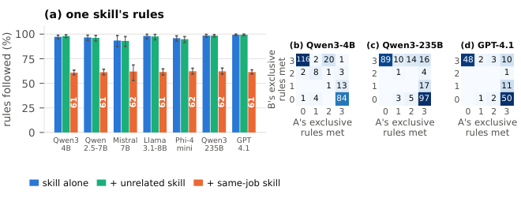

**原文图／官方图片** — 原图 2：(a) 七个模型上技能单独加载与并排同职能技能时的规则遵循率；(b-d) 双技能加载下按各自独占规则遵循数统计的输出——大多数输出落在两个“接管”角落。 · Figure 2 (fig_takeover.png), arXiv HTML 2610.25064v1 · [source](https://arxiv.org/html/2610.25064v1/fig_takeover.png)

**nanoRSI 复现状态** — not-run. 来源最近核验：2026-10-21.

**开源代码／权重／数据链接** — [prazmara/skillclash (no license file)](https://github.com/prazmara/skillclash)

**一手来源** — [arXiv abs 2610.25064](https://arxiv.org/abs/2610.25064) · [arXiv HTML v1](https://arxiv.org/html/2610.25064v1) · [prazmara/skillclash (no license file)](https://github.com/prazmara/skillclash)

### Compile Once, Run Cheap: Frozen, Portable Skills for Embodied Agents, and What Recursive Self-Improvement Adds

**2026-10-20** · paper · 直接有界闭环

**日期说明** — arXiv v1 于 2026-10-18 提交（稿件版本 3.6 落款 2026-10-17）；在 2026-10-20 批次公告，以公告日为首次公开日期；仓库 v1.0 于 2026-10-17 发布。

**机构关系** — Jingwen Bai、Canbo Zhang、Shuang Liu（北京欧瑞灵识科技有限公司 Orillusion；通讯 shuang.liu@orillusion.com），Guochao Bai、Weichun Huang（常州 ChangingTECH 机器人技术（苏州）），Shuangqi Li、Minchao Hu（上海云帆智控机器人技术）——依 HTML 头部块读出。

**改变对象与反馈复用** — 带显式编译协议的技能级递归自改进。强通用模型仅作为隔离、受审计的离线作者，在仿真中编写、运行、诊断并修复一个操作技能，直到通过在冻结之后才抽取的布局考试；冻结技能（SKILL.md、skills.py、perception.py 加含哈希、种子、环境指纹、考试结果与编译成本的 MANIFEST）之后仅以代码独立运行、或由只读其描述的廉价调用者驱动。全程设对照：每轮修复旁有无反馈对照草稿、仅继承对照、永不回灌的隐藏验证布局、以及用另一模型家族执行器运行同一文件的复用协议。

**作者报告结果** — 在 7 个 RoboTwin 2.0 任务上，Claude Code 把 4 个任务编译为 7 个冻结技能（5 个首稿即只需资格验证），单个作者成本 4.29-8.22 美元（计入 13 次失败战役后为每技能 55 美元）；另外 3 个任务在 18 次战役中未编译成功（含 5 次用 GPT-6 与一次预注册的 150 布局运行）——最难任务每次战役 78-95/100 但有 3-16 次安全中止，未过“95% 成功且零中止”闸门；继承早前证据的修复在隐藏布局上胜过重写；冻结技能跨执行器模型家族迁移。

**证据边界** — 仿真编译技能、任务集小；作者成本如实计入失败；100 局考试对中止率的界很宽；三个未编译任务如实按失败报告、未做修饰。

**代码／权重／数据／许可** — 仓库 github.com/Orillusion/embodied-skill-rsi 已上线，Apache-2.0 许可（LICENSE 从 raw.githubusercontent.com 读取；v1.0 发布于 2026-10-17）；论文为 arXiv 默认许可。

**可用于 nanoRSI 的实验方向——本次未实现** — 该编译协议正是本仓库冻结教义在具身技能上的镜像：把“每轮修复旁配无反馈对照草稿”与“仅继承”对照作为标准实验臂；被接受候选用发布 MANIFEST（哈希、种子、环境指纹、考试结果、编译成本）打包为交付标准。

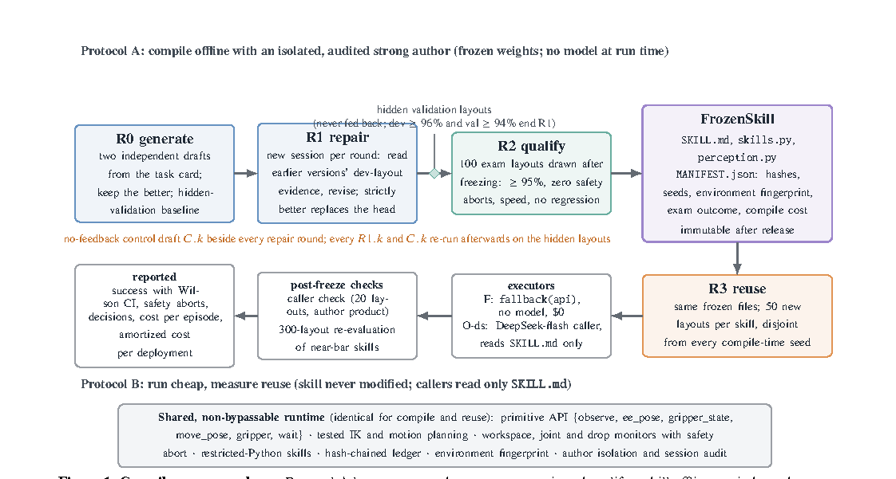

**原文图／官方图片** — 原图 1（自 PDF 渲染）：协议 A 由隔离、受审计的强作者离线编译并经独立闸门冻结技能；协议 B 用从未见过技能代码的执行器在新布局上运行同一文件；两者共享同一不可旁路运行时与哈希链清单。 · Figure 1 cropped from PDF page 2 (HTML figure assets absent); gs 150dpi render, bbox (77,99,1199,700) · [source](https://arxiv.org/pdf/2610.25114)

**nanoRSI 复现状态** — not-run. 来源最近核验：2026-10-21.

**开源代码／权重／数据链接** — [Orillusion/embodied-skill-rsi (Apache-2.0)](https://github.com/Orillusion/embodied-skill-rsi) · [embodied-skill-rsi LICENSE (Apache-2.0)](https://raw.githubusercontent.com/Orillusion/embodied-skill-rsi/main/LICENSE)

**一手来源** — [arXiv abs 2610.25114](https://arxiv.org/abs/2610.25114) · [arXiv HTML v1](https://arxiv.org/html/2610.25114v1) · [Orillusion/embodied-skill-rsi (Apache-2.0)](https://github.com/Orillusion/embodied-skill-rsi) · [embodied-skill-rsi LICENSE (Apache-2.0)](https://raw.githubusercontent.com/Orillusion/embodied-skill-rsi/main/LICENSE)

### EvoSkill v2: Fully Agentic Skill Evolution from Benchmark Adaptation to a Stateful Evolver

**2026-10-20** · paper · 直接有界闭环

**日期说明** — arXiv v1 于 2026-10-19 提交；在 2026-10-20 批次公告，以公告日为首次公开日期。

**机构关系** — Dastin Huang、Baran Nama、Salaheddin Alzubi——均为 Sentient Labs（作者块为 sentient.xyz 邮箱），依 HTML 作者块读出。

**改变对象与反馈复用** — 只编辑指令文件的三智能体技能演化（模型与 harness 不动）。基准适配器把用户描述的基准与评分器冻结为插件；求解器每轮对全部训练/验证任务各尝试三次；演化器是一个带 bash 工具、跨整次运行持续存在的有状态编码智能体——区别于逐次调用的优化器（SkillOpt）与每轮重启的智能体（SkillBoost）。演化器测量求解器 rollout 的次间方差，每个训练任务给多次尝试，并接受每一轮的技能而不是在噪声分数上做选择。

**作者报告结果** — 在有细粒度标准答案的设定下，EvoSkill v2 的技能把留出通过率在 SpreadsheetBench v2 上超过 SkillOpt/SkillBoost 中较强者 7.7 点、tau3-bench banking 上 5.4 点；两个基准、两种反馈设定下，其演化器每提升一点留出通过率的成本都低于两个基线优化器；较弱模型自我改进技能在 tau3 上最多 +21.5 点。

**证据边界** — 仅指令文件面；两个基准且评分器由用户提供；接受每轮以测量预算换选择稳健性（无逐轮过滤），留出对比独自承担全部检验；rollout 方差处理为启发式。

**代码／权重／数据／许可** — 核验时论文未给出代码仓库链接（所综述的 SkillOpt/SkillBoost 生态作为既有系统被引用）；论文 CC BY 4.0。

**可用于 nanoRSI 的实验方向——本次未实现** — 给选择器研究（ADOPTION 38/53）两项协议输入：跨代携带记忆的有状态提案器会话（替代逐次无状态）；以及“接受每一轮”实验臂——同预算下用最终留出面板对比全部轮次产物与闸门选择，直接检验逐编辑闸门是否丢弃最优（对照 AtomSearch 的 67% 非最优祖先发现）。

**原文图／官方图片** — 原图 1：运行前基准适配器把用户的基准与评分器冻结为插件；每轮求解器尝试训练与验证任务，有状态演化智能体重写技能。 · Figure 1 (figArch.svg), arXiv HTML 2610.25931v1, rendered to PNG · [source](https://arxiv.org/html/2610.25931v1/figArch.svg)

**nanoRSI 复现状态** — not-run. 来源最近核验：2026-10-21.

**开源代码／权重／数据链接** — 核验来源中没有确认的公开代码／资产链接。

**一手来源** — [arXiv abs 2610.25931](https://arxiv.org/abs/2610.25931) · [arXiv HTML v1](https://arxiv.org/html/2610.25931v1)

### From Trajectories to Differentiated Skills: Cognitive Differentiation for Self-Improving Agents

**2026-10-19** · paper · 直接有界闭环

**日期说明** — arXiv v1 于 2026-10-16 提交；在 2026-10-19 批次公告（OAI-PMH datestamp 2026-10-19），以公告日为首次公开日期。

**机构关系** — Yewei Zhao、Derong Xu、Wei Chen、Yin Xu、Mingjun Xiao（中国科学技术大学）；Derong Xu 兼美团；部分合著者（Peilun Zhou、Xiaohan Wang、Guojun Yin、Wei Lin）在 HTML 块中无可机读机构标注，香港城市大学出现在所列机构中——机构依 HTML 作者块读出。

**改变对象与反馈复用** — 技能演化中的认知分化（CDSE）：统一技能通过四个功能不同而协同的组件——Meta、Experience、Tool、Script——演化。从成功与失败轨迹提取有据可依的语义梯度，经保留闸门按功能角色巩固，再以组件特定更新与验证、跨组件协调及自适应调用（决定哪些组件进入当前任务上下文）落地。

**作者报告结果** — 对 500 个广泛使用技能包的分析发现 96.8% 至少跨两个功能角色。在六个基准（OfficeQA、SpreadsheetBench2、SealQA、LiveMathBench、SWE-Pro、AutomationBench）、三个模型（GLM-5.2、DeepSeek-V4-Flash、MiniMax-M3）与两个执行 harness（Claude Code、Codex）下（2:7 训练/测试切分），CDSE 在全部 36 个设定中得分最高：平均比 Base 智能体 +7.6 个点，比每个设定中最强的竞争技能演化方法（Trace2Skill、SkillOpt-lite、EvoSkill）+2.6 个点；单轮 token 开销各方法相当。

**证据边界** — 四组件分类学是认知科学启发的设计承诺而非推导出的必然；相对强未分化基线的优势为中等（+2.6）；评测用闭源 harness 与固定模型，技能演化在各基准 2/9 训练切分上训练。

**代码／权重／数据／许可** — 论文 HTML 中未发现仓库链接（2026-10-20 核验）；论文 CC BY 4.0。

**可用于 nanoRSI 的实验方向——本次未实现** — 把 nanoRSI 技能文件按 CDSE 四角色拆分并配组件级编辑预算（延伸 ADOPTION #53 文本学习率）与组件级接受检查；自适应调用对应按需加载组件，可在 skills 模板最小任务上直接检验。

**原文图／官方图片** — 原图 3 流水线：从成功与失败执行中发现语义梯度，按功能角色巩固，再经验证与自适应调用更新四个组件（Meta、Experience、Tool、Script）。 · Figure 3 (method-shao.png), arXiv HTML 2610.23599v1 · [source](https://arxiv.org/html/2610.23599v1/method-shao.png)

**nanoRSI 复现状态** — not-run. 来源最近核验：2026-10-20.

**开源代码／权重／数据链接** — 核验来源中没有确认的公开代码／资产链接。

**一手来源** — [arXiv abs 2610.23599](https://arxiv.org/abs/2610.23599) · [arXiv HTML v1](https://arxiv.org/html/2610.23599v1)

### SkillNEO: Non-Elitist Evolutionary Optimization of Agent Skills

**2026-10-15** · paper · 直接有界闭环

**日期说明** — arXiv 2610.20926 v1 提交于 2026-10-15，随 2026-10-16 批次公告；21 位作者分布于 UIC/MBZUAI/UCSD/UCLA/UT Arlington 加一位独立研究者。

**机构关系** — Enze Ma、Chunyu Miao、Yankai Chen、Jie Yang、Liancheng Fang、Kening Zheng、Hanrong Zhang、Muyao Xu、Xinle Yu、Chengze Li、Wei-Chieh Huang、Ziwei Ren、Yunhao Du、Zhixiang Shen、Xue Liu、Philip S. Yu、Zhen Wang 等——伊利诺伊大学芝加哥分校；穆罕默德·本·扎耶德人工智能大学；加州大学圣地亚哥分校；加州大学洛杉矶分校；德克萨斯大学阿灵顿分校；独立研究者（机构集合按 HTML 作者块原样记录）。

**改变对象与反馈复用** — 非精英技能演化：把“选哪个版本来用”与“选哪些版本继续改”分开——提升可能需要多条相互依赖的编辑，低分修订仍可能带有可用部分。通过观察相关版本如何执行同一任务，识别应保留的可用步骤与待修复的残留失败；还能回到更早版本，用后续尝试揭示的信息重新修订。

**作者报告结果** — 在覆盖软件工程、办公与另外六个领域的 86 个 SkillsBench 任务上，SkillNEO 把 GPT-5.4 Mini 的平均奖励从 49.1% 提到 66.4%，进入 GPT-5.5 与 GPT-5.6 Luna 的原技能性能区间。演化出的技能无需再编辑即可改进更强模型：在有改动的 41 个任务上，复用使 Luna 提升 10.5 个百分点、GPT-5.5 高出其公开原技能参考 10.6 个百分点。

**证据边界** — HTML 未找到 SkillNEO 本体的代码 URL（只有 SkillsBench 轨迹数据链接）；评测在作者自建的 SkillsBench 套件上；增益集中在较弱的编辑模型上，迁移在 41 任务子集上测得。

**代码／权重／数据／许可** — HTML 未找到专属仓库；引用了 github.com/benchflow-ai/skillsbench-trajectories 的 SkillsBench 轨迹数据。

**可用于 nanoRSI 的实验方向——本次未实现** — “用与改”分离的非精英选择是 ADOPTION 53 缺的另一半：让低分版本保持可编辑（但绝不投入使用）能抓住严格闸门丢弃的相互依赖编辑收益——与同批次 AtomSearch 的“保留但不晋升”状态互补（不同团队独立得出）。向更强模型 +10.5 个百分点的向上迁移，是技能面对我们跨面板迁移问题的回答。

**原文图／官方图片** — 原图 2：SkillNEO 把“选技能来用”与“选版本来改”分开——一个版本可以继续接受编辑（绿色）而另一版本被投入使用，并通过比较相关版本识别可用步骤与残留失败。 · Figure 2 (skillneo_method_artwork.png), arXiv HTML 2610.20926v1 · [source](https://arxiv.org/html/2610.20926v1/skillneo_method_artwork.png)

**nanoRSI 复现状态** — not-run. 来源最近核验：2026-10-17.

**开源代码／权重／数据链接** — 核验来源中没有确认的公开代码／资产链接。

**一手来源** — [arXiv abs 2610.20926](https://arxiv.org/abs/2610.20926) · [HTML full text v1](https://arxiv.org/html/2610.20926v1)

### CausalEvo: Causal Skill Self-Evolution for Health LLM Agents

**2026-10-14** · paper · 直接有界闭环

**日期说明** — arXiv v1 于 2026-10-14 提交；被 NeurIPS 2026 GenAI for Health 研讨会（悉尼）接收（研讨会接收不作为首发日期）。

**机构关系** — 单作者 Yuchen Zhang——休斯敦德克萨斯大学健康科学中心（HTML 作者块的 UTH.TMC 邮箱）。

**改变对象与反馈复用** — 冻结 LLM 每步提出两条新技能规则，与四条在位规则合并为候选集（在位者永远可选）。技能价值用因果方式估计而非裸面板分数：在候选集的随机重标环上，对每条有向边用相同反馈案例跑两次——共享 k-1 条背景规则、只交换被换的那条（等规则数把内容效应与规模效应分开）；零和约束的最小二乘把成对分数差解为相对技能价值，选择按字典序——先总和最高、平局偏向在位集合。决策损失界把误差分解为候选支撑、逼近（超出线性投影的规则交互）与估计三部分，并给出精确系数仍会因互补性选错的显式反例。

**作者报告结果** — 在六个 MedCalc-Bench-Verified 任务上（120 留出例、每任务 20、DeepSeek V4 Flash 0731 关思考）：CausalEvo 60.00% 对 SkillOpt 55.83% 对无技能 51.67%，训练 token 少 55.6%（2.203M 对 4.961M；336 对 839 次请求），终版技能 180 词对 999 词。信用分配消融（独立 24 例集）：70.83% 对打乱信用 62.50%（+8.33pp，区间含零）。

**证据边界** — 增益几乎全部集中在 Cockcroft-Gault（+9 例），其余五任务合计 -4；Child-Pugh 从 50% 回退到 30%，且该任务无技能基线胜过两个方法；Holm 校正后不显著（配对区间含零，对 SkillOpt [-5.00, 13.33])；即时学习获取为负（-3.33pp）；每方法单条训练轨迹且预算/后端/技能长度不一；可能过拟合 3 例反馈面板；参考标签存在争议；无临床验证。

**代码／权重／数据／许可** — 仓库 github.com/txbrook/CausalEvo 存在（2026-10-18 在线）但仅含手稿源码与数学检查器——论文明言完整训练代码与原始响应暂未包含；无 LICENSE 文件（按保留所有权利对待）；论文 CC BY 4.0；MedCalc-Bench-Verified 为 CC-BY-SA-4.0。

**可用于 nanoRSI 的实验方向——本次未实现** — 共享背景下的成对交换是技能闸门上廉价的归因层：让候选编辑按配对方式计分而非信任裸面板差值，使技能因边际贡献而非面板噪声晋升；论文的报告范式（点名增益集中任务、做 Holm 校正、声明单轨迹局限）正是选择器研究应对齐的诚实标准。

**原文图／官方图片** — 原图 1：方法流水线——候选规则池、共享背景下定容量成对交换、最小二乘信用估计、偏向在位者的 top-k 选择。 · Figure 1 (figures/causalevo_overview.png), arXiv HTML 2610.21016v1 · [source](https://arxiv.org/html/2610.21016v1/figures/causalevo_overview.png)

**nanoRSI 复现状态** — not-run. 来源最近核验：2026-10-18.

**开源代码／权重／数据链接** — [CausalEvo code](https://github.com/txbrook/CausalEvo)

**一手来源** — [arXiv abs 2610.21016](https://arxiv.org/abs/2610.21016) · [arXiv HTML v1](https://arxiv.org/html/2610.21016v1) · [CausalEvo code](https://github.com/txbrook/CausalEvo)

### AtomSearch: Evidence-Grounded Tree Search for Agent Skill Optimization

**2026-10-14** · paper · 直接有界闭环

**日期说明** — arXiv 2610.19951 v1 提交于 2026-10-14，随 2026-10-15 批次公告。

**机构关系** — Jia Tong、Senyou Deng、Min Peng、Jianfeng Pan——360 安全技术（北京）（三个 360.cn 作者邮箱；共享机构行）。

**改变对象与反馈复用** — 让技能修订动作保持局部，同时用后续技能状态引导搜索。对比原子编辑把每条最小规则编辑与失败/成功执行、一个行为假设和预期作用域绑定；技能状态树搜索评估短编辑组合并有选择地保留为可重访、可扩展的可执行状态；结果记忆向后续提案提供实测的修复与回归统计。

**作者报告结果** — 四个任务 × 五个目标模型：deepseek-v4-flash 下在 3/4 任务上超过 SkillOpt，LiveMathematicianBench 领先 9.68 个百分点，而 SkillOpt 终版技能字符数是其 2.3-19.7 倍。67% 的已完成搜索中，最优验证状态经过了在其深度上并非最高分的祖先——按即时分数贪心会丢弃通往最优的路径。

**证据边界** — 未找到代码链接；对比以 SkillOpt 为主、4 任务/5 模型；修复/回归统计未由本次核验重推。

**代码／权重／数据／许可** — HTML 全文未找到代码或仓库链接。

**可用于 nanoRSI 的实验方向——本次未实现** — “67% 经由非最高分祖先”是对纯严格闸门技能采纳（ADOPTION 53）的直接外部反证：有界技能状态树（保留但不晋升）是单编辑严格验证与多编辑提案之间缺的中间层；结果记忆（每条规则实测修复/回归）与技能轨道的证据账本字段一一对应。

**原文图／官方图片** — 原图 1：对比原子编辑把失败/通过执行对变成带作用域的编辑规格；技能状态树搜索保留可执行的中间状态；结果记忆把修复/回归统计喂给后续提案。 · Figure 1 (fig_overview.svg), arXiv HTML 2610.19951v1 · [source](https://arxiv.org/html/2610.19951v1/fig_overview.svg)

**nanoRSI 复现状态** — not-run. 来源最近核验：2026-10-17.

**开源代码／权重／数据链接** — 核验来源中没有确认的公开代码／资产链接。

**一手来源** — [arXiv abs 2610.19951](https://arxiv.org/abs/2610.19951) · [HTML full text v1](https://arxiv.org/html/2610.19951v1)

### Knowledge Graphs as Files: An Agent Harness Where Tool Creation and Tool Use Co-Evolve

**2026-10-13** · paper · 直接有界闭环

**日期说明** — arXiv v1 提交于 2026-10-13，随翻倍的 2026-10-14 批次公告；2026-10-16 完成一手核验。

**机构关系** — Yuyang Bai（德州农工）、Yu Wang（俄勒冈大学）、Yu Zhang（德州农工），取自署名行；HTML 邮箱链接错乱（Wang 的地址渲染成 Yu Zhang 的），如实记录。

**改变对象与反馈复用** — DKGI（直接知识图谱交互）把 KG 导出为文件——节点 JSONL 分片、按关系的 TSV 边表、schema.json、candidate_ids.txt——让编码 CLI（Pi 或 Codex）里的 ReAct 式代理把 shell 检索与直接在这些文件上写并执行 Python 交织，不用预定义图 API 或子图检索器。每回合代理可向工具箱 T_t 增加程序 p_t、向 L_t 增加保存的输出文件 l_t；执行反馈（候选 id、中间节点集、空匹配、报错信息，以及大输出的首尾截断视图）决定下一步的遍历、过滤或修订，使工具创造与工具使用在任务内共演化。复用有实测：48.4% 的程序嵌入早前输出中见过的节点 id；36.5% 修订早前程序（其中 88.6% 发生在失败之后）；更晚的程序读取早前的输出文件。

**作者报告结果** — 免训练 DKGI 在 STaRK 合成测试（Amazon 1,642 / MAG 2,665 / Prime 2,801 查询）上：GPT-6-Astra 下对 GRASP（最强已训练基线）Hit@1 领先 +8.2 / +9.0 / +6.7——“每张图至少 6.7 Hit@1”；整体 H@1 71.5（Luna/Pi）、73.1（Luna/Codex）、82.1（Astra/Pi）。消融（测试子集，GPT-6-Luna）：完整 DKGI 75.2 对仅 shell 68.3、预定义图工具 72.8、图工具+代码 74.2、单程序 69.0、仅检索 47.7、无邻边 44.2——在原始文件上加 Python 得 +6.9，而在预定义图工具上只加 +1.4。

**证据边界** — 范围：STaRK 三张 KG（≤10 实体类型、18 关系类型、190 万节点、3,980 万边）；Freebase/Wikidata 级 schema、聚合问题与同 harness 下的 Cypher/SPARQL 代理留作未来工作。仅用专有骨干（GPT-6-Luna/Astra，2026 年 9–10 月 API）；未测开源权重模型。基线数字取自文献、骨干/预算不一致；程序按查询丢弃；任意 shell 执行需沙箱。最大错误源是排序（答错案例中金节点被返回但未排第一的占 58/46/55%）；仅 shell 访问甚至不如预定义图工具。

**代码／权重／数据／许可** — 代码 MIT 许可，位于 github.com/leopoldwhite/DKGI；导出图、提示与全部轨迹 CC BY 4.0；论文 CC BY 4.0（2026-10-16 自 HTML 声明核验）。

**可用于 nanoRSI 的实验方向——本次未实现** — 共演化的度量即可迁移点：给 nanoRSI 技能演化装上统计——“新程序中复用早前输出（嵌入 id）的比例、修订早前程序的比例、修订中有多少发生在失败之后”——这些按轨迹的廉价统计能区分真实积累与重新推导。消融还支持把任务数据以原始文件而非预定义工具 API 交给代理：直接文件访问加代码的收益超过任一单独形式。

**原文图／官方图片** — 论文原图 1：STaRK-MAG 查询上，截断的预定义邻居调用漏掉金论文，而 DKGI 的代理自写代码（在导出的节点/边文件上扫描、合并、过滤）让工具创造与工具使用共演化并检索到它。 · Figure 1 (S1.F1), arXiv HTML v1 · [source](https://arxiv.org/html/2610.18616v1/fig1_image.svg)

**nanoRSI 复现状态** — not-run. 来源最近核验：2026-10-16.

**开源代码／权重／数据链接** — [DKGI code](https://github.com/leopoldwhite/DKGI)

**一手来源** — [arXiv abstract](https://arxiv.org/abs/2610.18616) · [arXiv HTML v1](https://arxiv.org/html/2610.18616v1) · [DKGI code](https://github.com/leopoldwhite/DKGI)

### Small but Mighty: Test Suites as Improvement Signals for Self-Evolving Agents

**2026-10-11** · paper · 直接有界闭环

**日期说明** — arXiv v1 提交于 2026-10-11，随翻倍的 2026-10-14 批次公告；2026-10-15 完成一手核验。

**机构关系** — Yutong Cheng（弗吉尼亚理工；实习工作于 NEC Labs America）、Wei Cheng、Wenchao Yu、Haifeng Chen（NEC Laboratories America）、Dawei Zhou（弗吉尼亚理工）。HTML 中邮箱与作者映射错乱，机构以论文署名行为准。

**改变对象与反馈复用** — 演化小型可执行测试套件，作为自编辑 harness 代码的接受/拒绝信号。质量-多样性搜索按套件规模生态位维护（覆盖率、变异得分）的帕累托前沿，让小而强的套件存活；交付套件是超体积最大者中最小的。学习到的落点核补偿 LLM 对套件规模指令的噪声服从（对数正态模型、在线估计计数偏差），并按请求实际落点加权老虎机信用；规模退火 UCB 在质量过阈后才惩罚规模。闸门：套件先对未修改模块跑通；修订模块若让先前通过的套件失败即被拒——无需模型调用即可拦截改变行为的自编辑。

**作者报告结果** — 129 个 TestGenEval Python 模块、3 骨干（GPT-5.4、Claude Opus 4.8、Gemini 3.1 Pro）：行为改变型重写的拒绝率 59.9% 对仓库测试的 25.3%，逐模块全面更优；等价重写上的误报率 4.0%（10/253）；判定 3.5 秒对 5.9 秒且零模型调用；每个骨干上超体积最高（超最佳基线 7.0-8.5）且套件最小（如 hv 0.976、规模 29.1）。自演化研究：8 个 mini-swe-agent harness 模块、470 条已验证修订、评分者间 kappa 0.74。

**证据边界** — 4.0% 误报率意味着等价重写偶被误拦（仓库测试为 0%）；评测仅限 Python（TestGenEval 模块）；自演化研究覆盖 8 个 harness 模块；HTML 邮箱-作者映射错乱（已如实记录）。

**代码／权重／数据／许可** — 代码/数据 MIT 许可，位于 github.com/ccsnow127/TeSearch（LICENSE 已于 2026-10-15 核验）。论文 CC BY 4.0。

**可用于 nanoRSI 的实验方向——本次未实现** — 对 nanoRSI 的核心迁移：用专门演化出的小套件而非任务自带测试来闸自编辑——套件先在父代跑通再判子代，提供带实测误拦率的行为保持检查（TeSearch 的 4.0% 即参考值）。规模生态位帕累托档案也是让评测工件小到可在 episode 预算内逐次运行的具体范式。

**原文图／官方图片** — 论文原图 1：TeSearch 的质量-多样性档案按套件规模生态位维护覆盖率与变异得分的帕累托前沿；交付的小套件再为自演化 harness 代码的行为改变型重写把关。 · Figure 1 (fig1_overview.png): the TeSearch archive keeping a Pareto front on (coverage, mutation score) per size niche, feeding suite-gated harness rewrites · [source](https://arxiv.org/html/2610.15964v1)

**nanoRSI 复现状态** — not-run. 来源最近核验：2026-10-15.

**开源代码／权重／数据链接** — [ccsnow127/TeSearch (MIT)](https://github.com/ccsnow127/TeSearch)

**一手来源** — [arXiv abstract](https://arxiv.org/abs/2610.15964) · [arXiv HTML v1](https://arxiv.org/html/2610.15964v1) · [ccsnow127/TeSearch (MIT)](https://github.com/ccsnow127/TeSearch)

### ViSkill: Reinforcing VLM Agents with Evolving Visual-Native Skills

**2026-10-08** · paper · 直接有界闭环

**日期说明** — arXiv v1 提交于 2026-10-08；无修订。

**机构关系** — 全部作者来自浙江大学（ZJU-REAL 实验室）；通讯作者 Yongliang Shen。

**改变对象与反馈复用** — 技能增强的 agent 通常把空间布局线性化为文本；ViSkill 改为把成功交互存成视觉技能卡，供 VLM agent 检索以同时引导推理与奖励塑形，同时策略用 PPO 在这些轨迹上训练；合格轨迹再蒸馏回技能库，形成技能演化与策略优化互相增强的闭环。可选冷启动机制为库播种。

**作者报告结果** — 在 Sokoban / FrozenLake / PrimitiveSkill 上，基础方法成功率达 0.82 / 0.84 / 1.00（总 0.89），冷启动后 0.88 / 0.85 / 1.00（总 0.91），高于 AtlasVA 0.87、VAGEN 0.80、GPT-5 0.70、o3 0.69、Claude 4.5 Sonnet 0.58、Qwen2.5-VL-72B 0.40 与 Qwen2.5-VL-3B 0.09 的总成绩，且比标准 PPO 收敛更快。消融：去掉策略优化 Sokoban 跌到 0.29；文本技能变体跌到 0.63；检索阈值 0.8、蒸馏多样性 0.9 为报告最优；演化出的技能库可迁移到未优化基座模型。

**证据边界** — 评估仅限 VAGEN 框架环境；更复杂或开放场景的收益未验证。技能引导奖励假设部分进展会到达检索技能中出现的状态，当有效解穿越不相交状态路径时引导有限。

**代码／权重／数据／许可** — 代码：github.com/ZJU-REAL/ViSkill，MIT 许可（raw LICENSE 核验，版权 RAGEN.AI）。数据：环境来自 VAGEN 框架。许可：MIT；论文 CC BY 4.0。

**可用于 nanoRSI 的实验方向——本次未实现** — 模态这一点超出视觉本身：nanoRSI 技能是文本文件，而这是「以执行器原生表示（而非有损序列化）存储经验会改变技能演化可表达内容」的实测证据——值得在技能产物可以是数据文件而非散文的数字/面板任务上做一次最小 A/B。

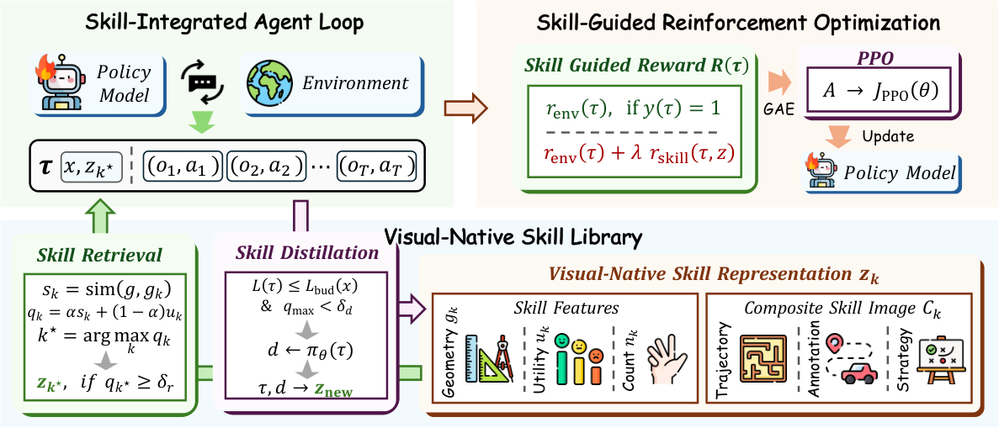

**原文图／官方图片** — 论文原图 2：ViSkill 总览——agent 从库中检索视觉技能卡以引导交互与奖励塑形，收集轨迹并把合格轨迹蒸馏为新技能，策略由 PPO 联合优化。 · Figure 2 (method.png): the agent retrieves a visual skill from the library to guide interaction, collects trajectories, and distills eligible trajectories into new skills while PPO optimizes the policy · [source](https://arxiv.org/html/2610.12403v1)

**nanoRSI 复现状态** — not-run. 来源最近核验：2026-10-13.

**开源代码／权重／数据链接** — [GitHub repository (MIT)](https://github.com/ZJU-REAL/ViSkill)

**一手来源** — [arXiv abstract](https://arxiv.org/abs/2610.12403) · [arXiv HTML v1](https://arxiv.org/html/2610.12403v1) · [GitHub repository (MIT)](https://github.com/ZJU-REAL/ViSkill)

### Trajectory-Guided Fault Localization for Agent Skill Evolution

**2026-10-08** · paper · 直接有界闭环

**日期说明** — arXiv v1 于 2026-10-08 提交（2610.11858）；截至 2026-10-12 仅有'20 页 3 图'信息，未标注会议。

**机构关系** — 四位作者来自南京大学（李中、张天为通讯作者），一位来自香港理工大学；内核生成落地在 Ascend CANN 生态的 AI 算子开发团队，评测用 NPUKernelBench。

**改变对象与反馈复用** — SkillMorph 把技能修订锚定在行为证据上：抽象化执行轨迹，跨重复运行与任务比较失败与成功证据，用演化循环之间的差异定位可疑动作，再在相应技能内定位编辑点并生成针对性修订——而不是仅凭结果反馈重写整条技能。

**作者报告结果** — 在 490 个 SWE-Skills-Bench 任务（1,470 次运行）上：SkillMorph 95.51% pass@3 / 92.24% 逐试精度 / 88.37% pass3，对照原始技能 82.45/75.44/67.96、四个技能演化基线中最强的 CAP-Evolve 92.24/89.39/84.90。在 15 个任务的 CannBot AscendC 内核基准上：三项指标均为 93.33，对照原始技能 80.00/66.67/46.67、CAP-Evolve 93.33/84.44/73.33。消融：去掉定位后 SWE 总体降至 91.22/87.35/82.24；单次运行变体 90.20。内核生成部署产生的 6 个技能修订拉取请求被开发团队接受。

**证据边界** — 未找到公开代码、基准或技能语料（HTML 中的 GitHub 链接指向 cap-evolve 等基线）；CannBot 仅 15 个任务，93.33 的天花板落在小面板上；逐试精度与 pass@3 由作者自己的 harness 计算；6 个被接受的 PR 作为落地证据计数，未对算子质量做受控前后对照。

**代码／权重／数据／许可** — 代码：arXiv 页与 HTML 均未找到。权重：不适用。数据：SWE-Skills-Bench 被描述为公开精选技能；CannBot 与 NPUKernelBench 的发布状态除引用外未核验。许可：论文为 arXiv 默认许可。

**可用于 nanoRSI 的实验方向——本次未实现** — nanoRSI 技能轨道可检验的思路：重写技能前，先对重复运行的抽象化失败/成功轨迹做差异对比，对可疑动作排序，并把编辑限制在这些动作回溯到的技能区域——与同评测预算下的整技能重写对照，并把编辑点精确率作为诚实的附加指标报告。

**原文图／官方图片** — 论文原图 3：SkillMorph 循环抽象化执行轨迹、跨运行对照失败与成功证据、隔离可疑动作，并把修订定位到负责的技能区域。 · Figure 3 (overview-final.png): SkillMorph overview - trajectory abstraction, failure/success comparison, suspicious-action ranking and localized skill revision · [source](https://arxiv.org/html/2610.11858v1)

**nanoRSI 复现状态** — not-run. 来源最近核验：2026-10-12.

**开源代码／权重／数据链接** — 核验来源中没有确认的公开代码／资产链接。

**一手来源** — [arXiv abstract](https://arxiv.org/abs/2610.11858) · [arXiv HTML v1](https://arxiv.org/html/2610.11858v1)

### RoboRSI: Stable, efficient, and reusable robot self-evolution in complex real-world environments

**2026-10-08** · paper · 直接有界闭环

**日期说明** — arXiv v1 于 2026-10-08 提交（2610.12424，cs.RO 交叉 cs.AI）。官方项目页标注 2026 年 9 月，配套仓库创建于 2026-08-29；按本库论文惯例，条目日期取 arXiv v1 日期。

**机构关系** — 十一位作者，Cewu Lu 与 Chuan Wen 为通讯作者；项目页与 BibTeX 署名 Noematrix 团队（lab.noematrix.ai）。arXiv HTML 未排印高校机构，故除 Noematrix Lab 外的机构信息此处未独立核验。

**改变对象与反馈复用** — 自顶向下技能精炼（TSR）把任务分解为复合、原子与基础技能，各带职责范围与显式输入输出契约，使执行失败可归因到负责分支，修订也只落在该分支。Manager 组织技能层级，Planner 组合执行计划，Engineer 执行，Reviewer 在发布前验证；人类通过目标与纠正进行导向；稳定序列固化为可复用复合技能。

**作者报告结果** — 在实体移动操作机上，多物体家庭清理经 104 轮自演化长成；约一天的迭代对照项目页所述 2024 年参考（两名工程师、约一个月、2000-3000 行任务代码）。仿真中在 LIBERO、LIBERO-PRO、LIBERO-Plus 与 RoboTwin 上取得最高成功率，较最强基线高 2.7-11.0 个百分点；LIBERO 累计 95/120（初始 32/120），RoboTwin 36/50（初始 9/50）。在 840 个 LIBERO-Plus 扰动实例上，固定系统过 261（31.1%），自适应 pass@2 过 398（47.4%）。600 局的固化消融把通过率从 21.5% 提到 29.0%（+7.5 点），中位 token 下降 29.4%。

**证据边界** — 实体结果来自单一移动操作平台上的两场景清理任务集；人类通过目标与纠正参与导向，自主性有界；基线差距（2.7-11.0 点）为作者在自有评测下报告；'一天对一个月'的对照引用团队自身 2024 年实践而非受控研究；一个图文件名提示 ICLR 2027 投稿，但未声称也未核验录用。

**代码／权重／数据／许可** — 代码：github.com/nssmd/RoboRSI，仓库内核验为 Apache-2.0（123 星，创建于 2026-08-29，最后推送 2026-10-10）；项目页 lab.noematrix.ai/blog/2-roborsi/ 带完整工具轨迹视频。权重：未核验到机器人策略检查点发布。数据：未核验到技能层级与评测日志发布。许可：Apache-2.0。

**可用于 nanoRSI 的实验方向——本次未实现** — 对 nanoRSI 可移植的纪律是契约约束的修订：给每条技能显式输入输出契约使失败归因到分支，把编辑限制在该分支内，并要求 Reviewer 式验证后技能才能回到库中——再测量同面板上约束编辑是否以更少回归胜过整文件重写，与既有反事实面板互相印证。

**原文图／官方图片** — 论文原图 2：RoboRSI 框架——Manager 组织任务的技能层级，Planner 组合执行计划，Engineer 执行，Reviewer 把通过验证的技能修订闸回技能库。 · Figure 2 (2027_ICLR_Framework2.0.png): Manager organizes the skill hierarchy, Planner composes the plan, Engineer executes, Reviewer validates before release · [source](https://arxiv.org/html/2610.12424v1)

**nanoRSI 复现状态** — not-run. 来源最近核验：2026-10-12.

**开源代码／权重／数据链接** — [Apache-2.0 code release](https://github.com/nssmd/RoboRSI) · [Apache-2.0 license](https://github.com/nssmd/RoboRSI/blob/main/LICENSE)

**一手来源** — [arXiv abstract](https://arxiv.org/abs/2610.12424) · [arXiv HTML v1](https://arxiv.org/html/2610.12424v1) · [Apache-2.0 code release](https://github.com/nssmd/RoboRSI) · [Apache-2.0 license](https://github.com/nssmd/RoboRSI/blob/main/LICENSE) · [Noematrix Lab project page](https://lab.noematrix.ai/blog/2-roborsi/)

### SkillAA: Attribution-Guided Skill-Graph Updating with Targeted Validation and Rollback

**2026-09-17** · paper · 直接有界闭环

**日期说明** — arXiv v1 2026-09-17；代码仓库同日创建。

**机构关系** — 学术工作（南京大学计算机软件新技术全国重点实验室与智能科学与技术学院）。

**改变对象与反馈复用** — 在冻结模型上，对比成功/失败 rollout 把每次失败归因到具体技能图对象；修复只编辑被选中的局部结构，Local 与 Big 双闸门在提交前验证候选变更并支持回滚。

**作者报告结果** — gpt-5.6-sol 下 SkillAA 达 SearchQA 81.5%、LiveMath 66.7%、DocVQA 91.2%，在所有主设置中观测均值最高；消融支持结构化表示、归因条件编辑与 Local-Gate 回归控制的作用。

**证据边界** — 作者自报且摘要无外部基线数字；对照在论文表格内；代码仓库无 LICENSE 文件（默认保留所有权利）。

**代码／权重／数据／许可** — 代码位于 github.com/Ziqiao-Shang/SkillAA（核验时无 LICENSE 文件——仅可借鉴思想）；论文 CC BY 4.0。

**可用于 nanoRSI 的实验方向——本次未实现** — nanoRSI 证据卡已存诊断与 diff；SkillAA 补上缺的另一半——编辑前把每次退化归因到确切技能小节，再用回滚单元闸门验证编辑，而非整技能重写。

**原文图／官方图片** — SkillAA 如何从错误学习：每个技能节点声明适用与不适用条件；归因把修复路由到具体失败对象后再做闸门编辑。 · Figure 2 (images/2.png) · [source](https://arxiv.org/html/2609.20455v1)

**nanoRSI 复现状态** — not-run. 来源最近核验：2026-09-19.

**开源代码／权重／数据链接** — [Code repository](https://github.com/Ziqiao-Shang/SkillAA)

**一手来源** — [arXiv abstract](https://arxiv.org/abs/2609.20455) · [Paper HTML (affiliations, Figure 2, results)](https://arxiv.org/html/2609.20455v1) · [Code repository](https://github.com/Ziqiao-Shang/SkillAA)

### FINSKILLOPS: A Self-Evolving Multi-Agent System for SEC Filing QA

**2026-09-17** · paper · 直接有界闭环

**日期说明** — arXiv v1 2026-09-17；28 位作者分布于一企业与十一所高校；HTML 用 EMNLP 模板但未声明接收。

**机构关系** — SimpleWay.AI 牵头的产业-学术联合，合作方含麦吉尔、多伦多、UCLA、港中文、Mila 等。

**改变对象与反馈复用** — 类型化、证据接地的失败诊断被转成带作用域的技能补丁，经定向验证、回归检查与阴性对照后，在 SEC 文件问答的服务/进化双环中做版本化替换或退役。

**作者报告结果** — 进化技能把裁判打分的正确性从 3.70 提到 4.55；另一项 12 轮运营研究仅晋升 33 个提案技能中的 6 个，监控非正确率从 20.0% 降至 12.5%。

**证据边界** — 作者自报于自建金融问答场景、评分依赖 LLM 裁判；6/33 晋升率是诚实的头条——多数提案技能未过闸；未找到代码发布。

**代码／权重／数据／许可** — arXiv 论文公开；核验时未发现代码发布。

**可用于 nanoRSI 的实验方向——本次未实现** — 阴性对照准入（提案技能必须在失败切片上胜过不作为对照）与显式退役是 nanoRSI 技能流缺的两道闸；6/33 晋升率是现实的前置参考。

**原文图／官方图片** — FinSkillOps：服务管线使用策划的文件索引，进化环把失败回答变成过闸的注册表更新并回流服务。 · Figure 1 (emnlp-FinEvo-Final.png) · [source](https://arxiv.org/html/2609.19680v1)

**nanoRSI 复现状态** — not-run. 来源最近核验：2026-09-19.

**开源代码／权重／数据链接** — 核验来源中没有确认的公开代码／资产链接。

**一手来源** — [arXiv abstract](https://arxiv.org/abs/2609.19680) · [Paper HTML (affiliations, Figure 1, abstract numbers)](https://arxiv.org/html/2609.19680v1)

### Reflect, Revise, Reuse: Training-Free Skill Evolution for GUI Agents

**2026-09-15** · paper · 直接有界闭环

**日期说明** — v1 2026-09-15；机构列表取自论文 HTML（一位合作者为电子科大，其余浙大）。

**机构关系** — 学术工作（浙大牵头）；未见企业隶属。

**改变对象与反馈复用** — 技能是部署期持续修订的多文件包，走反思-修订-复用循环：隔离评审者诊断失败、受限编辑接口限定可改的技能文件、修订过闸后复用——全程无权重更新。

**作者报告结果** — 免训练增益最高 +16.2%（MobileWorld）、+6.0%（AndroidWorld）、+10.5%（OSWorld），最后一项是跨基准迁移设定。

**证据边界** — 作者自报；仅 GUI 域；摘要未完整量化修订预算与评审者误差的影响。

**代码／权重／数据／许可** — arXiv 论文公开；代码在本次核验时未确认。

**可用于 nanoRSI 的实验方向——本次未实现** — 受限编辑接口（仅指定技能文件可写）加隔离评审者与 nanoRSI 的契约守卫同构；把部署期修订加为对照条件，可区分'技能变好了'与'技能没坏、执行漂移了'。

**原文图／官方图片** — 反思-修订-复用循环：失败触发隔离评审者与对多文件技能包的受限编辑，过闸后复用。 · Method figure (method.png) · [source](https://arxiv.org/html/2609.17653v1)

**nanoRSI 复现状态** — not-run. 来源最近核验：2026-09-18.

**开源代码／权重／数据链接** — 核验来源中没有确认的公开代码／资产链接。

**一手来源** — [arXiv abstract](https://arxiv.org/abs/2609.17653) · [Paper HTML (affiliations, method figure)](https://arxiv.org/html/2609.17653v1)

### SkillLift: Learning Dense Rubrics from Sparse Oracles for Efficient Skill Evolution

**2026-09-14** · paper · 直接有界闭环

**日期说明** — arXiv v1：2026-09-14。代码仓库创建于 2026-08-08。核验时无更新版本。

**机构关系** — 论文 v1：Haoxiang Kang 为独立研究者；Ming Wen 隶属复旦大学（通讯）。

**改变对象与反馈复用** — 把技能自进化重构为双层优化，以摆脱 oracle-rollout 瓶颈（通常每个候选编辑都要跑一整次智能体 rollout）。学习一个结构化评分表 R——对技能行为的 M 条带符号权重的二元判据——作为廉价的 oracle 对齐替代器。内环：冻结 R 引导技能修订，用一次 LLM 调用而非 rollout 为候选打分。外环：在冻结技能上跑少量 oracle rollout，用 Kendall's tau 秩相关重对齐 R——只看相对次序，不校准绝对分值。交替循环在保持替代器可信的同时摊薄 oracle 成本。

**作者报告结果** — 在 WildClawBench 与 SkillsBench、三个骨干模型上（SkillsBench 用 GPT-5.4-mini、WildClawBench 用 GPT-5.4，与官方实现对齐），SkillLift 同时超过人工技能、一次性 LLM 技能、SkillOpt 与 CoEvoSkills，且 token 成本比前沿进化方法省 40-70%。表 2 分类别格显示：各组内对最强基线的总分区间为 WildClawBench +5.4~+14.0、SkillsBench +9.6~+28.3；先导实验表明直接 oracle 引导搜索的累积 token 被 oracle rollout 成本主导。

**证据边界** — 两人署名论文；基准类别与评分表质量依赖 oracle 存在且可排序。基线获得 2 倍于 SkillLift 默认预算的 token，成本对比对此有利。全部数字为作者自测；仓库很新（核验时 2 星）。

**代码／权重／数据／许可** — 代码以 MIT 发布于 github.com/WalteR-MittY-pro/SkillLift（仓库创建于 2026-08-08，核验时 2 星）。未找到权重或数据发布。

**可用于 nanoRSI 的实验方向——本次未实现** — 对 nanoRSI 技能环：用学习的评分表替代器替换逐编辑全 rollout，周期性用秩相关在 oracle rollout 上重对齐——可在最小任务上直接验证其为更便宜的技能验收信号。

**原文图／官方图片** — 图 2：SkillLift 总览——内环以冻结评分表零 oracle 成本地修订技能，外环用少量 oracle rollout 按 Kendall's tau 重对齐评分表。 · Figure 2, PDF page 3 · [source](https://arxiv.org/pdf/2609.15396)

**nanoRSI 复现状态** — not-run. 来源最近核验：2026-09-16.

**开源代码／权重／数据链接** — [Code repository (MIT)](https://github.com/WalteR-MittY-pro/SkillLift)

**一手来源** — [arXiv abstract](https://arxiv.org/abs/2609.15396) · [Paper v1 PDF (affiliations, Figure 2, Table 2, protocol)](https://arxiv.org/pdf/2609.15396) · [Code repository (MIT)](https://github.com/WalteR-MittY-pro/SkillLift)

### SkillAdam: Stable and Efficient Skill Evolution for Agents

**2026-09-08** · paper · 直接有界闭环

**日期说明** — arXiv v1：2026 年 9 月 8 日（2609.08944）。官方仓库创建于 9 月 6 日并于 9 月 8 日公告论文；这些后续仓库事件不作为原始发表日期。

**机构关系** — 论文为作者团队列出中国人民大学与腾讯隶属；发布仓库为 ruc-datalab/SkillAdam。这是产学团队对自有方法的报告。

**改变对象与反馈复用** — 目标模型保持冻结，只优化持久的自然语言技能。每轮在抽样小批次上执行当前技能，把案例级问题与结果写入演化问题跟踪器（方向记忆），估计近期改进波动，并由两种状态共同约束下一次补丁范围。候选只有在指定指标提升且受保护指标不退化时才接受；被接受技能与优化状态进入下一轮。

**作者报告结果** — 作者报告：覆盖短程与长程任务的七个基准上，相比列出的基线取得当时最优结果，同时使用更少优化轮次和更低成本。论文报告一项累积消融：加入优化记忆后 DeepPlanning 平均分从 19.2% 升至 21.7%；主协议六个基准使用 GPT-5.5，DeepPlanning 使用 Claude Sonnet 4.5，受控采样种子为 42。

**证据边界** — 报告闭环有界且绑定基准：六个基准只遍历一次优化池，准入决策没有额外验证集，最终测试划分只评测一次。记忆消融是累积消融而非孤立的交互分析；尚未证明跨任务迁移、固定预算下的多轮复利或独立外部闸门。

**代码／权重／数据／许可** — 官方代码发布于 github.com/ruc-datalab/SkillAdam，仓库内许可证为 MIT。未发布新的模型权重；目标模型是冻结的第三方系统。基准数据与第三方组件仍适用各自条款，核验的仓库未证明存在可再分发的数据包。

**可用于 nanoRSI 的实验方向——本次未实现** — 对 nanoRSI：在技能面增加小型持久优化状态记录——问题历史加有界编辑预算——同时保持现有评估器冻结。在匹配 rollout 预算下比较无状态编辑、仅问题记忆、仅波动预算和组合状态；报告接受编辑、退化、编辑规模、token 及留出迁移。这是实验提案，不是已实现功能或本地复现。

**原文图／官方图片** — 图 2：Adam 与 SkillAdam 的功能对应——rollout 反馈更新问题记忆状态与波动驱动编辑预算，二者共同约束下一次技能补丁。 · Figure 2 · [source](https://arxiv.org/html/2609.08944v1)

**nanoRSI 复现状态** — not-run. 来源最近核验：2026-09-17.

**开源代码／权重／数据链接** — [Official implementation (MIT)](https://github.com/ruc-datalab/SkillAdam) · [Repository license (MIT)](https://raw.githubusercontent.com/ruc-datalab/SkillAdam/main/LICENSE)

**一手来源** — [arXiv abstract](https://arxiv.org/abs/2609.08944) · [Paper HTML v1 (Figure 2, protocol, results)](https://arxiv.org/html/2609.08944v1) · [Official implementation (MIT)](https://github.com/ruc-datalab/SkillAdam) · [Repository license (MIT)](https://raw.githubusercontent.com/ruc-datalab/SkillAdam/main/LICENSE)

### From Interaction Traces to Persistent Skills: Online Evolution for Computer-Use Agents

**2026-09-04** · paper · 直接有界闭环

**日期说明** — arXiv v1：2026-09-04。核验时无更新的修订版本。

**机构关系** — 论文 v1 列明第一作者 Longtao Hu（电子科技大学）与 Xiao Liang、通讯作者林超（Linchao Zhu，浙江大学）。独立学术工作，未标注企业隶属。

**改变对象与反馈复用** — 每轮迭代在持久技能库的冻结快照上执行 GUI 任务；抽取器把轨迹转为结构化事实，提案者诊断并起草候选修改（新建/编辑/删除/显式 no-op），构建者把通过的材料化为带编辑历史的版本化 SKILL.md。反馈来自评测结果与轨迹证据；唯一被修改的对象是技能库，模型权重保持冻结。

**作者报告结果** — 在与配置完全对齐的空技能库对照（同一动作生成与 GUI 定位栈、同一任务集与迭代轮数）下，系统在 OSWorld 四个应用域的预热后（t>=5）平均评测分全部更高，平均差 +5.7 至 +18.6 个百分点。GIMP 域的来源分析记录了跨任务复用与“修订抖动”：反复被接受的编辑仍可能无法恢复其来源任务——该负结果被保留。

**证据边界** — 证据限于 OSWorld 四个域和作者自建评测器；收益依赖评测信号质量，绝对分数距离饱和仍远。尚无第三方复现。

**代码／权重／数据／许可** — 代码公开于 github.com/LongtaoHu/Skill-Evo4GUI（2026-09-15 可访问）；仓库页未见许可证文件，不能假定可复用。无训练权重；使用 OSWorld 任务集但未随附发布数据。

**可用于 nanoRSI 的实验方向——本次未实现** — 把“冻结快照 + 版本化 SKILL.md + 显式 no-op”纪律移植进 nanoRSI 技能环：候选修改进入版本库，每个 episode 在冻结快照上运行，来源日志揭示哪些技能真的被检索、是否仍能解出来源任务。

**原文图／官方图片** — 图 1：在线技能进化闭环——运行时执行与轨迹抽象驱动提案/构建两端，把版本化技能提交进跨迭代共享的持久技能库。 · Figure 1 · [source](https://arxiv.org/html/2609.04869v1)

**nanoRSI 复现状态** — not-run. 来源最近核验：2026-09-15.

**开源代码／权重／数据链接** — [Author code repository](https://github.com/LongtaoHu/Skill-Evo4GUI)

**一手来源** — [arXiv abstract](https://arxiv.org/abs/2609.04869) · [Paper v1 (affiliations, Figures 1-2, Tables 1-2)](https://arxiv.org/html/2609.04869v1) · [Author code repository](https://github.com/LongtaoHu/Skill-Evo4GUI)

### SimSkill: A Self-Evolving LLM Agent for Skill and Knowledge Accumulation in Traffic Simulation

**2026-09-03** · paper · 直接有界闭环

**日期说明** — arXiv v1：2026-09-03；记录的最新修订 v3：2026-09-11。配图引自 v3，机制描述依据 v1/v3 摘要。

**机构关系** — 论文 v3 列明 Qi Liu、Qinzheng Wang、Yiming Bie 隶属吉林大学交通学院，Can Li、Wanjing Ma 隶属同济大学交通运输工程学院（道路交通工程教育部重点实验室）。

**改变对象与反馈复用** — 基于 SUMO 交通仿真与 Claude 式技能运行时。学习模式下，智能体识别自身能力缺口、自生成环境锚定任务并求解，经行动-批评环验证后，把结果蒸馏进三种记忆：情景记忆（带日期的任务经验）、程序记忆（.claude/skills 风格可执行技能）、语义记忆（策展知识页）。推理模式从记忆库检索；专门的记忆管理技能负责检索、摄取与 lint。其自进化环为：提议任务、规划检索、SUMO 执行、评估反思、蒸馏入库。

**作者报告结果** — 在两个留出基准、三个骨干 LLM 上评测，结果经作者所述的独立验证协议核验：验证成功率相对无记忆基线最多 +25 个百分点。消融显示程序记忆与语义记忆互补贡献；收益依赖骨干与算力预算——记忆并非对每个模型都有效、也不总降低推理成本，作者将其保留为警示。

**证据边界** — 限于 SUMO 交通仿真领域；“独立验证”指论文内自述的验证协议而非外部审计；v3 在八天内两次修订，若有更新版本应复读数字。

**代码／权重／数据／许可** — 代码与实验数据公开于 github.com/qiliuchn/SimSkill-V1，Apache-2.0 许可（2026-09-15 核验）。

**可用于 nanoRSI 的实验方向——本次未实现** — 缺口驱动的任务生成小型化：让 nanoRSI 提案者维护显式“能力缺口”清单，按缺口生成环境锚定的探针任务，把验证通过的解存为可复用技能——在最小任务上复刻提议、执行、评估、蒸馏回路。

**原文图／官方图片** — 图 1：SimSkill 架构及其在 SUMO 上的自进化环——提议任务、规划检索、执行、评估反思，再蒸馏进情景、程序与语义三种记忆。 · Figure 1 · [source](https://arxiv.org/html/2609.03753v3)

**nanoRSI 复现状态** — not-run. 来源最近核验：2026-09-15.

**开源代码／权重／数据链接** — [Author code repository (Apache-2.0)](https://github.com/qiliuchn/SimSkill-V1)

**一手来源** — [arXiv abstract](https://arxiv.org/abs/2609.03753) · [Paper v3 (affiliations, Figure 1, memory listings)](https://arxiv.org/html/2609.03753v3) · [Author code repository (Apache-2.0)](https://github.com/qiliuchn/SimSkill-V1)

### SkillGLoW: Procedural-Family Skill Consolidation for Self-Improving Agents on Long-Horizon Task Streams

**2026-09-02** · paper · 直接有界闭环

**日期说明** — arXiv v1：2026-09-02。核验时无更新的修订版本。

**机构关系** — 论文 v1 标注机构 1 为新加坡国立大学，机构 2 为新加坡先进智能计算研究所（IAIC）；通讯作者为 Joey Tianyi Zhou。

**改变对象与反馈复用** — 每个任务的执行产出本地技能卡；基于嵌入的聚类把卡片聚成程序性家族，压缩器把每个家族压成去实例化的全局先验。验证器锚定的提交闸门只在真实下游执行证明先验不会降低已部署技能库表现时才准入（与历史最优值比较）。执行时把冻结先验与即时再生成本地技能编织使用，实例细节按任务再生而非存储。

**作者报告结果** — 在跨 4 个基准（数学推理、终端自动化、软件修复、具身 ALFWorld）、3 个模型的 12 次持续改进运行中，整合先验相对无技能基线平均 +17.2 hard 分（本地再生后 +18.0），12/12 次运行全部为正。先验库比逐任务池紧凑 3.6 倍，并在 21 格中的 15 格领先一个已发表的单文档优化器。不加修改的先验把未见 ALFWorld 成功率从 73.9% 提到 83.9%。

**证据边界** — 未发布代码与数据；与单文档优化器的对比是附录中对齐任务集、模型与提示后的重跑，所有数字来自作者自测。作者也报告了随模型家族变化的波动。

**代码／权重／数据／许可** — 未找到代码或数据发布，仅有论文与附录。实验调用商业模型（表格中点名 MiniMax-M3 与 GPT-5.4-mini）。

**可用于 nanoRSI 的实验方向——本次未实现** — 对 nanoRSI 技能库：把相关任务聚成家族并按家族压缩先验，而非维护单一全局文档；并要求真实执行提交闸门——只有当前技能库分数不退化时才准入候选先验。

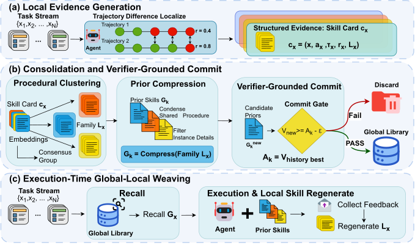

**原文图／官方图片** — 图 2：GLoW 总览——本地证据生成技能卡，聚类为程序性家族并压缩成候选先验，只有验证器锚定的提交闸门准入；执行时冻结先验与再生本地技能编织。 · Figure 2 · [source](https://arxiv.org/html/2609.02217v1)

**nanoRSI 复现状态** — not-run. 来源最近核验：2026-09-15.

**开源代码／权重／数据链接** — 核验来源中没有确认的公开代码／资产链接。

**一手来源** — [arXiv abstract](https://arxiv.org/abs/2609.02217) · [Paper v1 (affiliations, Figure 2, Tables 1-4)](https://arxiv.org/html/2609.02217v1)

### Scientific Agent Skills: A Library of Procedural Knowledge for Research Agents

**2026-08-30** · paper · 支撑技术／评测

**日期说明** — arXiv v1：2026-08-30；v2：2026-09-02。仓库（核验时 4.5 万星）早于论文且规模远超论文。

**机构关系** — 论文：Timothy Kassis、Vinayak Agarwal、Yuhuan He、Darshil Patel、Aubrey M. Brueckner——摘要页未渲染隶属；仓库在 K-Dense AI 组织下。

**改变对象与反馈复用** — 非闭环：一个开放许可的科研程序知识技能库，16 个科学实践领域（基因组、化学信息、医学影像、研究设计、科研传播）共 163 个技能。每个技能是一个目录，以版本化、人类可读的指令文件为中心、按需加载，常附参考资料与可运行脚本——编码了领域接受哪种检验、哪个标识符命名空间是权威。

**作者报告结果** — 无任务级评测与基线；量化内容是预算核算：163 个技能的常驻描述占 200K token 窗口的 7.1%；中位已文档化工作流占其 23.9%；46 个工作流中有 29 个若全量加载参考文件会溢出——故采用惰性按需加载。

**证据边界** — 人工策划的静态库：无进化机制、无任务基准；技能质量为人工保障；条目按'面向技能智能体的支撑基础设施'收录，非自改进结果。

**代码／权重／数据／许可** — 代码/库在 github.com/K-Dense-AI/scientific-agent-skills（MIT，核验时 45,207 星）。论文 CC BY 4.0。

**可用于 nanoRSI 的实验方向——本次未实现** — 对 nanoRSI：其 token 预算核算（常驻描述 vs 惰性加载 vs 溢出）是技能库成本报告的正确格式；人工策划的种子库也是技能进化实验的合法冷启动基线。

**原文图／官方图片** — 图 2：技能库总览——16 个实践领域 163 个版本化程序知识技能，按任务需要加载（常驻描述占 200K token 窗口的 7.1%）。 · Figure 2 · [source](https://arxiv.org/html/2609.00065v2)

**nanoRSI 复现状态** — not-run. 来源最近核验：2026-09-17.

**开源代码／权重／数据链接** — [Library repository (MIT)](https://github.com/K-Dense-AI/scientific-agent-skills)

**一手来源** — [arXiv abstract](https://arxiv.org/abs/2609.00065) · [Paper v2 (Figure 2, budget figures)](https://arxiv.org/html/2609.00065v2) · [Library repository (MIT)](https://github.com/K-Dense-AI/scientific-agent-skills)

### WikiSkill: Compiling Agent Experience into Persistent Knowledge for Skill Evolution

**2026-08-27** · paper · 直接有界闭环

**日期说明** — arXiv v1：2026-08-27。核验时无更新版本。

**机构关系** — 论文 v1：Google Research（Liyan Tang、Cyrus Rashtchian、Chun-Sung Ferng、Andrew Tomkins、Da-Cheng Juan）与 Tu Vu（Google Research + 弗吉尼亚理工，通讯）。

**改变对象与反馈复用** — 三层工作区：不可变的原始执行轨迹、跨迭代复利的持久 wiki（模式、日志、技能影响记录）、活跃的 SKILL.md 技能层。每轮推理智能体带技能（但不可访问 wiki）执行；wiki 维护者把采样轨迹固化为模式；技能提案者读 wiki 与轨迹，提议一次原子技能编辑；验证闸门决定接受或回滚技能——而 wiki 本身永不回滚，持续累积已接受/已拒绝 diff 的真值审计轨迹。

**作者报告结果** — 五个基准 x 五个模型、3 次运行、配对 bootstrap p<0.05：WikiSkill 全格胜过无技能、Trace2Skill、EvoSkill 与 SkillOpt（如 Gemini-3.5-Flash 68.1 对 SkillOpt 55.9；Qwen-3.6-27B 63.3 对 50.7）。增益随模型规模扩大（Qwen 4B/9B/27B +12.3/+17.5/+23.9）；Qwen-3.5-9B + WikiSkill（47.4%）胜过无技能的 Qwen-3.6-27B（39.4%）。消融：只给提案者 wiki 访问 +15.0；给推理智能体 wiki 访问反而 -7.2。

**证据边界** — 技能全量注入提示（未评估检索/触发）；严格闸门会拒绝可能支撑后续收益的中性提案；无自动 wiki 剪枝；未覆盖超长时程任务。

**代码／权重／数据／许可** — 未找到代码发布；论文 CC BY 4.0。

**可用于 nanoRSI 的实验方向——本次未实现** — 对 nanoRSI：把'永不回滚的知识'（wiki，含接受/拒绝 diff）与'可回滚的可执行技能'分层——一个单调增长的审计层，让技能闸门决策可事后复查。

**原文图／官方图片** — 图 2：WikiSkill 三层——不可变执行轨迹（raw）、跨迭代复利的持久知识库（wiki）、活跃过程指令（skills）；wiki 永不回滚。 · Figure 2 · [source](https://arxiv.org/html/2608.27454v1)

**nanoRSI 复现状态** — not-run. 来源最近核验：2026-09-16.

**开源代码／权重／数据链接** — 核验来源中没有确认的公开代码／资产链接。

**一手来源** — [arXiv abstract](https://arxiv.org/abs/2608.27454) · [Paper v1 (affiliations, Figure 2, main table)](https://arxiv.org/html/2608.27454v1)

### SkillOpt: Agent skills as trainable parameters

**2026-06-30** · report · 直接有界闭环

**日期说明** — 微软研究院博文发布于 2026-06-30（2026-10-16 由第三方文章回溯到一手来源而发现）；微软出版物页面存在但未确认 arXiv 编号——坊间流传的 arXiv 号（2605.23904）核对不符，不予记录。

**机构关系** — Yifan Yang、Xuemei Gao、Qi Dai、Bei Liu、Kai Qiu、Dongdong Chen、Chong Luo——微软研究院（亚洲院区）。

**改变对象与反馈复用** — 把自然语言技能文件当作“活在冻结目标模型之外的 可训练参数”。由独立的优化器模型在文本空间跑前向-反向-更新环：前向 = 冻结目标执行任务批；反向 = 优化器按小批反思轨迹；更新 = 小幅增/删/改编辑，经合并、去重、排序，并由“文本学习率”（每步编辑预算）裁剪。验证闸门严格：仅当编辑在留出验证切分上严格高于当前技能才被采纳；被拒编辑进入缓冲区作为负反馈复用，逐 epoch 的慢/元更新沉淀更长程的教训。权重从不更新，推理不增加额外模型调用；交付物是 best_skill.md。

**作者报告结果** — 在报告的全部 52 个评测格中最佳或并列最佳（博文口径），覆盖六个基准（SearchQA、SpreadsheetBench、OfficeQA、DocVQA、LiveMathematicianBench、ALFWorld）、七个模型（GPT-5.5 到 Qwen3.5-4B）与三种执行模式（直连、Codex、Claude Code），对照包括人工技能、一次性 LLM 技能、Trace2Skill、TextGrad、GEPA 与 EvoSkill。带技能的 GPT-5.4-mini（64.3）胜过不带技能的 GPT-5.4（59.7）。编辑极小：终版技能中位约 920 token、仅 1–4 条被采纳的编辑；OfficeQA 的 +39.0 来自单条编辑。跨 harness 迁移：Codex 训出的技能放进 Claude Code 从 22.1 升到 81.8。

**证据边界** — 博文级证据：“52 格”是博文对 6×7×3 空间的自报计数（全集的子集，未逐格公开）；GPT-5.5 六基准 58.8→82.3 等均值未给方差或种子数；方法适用于“存在自动评测或可靠验证器之处”。未核验到 arXiv 论文，数字以官方报告为准；52 格细节无法独立重算。

**代码／权重／数据／许可** — 代码 MIT 许可，位于 github.com/microsoft/SkillOpt（LICENSE 已于 2026-10-16 核验）；项目页 aka.ms/skillopt；配套 SkillLens 在 microsoft.github.io/SkillLens/。

**可用于 nanoRSI 的实验方向——本次未实现** — 正是 nanoRSI skills 模板缺的模式：文本学习率（每步有界编辑数）、严格“留出验证上严格更好才采纳”的闸门、复用为负反馈的被拒编辑缓冲、逐 epoch 汇总一遍——全部可在现有技能文件周围用标准库实现。终版技能中位约 920 token、仅 1–4 条采纳编辑，是“小技能即足”的参考预算。

**原文图／官方图片** — MSR 博客原图 1：冻结目标模型执行任务，独立优化器模型从轨迹反馈训练技能层——有界文本编辑、验证闸门采纳、慢速沉淀。 · Figure 1, MSR blog 'SkillOpt: Agent skills as trainable parameters' (2026-06-30) · [source](https://www.microsoft.com/en-us/research/wp-content/uploads/2026/06/SkillOpt_EXT_FA_Figure-1.png)

**nanoRSI 复现状态** — not-run. 来源最近核验：2026-10-16.

**开源代码／权重／数据链接** — [SkillOpt code](https://github.com/microsoft/SkillOpt)

**一手来源** — [MSR blog: SkillOpt](https://www.microsoft.com/en-us/research/blog/skillopt-agent-skills-as-trainable-parameters/) · [SkillOpt code](https://github.com/microsoft/SkillOpt) · [SkillOpt project page](https://aka.ms/skillopt)

### SkillOpt: Executive Strategy for Self-Evolving Agent Skills

**2026-06-30** · report · 直接有界闭环

**日期说明** — 微软研究院官方博客，日期 2026 年 6 月 30 日；随附的论文页与开源仓库在同一季度公开（仓库创建于 2026-05-08）。

**机构关系** — 微软研究院（MSRA）作者团队（Yifan Yang、Xuemei Gao、Qi Dai、Bei Liu、Kai Qiu、Dongdong Chen、Chong Luo）报告自有方法；博客数字为作者自报，论文自同一页面链接。

**改变对象与反馈复用** — 把 agent 的技能文件当作文本空间中的可训练参数：优化器模型在前向–反向–更新循环中提出有界编辑，候选技能"只有在留出验证集上严格优于当前技能时才被采纳"；被拒编辑进入缓冲区作为负反馈，其上还有按 epoch 的慢速/元更新。

**作者报告结果** — 作者报告：在全部 52 个评测单元（6 基准 × 7 模型 × 3 执行模式）中相对人工技能、单次 LLM 技能、Trace2Skill、TextGrad、GEPA、EvoSkill 取得最优或并列最优；GPT-5.5 直聊下六基准平均从 58.8 升至 82.3（绝对 +23.5 分）；SpreadsheetBench 41.8→80.7；在 Codex 中训练的表格技能把 Claude Code 从 22.1 提到 81.8（+59.7）；最终技能中位约 920 token、仅 1–4 次被采纳编辑；去掉元技能/慢更新后 SpreadsheetBench 从 77.5 跌至 55.0。

**证据边界** — 技能优化由固定基准内的留出验证监督——闭环是在已知测试分布上优化，未证明分布外或套件外任务的收益；跨 harness 迁移只展示了一个技能族；执行模式依赖未固定版本的商业 harness。

**代码／权重／数据／许可** — 官方实现已核验：github.com/microsoft/SkillOpt（MIT 许可，2026-05-08 创建，约 1.7 万星）；论文页自博客链接；无新权重（冻结第三方模型）；基准数据适用各基准自身条款。

**可用于 nanoRSI 的实验方向——本次未实现** — 建议：在 nanoRSI 的技能面上增加"留出闸门"技能编辑器——只在严格验证提升时采纳有界 diff 提案——与无闸门自编辑及冻结技能在相同任务流上对比，记录编辑采纳率与回归。

**原文图／官方图片** — 图 1：技能空间优化类比——带留出选择闸门的有界编辑沿验证误差面下降，而无约束的临时更新会跳变；右侧表格把经典训练超参数映射到文本空间对应物。 · Blog Figure 1 · [source](https://www.microsoft.com/en-us/research/blog/skillopt-agent-skills-as-trainable-parameters/)

**nanoRSI 复现状态** — not-run. 来源最近核验：2026-09-14.

**开源代码／权重／数据链接** — [Official implementation (MIT)](https://github.com/microsoft/SkillOpt)

**一手来源** — [Official MSR blog post (opened)](https://www.microsoft.com/en-us/research/blog/skillopt-agent-skills-as-trainable-parameters/) · [Official implementation (MIT)](https://github.com/microsoft/SkillOpt) · [Publication page](https://www.microsoft.com/en-us/research/publication/skillopt-executive-strategy-for-self-evolving-agent-skills/)

### SkillHone: A Harness for Continual Agent Skill Evolution Through Persistent Decision History

**2026-06-07** · paper · 直接有界闭环

**日期说明** — arXiv v1 首次提交于 2026-06-07；后续修订不重置纳入日期。论文标注 WeChat、Tencent Inc. 机构，并将 SkillHone 描述为持续研究框架。

**机构关系** — 论文将腾讯作者标为 WeChat、Tencent Inc.，并说明一位作者曾在 Tencent Inc. 的 WeChat AI 实习。高校合作方不被写成腾讯独占成果。

**改变对象与反馈复用** — 持久决策历史保存诊断、候选技能修订、脱敏评测证据和结果。优化 Agent 与评测 Agent 分别操作技能仓库和评测仓库；被接受的修订进入后续会话，因此技能产物在迭代间被修改并复用。

**作者报告结果** — 在 Qwen3.6-35B-A3B 的开放网页设置中，SkillHone 报告 GAIA 平均 64.6，对比精心构建的深度研究 Agent 48.8（+15.8）；WebWalkerQA-EN 为 66.4，对比 63.2（+3.2）。内部工具场景报告平均提升 +18.8；这些是作者报告的、任务特定的结果。

**证据边界** — 论文主要评测英文基准，并一次隔离一个技能；尚未展示多技能联合进化。原始企业内部框架不等同于公开仓库，因此不应把开源包写成腾讯内部基础设施的完整发布。

**代码／权重／数据／许可** — 已核验 Tencent/SkillHone 公开仓库。README 与 LICENSE 声明 MIT，但 GitHub API 元数据为 NOASSERTION。论文中的内部框架、内部数据和模型权重未随该仓库发布。

**可用于 nanoRSI 的实验方向——本次未实现** — 为 nanoRSI 增加版本化技能目录：保存决策记录、候选 diff、评测证据和回滚决定，再在隐藏任务上比较固定技能与接受修订后的复用。

**原文图／官方图片** — 图 2：SkillHone 将持久决策历史、技能优化和技能评测分开，使通过的修订可在后续迭代复用。 · Figure 2, framework.png · [source](https://ar5iv.labs.arxiv.org/html/2606.08671/assets/framework.png)

**nanoRSI 复现状态** — not-run. 来源最近核验：2026-09-13.

**开源代码／权重／数据链接** — [Tencent SkillHone repository](https://github.com/Tencent/SkillHone) · [SkillHone MIT license](https://github.com/Tencent/SkillHone/blob/main/LICENSE)

**一手来源** — [arXiv first submission and history](https://arxiv.org/abs/2606.08671) · [Paper v1 and framework figure](https://arxiv.org/html/2606.08671v1) · [Tencent SkillHone repository](https://github.com/Tencent/SkillHone) · [SkillHone MIT license](https://github.com/Tencent/SkillHone/blob/main/LICENSE)

### OpenSkill: Open-World Self-Evolution for LLM Agents

**2026-06-04** · paper · 直接有界闭环

**日期说明** — arXiv v1：2026-06-04（2606.06741），日期已在 abs 页按日核验。

**机构关系** — 论文：理海大学（Zhiling Yan、通讯 Lichao Sun）与 UIC（Hanrong Zhang、Philip S. Yu）、UBC/Vector（Yuxuan Zhang）、Salesforce AI Research（Yutong Dai、Ran Xu）、麻省总医院/哈佛医学院（Xiang Li）。

**改变对象与反馈复用** — 技能与其验证信号都从零构建、无目标任务监督：开放世界知识获取从文档、仓库、论文与网络检索任务知识与验证锚点（查询经过滤去掉基准名防泄漏）；无泄漏技能进化按计划起草 1-4 个技能，对照锚定在可独立验证事实上的自制'虚拟测试'迭代精炼（至多 3 轮），gap-vs-bug 分类器触发定向检索；零样本评估把最终技能工件部署给任意智能体——隐藏真值测试只在此时使用。

**作者报告结果** — SkillsBench：Opus 4.6 43.6% 对最强基线 Skill-Creator 34.7%（+8.9；人类 44.5%）；GPT 5.2 42.1% 对 CoT 33.3%（+8.8；人类 44.8%）——Opus 上距人类技能作者仅 1 分。SocialMaze/ScienceWorld 四列全胜；向四个较弱模型迁移 +5.5-14.8 分。验证器质量：精度 56.9%、召回 80.5%、覆盖 88.9% 真值测试意图。成本如实报告：端到端约 114 万 token/约 131 分钟（总估约 1800 美元）。

**证据边界** — 网络来源可能噪声大或自相矛盾（需溯源）；虚拟测试可能过易（高估技能质量），若源自隐藏答案则重新引入监督泄漏；开放世界检索增加延迟与 token 成本。

**代码／权重／数据／许可** — 代码在 github.com/OpenLAIR/OpenSkill（Apache-2.0，核验时 92 星）；站点 openlair.github.io/openskill。论文 CC BY 4.0。

**可用于 nanoRSI 的实验方向——本次未实现** — 对 nanoRSI：无评估器时，先从可独立验证的事实构建验证锚点、再构建技能；并从检索查询中剥离基准名作为标准防泄漏卫生。

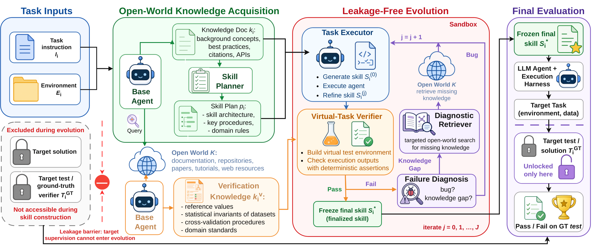

**原文图／官方图片** — 图 2：OpenSkill——基础智能体获取开放世界知识构建技能计划，在沙箱中对照自制虚拟测试迭代生成、执行、精炼技能；泄漏屏障在构建期阻断目标监督。 · Figure 2 · [source](https://arxiv.org/html/2606.06741v1)

**nanoRSI 复现状态** — not-run. 来源最近核验：2026-09-17.

**开源代码／权重／数据链接** — [Code repository (Apache-2.0)](https://github.com/OpenLAIR/OpenSkill)

**一手来源** — [arXiv abstract](https://arxiv.org/abs/2606.06741) · [Paper v1 (affiliations, Figure 2, tables)](https://arxiv.org/html/2606.06741v1) · [Code repository (Apache-2.0)](https://github.com/OpenLAIR/OpenSkill)

### SkillEvolver: Skill Learning as a Meta-Skill

**2026-05-11** · paper · 直接有界闭环

**日期说明** — arXiv v1：2026-05-11。该工作经 2026 年 5 月媒体报道进入视野，2026-09-15 对照 arXiv 原文与官方仓库完成核验；按首次公开日期收录。

**机构关系** — 论文 v1 列明 Erle Zhu、Jinfeng Zhou、Hongning Wang 隶属清华大学，Genrui Zhang、Caiyan Jia 隶属北京交通大学。

**改变对象与反馈复用** — 技能自进化被封装为任何遵循协议的 CLI 智能体都能加载的“元技能”；只更新技能的文本与代码，不动模型权重。单轮迭代：构思并派生 K 个策略多样的领域技能智能体收集成败轨迹；对比分析并合成针对性技能补丁；随后由全新会话中的独立审计员验证补丁——新鲜智能体过拟合审计，可发现数据泄漏与“静默旁路”（技能看似有效但运行时从未被调用）。只有部署后才触发精炼，学习信号来自真实下游智能体踩到的失败，而非仅探索轨迹。

**作者报告结果** — SkillsBench（83 任务、15+ 领域）：56.8% avg@5，对比人工精选技能 43.6%、无技能 29.9%；官方仓库 README 载明 R=2 配置达 56.9%，进化技能在 74.7% 的任务上持平或超过人工精选。KernelBench GPU 核优化：H100 上平均加速比 1.16 提至 1.51。下游运行 token -19%、轮次 -15%、墙钟 -24%；端到端成本约每任务 4 美元（仓库 README）。

**证据边界** — 基准采用作者自定任务范围；“先部署后精炼”的信号假定其他智能体会复用技能库，冷启动情形不明；成本与逐任务数字来自仓库 README 而非论文正文。

**代码／权重／数据／许可** — 官方代码位于 THU-AICosmos/skillevolver，MIT 许可（2026-09-15 核验）；README 写明工作模型为 Claude Opus 4.6。未找到单独的数据发布。

**可用于 nanoRSI 的实验方向——本次未实现** — 把“新鲜智能体过拟合审计 + 静默旁路检查”采纳为 nanoRSI 的技能验收闸门：用无任何先前会话状态的智能体审计候选技能，同时检验泄漏与运行时是否真的调用该技能。

**原文图／官方图片** — 图 2：SkillEvolver 单轮迭代——策略多样的探索收集成败轨迹，合成针对性补丁，由全新会话的独立审计员把守接受关口。 · Figure 2 · [source](https://arxiv.org/html/2605.10500v1)

**nanoRSI 复现状态** — not-run. 来源最近核验：2026-09-15.

**开源代码／权重／数据链接** — [Official code repository (MIT)](https://github.com/THU-AICosmos/skillevolver)

**一手来源** — [arXiv abstract](https://arxiv.org/abs/2605.10500) · [Paper v1 (affiliations, Figure 2, Tables 1-2)](https://arxiv.org/html/2605.10500v1) · [Official code repository (MIT)](https://github.com/THU-AICosmos/skillevolver)

### EmbodiSkill: Skill-Aware Reflection for Self-Evolving Embodied Agents

**2026-05-11** · paper · 直接有界闭环

**日期说明** — arXiv v1：2026-05-11；v2：2026-07-11。本文引用的指标与配图取自 v2。5 月经媒体线索与 SkillEvolver 一同浮出，2026-09-16 才首次对照原文核验。

**机构关系** — 论文 v2 标注五个机构：华中科技大学、中国科学技术大学、微软研究院、清华大学人工智能产业研究院（AIR）、南京大学；Ting Cao（微软研究院）在作者之列。5 月的媒体报道只提南大 x 微软 x 清华 AIR，完整名单更广。

**改变对象与反馈复用** — 免训练闭环，为冻结执行器进化二段式程序技能 S = (S_body, S_app)。每条轨迹相对当前技能解读并按证据类型拆分：技能变更类证据（Discovery、Optimization、SkillDefect 反思）整合后对技能主体做定向编辑，模型扮演受限编辑者而非自由重写者；执行失察类证据（智能体没有遵循有效指引）只更新附录，重新强调既有有效内容而非改写。修订集超过预算则本轮空转。

**作者报告结果** — ALFWorld（3,553 训练 / 134 测试任务，K=1，10 个修订阶段）上，冻结的 Qwen3.5-27B 执行器达 93.28% 成功率，比无技能直用 GPT-5.2 高 31.58 分；Puttwo 子任务 100.00% 对 G-Memory 的 52.94%。消融：无技能 61.19 -> 静态技能 73.13 -> 无技能感知反思 78.36 -> EmbodiSkill 93.28（感知增量 +14.92）。EmbodiedBench：EB-Habitat 最高均值 52.33%（比最强记忆基线 +16.29），EB-Navigation 61.33%（+17.94）。收益随骨干组合变化：配 Gemini 时 Qwen3.5-27B 的感知增量缩到 +1.49。

**证据边界** — v2 无专门局限性章节。感知增量在不同模型组合下不稳（同一骨干配 GPT-5.2 为 +14.92，配 Gemini 仅 +1.49），反思通道的价值依赖配置。全部数字为作者自测；EmbodiedBench 每环境 1,000 条训练任务由作者自行整理。

**代码／权重／数据／许可** — 代码以 MIT 发布于 github.com/air-embodied-brain/EmbodiSkill（仓库创建于 2026-07-03，核验时 25 星）。未找到权重或数据发布；实验调用商业模型（点名 Qwen3.5-27B、GPT-5.2、Gemini）。

**可用于 nanoRSI 的实验方向——本次未实现** — 对 nanoRSI 技能进化：把更新证据拆成两条通道——技能内容缺陷触发编辑；未遵循有效指引的失败只做重新强调（附录式），避免好技能因执行噪声被改写。

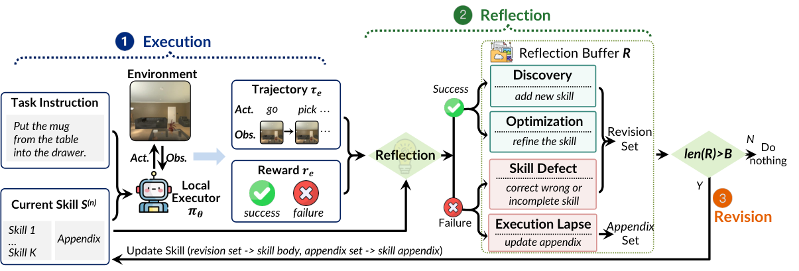

**原文图／官方图片** — 图 2：EmbodiSkill 总览——执行器带当前技能跑具身任务，反思把证据拆为修订集（Discovery/Optimization/SkillDefect -> 技能主体）与附录集（ExecutionLapse -> 附录），只有符合预算的修订集会被应用。 · Figure 2 · [source](https://arxiv.org/html/2605.10332v2)

**nanoRSI 复现状态** — not-run. 来源最近核验：2026-09-16.

**开源代码／权重／数据链接** — [Code repository (MIT)](https://github.com/air-embodied-brain/EmbodiSkill)

**一手来源** — [arXiv abstract](https://arxiv.org/abs/2605.10332) · [Paper v2 (affiliations, Figure 2, Tables, ablations)](https://arxiv.org/html/2605.10332v2) · [Code repository (MIT)](https://github.com/air-embodied-brain/EmbodiSkill)

### CoEvoSkills: Self-Evolving Agent Skills via Co-Evolutionary Verification

**2026-04-02** · paper · 直接有界闭环

**日期说明** — arXiv v1 2026-04-02（当前 v3 2026-08-10）；COLM 接收见 abs 页 Comments，2026-09-19 核验。

**机构关系** — UIC 牵头的学术联合工作，合著者来自 MBZUAI/麦吉尔、哥伦比亚、浙江大学与 UBC。

**改变对象与反馈复用** — 技能生成器产出多文件技能包，共同进化的代理验证器仅凭结构化失败反馈把关；ground-truth oracle 保持信息隔离（只给不透明 pass/fail）并触发测试升级，技能与验证器在无标注下互相自举。

**作者报告结果** — SkillsBench（Claude Opus 4.6 + Claude Code）：通过率 71.1%，对照无技能 30.6%（+40.5pp）、人工技能 53.5%（+17.6pp）、Anthropic Skill-Creator 34.1%；GPT-5.2 自进化 69.8% vs 29.6%；Opus 进化出的技能迁移到另外六个模型增益 +35~+44pp（如 Haiku 4.5：54.5% vs 10.4%）。

**证据边界** — 作者自报且集中于单一基准族；验证器在其反馈预算内仍可能被欺骗，论文度量技能通过率而非下游递归复利。

**代码／权重／数据／许可** — Apache-2.0 代码位于 github.com/Zhang-Henry/CoEvoSkills（已核验）；SkillsBench 使用条款以论文为准。

**可用于 nanoRSI 的实验方向——本次未实现** — nanoRSI skills starter 可借鉴信息隔离验证器模式：严格闸门只看结构化失败反馈，oracle 只发不透明 pass/fail，oracle 调用触发验证器测试升级。

**原文图／官方图片** — 技能生成器与代理验证器通过迭代精炼共同进化，ground-truth oracle 保持信息隔离。 · Figure 3 (process.png) · [source](https://arxiv.org/html/2604.01687v3)

**nanoRSI 复现状态** — not-run. 来源最近核验：2026-09-19.

**开源代码／权重／数据链接** — [Code repository](https://github.com/Zhang-Henry/CoEvoSkills)

**一手来源** — [arXiv abstract](https://arxiv.org/abs/2604.01687) · [Paper HTML (affiliations, Table 3, Figure 3)](https://arxiv.org/html/2604.01687v3) · [Code repository](https://github.com/Zhang-Henry/CoEvoSkills)

### SkillClaw: Let Skills Evolve Collectively with Agentic Evolver

**2026-04** · paper · 直接有界闭环

**日期说明** — arXiv v1：2026 年 4 月（2604.08377）。v1 确切日期未复核，采用月精度。

**机构关系** — 论文：阿里巴巴高德 DreamX 团队（Ziyu Ma、Shidong Yang 等，Tongwen Huang、Xiangxiang Chu）；仓库在 AMAP-ML 组织下。

**改变对象与反馈复用** — 跨用户群体的技能集体进化：跨用户会话变成保留完整'动作-反馈'因果链的结构化轨迹；会话按所引用的技能分组（天然消融，隔离每个技能的影响）；智能体进化器分析成败模式后选择精炼/新建/跳过；候选更新夜间在空闲用户环境验证，只有通过验证的改进才合并并同步给全部智能体（交互 -> 证据 -> 进化 -> 验证 -> 部署）。

**作者报告结果** — WildClawBench（Qwen3-Max 骨干、8 个模拟用户、6 天；报告六个类别中四个）：社交互动 54.01% -> 60.34%（+6.33）、搜索检索 22.73% -> 34.55%（+11.82，相对 +52%）、创意合成 11.57% -> 21.80%（相对 +88.41%）、安全对齐 24.00% -> 32.00%。受控'Skill Evolve Lite'探针：保存报告 28.3% -> 100.0%；平均 30.4% -> 72.5%。增益相对第 1 天初始技能集，非外部系统。

**证据边界** — 作者自述小规模测试（用户、反馈信号、交互深度有限）；结果仅覆盖六类中四类；后期大量候选被拒（6 天内进化进入平台期）；验证增加 token 成本。

**代码／权重／数据／许可** — 代码在 github.com/AMAP-ML/SkillClaw（MIT，核验时 2,613 星）。

**可用于 nanoRSI 的实验方向——本次未实现** — 对 nanoRSI：先按'调用过的技能'给执行证据分组再做归因——按技能分桶的会话是无须额外消融运行的最廉价因果隔离。

**原文图／官方图片** — 图 1：SkillClaw 总览——保留动作-反馈因果链的会话按所引技能分组，智能体进化器精炼或新建技能，夜间验证闸门决定合并回全部智能体的内容。 · Figure 1 · [source](https://arxiv.org/html/2604.08377v1)

**nanoRSI 复现状态** — not-run. 来源最近核验：2026-09-16.

**开源代码／权重／数据链接** — [Code repository (MIT)](https://github.com/AMAP-ML/SkillClaw)

**一手来源** — [arXiv abstract](https://arxiv.org/abs/2604.08377) · [Paper v1 (Figure 1, results)](https://arxiv.org/html/2604.08377v1) · [Code repository (MIT)](https://github.com/AMAP-ML/SkillClaw)

## Harness 搜索与进化 (28)

### HarnessPro: Recursive Harness Self-Improvement with Pareto Optimization for Performance-Cost Trade-offs

**2026-10-20** · paper · 直接有界闭环

**日期说明** — arXiv v1 于 2026-10-19 提交；在 2026-10-20 批次公告；仓库同日首发。

**机构关系** — Zhuoshi Pan、ZhiYuan Feng、Honglin Lin、H. Vicky Zhao、Jie Tang（清华大学），Yukuo Cen（智谱 Z.AI），Zhongxia Chen、Shuo Yang（快手），Junru Lu（华威大学），另有上海交通大学——依 HTML 作者块读出。

**改变对象与反馈复用** — 性能-成本 Pareto 目标下的无标签递归 harness 演化。每轮：专用智能体诊断执行轨迹、按不同性能-成本优先级规划更新并实现为候选 harness；候选用 LLM 生成的测试评估（无标准答案或官方测试），经归一化加权平方距离选择给出三个代表——成本优先（lite）、均衡（medium）、性能优先（heavy）——在留出评估前固定；入选 harness 带执行反馈进入下一轮。

**作者报告结果** — 在 Terminal-Bench 2、SWE-Bench Pro 与 ProgramBench 上（GPT-5.5 + Codex），heavy 模式较 RHO 平均 +2.0 通过率点、每任务成本降 26.1%（平均延迟 520 秒降至 412 秒）；GLM-5.2 + Claude Code 下优势保持；lite 模式以更低成本在三基准上均胜过原始 harness。

**证据边界** — 评估效度依赖 LLM 生成的测试（对判分结果的混淆矩阵有报告但并非标准答案）；绝对增益温和（约 2 点）；结果绑定两套 agent 栈（Codex、Claude Code）与三个基准。

**代码／权重／数据／许可** — 仓库 github.com/pzs19/HarnessPro 已上线，MIT 许可（2026-10-19 首发，LICENSE 从 raw.githubusercontent.com 读取）；在线演示 pzs19.github.io/HarnessPro；论文 CC BY 4.0。

**可用于 nanoRSI 的实验方向——本次未实现** — 把成本变成一等选择轴：证据账本已按候选计 token——在冻结测试前固定并报告一条 Pareto 前沿（便宜/均衡/昂贵的代），而非单一最高分赢家。

**原文图／官方图片** — 原图 1 总览：每轮分析 rollout 轨迹、生成候选 harness、并按性能与成本选出代表。 · Figure 1 (HarnessPro_Main_Figure.svg), arXiv HTML 2610.26770v1, rendered to PNG · [source](https://arxiv.org/html/2610.26770v1/HarnessPro_Main_Figure.svg)

**nanoRSI 复现状态** — not-run. 来源最近核验：2026-10-21.

**开源代码／权重／数据链接** — [pzs19/HarnessPro (MIT)](https://github.com/pzs19/HarnessPro) · [HarnessPro LICENSE (MIT)](https://raw.githubusercontent.com/pzs19/HarnessPro/master/LICENSE)

**一手来源** — [arXiv abs 2610.26770](https://arxiv.org/abs/2610.26770) · [arXiv HTML v1](https://arxiv.org/html/2610.26770v1) · [pzs19/HarnessPro (MIT)](https://github.com/pzs19/HarnessPro) · [HarnessPro LICENSE (MIT)](https://raw.githubusercontent.com/pzs19/HarnessPro/master/LICENSE) · [Live demo](https://pzs19.github.io/HarnessPro/)

### Federation over Harness

**2026-10-20** · paper · 直接有界闭环

**日期说明** — arXiv v1 于 2026-10-15 提交；在 2026-10-20 批次公告，以公告日为首次公开日期。

**机构关系** — Dixi Yao（通讯）、Tahseen Rabbani、Tian Li——芝加哥大学，依 HTML 作者块读出。

**改变对象与反馈复用** — 在分布式多智能体经验共享中同时自动演化两个层级的 harness。服务端智能体演化各客户端的任务求解与自我反思 harness，同时演化自己用于聚合分布式反思、维护共享洞察库、更新后续客户端 harness 的 harness。关键在于 FoH 不需要任何额外验证信号——无标准答案、无验证数据——仅从分布式智能体自生成的反思中学习。

**作者报告结果** — 在 PinchBench（V1 既有任务 + 124 个仅 V2 的留出任务）与 ClawEval 上，FoH 较固定 harness 的单智能体基线提升 53.57%，较单智能体 harness 自演化提升 29.76%；ScienceAgentBench 上孤立智能体失败而 FoH 演化的客户端 harness 用同一 LLM 解出，且各任务技能激活模式各异；消融显示剔除洞察库或本地反思后不稳定。

**证据边界** — 仅反思反馈：无任何环节验证沉淀洞察的正确性，增益取决于反思质量（论文自身表述）；以日常智能体基准为主；分解显示服务端 harness 更新占掉几乎全部输出 token。

**代码／权重／数据／许可** — 仓库 github.com/dixiyao/FoH 已上线，MIT 许可（LICENSE 从 raw.githubusercontent.com main 读取）；论文 CC BY 4.0。

**可用于 nanoRSI 的实验方向——本次未实现** — 无验证信号设定是对本仓库“评测器冻结”教义的诚实压力测试：任何仅反思的变体都必须标注为设计上不可验证、并与冻结评测器闸门对照；其客户端/服务端双编辑面也恰映射到每工作区技能文件与种群级共享文件。

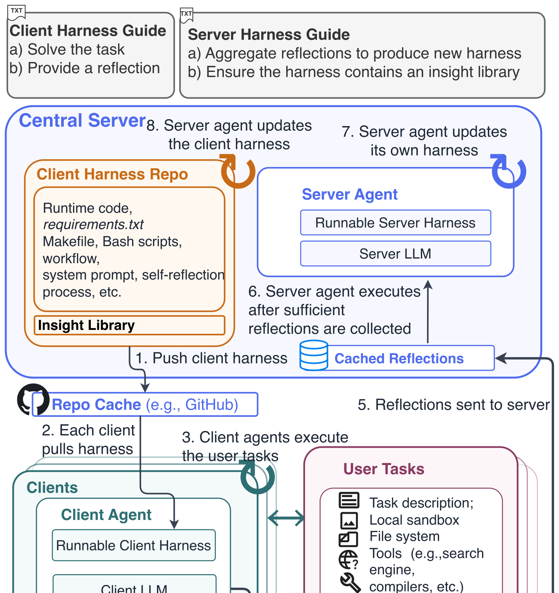

**原文图／官方图片** — 原图 1：FoH 工作流总览——分布式客户端智能体在演化中的客户端 harness 下解题并反思，服务端智能体演化自身 harness 以聚合反思、维护共享知识并更新后续客户端 harness。 · Figure 1 (workflow.svg), arXiv HTML 2610.24007v1, rendered to PNG · [source](https://arxiv.org/html/2610.24007v1/workflow.svg)

**nanoRSI 复现状态** — not-run. 来源最近核验：2026-10-21.

**开源代码／权重／数据链接** — [dixiyao/FoH (MIT)](https://github.com/dixiyao/FoH) · [FoH LICENSE (MIT)](https://raw.githubusercontent.com/dixiyao/FoH/main/LICENSE)

**一手来源** — [arXiv abs 2610.24007](https://arxiv.org/abs/2610.24007) · [arXiv HTML v1](https://arxiv.org/html/2610.24007v1) · [dixiyao/FoH (MIT)](https://github.com/dixiyao/FoH) · [FoH LICENSE (MIT)](https://raw.githubusercontent.com/dixiyao/FoH/main/LICENSE)

### Self-Evolving Coding Agents via Harness-Policy Optimization

**2026-10-19** · paper · 直接有界闭环

**日期说明** — arXiv v1 于 2026-10-16 提交；在 2026-10-19 批次公告（OAI-PMH datestamp 2026-10-19），以公告日为首次公开日期。

**机构关系** — Zhepei Wei（微软研究院实习；弗吉尼亚大学）、Wenlin Yao、Baolin Peng、Qianhui Wu、Hao Cheng、Jianfeng Gao（微软研究院）、Danqing Wang（卡内基梅隆大学）、Yu Meng（弗吉尼亚大学）——依 HTML 作者块读出。

**改变对象与反馈复用** — 在同一个智能体上交替两步的递归自改进。H 步：冻结的策略分析自己在搜索集上的失败并提出 harness 候选——一个继承种子 mini-SWE-agent 的 Python 类，可覆写 step、提示、反馈与提交处理；候选在该搜索集上选出。P 步：策略在选定 harness 下用 RL 更新，其间从未解出的任务成为下一搜索集，使 harness 优化始终对准策略演化中的失败模式。演化中的策略自身即 harness 提案器（无需外部模型）。

**作者报告结果** — Qwen3.5-35B-A3B 基座、三个编码基准（avg@3）：SWE-Bench Verified 解题率 61.0%→69.5%（自提案），外部 Opus 4.8 提案器达 71.6%；三基准平均 57.8%→64.8%，增益迁移到分布外的 SWE-Bench Multilingual（300 题）与 SWE-Bench Pro V2（642 题）；harness+策略联合增益超过各自增益之和，且两组件与对方基座版本配对时增益仍保留；消融：RL 71.6% 对 SFT 67.2%/RFT 70.5%，演化搜索集 71.6% 对固定集 70.1%。

**证据边界** — 仅编码任务，各对照固定算力与 rollout 预算且限单一 harness 族（mini-SWE-agent 子类化）；最强的 71.6% 依赖外部前沿提案器而非纯自提案；协同效应依赖此交替调度。

**代码／权重／数据／许可** — 仓库 github.com/MSR-Orchard/Self-HPO 已上线，MIT 许可（2026-10-20 从 raw.githubusercontent.com main 读取）；权重在 huggingface.co/self-hpo（200）；论文 CC BY 4.0。

**可用于 nanoRSI 的实验方向——本次未实现** — 在最小任务上移植交替调度：每个接受的 nanoRSI 代后，用当前候选恰好失败的 episodes 重建提案搜索集，并让技能文件编辑与策略侧代理量（如提示/选择参数）交替，检验同预算下交替是否优于单改变面。

**原文图／官方图片** — 原图 2 总览：H 步（上）——冻结策略分析搜索集上的失败并提出 harness 候选；P 步（下）——策略在选定 harness 下经 RL 更新，未解任务构成下一搜索集。 · Figure 2 (method_overview.png), arXiv HTML 2610.22791v1 · [source](https://arxiv.org/html/2610.22791v1/method_overview.png)

**nanoRSI 复现状态** — not-run. 来源最近核验：2026-10-20.

**开源代码／权重／数据链接** — [MSR-Orchard/Self-HPO (MIT)](https://github.com/MSR-Orchard/Self-HPO) · [Self-HPO LICENSE (MIT)](https://raw.githubusercontent.com/MSR-Orchard/Self-HPO/main/LICENSE)

**一手来源** — [arXiv abs 2610.22791](https://arxiv.org/abs/2610.22791) · [arXiv HTML v1](https://arxiv.org/html/2610.22791v1) · [MSR-Orchard/Self-HPO (MIT)](https://github.com/MSR-Orchard/Self-HPO) · [Self-HPO LICENSE (MIT)](https://raw.githubusercontent.com/MSR-Orchard/Self-HPO/main/LICENSE) · [Hugging Face checkpoints](https://huggingface.co/self-hpo)

### VideoHarness-SRSI: Structured Recursive Self-Improvement for Video Understanding Harness

**2026-10-14** · paper · 直接有界闭环

**日期说明** — arXiv v1 提交于 2026-10-14，随 2026-10-15 批次公告；2026-10-16 完成一手核验。

**机构关系** — 十三位作者：Zihao Lin（UC Davis × Meta MRS Research，工作完成于 Meta）、Haoyu Dong（杜克）、Haobo Xu 与 Xuying Ning（UIUC）、Chi-Chih Chang（康奈尔）、Yinglong Xia、Shuang Yang、Zhuokai Zhao、Xinying Song、Yang Song 与 Qifan Wang（Meta MRS Research）、Dongfang Liu（普渡）、Lifu Huang（UC Davis）。

**改变对象与反馈复用** — 研究围绕冻结视觉语言模型的递归 harness 演化（智能视频理解）。基线 VideoHarness-BRSI 演化 4,000+ 候选、可与手工系统匹敌，但有三个被诊断的失败模式：验证过拟合（复用的验证反馈同时驱动修订与提案器搜索向验证集靠拢）、搜索预算稀释与早期经验陷阱。VideoHarness-SRSI 重构搜索，使每个决定都建立在可迁移、充分、且在搜索承诺之前就采集好的证据上：提案器只见无内容反馈；插桩热身实验预先测量信号质量；候选机制先在隔离的 probe-race 分支验证，再做析因组合进部署 harness。

**作者报告结果** — 在四个视频理解基准上，VideoHarness-SRSI 相对 BRSI 将等权平均留出分提升 6.2%，并将平均验证-测试差距缩小 37.9%。

**证据边界** — 领域是冻结 VLM 的智能视频理解（四个基准）；Comments 未声明代码发布（“50 页、15 图”）；增益相对作者自己的 BRSI 基线测得；摘要未给逐基准方差与种子数。

**代码／权重／数据／许可** — 截至 2026-10-16 未声明代码或数据发布；arXiv 非独占许可。

**可用于 nanoRSI 的实验方向——本次未实现** — 其诊断正是 nanoRSI 反事实闸门的镜像：被修订与提案选择两头复用的验证反馈会过拟合——SRSI 的解法（给提案器无内容反馈、预提交的热身信号审计、机制级先隔离 probe-race 再组合）是既有评测器泄漏工作的具体范式；验证-测试差距缩减（37.9%）才是该跟踪的指标，而非只看留出增益。

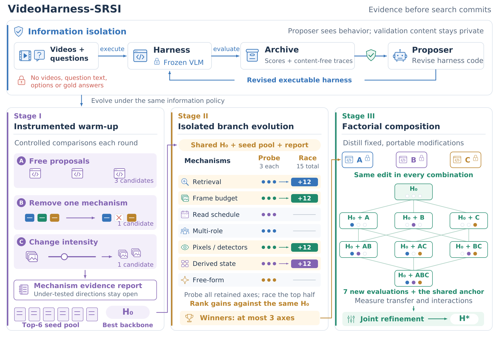

**原文图／官方图片** — 论文原图 4（SRSI 总览）：每个搜索决定都建立在可迁移、充分、且在搜索承诺前采集的证据上——给提案器的无内容反馈、插桩热身、以及析因组合前的 probe-race 分支。 · Figure 4 (S4.F4; asset named Figure2_VideoHarness_SRSI.svg), arXiv HTML v1 · [source](https://arxiv.org/html/2610.19424v1/Figure2_VideoHarness_SRSI.svg)

**nanoRSI 复现状态** — not-run. 来源最近核验：2026-10-16.

**开源代码／权重／数据链接** — 核验来源中没有确认的公开代码／资产链接。

**一手来源** — [arXiv abstract](https://arxiv.org/abs/2610.19424) · [arXiv HTML v1](https://arxiv.org/html/2610.19424v1)

### TimeRSI: Towards Self-Improved Agentic Deployment for Time-Series Foundation Models

**2026-10-14** · paper · 直接有界闭环

**日期说明** — arXiv 2610.19725 v1 提交于 2026-10-14；本次核验的 v2 修订于 2026-10-15。首次公开日期沿用 v1 惯例。

**机构关系** — Haoxin Liu、Lucheng Fu、Yiqiao Jin、Rushi Qiang、B. Aditya Prakash（佐治亚理工学院）；Deqing Fu（南加州大学）；Harshavardhan Kamarthi（佐治亚理工学院；Samay AI）。

**改变对象与反馈复用** — 围绕冻结时序基础模型的自改进部署系统：编码智能体把任务描述翻译成可执行的流水线改动，在历史预测窗口上测试每次修订并用观测误差引导后续修订；部署期由自适应选择器按相似条件下已完成预测的表现，在积累的流水线中挑选。两个阶段 TSFM 权重均保持冻结。

**作者报告结果** — 在 TIME 与 FEV-bench 的 198 个任务上，TimeRSI 在六项点预测与概率预测指标上全面超过所有参赛提交（对比提交中排名第一）。受控对比支持“反馈引导修订优于非迭代流水线搜索”；进一步实验验证了跨编码智能体与跨预测模型的泛化。

**证据边界** — 领域特定（预测部署）；排行榜式对比而非对每个基线的同算力重跑；代码仓库已链接但本核验未审计其产物完整性。

**代码／权重／数据／许可** — 代码 Apache-2.0，位于 github.com/haoxin1998/TimeRSI（LICENSE 已于 2026-10-17 经 raw.githubusercontent.com 核验）。

**可用于 nanoRSI 的实验方向——本次未实现** — 采纳流水线编辑前先在历史窗口预验证，就是换了部署外衣的训练/验证闸门——与 nanoRSI 晋升前教义一致；在积累的流水线组合上按匹配条件下的历史表现做自适应选择，是无权重的轻量种群模式。

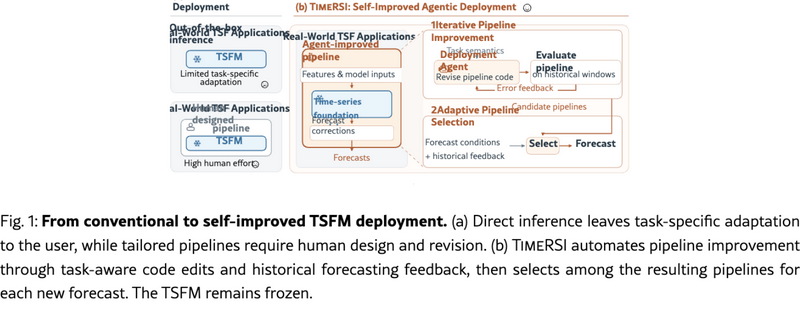

**原文图／官方图片** — 原图 1：从常规到自改进的 TSFM 部署——直接推理把任务适配丢给用户、手工流水线需要专家投入，TimeRSI 从观测预测误差迭代可执行的流水线修订，部署期由自适应选择器挑选。 · Figure 1 (inline SVG with 64 foreignObject blocks; in-browser screenshot of figure#S0.F1 at page-absolute coordinates), arXiv HTML 2610.19725v2 · [source](https://arxiv.org/html/2610.19725v2)

**nanoRSI 复现状态** — not-run. 来源最近核验：2026-10-17.

**开源代码／权重／数据链接** — [TimeRSI code (Apache-2.0)](https://github.com/haoxin1998/TimeRSI)

**一手来源** — [arXiv abs 2610.19725](https://arxiv.org/abs/2610.19725) · [TimeRSI code (Apache-2.0)](https://github.com/haoxin1998/TimeRSI)

### HarnessTTT: Learn to Optimize Harness at Test-Time for Scientific Discovery

**2026-10-12** · paper · 直接有界闭环

**日期说明** — arXiv v1 提交于 2026-10-12，随翻倍的 2026-10-14 批次公告；项目页标注“research preview, paper under review”；2026-10-16 完成一手核验。

**机构关系** — Yingzi Ma（威斯康星大学麦迪逊分校）、Yulong Cao（NVIDIA）、Nanxi Li（约翰霍普金斯）、Fang Wu（斯坦福）、Yizhe Zhang（Meta）、James Zou（斯坦福）、Yejin Choi（斯坦福）、Chaowei Xiao（约翰霍普金斯），取自署名行。

**改变对象与反馈复用** — 执行器冻结、在测试时训练 harness 提案器：提案器（执行器模型 + 持久 rank-64 LoRA，每轮 3 epoch，PPO 式裁剪目标，对冻结基座 KL 0.1）产出可执行 harness——系统提示、可复用技能、工具、中间件、执行控制——每个引导一次预算内发现式 rollout，其结果更新提案器。发现导向的策略梯度用缺口归一化奖励 g_k = (s_k − b_τ)/Z_τ（对已发表参考的剩余缺口；正信用以 3·tanh(g/3) 平滑封顶、损失下取 −1、非法候选 −1）、同父组内 RLOO 留一优势（刻意不除组标准差）、近平局（δ=1e-3）坍缩为均值且全平局组剔除，外加 max-sharpening（中心化 softmax，α=0.3）。每个生成的工具先过静态检查（导入白名单、禁止访问筛查）与沙箱自测再挂载，至多 2 次修复否则丢弃；受限 ctx 接口对提案器隐藏评测器代码、真值与网络。每轮只保留最优有效解（严格改进的棘轮）、现任 harness 与定长经验摘要。

**作者报告结果** — 冻结 9B 执行器：同一执行器下在全部十一个基准任务上胜过 OpenEvolve（圆装箱 1.17→2.64）；较发现式微调的 Finch-9B 最高 +91.7%（Hadamard；摘要四舍五入为 92%）；9/11 任务为开源权重 ≤10B 系统最佳；Erdős 最小重叠 0.380919，优于最佳人类参考 0.380927。提案器随冻结 27B 执行器扩展后十四个任务中十一个提升；学到的 harness 重放到 GPT-5.5 上在十四个任务中的九个上匹配或超过任意骨干的最强已报告系统。十四个任务覆盖数学、系统、GPU 内核、启发式、天体力学与生物。

**证据边界** — 在 AC2（0.934 对 0.947）与 Txn（4,255 对 4,762）上落后于 ≤10B 系统，AC2 比较受初始程序混杂；EPLB 落后前沿；27B 提案器在 Hadamard 上更差（−12.4%）。报告为单战役而非均值；迁移与重放增益是描述性点估计、未分离纯迁移效应；LLM-SQL 与 Txn 被隔离并附警示。释出工件缺少可信运行时、沙箱与日志，故设置“尚无法被独立验证”（作者自述，项目页同文）。

**代码／权重／数据／许可** — 项目页 gray311.github.io/harnessrl 链接了两个不同 GitHub 仓库（Code 按钮：SaFo-Lab/Self_Adapt_Harness；页脚：gray311/SAH——均可访问，不一致已如实记录）；页面未见许可声明，代码许可 2026-10-16 未核验。未声明权重或数据发布。

**可用于 nanoRSI 的实验方向——本次未实现** — 奖励配方可直接移植到 nanoRSI 的小噪声面板选择：把候选按（分数 − 父代）/对参考的剩余缺口归一化，正信用平滑封顶、损失取下限、非法尝试记 −1；同父组内算留一优势且不除组标准差，近平局坍缩、全平局组丢弃。挂载前验证阶梯（静态白名单 → 沙箱自测 → 至多 2 次修复 → 丢弃）是生成技能与评测器的具体 attempt 闸门范式。

**原文图／官方图片** — 论文原图 4（总览）：提案器（执行器 + LoRA 适配器）产出候选 harness，各自先验证再引导一次预算内发现式 rollout；rollout 结果在测试时训练提案器，执行器保持冻结。 · Figure 4 (S3.F4), arXiv HTML v1 · [source](https://arxiv.org/html/2610.17370v1/overview.svg)

**nanoRSI 复现状态** — not-run. 来源最近核验：2026-10-16.

**开源代码／权重／数据链接** — 核验来源中没有确认的公开代码／资产链接。

**一手来源** — [arXiv abstract](https://arxiv.org/abs/2610.17370) · [arXiv HTML v1](https://arxiv.org/html/2610.17370v1) · [HarnessTTT project page](https://gray311.github.io/harnessrl/)

### Harness^2: Recursive Agent Harnessing for an Open World

**2026-10-09** · paper · 直接有界闭环

**日期说明** — arXiv v1 提交于 2026-10-09，随翻倍的 2026-10-14 批次公告；2026-10-16 完成一手核验。

**机构关系** — 九位作者中八位属 Google Cloud AI Research（Yanfei Chen、Zhongying CuiZhu、Bhavana Dalvi Mishra、Yifei Ming、Han Yu、Rujun Han、Chen-Yu Lee、Tomas Pfister）；通讯作者 Ruiyao Xu 在 Google Cloud AI Research 之外另有 Northwestern University 署名行。署名“Zhongying CuiZhu”疑为 LaTeXML 合并两名作者造成的伪影；机构块另有零散 LaTeX 残留。

**改变对象与反馈复用** — 在 K=8 个可编辑组件的 harness（系统提示、护栏、记忆、技能、工具指引、脚本、子代理、TypeScript 中间件）上做两层递归。任务级 Propose-Probe-Compose：先以当前 harness 跑一次参照执行，再提出“不变式”候选（跨领域代理缺陷）与领域专用候选各一；Probe 在匹配配置下重跑各候选，把轨迹与交付物同参照对比得到行为反差（缓解/中性/退化），全程不用真值验证器；Compose 选择性合并受支持的编辑、修订冲突、采纳其一或保持不变——每个决定都绑定具体观察而非假想的分数增益。并行递归探 k 个候选并从池中组合；串行递归链式 k 步反差。harness 级：每个任务后由反思从完整改进记录提炼教训，只保留有反差支撑者；被采纳 harness 与一条 EXPERIENCE.md 条目进入带索引的改进库。默认 harness 编辑器为 OpenCode 下的 Claude Opus 4.8。

**作者报告结果** — 在三个专业基准与四个模型-harness 配置（冻结的 GLM-5 与 Gemini 3.5 Flash 执行器 × OpenCode 与 Codex 基线 harness）上，单步递归增益最高 WorkBuddy-Bench +11.5 分（GLM-5/OpenCode 64.2→75.7）、JobBench +4.5（Gemini 3.5 Flash/OpenCode）、LAB partial +11.8 个百分点（GLM-5/OpenCode 59.6→71.4）；递归预算 k 从 1 到 5 时并行与串行两种形态均单调提升（k=5 并行更高），按基准-配置再加约 +2.6–6.7 个百分点。

**证据边界** — 无正确性或迁移保证：反差与模型判断对执行变异和共享模型偏置敏感。负结果：ReasoningBank 在编码任务上最多低于基线 6.6 分；Harness Scaling 在 12 个基准-配置对中的 7 个劣于基线且 k=2→3 退化；LAB 上 Gemini 3.5 Flash/Codex 由 Meta-Harness 领先。9 例退化的失败分析：匿名交付物选择失当（选中 55 分而弃 95 分）、错误前提传播（损失 2–11 分）、无法归因的变异。递归需额外执行与编辑器会话。

**代码／权重／数据／许可** — 代码 Apache-2.0，位于 github.com/google-research/harness2（LICENSE 已于 2026-10-16 核验；3 次提交、无发布、带“非 Google 官方支持产品”惯常声明）；项目页 harness2.github.io；论文 CC BY 4.0。

**可用于 nanoRSI 的实验方向——本次未实现** — 反差探测是 nanoRSI 在开放任务上缺失的免验证器闸门：父代跑一次取参照，子代在匹配配置下重跑，比较轨迹/交付物，只接受有反差支撑的编辑——不用分数、评分表或真值。带逐条出处与留一复用审计（其图 10/11）的索引化改进库，是 nanoRSI 种群簿记在记忆面上的镜像。

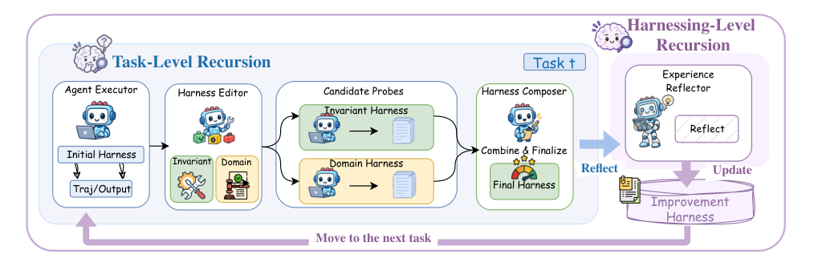

**原文图／官方图片** — 论文原图 3（管线）：任务级递归提出不变式与领域专用两个 harness 候选，对参照执行做行为反差探测并组合受支持编辑；harness 级递归把有反差支撑的教训蒸馏进带索引的改进库。 · Figure 3 (S2.F3), arXiv HTML v1 · [source](https://arxiv.org/html/2610.14224v1/harness2_main_new.png)

**nanoRSI 复现状态** — not-run. 来源最近核验：2026-10-16.

**开源代码／权重／数据链接** — [harness2 code](https://github.com/google-research/harness2)

**一手来源** — [arXiv abstract](https://arxiv.org/abs/2610.14224) · [arXiv HTML v1](https://arxiv.org/html/2610.14224v1) · [harness2 code](https://github.com/google-research/harness2) · [harness2 project page](https://harness2.github.io)

### Evo²: Evolving the Evolver through Weight-Harness Co-Evolution

**2026-10-09** · paper · 直接有界闭环

**日期说明** — arXiv v1 提交于 2026-10-09；无修订。arXiv HTML 把六位作者的共用机构渲染成 LaTeX 占位符（"\thepa"）；PDF 扉页明确为 Google DeepMind 与 UIUC。

**机构关系** — Google DeepMind（Shujian Zhang、Wenxuan Zhou、John Lambert、Beck Chen、Andrew Hard、Rajiv Mathews）与 UIUC（Bo Li；Chejian Xu 以学生研究员身份在 Google DeepMind 完成）。

**改变对象与反馈复用** — 单一策略在 harness 上扮演双角色：Proposer 写 harness 编辑、Reflector 诊断其效果并引导修订，交叉操作在搜索树分支间迁移策略。权重更新把闭环收到演化器自身：EvoTIDE（树引导交错双角色演化）用编辑抽取与前缀续写恢复可用训练轨迹，按每个角色决策引起的任务性能差给奖励（畸形输出记负奖励、只有留下机制确实运行的痕迹证据才计增益），再以 SFT 热启动加交错 GRPO 在 Proposer 与 Reflector 组间训练，每轮对位角色用冻结快照。

**作者报告结果** — 以 Qwen3.8-27B 同时充当执行器与演化器：Polyglot 82.1%、SWE-bench Verified 48.3%，对最强基线 62.6%（GEA）与 41.0%（HGM）；LiveCodeBench 58.0 对 56.0；演化出的 harness 无需再演化即跨基准迁移（6 个迁移方向中 5 个最佳，如 SWE 演化 harness 在 Polyglot 72.4）。在 60 题专有 SWE 子集上把 GPT-5-mini 从 24.4% 提到 48.3%、Claude Haiku 4.5 到 47.8%。记忆任务：LoCoMo F1 60.4 对 HGM 56.2；LongMemEval 71.5 对 64.4。训练演化器有效：训练对未训练消融 Polyglot +16.3（p=.001）、SWE +5.0（p=.086）、LoCoMo +9.3、LongMemEval +10.6；交叉再加约 4.1（Polyglot）；演化后 harness 调用更少（36 对 43）。

**证据边界** — SWE-bench 消融增益（+5.0）在 p<.05 下不显著（p=.086）；自演化主表只用一个开源执行器家族（Qwen3.8-27B）加专有子集；论文无显式局限章节；未发布代码或工件。

**代码／权重／数据／许可** — 论文未随附代码、权重或数据（arXiv 页与 HTML 均无链接）。论文按 arXiv 非独占许可（HTML 许可块标 CC BY 4.0）。

**可用于 nanoRSI 的实验方向——本次未实现** — 双角色分解可映射到 nanoRSI 的提案器/闸门分工：一个策略既提编辑又反思闸门结果，按角色的性能差奖励可直接从既有冻结面板证据账本算出，无需新闸门行为。harness 对权重的交叉报告（以训练演化器消融为对照）正是 ADOPTION 第 38 项已要求的形态。

**原文图／官方图片** — 论文原图 1：Evo² 把 harness 演化与统一 Proposer-Reflector 策略的训练连接起来——harness 编辑及其执行结果成为演化器的训练数据，更新后的权重再引导后续 harness 搜索。 · Figure 1 (fig1.png): weight-harness co-evolution overview with the shared Proposer-Reflector policy, harness edits and execution outcomes training the evolver weights, and crossover search · [source](https://arxiv.org/html/2610.13025v1)

**nanoRSI 复现状态** — not-run. 来源最近核验：2026-10-14.

**开源代码／权重／数据链接** — 核验来源中没有确认的公开代码／资产链接。

**一手来源** — [arXiv abstract](https://arxiv.org/abs/2610.13025) · [arXiv HTML v1](https://arxiv.org/html/2610.13025v1) · [arXiv PDF v1 (affiliations)](https://arxiv.org/pdf/2610.13025)

### Harness Evolution Hits a Ceiling: When Weight Training Should Begin

**2026-10-08** · paper · 直接有界闭环

**日期说明** — arXiv v1 提交于 2026-10-08；无修订。核验时 DOI 待注册。

**机构关系** — 两位独立研究者（同等贡献、共同通讯），合作者来自加州大学伯克利分校、普渡大学与斯坦福大学。

**改变对象与反馈复用** — 种子 harness 下的轨迹按首个失败信号标注为失败构成；过程性失败（调用受阻、循环、预算耗尽）分流给自演化 harness 循环（LLM 提议编辑、judge 校验），内容性失败分流给权重训练：在演化后 harness 采集的轨迹上做 LoRA 或全量微调。两个杠杆用交叉设计（种子/演化 harness x 基座/适配器权重）在保留任务上评估，并以逐轮全新锚点取代自报分数。

**作者报告结果** — 在 DeepPlanning（48 开发 / 72 保留）上，harness 演化把 Qwen3.5-4B 保留分从 0.16 提到 0.30、Qwen3.5-9B 从 0.32 提到 0.44（对全新锚点的四轮均值）；在演化后 harness 轨迹上训练的 LoRA 适配器在种子 harness 上再加 +0.13（两个尺寸均是），9B 适配器把内容性失败份额从约 25-28% 压到约 5%。答案乱序数据上的安慰剂适配器低于基座。该循环迁移到 WebArena-Lite（117 个未见任务 +0.088，0.256->0.344），适配器在该域无增益。横跨六家族八个模型，harness 杠杆在其中三个较小模型上无收益；作者另报前沿模型读数（GLM 5.3 开发 0.512 / 保留 0.488，无对照）。

**证据边界** — 诊断需要轨迹级过程信号加任务级评分器；部分消融格子只用两轮 rollout；安慰剂对照仅存在于 9B 模型；未与同预算的测试时搜索基线比较；基准的 LLM 计划转 JSON 环节使审计答案上的分数虚高约 0.025；两处比较跨夜、少数早期线重测过；前沿模型运行缺逐次数据与噪声估计。

**代码／权重／数据／许可** — 代码：arXiv 页与 HTML 中均未找到（称逐次前沿读数将随代码发布，暂无仓库）。权重：LoRA 适配器未发布。数据：未核验到 DeepPlanning 基准发布。许可：arXiv 默认许可。

**可用于 nanoRSI 的实验方向——本次未实现** — 先诊断后干预的规则可在 nanoRSI 直接检验：把每次失败标注为过程性或内容性，只把过程性失败路由给 harness/技能编辑，并报告过闸集合的构成是否相对全失败选择器改变。交叉评估（harness 状态 x 权重状态）与全新锚点复测正是条目 38-39 已要求的报告形态。

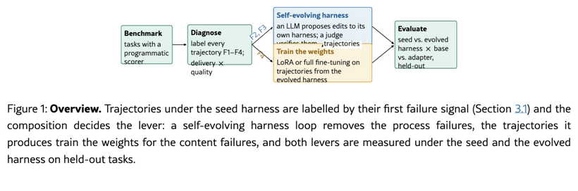

**原文图／官方图片** — 论文原图 1：种子 harness 下的轨迹按首个失败信号标注，失败构成决定杠杆——过程性失败走自演化 harness 循环，内容性失败在演化后 harness 轨迹上做权重训练（LoRA/全量微调）——并以种子/演化 x 基座/适配器交叉设计评估。 · Figure 1 (inline TikZ in the arXiv HTML; captured as a browser screenshot of the rendered figure element because the source stores it as an SVG fragment with foreignObject text) · [source](https://arxiv.org/html/2610.11655v1)

**nanoRSI 复现状态** — not-run. 来源最近核验：2026-10-13.

**开源代码／权重／数据链接** — 核验来源中没有确认的公开代码／资产链接。

**一手来源** — [arXiv abstract](https://arxiv.org/abs/2610.11655) · [arXiv HTML v1](https://arxiv.org/html/2610.11655v1)

### Safe, Persistent, and Evolving Agent Harness for Understanding Partially Observable Worlds

**2026-10-08** · paper · 直接有界闭环

**日期说明** — arXiv v1 提交于 2026-10-08；无修订。仓库名 E-LEDGER-WorldAbduct。

**机构关系** — 港科大（Yisen Gao、Qing Zong、Yangqiu Song）、LIGHTSPEED（Yue Guo）与独立通讯研究者（Yiwen Guo）。

**改变对象与反馈复用** — E-Ledger 是带代码审批层的多 agent harness：每个动作先过策略检查再执行，并维护已验证隐藏规则加证据支撑动态状态的账本。WorldAbduct 用溯因演化该 harness：跨四个视图（状态一致性、世界-观测差、策略闸正确性、目标判断）诊断执行轨迹以假设潜规则，经定向溯因交互验证后才写入账本。

**作者报告结果** — 在企业 World of Workflows 基准上，WorldAbduct 在四个后端上均取得最高安全任务完成率（DeepSeek-V4-Pro 80 STCR / 85 TCR / 95 PSR；GLM-5.3-Flash 75/80/95；Kimi-K3 70/75/95；GPT-5.6-Terra 65/65/100），比最强演化基线 MemoHarness 高 5-15 个百分点（GLM：75 对 65 STCR；DeepSeek：80 对 75；GPT-5.6：65 对 50）。消融：去掉静态世界层 GLM STCR 从 75.0 跌到 40.0；去掉溯因 PSR 从 95 降到 85。账本冻结的 54 条事实中 49 条全对、5 条部分正确、0 条错误。溯因演化迁移到 ScienceWorld（71.7 成功率）与 DiscoveryWorld（93.8 成功率，约 ReAct 三分之一步数）。

**证据边界** — WorldAbduct 比轻量基线用更多交互步数与成本（GPT-5.6：22.4 步 / 3.75 美元，对 WorldEvolver 13.4 步 / 1.72 美元）；GPT-5.6-Terra 保守性限制了任务完成率增益；64 次溯因检查中 6 次未解决；企业基准为自建。

**代码／权重／数据／许可** — 代码：github.com/HKUST-KnowComp/E-LEDGER-WorldAbduct——公开但仓库未找到任何 LICENSE 文件，按保留所有权利处理：只取思想，不复用代码。数据：WOW 基准在同一无许可条件的仓库内。许可：论文 CC BY 4.0；仓库无许可。

**可用于 nanoRSI 的实验方向——本次未实现** — 账本纪律是可移植模式：假设规则只有经定向验证交互后才进入持久状态，harness 修订由四视图失败诊断驱动——是 nanoRSI「失败后蒸馏」技能循环带逐规则显式准入检查的结构化版本。

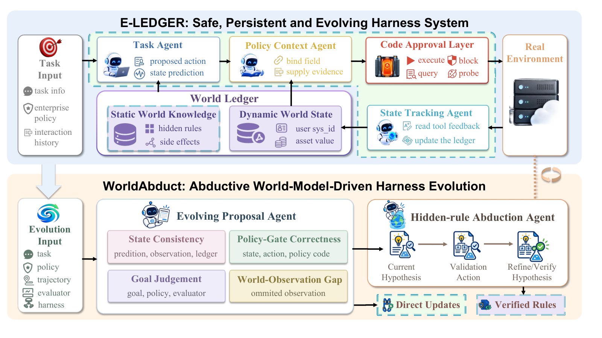

**原文图／官方图片** — 论文原图 2：E-Ledger 总览（上）——任务 agent、策略上下文 agent、代码审批闸、状态跟踪与世界账本构成的多 agent 运行循环；WorldAbduct（下）——经四视图轨迹诊断假设并验证潜规则以演化 harness。 · Figure 2 (frame.png): E-Ledger multi-agent runtime with the code approval layer and world ledger (top) and the WorldAbduct four-view abductive evolution pipeline (bottom) · [source](https://arxiv.org/html/2610.11552v1)

**nanoRSI 复现状态** — not-run. 来源最近核验：2026-10-13.

**开源代码／权重／数据链接** — [GitHub repository (no license file)](https://github.com/HKUST-KnowComp/E-LEDGER-WorldAbduct)

**一手来源** — [arXiv abstract](https://arxiv.org/abs/2610.11552) · [arXiv HTML v1](https://arxiv.org/html/2610.11552v1) · [GitHub repository (no license file)](https://github.com/HKUST-KnowComp/E-LEDGER-WorldAbduct)

### Self-Evaluating Recursive Agents

**2026-10-04** · paper · 直接有界闭环

**日期说明** — arXiv v1 于 2026-10-04 首次公开（2610.04902）。作者官方实现仓库在 2026-10-03 已有公开提交，本条单独作为实现配套核验，不把它当作论文更早的首发日期。

**机构关系** — 本条按 arXiv 原文列出的作者机构记录归属；GitHub 仓库以作者账号标识，不将仓库视为某机构背书。

**改变对象与反馈复用** — SERA 训练同一个递归策略同时进行任务分解、子任务执行和结果评估。委派前，父节点先写出加权 rubric；rubric 生成训练根据已验证的成功/失败延续进行排序，执行阶段使用习得 rubric 作为稠密子任务信号，并用叶节点覆盖率奖励有效分解。改变对象是策略的递归训练与评估行为，推理时还复用 rubric 做树选择；这是有界递归智能体方法，不是无限制模型自替换证据。

**作者报告结果** — 论文报告公开 checkpoint 在 632 个 TextCraft-Synth 任务上的三次运行平均成功率为 74.31%，在 1,400 个 TextWorld-Sync 任务上为 65.07%；相对递归智能体基线分别提升 5.38 和 13.14 个百分点，推理时 rubric 引导树选择在 TextWorld-Sync 上再提升 2.43 个百分点。这些是论文在其模型、任务、训练和计算条件下的作者结果，不是 nanoRSI 复现。

**证据边界** — 该方法依赖较重的训练基础设施（AReaL、Ray、PyTorch/vLLM 及可选外部裁判），且核验到的仓库根目录没有 LICENSE；检查到的只是第三方 Platoon MIT 声明。仓库包含基准文件并链接公开 Hugging Face checkpoint，但数据与 checkpoint 条款并非一个统一的项目级许可。报告增益只覆盖两个任务族上的递归智能体训练与选择，不能证明通用递归自改进或向 nanoRSI 迁移。

**代码／权重／数据／许可** — 代码：作者标注的 OliverLeeXZ/SERA 官方实现公开，但未核验到根目录项目许可证；第三方声明位于 Runtime/licenses。权重：README 链接了 Hugging Face 上公开的 TextCraft-step250 与 TextWorld-step400 checkpoint。数据：仓库包含训练、验证、评测文件和 TextWorld 生成代码，并保留已有来源声明。许可：项目级代码/数据许可仍未完整核验；未经许可审查，不把实现复制进 nanoRSI。

**可用于 nanoRSI 的实验方向——本次未实现** — 只复用可移植的对照思路：未来递归智能体轨道可在相同执行器、任务面板、种子和 token 预算下比较外部裁判、固定 rubric 与习得 rubric；分别记录 rubric 生成成本、分解/叶覆盖率、执行成功、选择器决策和留出迁移。这可扩展现有验证器/控制研究，但 AReaL 训练栈和 SERA 代码不应成为 nanoRSI 依赖，本轮不改变默认行为。

**原文图／官方图片** — SERA 原始 Figure 2：递归执行与三个交替训练阶段分别为执行、委派/叶覆盖率和 rubric 生成分配信用。 · Figure 2 (training.png): recursive execution, leaf-coverage credit and rubric-generation credit assignment · [source](https://arxiv.org/html/2610.04902v1)

**nanoRSI 复现状态** — not-run. 来源最近核验：2026-10-09.

**开源代码／权重／数据链接** — [Official implementation](https://github.com/OliverLeeXZ/SERA) · [Third-party notices in implementation](https://github.com/OliverLeeXZ/SERA/tree/main/Runtime/licenses)

**一手来源** — [arXiv abstract](https://arxiv.org/abs/2610.04902) · [arXiv HTML v1 and Figure 2](https://arxiv.org/html/2610.04902v1) · [Official implementation](https://github.com/OliverLeeXZ/SERA) · [Official checkpoint page](https://huggingface.co/Litux12138/SERA) · [Third-party notices in implementation](https://github.com/OliverLeeXZ/SERA/tree/main/Runtime/licenses)

### RSI-Master: Structuring Experiments to Guide Autonomous Model Improvement

**2026-09-28** · paper · 直接有界闭环

**日期说明** — arXiv v1 于 2026-09-28 首次公开（2609.35561）。本条使用首发日期，不把后续索引或修订日期当作新成果日期。

**机构关系** — 论文作者归属包括上海交通大学、中国科学技术大学、上海人工智能实验室、浙江大学与加州大学伯克利分校；本条记录论文归属，不把基础模型或基准使用关系当作机构关系。

**改变对象与反馈复用** — RSI-Master 改变的是围绕冻结或另行训练模型的研究 harness：Experiment OS 将低层操作限制为可检查的 CLI 动作与结构化产物，reviewer-guided research DAG 让 worker 探索不同后训练方向，并由 reviewer 在增加 worker 或提升配方前比较证据。改变对象是实验/研究流程及其持久证据，不是通用的自主模型权重闭环。

**作者报告结果** — 在 Qwen3-4B-Base 的 PostTrainBench 上，论文报告平均分 54.49，对比最强 agent 基线 46.53，hacking rate 为 0.0%。35B 规模上，论文报告 LiveCodeBench-v6 为 41.21，对比人工开发 Instruct 模型 37.36，并在 SciCode 上有提升、在 HorizonMath 上取得非零结果。这些是论文在其模型、基准与计算条件下的作者结果，不是 nanoRSI 复现。

**证据边界** — 本次核验可从摘要与 HTML 读取方法和主要指标，但未找到可独立核验的官方代码仓库、发布权重或可再分发的基准数据包。报告的 hacking rate 依赖作者的动作限制与评测器；论文不能证明通用 RSI 或向 nanoRSI 迁移。完整复现需要指定模型、后训练数据、基准环境和大量计算。

**代码／权重／数据／许可** — 代码：未核验到官方公开仓库。权重：未核验到 RSI-Master checkpoint 发布。数据：未核验到随项目发布的 PostTrainBench/HorizonMath 数据包，基准来源仍是外部资源。许可：由于未找到官方代码或数据包，无法审计项目代码/数据许可。

**可用于 nanoRSI 的实验方向——本次未实现** — 只复用可移植的控制模式：在 nanoRSI 现有评测器外增加可选、离线的 research-DAG/evidence-ledger 对照。在匹配调用、token、种子和留出任务下比较单一方向、固定多方向调度与 reviewer 闸门扩展方向；记录每个 worker 提案、reviewer 决策、动作限制和被拒提升。不把论文基准增益写成本地结果，也不引入未获许可的代码。

**原文图／官方图片** — RSI-Master 原始 Figure 2：reviewer 引导的 research DAG 与 Experiment OS 相连，后者限制动作并生成结构化训练、证据、评测和审查产物。 · Figure 2: RSI-Master methodology, Research Evolution and Experiment OS · [source](https://arxiv.org/html/2609.35561v2)

**nanoRSI 复现状态** — not-run. 来源最近核验：2026-10-08.

**开源代码／权重／数据链接** — 核验来源中没有确认的公开代码／资产链接。

**一手来源** — [arXiv abstract](https://arxiv.org/abs/2609.35561) · [arXiv HTML v2 and Figure 2](https://arxiv.org/html/2609.35561v2)

### RRSI: Regularized Recursive Self-Improvement of Agent Harnesses

**2026-09-21** · paper · 直接有界闭环

**日期说明** — arXiv v1 于 2026-09-21 首次公开；代码仓库创建于 2026-09-16，README 首次更新日期为 2026-09-21。本条以论文首发日作为研究记录日期。

**机构关系** — 主要研究归属为 Google Cloud AI Research；作者列表还包括 Stanford University、Washington University in St. Louis 与 UNC-Chapel Hill。论文注明 Peng Xia 在 Google Cloud AI Research 担任学生研究员期间完成该工作。

**改变对象与反馈复用** — 在冻结模型上运行有界的提案→反馈→选择 harness 闭环。提案侧逐轮降低一次可捆绑的编辑数，使用完整编辑历史分配信用，并在停滞时把搜索转向尚未尝试的组件；选择侧筛查基准特化逻辑，以重复基线评测校准噪声门槛，要求新增推理成本由可测增益支付，并裁剪近期没有正贡献的组件。被接受的 harness 提交成为下一代 incumbent；模型权重保持冻结。

**作者报告结果** — 在冻结 Claude Opus 4.8、匹配进化预算的条件下，RRSI 报告 Terminal-Bench 2.1 从 74.2→80.2（+6.0），SWE-bench Verified 从 82.0→83.8（+1.8）；留出/分布外评测中 JobBench 36.0→40.7、GDPval 48.8→52.3、APEX-Agents 34.2→37.9。论文报告分布外最高 +4.7 分，并比未正则化进化少 30% policy token；用未参与搜索的 Gemini 3.1 Flash Lite 评估进化后的 coding harness 时为 11.2→14.6（+3.4）。这些是作者结果，不是 nanoRSI 复现结果。

**证据边界** — 主干模型、提案器、分析器和泄漏评论器依赖托管模型；基准及若干运行环境为外部且成本较高。方法仍依赖有限进化集、固定正则化超参数和带噪自动反馈。论文明确不研究模型权重更新；公开仓库没有发布权重，也没有随仓库提供完整基准数据快照。

**代码／权重／数据／许可** — 代码：google-research/rrsi 公开，Apache-2.0，包含搜索核心与领域适配器。权重：未发布；实验调用托管的 Claude/Gemini 模型。数据：基准来源和环境 checkout 为外部资源，以固定提交或安装说明提供，而非可再分发的数据包。许可：仓库为 Apache-2.0；第三方组件保留各自许可。

**可用于 nanoRSI 的实验方向——本次未实现** — 在 nanoRSI 现有 harness/skill 候选闸门上做小型离线消融：把当前严格改进选择与一个正则化臂比较，后者（1）由重复冻结评测估计噪声带，（2）跨轮记录组件级编辑信用，（3）用递减预算限制一次捆绑编辑数，（4）没有补偿性增益时拒绝新增测得成本。冻结当前臂、种子、被拒候选和留出 fixture 面板；在考虑改变默认行为前报告迁移、成本和拒绝原因。

**原文图／官方图片** — RRSI 原始 Figure 2：提案侧限制并引导 harness 编辑搜索，选择侧在编辑成为 incumbent 状态前筛查泄漏、噪声、成本与结构持续性。 · Figure 2 (pipeline.png): proposal-side and selection-side regularization · [source](https://arxiv.org/html/2609.24972v1)

**nanoRSI 复现状态** — not-run. 来源最近核验：2026-09-29.

**开源代码／权重／数据链接** — [Google Research repository](https://github.com/google-research/rrsi) · [Repository license](https://raw.githubusercontent.com/google-research/rrsi/main/LICENSE)

**一手来源** — [arXiv paper and HTML](https://arxiv.org/html/2609.24972v1) · [Google Research repository](https://github.com/google-research/rrsi) · [Repository license](https://raw.githubusercontent.com/google-research/rrsi/main/LICENSE) · [Project page](https://regularized-rsi.com/)

### Bad Genius: Counterfactual-Guided Harness Evolution Beyond Task-Specific Shortcuts

**2026-09-16** · paper · 直接有界闭环

**日期说明** — v1 2026-09-16；机构信息取自论文 HTML 作者块。

**机构关系** — 学术联合体（国科大 × 新加坡国立 × 中科院自动化所）；未见企业隶属。

**改变对象与反馈复用** — 提案者进化目标智能体的 harness（提示、记忆、检索、工具、控制代码）；挑战者搜索保持任务有效性的基准反事实变体，确认档案会把在反事实下不再成立的增益降级，针对逐任务留集漏掉的基准级捷径。

**作者报告结果** — OfficeQA（每题 3 次滚动）上进化后 harness 的 R̂avg,A3 达 68.42%，对照原始 harness 66.23%（+2.19）；ProV2 切片 30.37% 对 27.04%（+3.33）；合成基准 Syn-Ledger 用于分离捷径行为；去掉挑战者的 HarnessCompass 变体得分低于原始 harness。

**证据边界** — 绝对增益温和；评测仅 OfficeQA 加合成基准；作者自报。

**代码／权重／数据／许可** — arXiv 论文公开；代码在本次核验时未确认。

**可用于 nanoRSI 的实验方向——本次未实现** — 把挑战者移植进 nanoRSI 闸门：在最小任务集自动生成的保有效性反事实上重测被接受候选；在那里消失的增益标记为捷径而非技能。

**原文图／官方图片** — CHASE 概览：提案者进化 harness，挑战者搜索保有效性的基准反事实以中和基准级捷径。 · Figure 2 (figure2_CHASE_pipeline.svg) · [source](https://arxiv.org/html/2609.18366v1)

**nanoRSI 复现状态** — not-run. 来源最近核验：2026-09-18.

**开源代码／权重／数据链接** — 核验来源中没有确认的公开代码／资产链接。

**一手来源** — [arXiv abstract](https://arxiv.org/abs/2609.18366) · [Paper HTML (affiliations, Figure 2, OfficeQA table)](https://arxiv.org/html/2609.18366v1)

### EvolveTrade: Experience-Driven Policy Refinement for Self-Evolving LLM Trading Agents

**2026-09-15** · paper · 直接有界闭环

**日期说明** — arXiv v1 2026-09-15；Sung Ju Hwang 双重隶属于 KAIST 与 DeepAuto.ai。

**机构关系** — 学术牵头（KAIST），一位企业合著者。

**改变对象与反馈复用** — 交易 agent 的系统提示被当作文本参数化的工具调用策略：独立 Policy Agent 每五个交易日依据决策轨迹与组合实绩改写它，底座 LLM 与工具全程冻结。

**作者报告结果** — GPT-5-mini、15 只美股蓝筹、3 次运行均值：Nov 2025 窗口 Sharpe 5.12 vs 静态工具调用 agent 2.87、累计收益 5.10% vs 3.30%；最强窗口 8.43/6.84%；Feb 2026 诚实负结果（Sharpe −2.53 vs 静态 −1.54）；50 交易日长窗含 10bps 手续费仍 SR 4.00 vs 2.94。

**证据边界** — 作者自报的 15 标的三种子回测；三个窗口之一输给静态策略；Apr 2026 的 Gemini-2.5-Flash 底座上静态基座 agent 反超；未找到代码发布。

**代码／权重／数据／许可** — arXiv 论文公开（CC BY 4.0）；核验时未发现代码发布。

**可用于 nanoRSI 的实验方向——本次未实现** — 一个带诚实负结果的最小自进化 agent 夹具：策略文本仅每 N 个任务批次依据累积轨迹证据改动，逐窗口对冻结策略的胜负就是发布口径。

**原文图／官方图片** — 概念图：静态 agent 只看固定通道；静态工具调用 agent 会检索但不学习；EvolveTrade 用自身经验精炼提示策略闭环。 · Figure 1 (concept_evolvetrade.png) · [source](https://arxiv.org/html/2609.17632v1)

**nanoRSI 复现状态** — not-run. 来源最近核验：2026-09-19.

**开源代码／权重／数据链接** — 核验来源中没有确认的公开代码／资产链接。

**一手来源** — [arXiv abstract](https://arxiv.org/abs/2609.17632) · [Paper HTML (affiliations, Tables 3/4, Figure 1)](https://arxiv.org/html/2609.17632v1)

### ModularRSI: Modular and Generalizable Recursive Harness Self-Improvement

**2026-09-14** · paper · 直接有界闭环

**日期说明** — arXiv v1：2026-09-14（2609.14857），已在 abs 页核验。

**机构关系** — 论文：北京航空航天大学、曼彻斯特大学、IQuest Research、M-A-P、澜舟科技（Langboat）与河海大学（HTML 中渲染了六个上标机构）。

**改变对象与反馈复用** — 对同一任务上成功与失败轨迹做对比分析，驱动五个 harness 模块（智能体循环、工具使用、观测管理、上下文管理、任务完成检测）各自在受限范围内独立进化；随后一轮跨模块集成解决冲突（重复、职责、协作）再冻结模块库。进化使用 2,000 条人工策划、与评测基准刻意不相交的可执行任务。

**作者报告结果** — TerminalBench 2.0（DeepSeek-V4-Flash）：域内准确率 47.57→52.43、Pass@3 58.43→65.17；TB 上进化的 harness 迁移到 SWE-bench Verified，域内 73.40→76.45，SWE 上进化的 harness 在 TB 域外达 49.40。冻结 harness 跨模型迁移：GLM-5.2 59.55→61.80、MiniMax-2.5 41.57→44.94。与基线比较：61.79→67.42，优于 AHE 62.54 与 Meta-Harness 62.92。

**证据边界** — 作者明确未做隔离对比轨迹分析贡献的专门消融，且成本使进化实验只用了 2,000 条任务的子集。

**代码／权重／数据／许可** — 核验时未找到代码仓库；仅论文（arXiv）。

**可用于 nanoRSI 的实验方向——本次未实现** — 对 nanoRSI：把 harness 分解为具名模块并限定各自编辑范围，在与基准不相交的可执行任务上用成功/失败对比对分别进化，合并库须经显式冲突消解轮再冻结。

**原文图／官方图片** — ModularRSI 总览：对比轨迹驱动五个 harness 模块独立进化，再经冲突消解集成。 · Figure 1 (S2.F1) · [source](https://arxiv.org/html/2609.14857v1)

**nanoRSI 复现状态** — not-run. 来源最近核验：2026-09-17.

**开源代码／权重／数据链接** — 核验来源中没有确认的公开代码／资产链接。

**一手来源** — [arXiv abstract](https://arxiv.org/abs/2609.14857) · [arXiv HTML v1](https://arxiv.org/html/2609.14857v1)

### (Self-Improving)² Coding Agents: Curating High-Quality Trajectories via Recursive Self-Improvement

**2026-09-11** · release · 直接有界闭环

**日期说明** — 官方仓库 README 将代码与轨迹数据公开日期标为 2026-09-11。仓库提供方法 PDF 并报告论文表格，但未核验到独立的 arXiv 或出版方记录；因此本条使用有日期的公开发布日，不虚构论文日期。

**机构关系** — 公开材料标识了 Self-Improving-Coding-Agents 项目及其贡献者，但没有说明独立的公司或大学归属。机构字段有意保留这一不确定性。

**改变对象与反馈复用** — 在 turn 层，冻结的后端模型生成多个候选动作，并用 self-judgement（基于特权信息的评分表加权打分）或 self-likelihood（长度归一化条件似然）选择动作。独立的递归策略发现环读取历史提案、策略、结果及接受/拒绝候选，提出何时以及如何分支，在验证任务上评估策略，并且只有在准确率提高或准确率相当但轨迹更短时保留。后续 SFT 阶段使用筛选后的轨迹；这里改变的是持久轨迹/策略状态，不是自主更新模型权重的闭环。

**作者报告结果** — README 报告的作者结果包括 SWE-bench Verified（500 题）：Qwen3.5-35B-A3B 的 self-judgement 为 70.0%，标准组为 65.8%（+4.2），self-likelihood 为 66.8%；Qwen3.5-122B-A10B 的 self-judgement 为 71.0%，标准组为 67.0%（+4.0），self-likelihood 为 69.8%。SWE-bench Pro（731 题）上，122B self-judgement 为 58.5%，标准组为 48.0%（+10.5）。DeepSWE（113 题）上，四次 Terra 运行报告 67.5±2.5%，标准组为 64.4±2.0%，平均 turn 数为 52.3 对 59.3。这些是项目报告结果，不是 nanoRSI 复现结果。

**证据边界** — 公开来源是带方法图和 README 表格的发布仓库，而不是已单独核验的论文成品。完整基准运行需要模型端点或大型本地模型、兼容 Docker 的任务沙箱、外部基准输入和大量计算；README 中 DeepSWE 的 Terra 比较使用四次独立运行，而 Luna 只有一次。因此这些增益不能证明通用 RSI、模型权重自改进或向 nanoRSI 的迁移。

**代码／权重／数据／许可** — 代码：Self-Improving-Coding-Agents/SI2CA 公开，Apache-2.0。权重：未核验到项目自有 checkpoint 发布；说明使用外部 Qwen 权重或 API/本地服务端点。数据：SI2CA-Training-Trajectories 在 Hugging Face 公开，数据卡声明 CC-BY-4.0；基准任务镜像和源输入仍是外部资源或另行许可。代码与数据许可彼此独立。

**可用于 nanoRSI 的实验方向——本次未实现** — 只复用可检查的部分：在 nanoRSI 现有 evidence ledger 上增加有界策略发现臂，固定执行器、评估器和冻结留出任务。在匹配调用、token 和种子的条件下比较无策略搜索、固定策略及递归提出分支时机三组；记录每个策略的接受/拒绝，以及轨迹变短时留出集成功率是否保持。不引入 SI2CA 的训练栈，也不把其基准增益当作本地证据。

**原文图／官方图片** — SI2CA 官方 Figure 1：turn 层 self-judgement/self-likelihood 选择，以及围绕历史、提案、评估和接受/拒绝结果运行的外层递归策略发现环。 · README Figure 1; linked editable method overview PDF · [source](https://github.com/Self-Improving-Coding-Agents/SI2CA/blob/main/docs/static/images/method.png)

**nanoRSI 复现状态** — not-run. 来源最近核验：2026-10-07.

**开源代码／权重／数据链接** — [Official repository README](https://github.com/Self-Improving-Coding-Agents/SI2CA) · [Repository license](https://raw.githubusercontent.com/Self-Improving-Coding-Agents/SI2CA/main/LICENSE) · [Training trajectories dataset](https://huggingface.co/datasets/Self-Improving-Coding-Agents/SI2CA-Training-Trajectories)

**一手来源** — [Official repository README](https://github.com/Self-Improving-Coding-Agents/SI2CA) · [Method overview PDF](https://raw.githubusercontent.com/Self-Improving-Coding-Agents/SI2CA/main/data/method_editable.pdf) · [Repository license](https://raw.githubusercontent.com/Self-Improving-Coding-Agents/SI2CA/main/LICENSE) · [Training trajectories dataset](https://huggingface.co/datasets/Self-Improving-Coding-Agents/SI2CA-Training-Trajectories) · [Dataset card](https://huggingface.co/datasets/Self-Improving-Coding-Agents/SI2CA-Training-Trajectories#dataset-card-for-si2ca-training-trajectories)

### HarnessDev: Can LLMs Create and Evolve Their Own Agent Harness?

**2026-09-01** · paper · 直接有界闭环

**日期说明** — arXiv v1：2026-09-01；共用的 Self-Developing Agents 项目页同样标为九月一日。

**机构关系** — 所列机构均由论文明列，字节跳动 Seed 为研究参与方。

**改变对象与反馈复用** — Creation 从弱种子构建可运行框架；Evolution 根据下游执行反馈反复修改持久框架。正式版本冻结后在隐藏任务上评测，衡量跨任务复用而非单份输出修补；固定运行模型的对照评估可迁移性。

**作者报告结果** — 九条单次进化轨迹中，可见分数与隐藏分数的变化方向仅在 34/64 次相邻版本切换中一致（53.1%）；仅 2/9 个声明最终版本在隐藏集上最优。Creation 覆盖六个创建模型、四个领域和 2,207 个下游实例。

**证据边界** — 这是受限直接闭环的基准研究，不证明稳定累积改进；最终选定产物可能退化，收益依赖执行模型。

**代码／权重／数据／许可** — 论文与项目页公开，论文为 CC BY-NC-ND 4.0；未核验到可下载的基准代码/数据仓库、衍生权重或对应许可，不应标为已开放代码。

**可用于 nanoRSI 的实验方向——本次未实现** — 拟议 nanoRSI coding 实验：冻结每个候选版本，保留完整评分轨迹，在固定执行模型下衡量开发集与隐藏集提升方向的一致性。

**原文图／官方图片** — 图 1：从弱种子创建可运行框架，再用执行反馈持续演化持久化框架。 · Figure 1, PDF p.2 · [source](https://arxiv.org/html/2609.01437v1)

**nanoRSI 复现状态** — not-run. 来源最近核验：2026-09-13.

**开源代码／权重／数据链接** — 核验来源中没有确认的公开代码／资产链接。

**一手来源** — [arXiv first submission](https://arxiv.org/abs/2609.01437) · [Paper v1](https://arxiv.org/html/2609.01437v1) · [Official Self-Developing Agents project](https://self-developing-agents.github.io/)

### HELIX: Model-Harness Co-evolution for Recursive Self-Improvement

**2026-08-14** · paper · 直接有界闭环

**日期说明** — arXiv v1 提交于 2026-08-14；无修订。经 lobehub/awesome-rsi（2026-10-12 加入）发现、2026-10-15 完成一手核验；发表到收录相隔两个月，如实记录。

**机构关系** — Tianyu Fan 与 Chao Huang，香港大学（论文代码以 HKUDS 组织名义发布）。

**改变对象与反馈复用** — 两个耦合时间尺度：任务内由 harness 为固定模型中介上下文、工具结果、权限与控制流；跨轮则让一组演化出的 harness（65 个候选）在同一批任务上运行，已验证的同胞轨迹成为下一代模型的更新信号（SFT、critic、filter、preference 记录），更新后模型变化的能力画像再决定下一轮 harness 重建。HELIX 本体是一个可审计、可溯源的基座：把 agent 系统分解为类型化 ports/atoms/recipes/shells/policies，保留轨迹与出处。

**作者报告结果** — 代码修复（SWE-bench）上：最佳固定 harness 比 Pi 多 4.0% 任务覆盖；65 候选完整组合通过互补的同胞行为多暴露至多 58.0% 的已验证覆盖；200 槽同胞切片产出 438 条已验证训练记录（SFT、critic、filter、preference）。

**证据边界** — 主要数字核验到摘要层面；组合对单件的 58.0% 是覆盖暴露指标而非基准分数；展示的评测域仅为代码修复。

**代码／权重／数据／许可** — 代码 MIT 许可，位于 github.com/HKUDS/HELIX（LICENSE 已于 2026-10-15 核验）。论文按 arXiv 非独占许可（abs 页标 CC BY 4.0）。

**可用于 nanoRSI 的实验方向——本次未实现** — 已验证同胞切片的思路可直接映射到 nanoRSI 的冻结面板：每次闸门尝试（无论接受与否）都产出面板轨迹，可蒸馏为训练数据而非丢弃——证据账本已在记录它们。类型化 port 分解也是声明候选改动面的词汇表（ADOPTION 第 40 项的账本 schema）。

**原文图／官方图片** — 论文原图 1：模型-harness 递归改进的两个时间尺度——任务内 harness 引导模型；跨轮已验证同胞轨迹更新模型，新的能力画像再决定下一轮 harness 重建。 · Figure 1 (harness-model-coevolution.svg): two timescales of model-harness recursive improvement - within-task harness/model interaction above, verification-gated update and rebuild below · [source](https://arxiv.org/html/2608.13951v1)

**nanoRSI 复现状态** — not-run. 来源最近核验：2026-10-15.

**开源代码／权重／数据链接** — [HKUDS/HELIX (MIT)](https://github.com/HKUDS/HELIX)

**一手来源** — [arXiv abstract](https://arxiv.org/abs/2608.13951) · [arXiv HTML v1](https://arxiv.org/html/2608.13951v1) · [HKUDS/HELIX (MIT)](https://github.com/HKUDS/HELIX)

### Qwen3.8-Max: A New Bar for Coding and Cowork (self-evolving harness demonstrations)

**2026-08-03** · report · 直接有界闭环

**日期说明** — Qwen 团队官方博客，页面标注 2026/08/03，发布 Qwen3.8-Max（2.4T 参数、激活 95B）；页面承诺次周开放权重。

**机构关系** — 阿里 Qwen 团队对自家旗舰模型与演示过程的第一方报告；所有数字均为官方博客自报。

**改变对象与反馈复用** — 三个长程演示，模型通过反馈回路修改自身工作基础设施：(1) 从空文件夹起用 10+ 天自主运行构建 oh-my-cli 项目，配合 issue 状态机、调度器、监控与看门狗——"需求归一化为 issue，由 agent 自动认领执行，经代码、测试、预览与日志持续迭代"；(2) 从零复现论文《Unified Data Selection for LLM Reasoning》（约 125 小时、约 7,600 行代码、33 轮 GPU 训练），再以"假设→写码→上 GPU→分析"的自改进环在四轮中自提 18 个改进想法；(3) 竞赛榜单迭代。

**作者报告结果** — 自报结果：oh-my-cli 自主运行约 16 天累计 265 次提交、127 个 PR、151 个 issue（截至 2026 年 7 月 30 日）；研究复现环节先复现论文六项主要发现（其选择法在 AIME24 上超随机 +7.7%），再演化出在 AIME24 上超过原方法 +2.7 分的新方法。

**证据边界** — 属演示而非受控实验：harness 运行没有公开基线 harness、固定种子对照或成本控制；AIME24 +2.7 分为单模型自报结果，无方差与独立核验。审计时点的开放权重状态：页面承诺公开，但本次运行未核验到已发布。

**代码／权重／数据／许可** — 官方博客；演示仓库 github.com/qwen-code-dev-bot/oh-my-cli 公开（Apache-2.0，2026-07-13 创建）并保留完整轨迹；模型权重已宣布开放，但本次审计未核验到发布。

**可用于 nanoRSI 的实验方向——本次未实现** — 建议：搭建最小 issue 环路 harness，让 nanoRSI 的改进器认领、实现并验证自己仓库的 issue，在同一 issue 流上与固定计划对照比较有效 diff 产出率与回归率。

**原文图／官方图片** — 博客中描述 10+ 天自主运行的章节："通过反馈回路自我演化"，含 oh-my-cli 的 issue 认领环路（状态机、调度器、监控、看门狗）与自测细节。 · Section '10+ Days of Autonomous Coding: Building a Self-Evolving Harness' · [source](https://qwen.ai/blog?id=qwen3.8)

**nanoRSI 复现状态** — not-run. 来源最近核验：2026-09-14.

**开源代码／权重／数据链接** — [Demonstration repository with full trace (Apache-2.0)](https://github.com/qwen-code-dev-bot/oh-my-cli)

**一手来源** — [Official Qwen blog post (opened via browser)](https://qwen.ai/blog?id=qwen3.8) · [Demonstration repository with full trace (Apache-2.0)](https://github.com/qwen-code-dev-bot/oh-my-cli)

### DarwinX: Evolving Agent Harnesses Through Natural Selection

**2026-07-31** · paper · 直接有界闭环

**日期说明** — DarwinX 于 2026-07-31 首次提交；官方 Beagle 实现于 2026-09-02 开源。资料库使用论文首发日期，并单独记录后续仓库发布。

**机构关系** — 论文与官方实现来自 Salesforce AI Research；Beagle 由 SalesforceAIResearch GitHub 组织维护。

**改变对象与反馈复用** — Beagle 将 agent harness 作为可进化对象，提供评测／进化后端、基准原生 rollout 引擎与 agent 工厂。DarwinX 冻结模型权重，由 evolver 提议 harness 变体，经各基准验证器评分，仅接受不退化且扩展覆盖的候选，并保留替代谱系供重组。

**作者报告结果** — 作者报告 GPT-5.5 high 与 Monet 上的结果：Terminal-Bench 2.1 pass@5 从 75.5 升至 83.2（+7.7 分），TerminalWorld pass@1 从 48.8 升至 56.1（+7.3），WebArena-Infinity pass@1 从 43.5 升至 93.0（+49.5），SWE-bench Verified pass@1 从 80.8 升至 84.2（+3.4）。TerminalWorld 使用训练／测试划分，进化后的 harness 原样迁移到 SWE-bench。

**证据边界** — 这些是作者报告结果，不是本地复现。WebArena 最大增益包含新增 browser_execute action。首发版本需要 Docker、uv、服务商凭据与基准基础设施。权重不变；展示的递归面是有界 harness 修订与种群选择，而非开放式持续提升。

**代码／权重／数据／许可** — Beagle 与官方 DarwinX 实现以 Apache-2.0 公开。未发布模型权重或基准数据集；系统依赖基准原生任务缓存及用户提供的 harness 仓库。

**可用于 nanoRSI 的实验方向——本次未实现** — 建议：围绕 nanoRSI 冻结评测器增加小型 population 模式，保留候选原始增量、回滚后选中增量及替代谱系元数据；在相同任务流与预算下比较单谱系复用和 preserve-and-extend 选择。不要将 Beagle 或其依赖栈引入标准库核心。

**原文图／官方图片** — Beagle 官方架构图：基准数据与 agent 工厂进入评测／进化后端、rollout 引擎及 DarwinX 进化算法。 · Official project architecture figure · [source](https://github.com/SalesforceAIResearch/Beagle/blob/main/docs/assets/beagle-architecture.svg)

**nanoRSI 复现状态** — not-run. 来源最近核验：2026-09-21.

**开源代码／权重／数据链接** — [Official Beagle repository](https://github.com/SalesforceAIResearch/Beagle) · [Beagle Apache-2.0 license](https://github.com/SalesforceAIResearch/Beagle/blob/main/LICENSE.txt)

**一手来源** — [DarwinX paper v1](https://arxiv.org/abs/2608.07545) · [Official Beagle repository](https://github.com/SalesforceAIResearch/Beagle) · [Beagle Apache-2.0 license](https://github.com/SalesforceAIResearch/Beagle/blob/main/LICENSE.txt) · [Official Beagle architecture figure](https://github.com/SalesforceAIResearch/Beagle/blob/main/docs/assets/beagle-architecture.svg)

### AgentDescent: Gradient descent, but the parameters are agents

**2026-07-26** · release · 支撑技术／评测

**日期说明** — PyPI 首个版本 0.1.0 于 2026-07-26；核验时最新为 0.5.0（2026-09-07）。MIT 许可、核心零必装依赖（Python ≥3.9）；方法文档挂 Zenodo DOI 10.5281/zenodo.22348027。README 自述为研究参考实现而非生产系统。

**机构关系** — 独立开源项目（Zenodo 引用作者 Danyang Chen）；核验时 README 与 PyPI 均未写机构归属。

**改变对象与反馈复用** — 多 worker 的自进化算法引擎：worker 并行提出对共享工件的 diff，聚合器把被接受提案合并进 git 版本化账本。策略的键空间决定并发提案能否融合——反思式合并在语义上融合，键控并集永远做不到。内置约二十个已发表自进化算法的忠实移植（GEPA、ACE、ADAS、DGM 等），分歧有文档记录且类似物明确不可作基准引用。

**作者报告结果** — 在 BBH dyck_languages（GLM-5.2，N=4，四种子）上：反思式合并融合 48 次合并机会中的 42 次，键控并集为 0/48。固定滚动预算下：模型调用少 40%（95% CI 27–54%，每个种子方向一致）；对忠实串行对照的 wall-clock 中位加速 6.8×（三种子，3.1–9.5×）；单调用路径保留集精确匹配 0.167→0.583（40 题 HotpotQA，保留 12 题）。

**证据边界** — 自跑基准报告于 README/文档并给区间，未经同行评审；规模小（N=4 滚动、几十题）；引擎本身是基础设施——改进主张属于其复现的被移植算法。

**代码／权重／数据／许可** — MIT 许可；PyPI 包 agentdescent；核心零必装依赖；方法文档有 Zenodo DOI；GitHub Releases 为空（发版走 PyPI）。

**可用于 nanoRSI 的实验方向——本次未实现** — 可移植的是合并策略教训：并行候选编辑同一共享工件时，键控/位置并工会静默丢弃重叠工作——候选合并需要语义（反思式）融合，融合结果应像其他被接受候选一样落入版本化账本。

**原文图／官方图片** — agentdescent 架构：worker 并行提出 diff；账本为共享工件做版本管理；聚合器反思并合并；评估反馈进入下一轮。 · docs/assets/architecture.png in the repository · [source](https://github.com/Birfy/agentdescent/blob/main/docs/assets/architecture.png)

**nanoRSI 复现状态** — not-run. 来源最近核验：2026-09-20.

**开源代码／权重／数据链接** — [GitHub repository](https://github.com/Birfy/agentdescent) · [README (results and license)](https://raw.githubusercontent.com/Birfy/agentdescent/main/README.md) · [PyPI release history](https://pypi.org/pypi/agentdescent/json)

**一手来源** — [GitHub repository](https://github.com/Birfy/agentdescent) · [README (results and license)](https://raw.githubusercontent.com/Birfy/agentdescent/main/README.md) · [PyPI release history](https://pypi.org/pypi/agentdescent/json)

### PenguinHarness: Harness for RSI. Let AI Build AI

**2026-07-19** · release · 直接有界闭环

**日期说明** — 首个公开发布 v0.0.1 于 2026-07-19（自称 first public release，由 CI 机器人发布）；核验时最新 v0.2.13 于 2026-09-16（为发布失败的 v0.2.12 的重发）。Apache-2.0；团队署名郑耀威（LlamaFactory 作者）与 PrismShadow AI 团队。

**机构关系** — 独立公司团队（Prism Shadow）；未声称高校归属。

**改变对象与反馈复用** — 本地优先的多智能体 auto-dev 平台（桌面应用、CLI、npm、Docker；宣称支持 1000+ 模型并以 DeepSeek 级开源模型为默认）内置自进化引擎：agent 自评自优——跑基准、找失分点、发布 N+1 版，每轮前有快照、每个请求可在 Trace 视图检查；agent 还可编写并优化自己的技能。

**作者报告结果** — 核验时为自我报告的营销级声明：数据分析最佳准确率、成本为 Claude Code 的 1/70；图表标题称领先数据分析套件并在编码上打平 OpenAI Codex；一个完整 RAG 演示应用在 DeepSeek V4 Pro 上仅花 0.02 美元 token 生成。这些声明未附带基准方法学、套件或原始数字（基准套件公开发布仍在路线图）。

**证据边界** — 头条数字为无公开方法学的自我营销声明；基准套件尚未公开；2.3k 星项目迭代极快（发版以天计）；无同行评审评测。

**代码／权重／数据／许可** — Apache-2.0；npm 包 @prismshadow/penguin-core；Docker 镜像；网站 penguin.ooo；GitHub 发版（核验时最新 v0.2.13）。

**可用于 nanoRSI 的实验方向——本次未实现** — 在数字可核验之前就值得借鉴其可追溯纪律：每轮自进化前做快照、每个请求可检查，使自改代理的历史可回放——与 nanoRSI 证据账本所强制的性质相同。

**原文图／官方图片** — PenguinHarness 自进化引擎海报：跑基准、找失分点、发布 N+1 版，配快照与可检查的 trace。 · Official site self-evolution poster (benchmark → find the lost points → ship vN+1) · [source](https://penguin.ooo/assets/evo-poster-en-Bp4EWVlL.webp)

**nanoRSI 复现状态** — not-run. 来源最近核验：2026-09-20.

**开源代码／权重／数据链接** — [GitHub repository](https://github.com/Prism-Shadow/penguin-harness) · [README (mechanism and claims)](https://raw.githubusercontent.com/Prism-Shadow/penguin-harness/main/README.md)

**一手来源** — [GitHub repository](https://github.com/Prism-Shadow/penguin-harness) · [README (mechanism and claims)](https://raw.githubusercontent.com/Prism-Shadow/penguin-harness/main/README.md) · [Website](https://penguin.ooo/)

### Evolving Agents in the Dark: Retrospective Harness Optimization via Self-Preference

**2026-06-04** · paper · 直接有界闭环

**日期说明** — arXiv v1 2026-06-04；2026-09-19 在企业线索补扫中发现——属 6 月漏收，不是新论文。

**机构关系** — 企业-学术（微软亚洲研究院与香港城市大学）。

**改变对象与反馈复用** — 无需标注或验证反馈的 harness 优化：DPP 选出的历史任务核心集分组重解，从轨迹蒸馏诊断线索，改写全栈 harness（指令、技能、可执行工具），再由 agent 自身成对排序候选（自偏好）选 N=3 中最优。

**作者报告结果** — Codex（GPT-5.5 high）单轮优化：SWE-Bench Pro 0.59→0.78、Terminal-Bench 2 0.71→0.76、GAIA-2 0.29→0.37；三项全面超过免反馈基线（Dynamic Cheatsheet/ReasoningBank/Sleep-time Compute）；验证反馈型 Meta-Harness 需 10 轮（约 3.1× 算力+标注）才到 0.80。

**证据边界** — 自偏好可能排错（消融：选中候选能避开最差但未必是经验最优）；分组 rollout 假设环境可干净重置；作者警示错误自偏好可能放大不安全行为。

**代码／权重／数据／许可** — MIT 代码位于 github.com/wbopan/retro-harness（核验时 56 星，最后推送 2026-06-12）。

**可用于 nanoRSI 的实验方向——本次未实现** — nanoRSI 运行档案已存候选树；RHO 展示了免标注复用——在每个候选下重解难度多样的核心集再自排序。这是 ADOPTION 22 的免 oracle 扩展。

**原文图／官方图片** — RHO 流水线：核心集选择挑出难度多样的历史任务，分组 rollout 重解，诊断加自偏好排序改写 harness。 · Figure 2 (fig2-pipeline.png) · [source](https://arxiv.org/html/2606.05922v1)

**nanoRSI 复现状态** — not-run. 来源最近核验：2026-09-19.

**开源代码／权重／数据链接** — [Code repository](https://github.com/wbopan/retro-harness)

**一手来源** — [arXiv abstract](https://arxiv.org/abs/2606.05922) · [Paper HTML (affiliations, results, Figure 2)](https://arxiv.org/html/2606.05922v1) · [Code repository](https://github.com/wbopan/retro-harness)

### Combee: Scaling Prompt Learning for Self-Improving Language Model Agents

**2026-04-05** · paper · 支撑技术／评测

**日期说明** — arXiv v1 2026-04-05；COLM 2026 接收列表（2026-09-18 核验）的措辞略有差异。

**机构关系** — 学术工作（斯坦福 × 伯克利系统/机器学习组），另有两家企业合著者。

**改变对象与反馈复用** — 并行扫描、增强洗牌机制与动态批大小控制器让多个智能体并行做提示学习并从合并轨迹中学习而不损质量——把自改进循环横向而非串行扩展。

**作者报告结果** — 在 AppWorld、Terminal-Bench、Formula、FiNER 上（头条快照为 DeepSeek-V3.1 底座），相对既有提示学习方法最高 17× 加速，精度持平或更优、成本相当。

**证据边界** — 作者自报；加速相对既有提示学习流水线而非单次运行质量上限；仅覆盖智能体任务。

**代码／权重／数据／许可** — arXiv 论文公开；代码在本次核验时未确认。

**可用于 nanoRSI 的实验方向——本次未实现** — nanoRSI 种群运行已并行评测；Combee 可借鉴的是运行中洗牌——候选在代际边界之前就周期性交换已学提示内容。

**原文图／官方图片** — Combee 通过提高高并行下学到的提示内容量，以显著降低的训练时间逼近最优提示质量。 · Figure 1 (intro_fig.svg) · [source](https://arxiv.org/html/2604.04247v1)

**nanoRSI 复现状态** — not-run. 来源最近核验：2026-09-18.

**开源代码／权重／数据链接** — 核验来源中没有确认的公开代码／资产链接。

**一手来源** — [arXiv abstract](https://arxiv.org/abs/2604.04247) · [Paper HTML (affiliations, Figure 1)](https://arxiv.org/html/2604.04247v1)

### GenericAgent: A Token-Efficient Self-Evolving LLM Agent via Contextual Information Density Maximization (V1.0)

**2026-04** · paper · 直接有界闭环

**日期说明** — arXiv v1：2026 年 4 月（2604.17091）。v1 确切日期未复核，采用月精度。仓库（lsdefine/GenericAgent，MIT）核验时已达 1.42 万星。

**机构关系** — 论文署名为 Advantage AI Agent Lab（A3 Lab），'深圳 Aquaintelling 科技与复旦大学成员的联合实验室'；未列个人作者。

**改变对象与反馈复用** — 统一智能体循环（约 3,300 行代码中核心约 92 行，比 OpenClaw 小 160 倍以上）从任务、记忆与两层技能树（类别 + 带使用计数的命名技能）构造执行上下文。课程规划器为技能候选打分（收益/难度/使用/兴趣，权重 0.3/0.2/0.3/0.2）并经反思自适应权重；每个任务以'技能固化'收尾——归档 Markdown 报告、更新技能树、递增计数——部署产物单调增长而循环保持极小。

**作者报告结果** — Lifelong AgentBench：222K 输入 token 下 100% 准确率，对 OpenClaw 1.43M 下 70%、Claude Code 800K 下 75%（约 6.4 倍 token 优势——即仓库的'6 倍'说法）。长时程任务 188.8K token 下 100%，对 Claude Code 537K。自进化第 1 -> 9 轮：222,203 -> 23,010 token（-89.6%）、7m30s -> 1m38s、32 -> 5 次 LLM 调用。20 个技能后提示仅 2,298 token，对 Claude Code 22,821、OpenClaw 43,321。跨任务节省 61.0-92.4%（总体 79.3%）。

**证据边界** — 30 轮上下文上限迫使长研究跨会话；自适应权重缺乏长期验证；自改进日志人工整理；技能树的合并/废弃靠手工。

**代码／权重／数据／许可** — 代码在 github.com/lsdefine/GenericAgent（MIT，核验时 14,200 星）。

**可用于 nanoRSI 的实验方向——本次未实现** — 对 nanoRSI：证明带技能固化的极小种子环能在 token 效率上胜过百万行级 harness——nanoRSI 的纯标准库内核押注相同；使用计数与按技能隔离提示是最廉价的第一步。

**原文图／官方图片** — 图 2：GenericAgent 统一循环——由任务、记忆与两层技能树构造执行上下文；课程规划器为技能打分，每个任务以技能固化（归档报告、更新树、递增计数）收尾。 · Figure 2 · [source](https://arxiv.org/html/2604.17091v1)

**nanoRSI 复现状态** — not-run. 来源最近核验：2026-09-21.

**开源代码／权重／数据链接** — [Code repository (MIT)](https://github.com/lsdefine/GenericAgent)

**一手来源** — [arXiv abstract](https://arxiv.org/abs/2604.17091) · [Paper v1 (Figure 2, token/cost tables)](https://arxiv.org/html/2604.17091v1) · [Code repository (MIT)](https://github.com/lsdefine/GenericAgent)

### MiniMax M2.7: Early Echoes of Self-Evolution

**2026-03-18** · report · 直接有界闭环

**日期说明** — 官方报告日期为 2026-03-18。相关 M2 系列技术论文首发于 2026-05-26，不能以七月修订日期替代 M2.7 最早事件。

**机构关系** — MiniMax 第一方报告，并有 MiniMax-M2 系列技术论文作为后续材料。

**改变对象与反馈复用** — 内部 M2.7 智能体分析失败轨迹，修改 scaffold 代码及采样配置，评测后保留或回滚，并用于下一轮。另一个研发流程更新记忆/技能、辅助研究员开展 RL 实验，但仍由人提供方向并作关键决策。

**作者报告结果** — MiniMax 报告进行了超过 100 轮自主 scaffold 迭代，内部编程评测提升 30%；未披露绝对基线、评测集身份及不确定性，因此不能独立横向比较。

**证据边界** — 这是第一方内部实验，尚非复现结果；辅助模型研发与 scaffold 自改不证明完全自主的后继模型训练。

**代码／权重／数据／许可** — M2.7 权重公开。当前模型 LICENSE 为自定义非商业许可，商业使用需书面授权；未核验到内部自进化框架、评测数据及完整训练流程公开。

**可用于 nanoRSI 的实验方向——本次未实现** — 拟议 nanoRSI coding 实验：将修改限制在 scaffold 文件，冻结执行模型，在隐藏测试集上审计保留/回滚决策。

**原文图／官方图片** — 图 8：M2.7 自进化使用的模型迭代系统与双循环流程。 · Figure 8 · [source](https://arxiv.org/html/2605.26494v1)

**nanoRSI 复现状态** — not-run. 来源最近核验：2026-09-13.

**开源代码／权重／数据链接** — [Official M2.7 model](https://huggingface.co/MiniMaxAI/MiniMax-M2.7) · [Current M2.7 non-commercial license](https://huggingface.co/MiniMaxAI/MiniMax-M2.7/blob/main/LICENSE)

**一手来源** — [Official M2.7 report](https://www.minimax.io/news/minimax-m27-en) · [Related M2-series technical paper dates](https://arxiv.org/abs/2605.26494) · [Related M2-series paper v1](https://arxiv.org/html/2605.26494v1) · [Official M2.7 model](https://huggingface.co/MiniMaxAI/MiniMax-M2.7) · [Current M2.7 non-commercial license](https://huggingface.co/MiniMaxAI/MiniMax-M2.7/blob/main/LICENSE)

### Meta-Harness: End-to-End Optimization of Model Harnesses

**2026-03** · paper · 直接有界闭环

**日期说明** — arXiv v1：2026 年 3 月（2603.28052）；Terminal-Bench 2.0 工件仓库创建于 2026-03-26。v1 确切日期未复核，采用月精度。

**机构关系** — 论文：Yoonho Lee、Roshen Nair、Qizheng Zhang、Chelsea Finn（斯坦福）、Kangwook Lee（KRAFTON）、Omar Khattab（MIT）。

**改变对象与反馈复用** — 对任务 harness 代码的外层搜索环：编码智能体提案者（Claude Code / Opus 4.6）读取一个持续增长的文件系统——内含此前每个候选的源码、执行轨迹与分数（经 grep/cat 工具）——提议新的单文件 harness（控制提示、检索、记忆与编排），评估后把全部信息写入新目录。用精度-上下文成本的 Pareto 前沿取代硬编码父代选择；20 轮迭代约 60 个 harness。消融：完整轨迹访问是关键——只看分数时最优精度从 56.7 塌到 41.3，轨迹摘要甚至有害。

**作者报告结果** — TerminalBench-2（Opus 4.6）：76.4%（Opus-4.6 智能体中排名第二；Terminus-KIRA 74.7%；ForgeCode 更高的 81.8% 用公开代码无法复现）。Haiku 4.5：37.6%，第一。文本分类：11.4K 上下文 token 下 48.6%，对 ACE 50.8K 下的 40.9%（+7.9 且省 4 倍 token）；OOD 73.1% 对 70.2%；以 0.1 倍评估次数追平此前最优文本优化器。

**证据边界** — TerminalBench-2 的搜索与最终评估用同一批 89 个任务（'发现问题'设定），仅靠人工检查与正则审计查字符串泄漏；只研究了一个提案智能体；ForgeCode 榜单分无法复现。

**代码／权重／数据／许可** — 项目页 yoonholee.com/meta-harness；优化工件在 github.com/stanford-iris-lab/meta-harness-tbench2-artifact（1,213 星，核验时无许可证文件）。论文 CC BY 4.0。

**可用于 nanoRSI 的实验方向——本次未实现** — 对 nanoRSI：把每个候选的完整轨迹（而非摘要）存入提案者可查询的存储——消融表明让 harness 搜索奏效的是轨迹访问本身，而非选择策略的精巧。

**原文图／官方图片** — 图 2：Meta-Harness 搜索环——智能体读取含此前全部候选代码、轨迹与分数的文件系统，提议新 harness、评估、并把全部信息记入新目录。 · Figure 2 · [source](https://arxiv.org/html/2603.28052v1)

**nanoRSI 复现状态** — not-run. 来源最近核验：2026-09-16.

**开源代码／权重／数据链接** — [Artifact repository](https://github.com/stanford-iris-lab/meta-harness-tbench2-artifact)

**一手来源** — [arXiv abstract](https://arxiv.org/abs/2603.28052) · [Paper v1 (affiliations, Figure 2, results)](https://arxiv.org/html/2603.28052v1) · [Artifact repository](https://github.com/stanford-iris-lab/meta-harness-tbench2-artifact)

## 自改写元智能体与谱系 (14)

### RSIFlow: Adaptive Self-Improvement Workflows with an Evolving Meta-Agent

**2026-10-15** · paper · 直接有界闭环

**日期说明** — arXiv v1 于 2026-10-15 提交；代码仓库推送至 2026-10-13。

**机构关系** — Huan Zhang*、Mingju Chen*、Dongxu Zhou、Can Lv、Sen Cui、Faguo Wu、Shiji Zhou（通讯）——北京航空航天大学人工智能学院、未来区块链与隐私计算北京前沿创新中心（*同等贡献；机构依 HTML 作者块读出）。

**改变对象与反馈复用** — 任务智能体（Qwen3-4B/8B）执行任务并收集轨迹与环境反馈；元智能体（GPT-5.6 Sol）诊断当前瓶颈部件，自适应选择部件专属的改进工作流——模型更新（固定单 epoch 超参与全局批 8 的局部 LoRA）、harness 更新或任务产物修订。元层递归在于：工作流结果被蒸馏为部件专属技能与跨部件原则，并整合进 Meta-Harness（元智能体自己的编排层），使后续轮次诊断与编排更好——元智能体参数从不更新。共五轮演化，每轮至多两次尝试。

**作者报告结果** — 六基准（HumanEval+、MBPP+、BFCL-v3、ACEBench、HotpotQA、2Wiki）总体均值：Qwen3-4B 51.21 对 SIA 45.15、Hyperagent 41.26、AFlow 40.73（另 SFT 41.12、GRPO 42.04、HarnessForge 41.22、MermaidFlow 43.59）；Qwen3-8B 59.86 对 SIA 56.00、AFlow 54.27。消融（4B、R=5）：相对原始版本三域均值 +13.72；自适应编排平均超最佳固定部件流程 4.13–8.81；关闭元智能体演化损失 5.74 点。

**证据边界** — 任务侧基座仅 Qwen3-4B/8B（集群规模与更大基座未探索）；元环带来额外计算开销，更廉价的元智能体可能折损演化收益；经验驱动的 Meta-Harness 更新稳定性未充分研究（作者把反事实分析与元智能体参数优化列为未来工作）；这些基准上强基线密集、余量有限。

**代码／权重／数据／许可** — 代码 MIT 许可，位于 github.com/1HUAN1/RSI-Flow（2026-10-18 经 API 核验许可）。

**可用于 nanoRSI 的实验方向——本次未实现** — 瓶颈诊断路由是 nanoRSI 主循环的一种选择器设计：先分类哪个面（技能文本、harness 代码、评测器产物）是约束瓶颈，再施加该面专属算子，而不是把尝试预算花在错误面上。把编排结果蒸馏为可复用元技能与 ADOPTION #53 在技能轨对应；论文的固定对自适应消融正是面路由提案需要的对照。

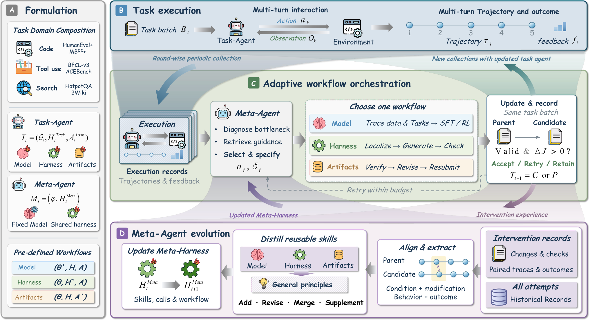

**原文图／官方图片** — 原图 2 总览：任务域与任务智能体、轨迹收集、元智能体自适应编排部件专属工作流（模型/harness/产物）、干预经验蒸馏为技能并更新 Meta-Harness。 · Figure 2 (Overview.png), arXiv HTML 2610.21791v1 · [source](https://arxiv.org/html/2610.21791v1/Overview.png)

**nanoRSI 复现状态** — not-run. 来源最近核验：2026-10-18.

**开源代码／权重／数据链接** — [RSI-Flow code](https://github.com/1HUAN1/RSI-Flow)

**一手来源** — [arXiv abs 2610.21791](https://arxiv.org/abs/2610.21791) · [arXiv HTML v1](https://arxiv.org/html/2610.21791v1) · [RSI-Flow code](https://github.com/1HUAN1/RSI-Flow)

### MetaShare: Failure-Aware Collective Self-Improvement for Open-Ended Agents

**2026-10-15** · paper · 直接有界闭环

**日期说明** — arXiv v1 于 2026-10-15 提交；被 NeurIPS 2026 workshop “Managing Agents that Manage Agents: Workshop on Responsible Use of Meta-Agents” 接收（见 abs 页备注）。

**机构关系** — Vishal Bhutani、Prasang Gupta、Sumanth Chundru、Kevin Paul——全部任职普华永道（PwC），机构依 HTML 作者块 pwc.com 邮箱读出。

**改变对象与反馈复用** — 每次被评测的智能体修改都成为一条带符号的记录（有帮助→复用，有损害→规避），存入有界的跨谱系池。每代生成前，失败感知的多样性检索重建“采纳/规避/必试”引导上下文；K 个元智能体以异构温度并行提案，经确定性的四轴准入闸门录取其一。任务盲审计器定期从脱敏摘要中注入缺失或代表性不足的机制类别；基于嵌入的去冗余排序限制检索重复。

**作者报告结果** — 对 DGM-H（五次运行取中位数、95% bootstrap 置信区间）：论文评审 0.71→0.79、Polyglot 全量 225 任务 0.28→0.34、机器人奖励设计 0.37→0.40、三个 IMO 评分设置 0.61/0.64/0.60→0.64/0.70/0.67、审计风险 0.45→0.55，同时最优检查点出现代数下降 1.7–2.9 倍（论文评审 100→36、审计风险 44→26）。Polyglot 小/中集：五次运行 0.912 [0.902, 0.922]、10 次迭代内，对 GEA 单次运行 0.88——作者自述为更低迭代数下的竞争性而非同类对比胜利。消融：把真实失败记录换成长度匹配的打乱失败损失 0.07（语义而非 token）；移除任务盲审计器损失 0.15；算力匹配参照（k=3 时关闭池）分离出记忆层 +0.11 验证精度与少 19 代；审计器可复现地解锁动态模型选择（o3-mini→GPT-4o-mini），而拥有相同动作空间的 DGM-H 从未提出。

**证据边界** — 论文评审、机器人与 IMO 上的 DGM-H 数字取自 Zhang et al. (2026) 报告值而非重跑，故这些域上两臂的准入闸门未保持一致；k=3 消耗约 3 倍自修改 token（是质量与速度主张，非 token 效率）；NMAE 在两个域回退（IMO-full 0.175 对 0.157、审计风险 0.357 对 0.312）；与 GEA 的对比是五次运行区间对单点估计。

**代码／权重／数据／许可** — 论文未链接代码仓库；核验时未发现（未核验其存在）。

**可用于 nanoRSI 的实验方向——本次未实现** — 带打乱失败对照的符号化失败账本可直接移植到 nanoRSI 的 rejected_recent 池：按提案存储带符号增益，引导提案器时作为规避信号检索，并跑长度匹配的打乱拒绝对照臂，证明账本承载语义而非 token；任务盲“必试”注入是防止提案流塌缩到冗余编辑的多样性机制。

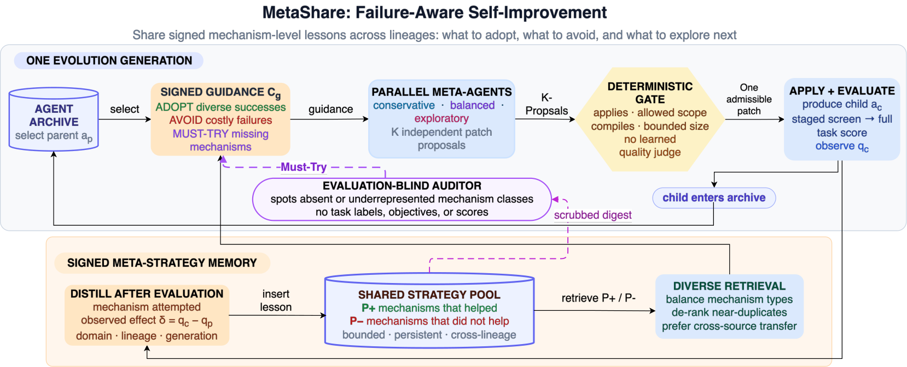

**原文图／官方图片** — 原图 2 架构：上为一轮生成（符号引导上下文、K 个并行元智能体、确定性闸门、应用并评分），下为跨谱系有界符号教训池，含失败感知多样性检索与任务盲审计器的必试注入。 · Figure 2 (arch.png), arXiv HTML 2610.21887v1 · [source](https://arxiv.org/html/2610.21887v1/arch.png)

**nanoRSI 复现状态** — not-run. 来源最近核验：2026-10-19.

**开源代码／权重／数据链接** — 核验来源中没有确认的公开代码／资产链接。

**一手来源** — [arXiv abs 2610.21887](https://arxiv.org/abs/2610.21887) · [arXiv HTML v1](https://arxiv.org/html/2610.21887v1)

### Drafting Agents, Not Just Tokens: Speculative Recursive Self-Improvement for Agentic Systems

**2026-10-12** · paper · 直接有界闭环

**日期说明** — arXiv v1 提交于 2026-10-12，随翻倍的 2026-10-14 批次公告（10-13 周二公告被跳过并入周三）；2026-10-15 完成一手核验。

**机构关系** — Xin Xu、Ke Cheng、Yangru Huang、Haibin Lv、Jun Zhang、Jie Jiang（Tencent AMS）；Xin Xu 兼北大、Ke Cheng 兼北航；Hao Wang（小红书）；Yanghao Xiao（国科大）；Zhichao Chen（北大通用人工智能全国重点实验室）；Zhisheng Zhong（腾讯混元）；Zhouchen Lin（北大）；通讯：Jun Zhang、Zhouchen Lin。

**改变对象与反馈复用** — 把投机执行引入递归自改进：在父代验证完成前就起草可执行的子代 agent，长出一棵由冻结版本与编辑边组成的不可变树；采纳仍要求完整、可采纳的验证。VATS（验证感知树搜索）在起草与检查之间分配剩余预算——Solver 用 MILP（缺失检查、依赖、共享设置）构造可行补全束，Scorer 预测扣除未来成本后的期望已验证增益，Policy 采样下一个起草或验证计划。GVO（组验证优化）进而训练改进器本身：同一根节点在冻结改进器下跑 G>=2 次独立完整搜索，优势=每次搜索的已验证增益减全部成本对组内留一均值，Scorer 以实现后缀回报回归+成对差分损失训练，演员用裁剪 PPO 式目标更新；验证契约全程冻结。

**作者报告结果** — 科学赛道：50 个骨干-任务对全胜 Janus，终局增益 +33.3-40.0%、AUBC +30.4-33.7%（逐对提升 17.8-27.6%）。系统赛道：20 个骨干上宏平均超 MetaRSI-v1 1.85-2.38pp（TB2.1、SWE-Pro、GPQA-hard100、AIME）。编码验证 69.4% 对 HGM 64.3%，成本指数低 20.8%（60.8 对 76.8）。生命周期总成本指数 106.3 对 MetaRSI-v1 的 112.7；科学搜索成本比 Janus 高 7.2%——诚实注脚是投机买到的是出结果时间，不是处处更便宜。

**证据边界** — 科学搜索成本比 Janus 高约 7%；部分 10 骨干图上总成本指数比 MetaRSI-v1 高 0.83-0.90%；基线是近期预印本系统（Janus、MetaRSI-v1、HGM）而非成熟排行榜；验证契约固定意味着验证器本身未被改进。

**代码／权重／数据／许可** — 代码 MIT 许可，位于 github.com/SpecRSI-GPR/SpecRSI（LICENSE 已于 2026-10-15 核验）。论文按 arXiv 永久非独占许可。

**可用于 nanoRSI 的实验方向——本次未实现** — 两个可迁移件：(1) 只认完整验证的投机起草是 nanoRSI 尝试循环的预算策略——当前提案面板未跑完就先起草下一个，但绝不在部分证据上晋升；(2) GVO 的组内多次搜索+留一优势+冻结改进器正是 ADOPTION 第 38 项控制下的'改进改进器'探针（冻结改进器、等预算、只认已验证增益）。

**原文图／官方图片** — 论文原图 1（a-f 面板）：三种 RSI 执行形态（单路径、并行、投机）及其搜索论类比（贪心、束搜索、投机解码）——先探前路，采纳前必验证。 · Figure 1 (six panel SVGs trim_f1a-f1f + legend, recomposed into one image): single-path RSI, parallel branches and speculative RSI mapped to greedy, beam search and speculative decoding · [source](https://arxiv.org/html/2610.16491v1)

**nanoRSI 复现状态** — not-run. 来源最近核验：2026-10-15.

**开源代码／权重／数据链接** — [SpecRSI-GPR/SpecRSI (MIT)](https://github.com/SpecRSI-GPR/SpecRSI)

**一手来源** — [arXiv abstract](https://arxiv.org/abs/2610.16491) · [arXiv HTML v1](https://arxiv.org/html/2610.16491v1) · [SpecRSI-GPR/SpecRSI (MIT)](https://github.com/SpecRSI-GPR/SpecRSI)

### RSI-Anything: Unlocking Recursive Self-Improvement with World Models

**2026-10-09** · paper · 直接有界闭环

**日期说明** — arXiv v1 提交于 2026-10-09；仓库 2026-10-08 建立并随论文公布；无修订。

**机构关系** — PhAI Labs（Zhenfei Yin、Yingcheng Wu）、港中文（Pheng Ann Heng、Taoyong Cui）、澳门大学、上海交通大学、复旦大学、牛津大学、斯坦福大学与北京大学；通讯含 Ling Yang。

**改变对象与反馈复用** — 构建在 JEPA-Anything 预测基座上，世界模型预测同时引导动作选择与学习数据选择，替代昂贵的外部反馈。观测到的反馈更新策略/工作流；当策略演化使世界模型可靠性下降时有条件地再适配，组件与兼容性检查决定更新后的策略-模型对是否保留。想象轨迹须经门控指标（候选合法、效用过阈、不确定度低于上限、证据标签属允许来源）才进入训练集，证据分层为 E0 规则检查 / E1 模型预测 / E2 仿真器 / E3 外部测量。

**作者报告结果** — 代码修复（200 道 CodeContests、固定 coder）：隐藏测试成功率 26.3%（静态验证器）/ 26.0%（随机选择）→ 29.2%（固定世界模型）→ 31.2%（世界模型适配后）；排序准确率 66.5%→72.8%，Brier 0.488→0.358。GUI：click-checkboxes 51%→99%，平均动作数降 39.4%（5.30→3.21），重复点击 237→0；OSWorld 相对 RLAnything +5.5%、对初始 agent +18.4%。实验室规划：LabHorizon F200 Level-2 五个 4B 策略版本从 21.80% 提到 46.01%，最终版本超过 Actor-Simulator-Selector 参照（46.01 对 45.32），并优于 Grok 4.3、Gemini 3.1 Pro、GPT-5.5、Kimi K2.6。反应优化：40 次 LC-MS 实验预算下平均最佳收率 96.15%，对贝叶斯优化 82.16%。另有端到端免疫科学应用把工作流演化与治疗假设生成耦合。

**证据边界** — 单任务内策略与世界模型持续互改进的联合多轮评估仍待做；实验室结果只评协议对齐的规划、不含物理执行；化学仅覆盖报告预算下两组 Suzuki-Miyaura 筛选；免疫科学治疗假设待实验检验。

**代码／权重／数据／许可** — 代码：github.com/Gen-Verse/RSI-Anything，Apache-2.0（核验时 571 星；含代码修复、GUI、实验室规划与反应优化各任务目录、测试与文档）。数据：Hugging Face 上的 Gen-Verse/RSI-Anything 分域数据集。论文按 arXiv 非独占许可。

**可用于 nanoRSI 的实验方向——本次未实现** — 对自生成训练数据的分层证据准入闸（E0-E3 标签加合法性、效用与不确定度检查）是 nanoRSI 反事实面板纪律的具体 schema；世界模型作为廉价预验证器、可靠性下降时再适配，可直接用作冻结选择器研究（ADOPTION 38-39 项）的低成本预排序臂。

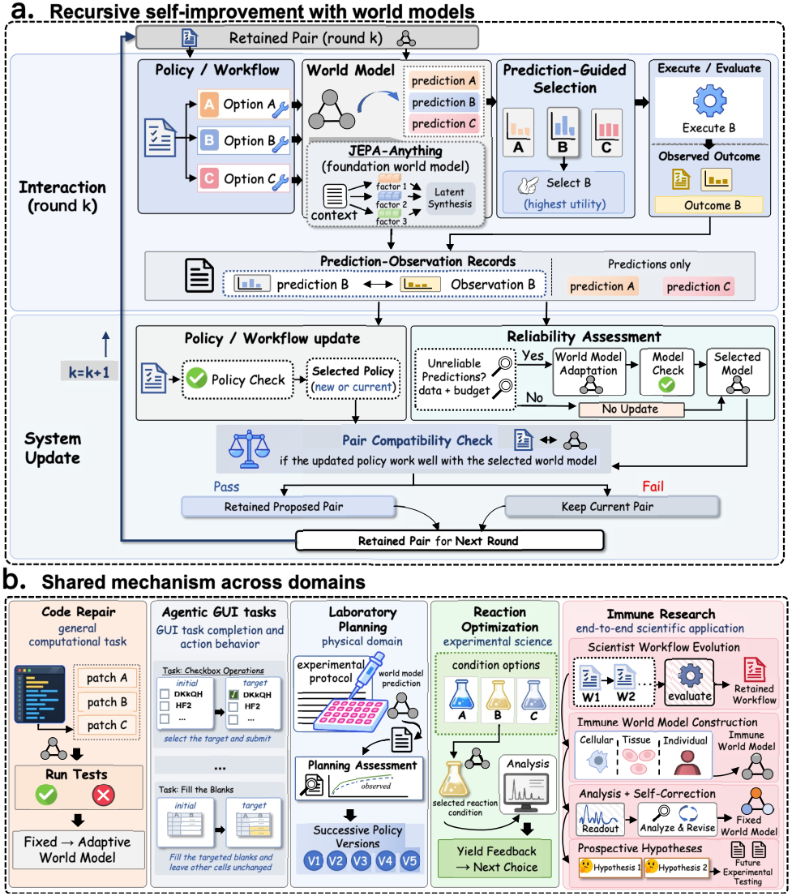

**原文图／官方图片** — 论文原图 2：RSI-Anything 循环——世界模型预测引导动作与学习数据选择，观测反馈更新策略/工作流并有条件地再适配世界模型，组件与兼容性检查决定保留哪个策略-模型对。 · Figure 2 (figure1_v12_2026-10-09.png): RSI-Anything couples prediction-guided action with retained system updates, with domain instantiations in panel b · [source](https://arxiv.org/html/2610.13912v1)

**nanoRSI 复现状态** — not-run. 来源最近核验：2026-10-14.

**开源代码／权重／数据链接** — [GitHub repository (Apache-2.0)](https://github.com/Gen-Verse/RSI-Anything)

**一手来源** — [arXiv abstract](https://arxiv.org/abs/2610.13912) · [arXiv HTML v1](https://arxiv.org/html/2610.13912v1) · [GitHub repository (Apache-2.0)](https://github.com/Gen-Verse/RSI-Anything)

### AgentEvolver: System-Wide Self-Evolution Through Task Execution

**2026-10-08** · paper · 直接有界闭环

**日期说明** — arXiv v1 提交于 2026-10-08；无修订。标题栏给出项目页与仓库链接。

**机构关系** — 新加坡南洋理工大学计算学院（含 Bo An 在内四位作者）与新加坡管理大学（Xinrun Wang）。

**改变对象与反馈复用** — 在任务执行过程中、基础模型不变的前提下构建能力：八个实体族（操作、方法、agent、控制流、接口与支撑状态等）把各自组件交给统一的带版本生命周期——结构准入、功能评估、随后激活。共享 Runtime 协调任务编排、持久规划与可恢复上下文，版本管理把每次评估过的变更链接到它所进入的生效能力集。

**作者报告结果** — 在 SWE-bench Pro Public 上，系统报告开启演化后解决率 82.08%，高于其自身未演化基线（作者对照；论文强调区分组件改进与最终任务成功）。六个应用案例显示能力迁移到网站、游戏与研究任务，同时如实记录了未完成目标与一次失败策略；独立任务迁移与总开发成本列为开放问题。

**证据边界** — 头条数字是与系统自身未演化配置比较，而非外部 SOTA agent；能力迁移只在六个自选应用案例上考察；独立任务迁移与总开发成本明确留作开放问题；论文自身即区分组件改进与最终任务成功。

**代码／权重／数据／许可** — 代码：github.com/DVampire/AgentEvolver，MIT 许可（经 raw LICENSE 核验）。项目页：dvampire.github.io/AgentEvolver。数据：使用外部基准。许可：MIT。

**可用于 nanoRSI 的实验方向——本次未实现** — 逐实体带版本生命周期的设计是 nanoRSI 技能轨的具体模式：给每个被编辑产物（技能文件、runner、评测器配置）同一套准入->评估->激活生命周期并把版本链接写入证据账本，使能力可回溯到产生它的变更——把 nanoRSI 已对接受代数做的审计延伸到激活一步。

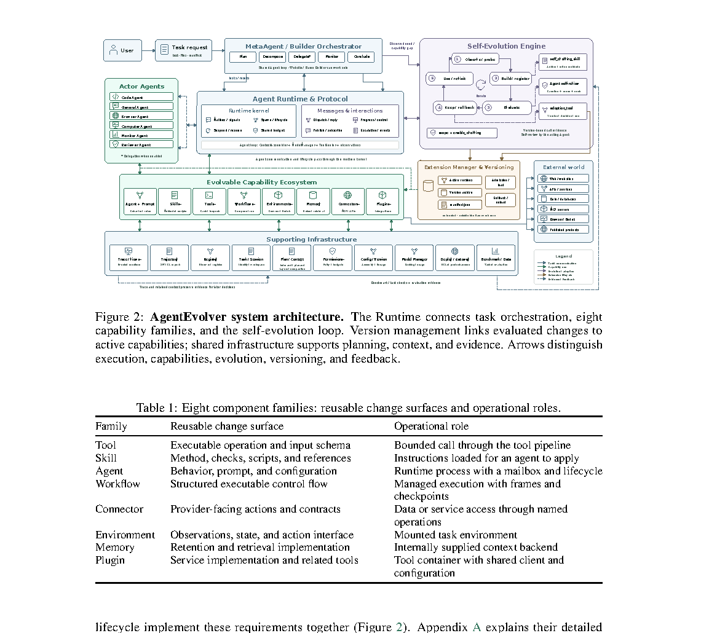

**原文图／官方图片** — 论文原图 2：AgentEvolver 系统架构——Runtime 连接任务编排、八个能力族与自演化循环；版本管理把评估过的变更链接到生效能力，并共享规划、上下文与证据基础设施。 · Figure 2, page 5 of the PDF (rendered at 150 dpi and cropped): the Runtime connecting task orchestration, the eight capability families and the self-evolution loop · [source](https://arxiv.org/pdf/2610.11613)

**nanoRSI 复现状态** — not-run. 来源最近核验：2026-10-13.

**开源代码／权重／数据链接** — [GitHub repository (MIT)](https://github.com/DVampire/AgentEvolver)

**一手来源** — [arXiv abstract](https://arxiv.org/abs/2610.11613) · [arXiv PDF v1 (no HTML rendering exists)](https://arxiv.org/pdf/2610.11613) · [GitHub repository (MIT)](https://github.com/DVampire/AgentEvolver) · [project page](https://dvampire.github.io/AgentEvolver/)

### SoL-Pi: Recursively Scaling Auto-Research Loops for Efficient Agent Harness

**2026-09-17** · paper · 直接有界闭环

**日期说明** — arXiv v1 2026-09-17；代码仓库创建于 2026-09-02，活跃至 2026-09-18。

**机构关系** — 企业牵头（NVIDIA，NTU 与 MIT 合著；NVlabs 仓库与项目页）。

**改变对象与反馈复用** — 受 RSI 启发的自动研究循环递归改进 agent harness 本身：研究 AI 从执行轨迹提出 harness 机制，agent 种群并行探索候选并独立评审，只有通过留出验证的机制被保留（EdgeBench 始终不进搜索）——最终保留四个机制。

**作者报告结果** — 在 51 任务 EdgeBench 上，SoL-Pi 在 GPT-5.6 Sol 与 Opus 5 下性能与 Pi 持平，token 流量降 44.7-49.0%、API 成本约降三分之一；相对原生 Codex/Claude Code 每小时省 $8.75-13.50，相对 Pi 省 $4.36-5.71。

**证据边界** — 作者自报的等性能效率增益；搜索本身耗算力不小（两小时种群运行）；EdgeBench 类边缘任务之外的泛化未展示。

**代码／权重／数据／许可** — MIT 代码位于 github.com/NVlabs/SoL-Pi（核验时 2,244 星）与项目页 nvlabs.github.io/SoL-Pi/。

**可用于 nanoRSI 的实验方向——本次未实现** — 仓库衍生搜索环境与永不触碰的留出基准之间的硬隔离，加上机制保留前的独立评审闸门，可直接移植到 nanoRSI 种群运行。

**原文图／官方图片** — SoL-Pi 通过自动化研究发现更省 token 的 harness：研究环境供给任务，运行基础 harness 的 AI 迭代机制。 · Figure 1 (teaser-funnel-v10.png) · [source](https://arxiv.org/html/2609.20519v1)

**nanoRSI 复现状态** — not-run. 来源最近核验：2026-09-19.

**开源代码／权重／数据链接** — [Code repository](https://github.com/NVlabs/SoL-Pi)

**一手来源** — [arXiv abstract](https://arxiv.org/abs/2609.20519) · [Paper HTML (affiliations, Figure 1-2, abstract numbers)](https://arxiv.org/html/2609.20519v1) · [Code repository](https://github.com/NVlabs/SoL-Pi) · [Project page](https://nvlabs.github.io/SoL-Pi/)

### Self Improvement via Fast Tree-search

**2026-09-17** · paper · 直接有界闭环

**日期说明** — arXiv v1 于 2026-09-17 提交（2609.19526），截至 2026-10-11 无后续版本。媒体报道（VentureBeat，2026-10-02）晚于首发，仅作线索回溯使用，不作为首发日期。

**机构关系** — 论文 HTML 列出 MIT 的 Xinghong Fu（通讯）与 Sakana AI 的 Aravinth Kulanthaivelu、Yutaro Yamada。媒体对该工作的报道仅作线索，不作为来源。

**改变对象与反馈复用** — 编码智能体在树搜索中递归修改自身实现。SIFT 在该循环内加入廉价监督信号：LLM 裁判对候选补丁与历史版本做两两比较，胜负记录经正则化 Bradley-Terry 模型聚合为强度分数，并按排名进行父节点采样使扩展偏向更强节点；昂贵的下游基准评测只留给最有希望的节点，另有一个解耦流水线变体允许在完整评测结束前扩展已获得强裁判信号的节点。

**作者报告结果** — 作者报告的完整 Polyglot 基准结果：o3-mini 智能体加 gpt-5.4 裁判的 SIFT 达 35.1%，对照 DGM（o3-mini）30.7%、基础智能体 14.2%；o3-mini 配置重复运行为 32.0-35.6%，Qwen3-Coder-30B 配置达 32.0%。o3-mini 运行在 50 CPU 小时、5 小时墙钟内完成，Qwen3 配置在 250 CPU 小时、7 小时内完成。论文还报告发现的智能体 harness 可跨编码模型迁移。以上均为作者在其基准与 API 预算下的报告，不是 nanoRSI 复现。

**证据边界** — 主要增益依赖裁判模型：裁判为 None 的 SIFT 仅 29.8%（低于 DGM 的 30.7%），gpt-5-mini 裁判配置为 31.6%，裁判质量与成本是承重点。评测以 Polyglot 为主、TerminalBench 为辅，且核验的论文页面未发现代码、权重或数据发布。墙钟与 API 成本数字依赖作者 2026 年的 API 价格与基础设施。

**代码／权重／数据／许可** — 代码：核验的摘要与 HTML 页面未发现仓库链接。权重：未涉及/未分发。数据：未发现数据发布。许可：论文在 arXiv 上为 CC BY 4.0；无发布则无法核验实现许可。'未核验'不等于'不存在'。

**可用于 nanoRSI 的实验方向——本次未实现** — 可移植部分是廉价预闸门：用两两 LLM 裁判比较加 Bradley-Terry 聚合，在任何完整面板评测前对提案做低成本排序，并与完整评测闸门显式对照，记录误准入/误拦截与裁判成本。这可以纳入已冻结的 RRSI 式选择器研究与反事实面板；属于拟议受控实验，不是 nanoRSI 默认行为。

**原文图／官方图片** — 论文原始 Figure 1：SIFT 单步扩展——被采样节点自我改进，裁判将其与历史版本比较，胜负记录进入 Bradley-Terry 强度分数并用于按排名的父节点采样。 · Figure 1 (figures/pipeline_full_bigfont.png): node expansion with judge comparison, Bradley-Terry aggregation and rank-based parent sampling · [source](https://arxiv.org/html/2609.19526v1)

**nanoRSI 复现状态** — not-run. 来源最近核验：2026-10-11.

**开源代码／权重／数据链接** — 核验来源中没有确认的公开代码／资产链接。

**一手来源** — [arXiv abstract](https://arxiv.org/abs/2609.19526) · [arXiv HTML v1 and Figure 1](https://arxiv.org/html/2609.19526v1)

### Refactoring Hermes with 1,393 agents

**2026-09-15** · report · 直接有界闭环

**日期说明** — 重构运行发生在 2026-09-02/04；页面结构化元数据把发布日期记为 2026-09-15T15:00Z。

**机构关系** — Nous Research 第一方记录，Teknium 执笔。

**改变对象与反馈复用** — 人类下达 /goal 后，Hermes 编排器把自家约 106 万行仓库切成 36 组，派出工作子智能体在独立 git worktree 中编辑并做接口校验（JSON schema、逐字节一致的 CLI --help）；经验教训自动写入 hermes-agent-dev Markdown 技能并再共享，让其他智能体继承已学流程。

**作者报告结果** — 1,393 个子智能体（峰值并发 218）、约 19 个活跃小时、主运行约 1.93 万美元（人工估算 15 万-180 万）；非测试 Python 从 1,063,826 行降至 698,363 行（−34.4%）；超 5,000 行的文件 37 → 6；超 300 行的函数 192 → 2；最长 if/elif 链 92 → 9 分支；4,000 次符号查询测试的平均返回 token 从 2,218 降至 993。

**证据边界** — 无能力对照——测的是代码健康度而非任务表现；评审抓到测试漏掉的真实回归（删除公开命名、约 65 处异常处理被重写）；首次运行因鉴权 token 过期中断；模块数与部分入口导入时间变差。

**代码／权重／数据／许可** — 博文公开；Hermes Agent 仓库公开，当前已核验到 LICENSE 文件，GitHub 识别为 MIT。该许可只覆盖仓库代码；报告中的托管运行、模型及生成物另行处理，本轮未审计其再分发条件。

**可用于 nanoRSI 的实验方向——本次未实现** — nanoRSI 已有每候选 worktree 评测；要补的是把事后教训自动写入技能文件供后续运行加载，让一次性失败与持久流程记忆之间闭环。

**原文图／官方图片** — Nous Research 官方文章题图：Hermens 用 1,393 个子智能体自主重构自身约百万行代码库。 · Post banner graphic · [source](https://nousresearch.com/refactoring-hermes-with-1393-agents/)

**nanoRSI 复现状态** — not-run. 来源最近核验：2026-10-16.

**开源代码／权重／数据链接** — [Hermes Agent repository](https://github.com/NousResearch/hermes-agent) · [Repository LICENSE](https://github.com/NousResearch/hermes-agent/blob/main/LICENSE) · [hermes-agent v0.22.2 release](https://github.com/NousResearch/hermes-agent/releases/tag/v0.22.2)

**一手来源** — [Nous Research blog report](https://nousresearch.com/refactoring-hermes-with-1393-agents/) · [Hermes Agent repository](https://github.com/NousResearch/hermes-agent) · [Repository LICENSE](https://github.com/NousResearch/hermes-agent/blob/main/LICENSE) · [Hermes Agent v0.21.5 release](https://github.com/NousResearch/hermes-agent/releases/tag/v2026.9.24) · [Hermes Agent v0.21.6 release](https://github.com/NousResearch/hermes-agent/releases/tag/v0.21.6) · [hermes-agent v0.22.2 release](https://github.com/NousResearch/hermes-agent/releases/tag/v0.22.2)

### Mendel Gödel Machine: Recursive Self-Improving Coding Agents via Comparative Evolution

**2026-08** · paper · 直接有界闭环

**日期说明** — arXiv v1：2026 年 8 月（2608.07645）。v1 确切日期未复核，采用月精度。

**机构关系** — 论文：Changzhi Liu、Yilun Liu、Sikuan Yan、Volker Tresp、Yunpu Ma——电子科技大学、慕尼黑大学与慕尼黑机器学习中心。

**改变对象与反馈复用** — 在档案式自修改（DGM/HGM）上加入三个由比较证据驱动的孟德尔算子：克隆变异（单轨迹编辑）、反应规范变异（用同一智能体跨多任务的轨迹编辑——复现失败标记基因型缺陷）、跨谱系杂交（从另一谱系的成功轨迹提取可迁移行为性状并适配，不拼接代码）。失败任务池提高采样权重使谱系在难题上重叠。命题 1：加性适应度地形下，比较证据提升修复概率。

**作者报告结果** — Qwen3.6-35B-A3B、200 次评估 + 24 次扩展：SWE-bench Verified-60 68.3% -> 78.3%（HGM 73.3%）；Polyglot-60 50.8% -> 93.2%（HGM 77.9%）；完整 Polyglot-225 达 93.3%，'以约 117 倍少的参数超过闭源 GPT-5'。跨基准迁移：SWE-bench Pro 16.7% -> 26.7%；Multilingual 41.7% -> 55.0%。跨模型迁移：DeepSeek-V4-Flash 50.0% -> 66.7%、V4-Pro 45.0% -> 75.0%。

**证据边界** — 高时间/GPU 成本限制了种子数与扫参；算子需要多轨迹历史与跨谱系任务重叠（档案小时退化为单轨迹基线）；编辑质量无保证；结论限于公开基准上的编码智能体脚手架。

**代码／权重／数据／许可** — 代码在 github.com/RealLcz/MGM（Apache-2.0，核验时 32 星）；项目页 reallcz.github.io/MGM。

**可用于 nanoRSI 的实验方向——本次未实现** — 对 nanoRSI：按谱系保存逐任务轨迹，并允许由跨任务复现失败（反应规范）与其他候选在共享任务上的成功（杂交）驱动的编辑——都是候选分数之外的选择信号。

**原文图／官方图片** — 图 1：孟德尔哥德尔机——档案谱系树上，采样与评估喂给三个比较算子：克隆变异、反应规范变异、跨谱系杂交。 · Figure 1 · [source](https://arxiv.org/html/2608.07645v1)

**nanoRSI 复现状态** — not-run. 来源最近核验：2026-09-21.

**开源代码／权重／数据链接** — [Code repository (Apache-2.0)](https://github.com/RealLcz/MGM)

**一手来源** — [arXiv abstract](https://arxiv.org/abs/2608.07645) · [Paper v1 (affiliations, Figure 1, results tables)](https://arxiv.org/html/2608.07645v1) · [Code repository (Apache-2.0)](https://github.com/RealLcz/MGM)

### Meta^n: Recursive Self-Improvement through Emergent Depth

**2026-08** · paper · 直接有界闭环

**日期说明** — arXiv v1：2026 年 8 月（2608.24735）；官方仓库创建于 2026-08-26。v1 确切日期未复核，采用月精度。

**机构关系** — 论文：Zae Myung Kim、Young-Jun Lee、Dongyeop Kang（明尼苏达大学）与 Seungyeon Jwa（首尔国立大学）。

**改变对象与反馈复用** — 单一固定的元操作 Omega 反复作用于自身输出：每次调用读取下层的轨迹与（自第 3 层起）其产出的代码，再写出下一层代码（预处理器 + 代码库）；包装器复合成 Sd = Md o ... o M2 o S1。深度持续增长直到 Omega 不再找到改进（收敛阈值 0.02），并有跨链进化档案；各层角色无提示地涌现（回滚行为首次出现在第 3 层）。

**作者报告结果** — 八个基准家族上实测元深度 3-6（平台期 3-4；材料科学 SR 达 6），而既有自改写系统实测上限约 2.5。ARC-AGI-2：0.331 +/- 0.010 对 OpenEvolve 0.003、Godel Agent 0.054——唯一能解出任意任务的系统；CO-Bench（GPT-5.2）0.870 对 0.702。消融去递归：-0.131（Gemma CO）；层间上下文贡献约 72% 增益。

**证据边界** — 所有层用同一模型（更强的 Omega 配更弱基座未测）；层间上下文是自由文本；高层推理能力与累积层代码的上下文饱和仍是未测上界。

**代码／权重／数据／许可** — 代码在 github.com/minnesotanlp/meta-n（MIT，核验时 29 星）。论文 CC BY-NC-ND 4.0（非商业条款）。

**可用于 nanoRSI 的实验方向——本次未实现** — 对 nanoRSI：把'实测元深度'（在平台期前真正有效的嵌套改进层数）作为标准报告字段——Meta^n 证明它可测量，而自改写环要打败的基线约为 2.5。

**原文图／官方图片** — 图 1：Meta^n 一览——固定元操作反复读取下层并写出下一层代码；实测深度增长到 3-6，而自改写系统上限约 2.5。 · Figure 1 · [source](https://arxiv.org/html/2608.24735v1)

**nanoRSI 复现状态** — not-run. 来源最近核验：2026-09-16.

**开源代码／权重／数据链接** — [Code repository (MIT)](https://github.com/minnesotanlp/meta-n)

**一手来源** — [arXiv abstract](https://arxiv.org/abs/2608.24735) · [Paper v1 (affiliations, Figures 1-3, tables)](https://arxiv.org/html/2608.24735v1) · [Code repository (MIT)](https://github.com/minnesotanlp/meta-n)

### AIDE²: The First Evidence of Recursive Self-Improvement

**2026-07-14** · report · 直接有界闭环

**日期说明** — Weco AI 第一方博客报告于 2026-07-14 首次公开。完整技术报告题为《Recursive self-improvement of AI research agents》，于 2026-09-22 以 arXiv:2609.26457 首次公开；该日期作为后续实质事件记录，不替换原始报告日期。

**机构关系** — Weco AI 对自家系统的第一方报告，无独立复现。

**改变对象与反馈复用** — 双层循环：外环智能体改写内环研究智能体的代码；每个候选在固定的逐任务预算下跨异构 AI 研发任务族评测，并在接受前把留出分数汇总为私有等级。论文报告一条包含 100 个节点、接受 7 次重写的轨迹；演化后的 harness 改变搜索策略、上下文管理和奖励黑客防护，而每层循环内的底层模型保持固定。

**作者报告结果** — 一次 8 天无人值守运行接受了 7 次重写，私有选择等级从 0.703 提升到 0.778。在四个留出基准上，AIDE₈₅ 按相同协议达到或超过人工构建基线，其中包括分布外的 WeatherBench 2；在另一个留出的 KernelBench 式任务族上，奖励黑客率从 55% 降至 32%，人工基线为 39%。另外两次完整运行也显示持续改进，但点火测试没有统计上决定性的结果。这些是作者报告，不是 nanoRSI 复现。

**证据边界** — 主轨迹是一次昂贵的托管模型运行；论文指出比较带噪、部分基线评测因上下文窗口失败，且不同 checkpoint 的收益并不单调。外环点火结果不确定；报告中的“递归自我改进”指固定评测预算下的 harness／搜索效率，不是模型权重自改进，也不是通用 RSI 门槛。

**代码／权重／数据／许可** — 论文与原始图：已由 arXiv:2609.26457 公开。AIDE² 实验代码、权重和基准数据包未发布，也未独立核验。相关的 WecoAI/aideml 前身仓库为 MIT，但该许可不能扩展到 AIDE² 运行、托管模型或生成物。

**可用于 nanoRSI 的实验方向——本次未实现** — 把 AIDE² 作为既有 RRSI 选择器研究的协议参照：固定内层任务预算，把公开反馈与留出接受等级分开，并报告完整的接受／拒绝谱系。不要复制 Weco 代码，也不要把论文基准收益说成本地结果；先冻结 nanoRSI 的三种子、三预算点协议和成本上限。

**原文图／官方图片** — AIDE² 原始 Figure 1：外环改写完整研究智能体，内环在 AI 研发任务上评测候选，并由私有留出等级决定重写是否成为 incumbent。 · Figure 1 (figures/fig_system_diagram_light.pdf): one step of recursive self-improvement · [source](https://arxiv.org/html/2609.26457v1)

**nanoRSI 复现状态** — not-run. 来源最近核验：2026-09-29.

**开源代码／权重／数据链接** — [Related AIDE predecessor repository](https://github.com/WecoAI/aideml) · [Related AIDE predecessor license](https://raw.githubusercontent.com/WecoAI/aideml/main/LICENSE)

**一手来源** — [Weco AI blog report](https://www.weco.ai/blog/first-evidence-of-recursive-self-improvement) · [AIDE² technical report](https://arxiv.org/html/2609.26457v1) · [Related AIDE predecessor repository](https://github.com/WecoAI/aideml) · [Related AIDE predecessor license](https://raw.githubusercontent.com/WecoAI/aideml/main/LICENSE)

### Hyperagents

**2026-03-19** · paper · 直接有界闭环

**日期说明** — arXiv v1发布于2026-03-19；Meta论文页面日期为2026-03-24。

**机构关系** — 论文列有FAIR at Meta、Meta Superintelligence Labs及学术合作机构。

**改变对象与反馈复用** — 可编辑的元智能体修改自身及任务智能体；经评价的有效变体进入档案，作为后续父代和反馈来源，入库不要求立即提高分数。

**作者报告结果** — 100轮后，论文评审保留集准确率为0.710（置信区间0.590–0.750），静态基线为0.630、定制DGM为0.590。与定制DGM的差异不显著；初始0.0源于输出格式失败。

**证据边界** — 基础模型和评价器固定，有限轮次实验不能证明无限自我加速。

**代码／权重／数据／许可** — 已确认官方代码及实验日志链接；未提供基础模型权重。代码采用CC BY-NC-SA 4.0，不能称为允许商业使用的宽松开源。未检查日志内容及独立数据许可。

**可用于 nanoRSI 的实验方向——本次未实现** — 建议实验：分别管理任务代码和元代码版本，保留已评价的中间变体及不可变评价记录。

**原文图／官方图片** — 图 1：DGM-Hyperagents 将可修改的任务 Agent 与元 Agent 结合，并用 stepping-stone 档案持续搜索。 · Figure 1 · [source](https://arxiv.org/html/2603.19461v1)

**nanoRSI 复现状态** — not-run. 来源最近核验：2026-09-16.

**开源代码／权重／数据链接** — [Official code](https://github.com/facebookresearch/HyperAgents) · [Code licence](https://github.com/facebookresearch/HyperAgents/blob/main/LICENSE.md)

**一手来源** — [Paper history](https://arxiv.org/abs/2603.19461) · [Paper v1, authors and section 5.1](https://arxiv.org/html/2603.19461v1) · [Meta publication](https://ai.meta.com/research/publications/hyperagents/) · [Official code](https://github.com/facebookresearch/HyperAgents) · [Code licence](https://github.com/facebookresearch/HyperAgents/blob/main/LICENSE.md)

### Group-Evolving Agents: Open-Ended Self-Improvement via Experience Sharing

**2026-02-04** · paper · 直接有界闭环

**日期说明** — arXiv v1 提交于 2026-02-04；无修订。经 lobehub/awesome-rsi（2026-10-12）发现、2026-10-15 完成一手核验。它正是 Evo²（2610.13025）中最强自演化基线 'GEA'——基线本身此前未被收录。

**机构关系** — Zhaotian Weng、Antonis Antoniades、Deepak Nathani、Zhen Zhang、Xiao Pu、Xin Eric Wang——加州大学圣巴巴拉分校。

**改变对象与反馈复用** — 把整个 agent 群体而非单一谱系作为进化单元：自改进 agent 自主改写自身架构，群内成员在开放式演化中共享复用经验，使早期探索多样性得以保留而非损失在孤立的树分支里。最佳 agent 整合来自多个不同祖先的经验。

**作者报告结果** — SWE-bench Verified 71.0% 对最强自演化基线 DGM 56.7%；Polyglot 88.3% 对 68.3%。对顶级人工设计框架：OpenHands+GPT-5 71.8%、Aider+GPT-5(high) 52.0%——匹配或超越。鲁棒性：框架级 bug 平均 1.4 次迭代修复（对照 5.0）；最佳 GEA agent 整合 17 个不同祖先（DGM 为 9）；改进跨 GPT 系与 Claude 系骨干迁移。

**证据边界** — 未发布代码；arXiv 页与论文正文均无仓库链接。71.0/88.3 是论文自身 harness 设置下对自演化基线的数字；人工框架对比使用不同骨干（GPT-5）。

**代码／权重／数据／许可** — 未发布代码、权重或数据；论文按 arXiv 非独占许可（CC BY 4.0）。

**可用于 nanoRSI 的实验方向——本次未实现** — 群体级经验共享是对 nanoRSI rejected_recent 隔离的反向设计：失败候选的诊断轨迹可以共享给后续提案而非只做压制；17 祖先广度也是 ADOPTION 第 39 项可直接计算的选型统计（幸存候选动用了多少个不同先前尝试）。

**原文图／官方图片** — 论文原图 1：对比树结构自演化（孤立分支损失探索多样性）与群体演化 agent（群内成员在开放式演化中共享复用经验）。 · Figure 1 (pipeline_overall.png): GEA vs tree-structured self-evolution - isolated branches on the left, group-level experience sharing on the right · [source](https://arxiv.org/html/2602.04837v1)

**nanoRSI 复现状态** — not-run. 来源最近核验：2026-10-15.

**开源代码／权重／数据链接** — 核验来源中没有确认的公开代码／资产链接。

**一手来源** — [arXiv abstract](https://arxiv.org/abs/2602.04837) · [arXiv HTML v1](https://arxiv.org/html/2602.04837v1)

### Huxley-Gödel Machine: Human-Level Coding Agent Development by an Approximation of the Optimal Self-Improving Machine

**2025-10-24** · paper · 直接有界闭环

**日期说明** — arXiv v1 2025-10-24、v2 2025-10-28、v3 2025-10-29（当前版）；收录时已处于滚动窗口下缘。经 lobehub/awesome-rsi（2026-10-12）发现、2026-10-15 完成一手核验。

**机构关系** — Wenyi Wang、Piotr Piękos、Li Nanbo、Firas Laakom、Yimeng Chen、Mateusz Ostaszewski、Mingchen Zhuge、Jürgen Schmidhuber——全员 KAUST。

**改变对象与反馈复用** — 编码 agent 编辑自身代码库，构建自修改树。论文识别出'元生产力-性能失配'——agent 的基准分数并不可靠指示其产出更强后代的能力——并提出 CMP（Clade Meta Productivity）：聚合一个 agent 全部后代的基准表现作为自改进潜力的指标。HGM 在线估计 CMP 并用它引导自修改树的搜索；论文证明在一定假设下，拥有真值 CMP 足以模拟 Gödel Machine 的行为。

**作者报告结果** — SWE-Verified-60（800 次评估、best-belief agent）：HGM 56.7（+16.7）对 DGM 53.3（+13.3）与 SICA 50.0（+10），CPU 时耗 517 小时对 DGM 1231（省 2.38 倍）；Polyglot 30.5（+10.2）对 27.1/25.4，347 小时对 2385（比 DGM 省 6.86 倍）。CMP 估计器与实现后代增益的加权相关性：SWE-Verified-60 0.778、Polyglot 0.626，对 DGM 0.285/0.383、SICA 0.444/0.274。完整 SWE-bench Verified 8000 次评估后达 61.4%（初始 agent 53.2%），当时排行榜最高的 GPT-5-mini 系统。迁移：GPT-5-mini 优化的 agent 换 GPT-5 评测 SWE-bench Lite 得 47.8%（filtered；SWE-agent 48.3%）与 57%（standard；56.7%）——匹配最佳官方核验的人工设计 agent。

**证据边界** — '当时排行榜最高'的断言会快速过时；CMP 相关性在加权评估子集上测得；论文 arXiv 许可为 CC BY-NC-SA（代码单独 Apache-2.0）。

**代码／权重／数据／许可** — 代码 Apache-2.0，位于 github.com/metauto-ai/HGM（LICENSE 已于 2026-10-15 核验）。论文许可 CC BY-NC-SA 4.0。

**可用于 nanoRSI 的实验方向——本次未实现** — CMP 是 ADOPTION 第 38/39 项可实现的竞争选型器：按后代的聚合冻结面板表现（而非父代自身分数）给父代排名，可从既有 lineage store 直接计算、无需新增模型调用。'失配'发现对 nanoRSI 闸门也是直接警示：候选自身的面板分数对谱系价值只是噪声预测器。

**原文图／官方图片** — 论文原图 1：基准表现与自改进增益几乎不相关（左），由此提出以后代谱系聚合表现为自修改树搜索引导信号的 CMP（右）。 · Figure 1 (intro_figure_combined_wider.svg): left - the Metaproductivity-Performance Mismatch scatter (benchmark accuracy vs descendant gain); right - HGM's clade-level metric and compute efficiency · [source](https://arxiv.org/html/2510.21614v3)

**nanoRSI 复现状态** — not-run. 来源最近核验：2026-10-15.

**开源代码／权重／数据链接** — [metauto-ai/HGM (Apache-2.0)](https://github.com/metauto-ai/HGM)

**一手来源** — [arXiv abstract](https://arxiv.org/abs/2510.21614) · [arXiv HTML v3](https://arxiv.org/html/2510.21614v3) · [metauto-ai/HGM (Apache-2.0)](https://github.com/metauto-ai/HGM)

## 程序进化与进化搜索 (10)

### A Self-Improving Agent that Grows its Own DSL: Oracle-Free Operator Induction for Exact Question Answering

**2026-10-14** · paper · 直接有界闭环

**日期说明** — arXiv v1 于 2026-10-14 提交（唯一版本）；题名逐字取自 abs 页。

**机构关系** — Yun-Shiuan Chuang*、Yirou Ge*、Yixi Li*（*同等贡献）、Yiming Bian、Zijie Pan，以及 Jenna L. Ballard、Uma Kona、Linsey Pang、Prakhar Mehrotra——HTML 作者块以单一 PayPal AI 机构行集体署名。

**改变对象与反馈复用** — 单一冻结模型在小而精确的 DSL 上跑双层循环：无奖励、无裁判、无答案钥匙。内层在固定算子库内扩张可答问题集：每条候选表达式必须由第二次独立重写的表达式在全部验证记录上一致才保留。外层发现重复出现的能力缺口，把新算子写成沙箱内无方法调用的 Python，且只有通过三段无 oracle 闸门才准入：差分测试（两个独立实现全记录加模糊输入一致）、已信任算子之上的蜕变守恒律、以及内层独立一致检查的往返验证。

**作者报告结果** — 可答集增长：Merchant 10→336、BookSQL 15→162、EHRSQL（MIMIC-III）13→248；仅内层循环就把覆盖面约扩为三倍（13 个起始集平均 +18.3）。闸门健全性在 14 个被准入算子的全部单点突变体上测得：非相关参照下 0/138 缺陷变体被准入（两个实现带同一缺陷的相关最坏情形下 10/138），对照 admit-if-it-runs 129/138、self-consistency 129/138、压缩法 101/138；LLM 裁判还错误拒绝 2/14 个正确算子。机制不做修改即跨模型家族迁移（主模型 Qwen3.6-35B-A3B；Mistral-Small-24B、Llama-3.3-70B、Gemma-3-27B 也能自我扩展）。

**证据边界** — mode（众数）归约器永久不可达，因为不存在对应的守恒律；只测了至多 3 轮归纳；81% 的准入拒绝源于沙箱禁用的方法调用；存在一例对抗逃逸（见证关系引用裸内建函数而非受信任算子时，改变尺寸的合并缺陷被准入）；种子集中在按组聚合族；Gemma-3-27B 只在一个种子上自我扩展（DSL 编译率 13%）。

**代码／权重／数据／许可** — 论文承诺补充材料（DSL 及其测试、两个代理循环的完整提示词、生成与研究脚本）；HTML 中未发现独立公开仓库链接；合成语料可由聚合参数再生成，无需专有数据；仅 arXiv 非独占许可。

**可用于 nanoRSI 的实验方向——本次未实现** — 精确任务上无 oracle 闸门的范本：双独立实现加守恒律替代留出标签，可直接用于 nanoRSI 有可验证不变量但无金标面板的场景。同样可移植的是审计协议——对每条被接受的编辑生成全部单点突变体并测闸门误准入率——可为反事实/挑战闸门给出论文级健全性分数。

**原文图／官方图片** — 原图 1：单一冻结模型跑的双层循环，无金标 oracle、无裁判——内层在固定算子内扩张可答集，外层在无 oracle 准入闸门下归纳新算子。 · Figure 1 (method_overview.png), arXiv HTML 2610.20809v1 · [source](https://arxiv.org/html/2610.20809v1/method_overview.png)

**nanoRSI 复现状态** — not-run. 来源最近核验：2026-10-18.

**开源代码／权重／数据链接** — 核验来源中没有确认的公开代码／资产链接。

**一手来源** — [arXiv abs 2610.20809](https://arxiv.org/abs/2610.20809) · [arXiv HTML v1](https://arxiv.org/html/2610.20809v1)

### LAGO: Language Agents with Reusable Growing Options

**2026-10-14** · paper · 直接有界闭环

**日期说明** — arXiv 2610.19843 v1 提交于 2026-10-14，随 2026-10-15 批次公告。Yuran Wu 与 Mengkang Hu 同等贡献；通讯作者 Xu Wang。

**机构关系** — Yuran Wu、Qiudan Zhang、Xu Wang（深圳大学）；Mengkang Hu（香港大学）；Qionglin Qiu（湖南大学）；Fanqing Meng（新加坡国立大学）；Qiguang Chen（Evolvent Research Team）；Yuhang Zhou（复旦大学）。

**改变对象与反馈复用** — 把专门化语言智能体当作可复用的时间扩展选项：元智能体从持久库检索选项或新生选项、派发子任务、验证结果、把成功的新选项准入库；库跨任务增长而不更新模型权重。

**作者报告结果** — 在 500 个 SWE-bench Verified 任务上以官方 Docker 评测器单次尝试评测，冻结 Qwen3.5-35B-A3B 同时担任元智能体与选项角色解决 58.6%。在固定 150 任务受控子集（同策略、同温度、同任务 ID、同评测器）：mini-SWE-agent 49.3%、Terminus 2 57.3%、LAGO 60.3%。50 任务组件消融：去掉分解少解 4 题、复用内容乱序少 2 题、去掉库少 6 题。跨模型实验与“分解质量有作用”的解释一致。

**证据边界** — 未找到代码链接；元智能体与选项共用同一冻结模型（能力上限受约束）；受控对比只覆盖 500 任务中的 150 个。

**代码／权重／数据／许可** — HTML 全文未找到代码或仓库链接。

**可用于 nanoRSI 的实验方向——本次未实现** — 选项准入（生成→验证→准入→复用）正是技能模板可以镜像的库增长环：经验证的子智能体程序成为一等可复用单元而非一次性轨迹。“去掉库少解 6 题”的消融量化了冻结模型上持久库的价值——这是 nanoRSI 任何技能库变体要打败的数字。

**原文图／官方图片** — 原图 1：LAGO 把任务分解变成可复用动作空间——元智能体从持久库检索选项或新生选项、派发子任务、验证结果、把成功的新选项准入库。 · Figure 1 (LAGO_editable_no_footer.drawio.png), arXiv HTML 2610.19843v1 · [source](https://arxiv.org/html/2610.19843v1/LAGO_editable_no_footer.drawio.png)

**nanoRSI 复现状态** — not-run. 来源最近核验：2026-10-17.

**开源代码／权重／数据链接** — 核验来源中没有确认的公开代码／资产链接。

**一手来源** — [arXiv abs 2610.19843](https://arxiv.org/abs/2610.19843) · [HTML full text v1](https://arxiv.org/html/2610.19843v1)

### EvoAlloc: A Self-Evolving Resource Allocation Agent for Efficient Program Evolution

**2026-10-08** · paper · 支撑技术／评测

**日期说明** — arXiv v1 于 2026-10-08 提交（2610.12086），在 2026-10-09 列表公告。截至核验日，论文页面未链接代码或项目页。

**机构关系** — 论文页眉将全体作者列为 KAUST 生成式 AI 卓越中心，其中作者 Wenyi Wang 兼属 Sakana AI。

**改变对象与反馈复用** — EvoAlloc 学习在 LLM 程序演化中分配评测算力：一个分配智能体决定哪些候选获得完整评测，其策略通过把历史搜索与分配结果巩固为可复用经验来修订，并以反事实探索偶尔评测曾被拒绝资源的候选、揭示其结果以充实后续策略更新。被改变的对象是搜索循环内分配器的策略/经验状态，不是模型权重。

**作者报告结果** — 作者报告的跨编码与智能体 harness 优化基准（附录含 ADAS-AIME 与 circle-packing 设置）结果：达到基线水平性能所需完整评测减少 59-82%、总 LLM token 减少 61-89%；在相同完整评测预算下，自适应分配取得 8.7-12.0% 更高的最终性能。以上为作者在其基准与预算下的报告，不是 nanoRSI 复现。

**证据边界** — 该研究优化的是评测成本而非最终能力上限；核验的论文页面未发现公开代码、权重或数据发布，复现依赖作者材料。基准覆盖为作者的编码与 harness 套件，反事实探索率是论文分析了但 nanoRSI 未核验的敏感超参数。

**代码／权重／数据／许可** — 代码：核验的摘要与 HTML 页面未发现仓库链接。权重：未涉及/未分发。数据：未发现数据集发布。许可：无发布即无法核验。'未核验'不等于'不存在'。

**可用于 nanoRSI 的实验方向——本次未实现** — 对 nanoRSI 有界评测预算的两个可移植方向：(1) 经验更新的分配器决定哪些候选提案进入完整面板评测，在匹配总 token 与评测次数下与固定轮转对照；(2) 把反事实探索用作误拦截量测——偶尔评测被选择器拒绝的提案，与既有的闸门反事实面板互相印证。两者均为可选择的实验设计，默认不改动任何调度器。

**原文图／官方图片** — 论文原始 Figure 1：(a) 分配智能体选择进入完整评测的候选；(b) 结果被巩固为更新策略的经验；(c) 反事实探索评测曾被拒绝的候选以充实后续更新。 · Figure 1 (figures/fig1.png): strategy-guided allocation, experience-driven strategy evolution and counterfactual exploration · [source](https://arxiv.org/html/2610.12086v1)

**nanoRSI 复现状态** — not-run. 来源最近核验：2026-10-11.

**开源代码／权重／数据链接** — 核验来源中没有确认的公开代码／资产链接。

**一手来源** — [arXiv abstract](https://arxiv.org/abs/2610.12086) · [arXiv HTML v1 and Figure 1](https://arxiv.org/html/2610.12086v1)

### AGAR: a reinforcement learning substrate for LLM program evolution

**2026-10-06** · paper · 直接有界闭环

**日期说明** — arXiv v1 于 2026-10-06 提交（2610.09215，cs.AI 交叉 cs.MA）；截至 2026-10-12 无后续版本。

**机构关系** — 作者栏列出中国科学院大学、百度、清华大学、中国科学院自动化研究所与上海大学；由百度方作者提交。

**改变对象与反馈复用** — 把 LLM 程序演化形式化为马尔可夫决策过程，其动作是模型被条件化的模块化前缀而非它输出的程序。常见循环里五个手设常量——父代选择、变异强度、多样性保持、记忆、以及不分部件归因的标量分数——分别替换为挂接到不同组件的 RL 估计器（信用分配、价值估计、自适应探索、经验记忆）。任一估计器可替换或关闭而不改动控制器，使每个迁移机制可逐一审计；后端模型不做梯度训练。

**作者报告结果** — 19 个任务、两个后端（DeepSeek-V4-Flash、GLM-5.2）、三个种子、同一 harness 下，逐任务归一化的同预算最优分数：DeepSeek-V4-Flash 后端 OpenEvolve 0.855+-0.193、ShinkaEvolve 0.919+-0.138、AGAR-Base 0.949+-0.107、AGAR-Combo 0.990+-0.024；GLM-5.2 后端 OpenEvolve 0.897+-0.131、ShinkaEvolve 0.929+-0.093、AGAR-Base 0.979+-0.045、AGAR-Combo 0.972+-0.052。DeepSeek 后端下两个 AGAR 实例均高于两条基线；GLM 下 Base 领先、Combo 紧随。增益集中在竞赛编程族；五个近天花板任务压低方差。该形式化还把既有系统解读为隐式零折扣，因为适应度外在于个体。

**证据边界** — 仅三个种子，作者自述只支持定性结论；两个任务（ahc015、ahc027）的 AGAR 种子不足三个；OpenEvolve 与 ShinkaEvolve 在各自 harness 下运行、任务规格由 AGAR 作者移植，harness 对齐并不严格；未找到公开代码、权重或数据，迁移消融声明无法独立复跑。

**代码／权重／数据／许可** — 代码：arXiv 页与 HTML 中均未找到（正文中的 GitHub 链接指向 OpenEvolve、slime 等既有系统而非 AGAR）。权重：不适用（API 后端）。数据：未核验到任务套件发布。许可：论文为 arXiv 默认许可；无代码许可可核验。

**可用于 nanoRSI 的实验方向——本次未实现** — 对 nanoRSI 可直接移植的思路是逐机制可审计性：把演化循环的选择器、变异强度、多样性与记忆拆成可独立开关的组件，在同一 harness 下报告每个迁移估计器逐一关闭的消融，而不是整体移植框架。适应度零折扣的解读也是研究设计里值得写明的廉价检查。

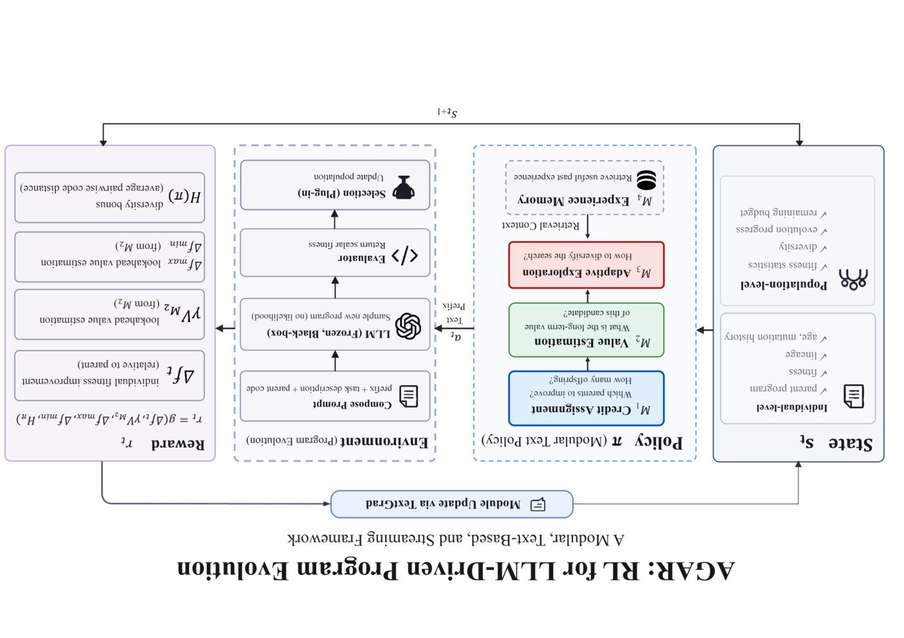

**原文图／官方图片** — 论文原图 1：程序演化写成 MDP——状态是种群的混合粒度视图，动作是条件化 LLM 的模块化前缀，信用分配、价值估计、自适应探索与经验记忆分别挂接到基底的不同组件。 · Figure 1 (framework_mdp.png, rotated upright for readability): the mixed-granularity state, the policy whose action is the modular prefix, and where RL estimators attach · [source](https://arxiv.org/html/2610.09215v1)

**nanoRSI 复现状态** — not-run. 来源最近核验：2026-10-12.

**开源代码／权重／数据链接** — 核验来源中没有确认的公开代码／资产链接。

**一手来源** — [arXiv abstract](https://arxiv.org/abs/2610.09215) · [arXiv HTML v1](https://arxiv.org/html/2610.09215v1)

### Compiled Agency: Frontier General-Purpose Coding Agents Build Winning Game Players from Bare Interaction - from Flappy Bird to StarCraft II and Civilization

**2026-09-17** · paper · 支撑技术／评测

**日期说明** — v1 提交于 2026-07-17，被 arXiv 扣留至 2026-09-17 才公告（OAI datestamp）；按被扣留论文惯例记首次公开日。

**机构关系** — 学术：纽约大学（Joey Xiao）与普林斯顿大学（Haonan Huang，通讯）。

**改变对象与反馈复用** — Gauntlet 是开发-冻结-评测框架：通用编码代理只拿到游戏描述、原始观测/动作接口和一份空策略文件——不给策略、算法或架构。在单次自主会话中与真实游戏交互试错并写出独立控制器，随后冻结并在保留实例上评测，游玩期间零模型调用。冻结产物可检查。

**作者报告结果** — 在一个未公开的程序化 roguelike 上，保留集成功率跨度 0–86%，并呈现清晰的代际门槛：最新一代系统的每个观测会话都胜过上一代的最佳会话。编译出的原始 API 星际争霸 II 控制器击败全部公平内置 AI 与两个作弊变体；单会话程序在保留种子上以完全征服赢得整局文明（Freeciv）——对新手 AI 胜率不高，但号称是无逐回合模型调用、无手工战术层的独立语言代理系统首例。

**证据边界** — Freeciv 胜率仅对新手 AI 且不高；roguelike 结果依赖未公开私设游戏；未找到代码或 harness 发布；核验时仅一版。

**代码／权重／数据／许可** — 核验时未找到代码；论文 CC BY 4.0。

**可用于 nanoRSI 的实验方向——本次未实现** — 冻结后评测的契约可直接映射到 nanoRSI 终测：候选冻结后，评测必须在保留种子上零额外模型调用运行，任何运行时自改都会作为契约违例显形。

**原文图／官方图片** — Gauntlet 图 1：先前工作由研究者提供观测抽象、记忆、技能与规划器；此处智能架构本身是输出，由模型从裸交互中自建。 · Figure 1 (x1.png) · [source](https://arxiv.org/html/2609.18996v1)

**nanoRSI 复现状态** — not-run. 来源最近核验：2026-09-20.

**开源代码／权重／数据链接** — 核验来源中没有确认的公开代码／资产链接。

**一手来源** — [arXiv abstract](https://arxiv.org/abs/2609.18996) · [arXiv HTML v1](https://arxiv.org/html/2609.18996v1)

### Dream-RSI: Recursive Self-Improvement through Evolving Worlds

**2026-09-14** · paper · 直接有界闭环

**日期说明** — arXiv v1：2026-09-14；仓库创建于 2026-09-13。

**机构关系** — 论文：马里兰大学帕克分校（Tong Zheng、Rui Liu、Heng Huang 等）、Google DeepMind（Zhankui He、Benjamin Coleman、Di Bai、Wang-Cheng Kang）与弗吉尼亚大学（Haolin Liu）。

**改变对象与反馈复用** — 发现历史被组织成树，节点存每次尝试的工作区、工件、诊断与得分；这棵树成为回放模拟器——备选探索策略以不同顺序、并行分组与停止点'导航'已记录分支，无需重跑底层智能体。策略开发 LLM 迭代改写探索策略代码，每个版本按平衡最优得分、执行成本与并行度的回放目标打分；最优策略重新上线，新历史又扩充模拟器池。

**作者报告结果** — 算法工程（Lasso、6 个留出数据集）：Gemini-3.1-Pro 下 Dream-RSI 以 317 次调用达均值 2,931ms，对固定探索 550 次的 3,587ms；Gemini-3.7-Flash 下 1,879 次调用 2,350.6ms 对 3,200 次的 2,516.7ms（SimpleTES 需 51,200 次）。内核工程：VGG16/LayerNorm 以少 2.43/1.79 倍生成数持平；ConvDiv 同预算下 +2.09 倍得分。

**证据边界** — 回放只对已记录分支确定性有效——无法评估真正新颖的方向；增益仅见于 3 域 8 任务；需要结构化发现树；离线策略迭代仍耗 LLM 调用。

**代码／权重／数据／许可** — 代码在 github.com/zhengkid/Dream-RSI（172 星，核验时无许可证文件）；项目站 dream-rsi.com。

**可用于 nanoRSI 的实验方向——本次未实现** — 对 nanoRSI：把运行档案复用为免费模拟器——在花费任何新评估之前，让备选提案/调度策略在已记录的候选树上回放打分；这是有界环可用的最廉价策略改进形式。

**原文图／官方图片** — 图 1：Dream-RSI 三阶段递归环——在线探索构建发现树，树成为回放模拟器，'做梦'式策略改进离线改写探索策略。 · Figure 1 · [source](https://arxiv.org/html/2609.14858v1)

**nanoRSI 复现状态** — not-run. 来源最近核验：2026-09-21.

**开源代码／权重／数据链接** — [Code repository](https://github.com/zhengkid/Dream-RSI)

**一手来源** — [arXiv abstract](https://arxiv.org/abs/2609.14858) · [Paper v1 (affiliations, Figure 1, tables)](https://arxiv.org/html/2609.14858v1) · [Code repository](https://github.com/zhengkid/Dream-RSI)

### AlgoEvo: Self-Evolving Agentic Search for Automated Algorithm Discovery

**2026-09-14** · paper · 直接有界闭环

**日期说明** — arXiv v1：2026-09-14（2609.15820）。注：9 月 16 日雷达流程注记曾记录一个错乱的"AlgoEvo"列表项并解析到无关的 XAI 论文；本 abs 页确认当前标题与内容真实。

**机构关系** — 论文：香港城市大学（Junhao Qiu、Qinglong Hu、Qingfu Zhang）、华为诺亚方舟实验室（Xialiang Tong、Mingxuan Yuan）与 A*STAR（Liyong Lin）。

**改变对象与反馈复用** — 自治智能体依据运行时反馈检视、诊断并编辑算法代码，而非执行固定搜索管线。设计技能中心把范式专属知识外置为可插拔技能（策略角色、代码接口、修改原则、评测约定），使单一引擎覆盖单目标、多目标与多组件设计；层级经验库（经验卡、带情境 UCB 选择的任务级经验树、跨任务固化进技能）跨任务积累知识，一个模式在至少两个任务上验证后才升格为技能。

**作者报告结果** — 在六个任务（TSP、CVRP、Bi-TSP、Bi-FJSP、CVRP-DR、FJSP 4-Ops）上匹配或超越专用基线（EoH、ReEvo、MCTS-AHD、FunSearch、MEoH、MOTIF、E2OC 等）：TSP 最优结果仅约 39 次评估（配额 500）与 290 万 token（FunSearch 320 万）；CVRP 约 35 次评估最优（190 万 token 对 EoH/ReEvo/MCTS-AHD 约 400 万）；Bi-TSP 与 Bi-FJSP 的 HV 最优且仅 33-36 次评估；CVRP-DR 两个划分皆最优（1.392 亿 token 对 MOTIF 3.171 亿）、FJSP 4-Ops 测试最优（1.181 亿对 5.847 亿）。

**证据边界** — 作者报告复杂多组件设置下 token 开销增大、对齐的问题族之外迁移效果下降；未给公开仓库地址（源码在补充材料中）。

**代码／权重／数据／许可** — 核验时未找到公开仓库；论文称源码在补充材料中，实例/种子/评测脚本已发布。

**可用于 nanoRSI 的实验方向——本次未实现** — 对 nanoRSI：可复用技能只有在两个及以上任务验证后才升格；经验存为卡片加带 UCB 选择的任务级树——35/500 次评估即收敛的评测预算纪律是最可迁移的部分。

**原文图／官方图片** — AlgoEvo 总览：设计技能中心在层级经验库之上激活范式技能，用于算法发现。 · Figure 2 (S3.F2) · [source](https://arxiv.org/html/2609.15820v1)

**nanoRSI 复现状态** — not-run. 来源最近核验：2026-09-17.

**开源代码／权重／数据链接** — 核验来源中没有确认的公开代码／资产链接。

**一手来源** — [arXiv abstract](https://arxiv.org/abs/2609.15820) · [arXiv HTML v1](https://arxiv.org/html/2609.15820v1)

### EvoPolicyGym: Evaluating Autonomous Policy Evolution in Interactive Environments

**2026-07-02** · paper · 支撑技术／评测

**日期说明** — arXiv v1：2026-07-02（2607.02440）。与 AgentGym/AgentEvol 同一作者谱系。

**机构关系** — 论文：中科大、港中文、澳门大学、清华、浙大、苏州大学、布朗大学与上海交大。

**改变对象与反馈复用** — 评测'策略即代码'进化的基准而非训练方法：固定 Gymnasium 风格环境（MiniGrid、Box2D、MuJoCo 族）；智能体在工作区反复编辑可执行 Python'策略系统'，提交训练 rollout（总计至多 128 回合）并获服务器中介反馈；用隐藏的验证选中检查点在留出回合上计分——训练反馈可见、验证/留出隐藏在服务端。诊断把编辑分为综合（新结构）与调参。

**作者报告结果** — Core16 留出归一化回报：GPT-5.5（Codex）0.891、9 胜且 16 环境全进前二；Claude Opus 4.7（Claude Code）0.750；MiniMax-M3 0.531；DeepSeek-V4-Pro 0.359；随机 0.109。强智能体把综合编辑转化为新验证最优的比率达 41-48%，弱者仅 3-10%。进化出的机制含道路掩码前瞻（CarRacing）、周期步态（HalfCheetah）与 BFS 建图（ObstructedMaze）。

**证据边界** — 诊断是'保守代理而非语义证明'（AST 拓扑忽略行为相似性）；策略源边界排除生成数据与学习权重；128 回合预算远低于标准 RL 样本量级，故排除常规 RL 基线；跨 harness 的 token 未归一。

**代码／权重／数据／许可** — 代码在 github.com/Linzwcs/EvoPolicyGym（MIT，核验时 176 星）；HF 数据集 EvoPolicyGym-Exp-data；项目页 linzwcs.github.io/EvoPolicyGym。

**可用于 nanoRSI 的实验方向——本次未实现** — 对 nanoRSI：现成的工件轨评分协议——服务端隐藏验证检查点 + 留出回合 + 硬回合预算，并在账本中区分综合与调参编辑。

**原文图／官方图片** — 图 1：EvoPolicyGym——智能体编辑可执行策略，在有限预算下提交回合 rollout 并获平台中介反馈；验证与留出计分留在服务端隐藏。 · Figure 1 · [source](https://arxiv.org/html/2607.02440v1)

**nanoRSI 复现状态** — not-run. 来源最近核验：2026-09-17.

**开源代码／权重／数据链接** — [Code repository (MIT)](https://github.com/Linzwcs/EvoPolicyGym)

**一手来源** — [arXiv abstract](https://arxiv.org/abs/2607.02440) · [Paper v1 (affiliations, Figure 1, Core16 table)](https://arxiv.org/html/2607.02440v1) · [Code repository (MIT)](https://github.com/Linzwcs/EvoPolicyGym)

### WebAggregator: Enhancing Compositional Reasoning Capabilities of Deep Research Agent Foundation Models

**2025-10-16** · paper · 直接有界闭环

**日期说明** — arXiv v1 于 2025-10-16 以 Explore-to-Evolve 工作标题提交；后续改名为 WebAggregator 不改变原始日期。

**机构关系** — 论文明确列出腾讯 AI Lab 与香港中文大学作者；代码及数据构建仓库由腾讯账号发布。

**改变对象与反馈复用** — 在线探索器访问网页，组合逻辑提案器选择、组合并细化高层聚合操作。质量控制将可执行聚合程序转成覆盖 5 万网站、11 个领域的 1 万条可验证 QA；轨迹与答案再用于 WebAggregator 模型的 SFT。

**作者报告结果** — 论文报告 WebAggregator-8B 达到 GPT-4.1 水平，32B 在 GAIA-text 上超过 GPT-4.1 十个百分点以上并接近 Claude-3.7。人工标注的 WebAggregatorQA 测试中，Claude-3.7 的 pass@1 为 28.0%，GPT-4.1 为 25.8%；模型比较使用固定裁判和有界重试。

**证据边界** — 被进化的对象是网页聚合程序及其生成训练数据；下游基础模型经过 SFT 后评测，并未递归部署来改进自身提案器。网站可用性、裁判质量和生成数据泄漏都会影响结果。

**代码／权重／数据／许可** — Tencent/WebAggregator 发布 QA 构建引擎、查询、轨迹、模型和运行脚本。LICENSE.txt 为 WebAggregator 自定义条款，并写明不适用于欧盟境内；GitHub API 元数据为 NOASSERTION。数据、模型和第三方条款仍需分别核验。

**可用于 nanoRSI 的实验方向——本次未实现** — 使用小型封闭网页任务集测试 nanoRSI 程序进化：保存每个提案程序、来源 URL、验证器输出和生成样本，再比较固定数据 SFT 与刷新数据的迭代。

**原文图／官方图片** — 图 2：Explore-to-Evolve 将网页探索与可执行聚合逻辑转成可验证 QA 和模型训练数据。 · Figure 2, illus.png · [source](https://ar5iv.labs.arxiv.org/html/2510.14438/assets/illus.png)

**nanoRSI 复现状态** — not-run. 来源最近核验：2026-09-13.

**开源代码／权重／数据链接** — [Tencent WebAggregator repository](https://github.com/Tencent/WebAggregator) · [WebAggregator custom license terms](https://github.com/Tencent/WebAggregator/blob/main/LICENSE.txt)

**一手来源** — [arXiv first submission and history](https://arxiv.org/abs/2510.14438) · [Paper v1 and Explore-to-Evolve figure](https://arxiv.org/html/2510.14438v1) · [Tencent WebAggregator repository](https://github.com/Tencent/WebAggregator) · [WebAggregator custom license terms](https://github.com/Tencent/WebAggregator/blob/main/LICENSE.txt)

### ShinkaEvolve: Towards Open-Ended And Sample-Efficient Program Evolution

**2025-09-17** · paper · 直接有界闭环

**日期说明** — arXiv 首版为 2025 年 9 月 17 日，Sakana 公告为 9 月 25 日；不以之后的仓库更新重新确定首发日期。

**机构关系** — Sakana AI 开发并发布该框架，公司公告直接链接论文及官方仓库。

**改变对象与反馈复用** — LLM 修改档案中的程序，以验证器适应度选择下一轮可复用的父代；新颖性筛选与多臂赌博机模型选择提高搜索效率。目标包括 AIME 智能体框架和 MoE 负载均衡损失。

**作者报告结果** — 作者报告以 150 个样本找到优于 AlphaEvolve 的 26 圆装填解。MoE 损失搜索使用 30 代；公告称相对 Global LBL，无效路由减少 5.81%，七个基准的平均表现提高 1.73%。

**证据边界** — 目标由人类限定，并依赖外部 LLM；并未证明变异引擎自身持续改进或无界递归自我改进。

**代码／权重／数据／许可** — 已确认官方代码与示例，许可为 Apache-2.0；不要求发布新的基础模型权重。未完整审计实验数据开放情况。

**可用于 nanoRSI 的实验方向——本次未实现** — 建议：增加基于档案的智能体框架搜索示例，固定留出测试，并在父代选择中计入成本。

**原文图／官方图片** — 图 1：ShinkaEvolve 的档案、拒绝采样、程序变异和适应度评估闭环。 · Figure 1 · [source](https://arxiv.org/html/2509.19349v1)

**nanoRSI 复现状态** — not-run. 来源最近核验：2026-09-29.

**开源代码／权重／数据链接** — [Official code and license](https://github.com/SakanaAI/ShinkaEvolve)

**一手来源** — [arXiv original date](https://arxiv.org/abs/2509.19349) · [Sakana announcement and results](https://sakana.ai/shinka-evolve/) · [Official code and license](https://github.com/SakanaAI/ShinkaEvolve)

## 反馈审查与编排 (6)

### Verifier-Harness Co-Evolution for Training-Free Self-Improvement on Open-Ended Tasks

**2026-10-13** · paper · 直接有界闭环

**日期说明** — arXiv v1 提交于 2026-10-13，随翻倍的 2026-10-14 批次公告；2026-10-15 完成一手核验。论文所列代码链接在核验时为 404。

**机构关系** — Tianyi Xu、Joe Nguyen、Huazheng Wang（俄勒冈州立大学）；Yaolun Zhang（俄勒冈州立/AG2 AI，共同一作）；Yiran Wu（宾州州立/AG2 AI，共同一作）；Shengyu Dai、Saba Moeinizade、Zhenwen Shao（强生）；Qingyun Wu（宾州州立/AG2 AI）。

**改变对象与反馈复用** — 免训练地把可执行验证器程序 V=（打分器组、聚合器、诊断器）与 agent 的 harness 状态共同演化。验证器候选由挖掘到的'Actor 对更大冻结模型'响应对比（恰好差一个目标缺陷族的响应对）合成，按驱动力选择——候选在最弱对比族上的判别力（对比族上的 maximin；定理 1 证明其对任意族混合最大化最坏情形成功率）。验证器给草稿打分、把最弱准则诊断为一次局部修复，仅当修订的奖励以边际超过草稿才上线；只有被接受的修复可向 harness 写入任务派生内容，且蒸馏为至多一条有界触发-动作程序。检查点上验证器自身由累积诊断重新合成，仅当最弱族严格增益且赢得的留出对比多于输掉的（W>L）、每族都在容差 kappa=0.10 内才替换。

**作者报告结果** — 开放式偏好（平局调整、Qwen3.5-397B 评审）对匹配的直接生成：Qwen3-8B 平均 59.00%、Qwen3.8-27B 57.19%（最佳基线 49.26/51.60），12 个基准×Actor 设置全胜（Arena-Hard、WritingPrompts、WildBench、WritingBench、MultiChallenge、RefineBench）。可验证任务（8B）：均值 36.06%→38.48%，IFBench 30.00→34.67、Hard-MATH 56.54→59.16、BigCodeBench-Hard 无损而所有基线跌破直接生成。Codex agent harness 内 SpreadsheetBench-2（GPT-5.6-luna）：精确匹配 22.7% 对 17.3%。消融：完整 58.30% 对只更新 harness 50.80%、固定验证器 56.60%。机制核查：更新后验证器的 94 个被接受提案中，外部评审 73 个更好（7 差、14 平）。

**证据边界** — 偏好由大号 Qwen 模型评审（与 Actor 骨干同家族）；论文不同段落混用 'Qwen3-8B' 与 'Qwen3.8-27B' 命名；头版代码链接核验时 404；开放式任务无真值，一切改进都是相对偏好的。

**代码／权重／数据／许可** — 论文所列代码 URL（github.com/tianyi0216/Unified-Co-Evolution）核验时（2026-10-15）404——按未发布对待。论文 CC BY 4.0。

**可用于 nanoRSI 的实验方向——本次未实现** — 对比族 maximin 选择与'W>L 且带容差'替换规则是 nanoRSI 评测器轨道现成的闸门准则：候选验证器只有在任何对比族不更差且总体严格更好时才替换在位者——是 ADOPTION 第 44 项锚定参考一致性检查的可计算类比。'只有被接受的修复才写记忆、每次接受至多一条有界程序'也约束了记忆的无界增长。

**原文图／官方图片** — 论文原图 2：UCoE 工作流把共同演化的可执行验证器（合成、对比 maximin 选择、检查点演化）与 agent 的起草-修订-蒸馏循环耦合，只有被接受的修复才更新 harness 状态。 · Figure 2 (fig2v3.svg): UCoE workflow - verifier side (synthesize / contrast-select / evolve) coupled to agent side (draft / revise / distill), with accepted repairs gating harness updates · [source](https://arxiv.org/html/2610.17609v1)

**nanoRSI 复现状态** — not-run. 来源最近核验：2026-10-15.

**开源代码／权重／数据链接** — 核验来源中没有确认的公开代码／资产链接。

**一手来源** — [arXiv abstract](https://arxiv.org/abs/2610.17609) · [arXiv HTML v1](https://arxiv.org/html/2610.17609v1)

### Who Verifies the Verifier? Co-Evolving Inspectable Graders with Self-Improving Agents

**2026-10-08** · paper · 直接有界闭环

**日期说明** — arXiv v1 提交于 2026-10-08；被 NeurIPS 2026 workshop "Who Verifies the Agents? Toward Reliable Agent Development" 接收。

**机构关系** — 作者来自 AWS Forward Deployed Engineering 与 HSBC 中国科技中心（一位作者双隶属）；通讯作者在 AWS。

**改变对象与反馈复用** — 把校验器本身作为演化对象：一个由小型、多为确定性的缺陷检测器合成的可检查表达式，检测器从聚类失败中合成、出生即受闸门约束，表达式按与锚定的十例参照集的一致性加未标注输出上的共识来选择——绝不按 agent 分数选择。协同演化系统（Double Ratchet）把该校验器与带生命周期的技能循环配对；当演化技能钻报告评分空子时，外层 judge 在拿到任务契约后才抓到，新增一个检测器即修复。

**作者报告结果** — 在 MBPP+ 上，演化校验器每个种子都达到 0.625+-0.050 保留一致率，高于手写种子 0.417+-0.058（+0.21）与其内含的裸 LLM judge 0.55+-0.04。Double Ratchet 在代码生成、企业 text-to-SQL 与无参照报告生成上保有真值或手写评分所提供增益的 88-110%（MBPP+ 106%、Spider 110%、报告 88%）。去掉锚定守卫后校验器塌缩为全通过评分器，却仍把技能训练得一样好——下游任务分数不能给自演化校验器作证。报告评分上的钻空子从约 30% 无价值标签降到修复后约 1%；任务感知外层 judge 胜率 0.515->0.770。

**证据边界** — 这是机制研究而非规模结果：三个任务族、一个模型族、数百轮、几十例保留集、单一外层 judge 且无人工小组；技能循环在 2900 轮中的 23 轮触碰了锁定的回滚/评估集（技能绝对水平偏乐观）；干净执行但语义错误的输出（Spider）仍难检测；外层 judge 在拿到任务契约之前自己也判错。

**代码／权重／数据／许可** — 代码：arXiv 页与 HTML 均未找到。数据：未核验到发布（MBPP+ 与 Spider 为外部基准）。许可：论文 CC BY-NC-SA 4.0。

**可用于 nanoRSI 的实验方向——本次未实现** — 直接塑造 nanoRSI 闸门量测：除下游分数外一并报告校验器效度（与锚定参照集的保留一致率），保留全通过评分器臂作为诚实零假设，并为每次过闸变更记录检测器级来源——把条目 40 的量测闸门字段扩展出技能分数无法作证的效度轴。

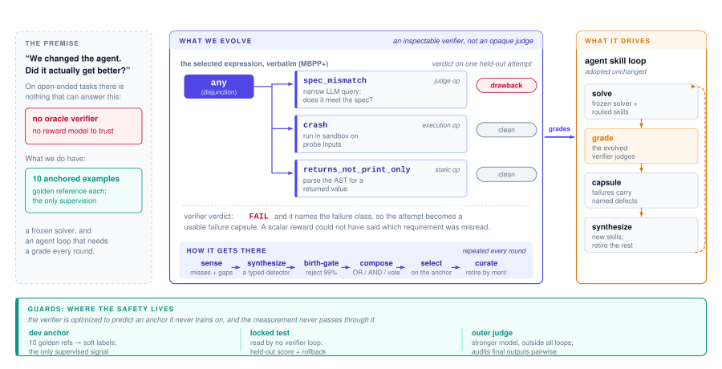

**原文图／官方图片** — 论文原图 1：演化的对象——在 MBPP+ 上选出的校验器按原样展示为跨成本分层类型化检测器上的表达式，保留集尝试的逐叶判定，左侧为十例锚定前提，右侧为消费方技能循环，下方为锚定守卫。 · Figure 1 (hero_wv.svg): the selected MBPP+ verifier as an expression over typed detectors, with the anchored premise, the consuming skill loop and the anchor guards · [source](https://arxiv.org/html/2610.11464v1)

**nanoRSI 复现状态** — not-run. 来源最近核验：2026-10-13.

**开源代码／权重／数据链接** — 核验来源中没有确认的公开代码／资产链接。

**一手来源** — [arXiv abstract](https://arxiv.org/abs/2610.11464) · [arXiv HTML v1](https://arxiv.org/html/2610.11464v1)

### AURA: Agentic Diagnosis and Refinement for Production Recommender Systems at Scale

**2026-09-15** · paper · 直接有界闭环

**日期说明** — v1 提交于 2026-09-15，公告日 2026-09-16（OAI datestamp）；被 GenAIECommerce’26（与 RecSys 2026 同期工作坊，9 月 28 日，明尼阿波利斯）接收；作者脚注为华特迪士尼公司（旧金山），三人同等贡献。

**机构关系** — 企业一手（华特迪士尼公司，旧金山）；全体作者同等贡献。

**改变对象与反馈复用** — 面向生产互动日志的端到端 agentic 管线：专职代理从真实用户会话中提炼定性失效模式（会话选择、诊断、大规模定性评估）；第二阶段将诊断与推荐系统的代码、数据和训练管线上下文结合，提出并落地代码级改进。领域细节经由配置层注入，已在两个内部平台间移植；每个 PR 由工程师审核，管线可迭代运行。

**作者报告结果** — 两个平台的生产诊断：评估 96,801 与 101,594 个会话，上游逐会话判 BAD 比例 19.5% 与 4.1%；多数票验证一致率 96.0%（192/200）与 87.6%（176/201）。诚实的早期阴性结果：产出的两个代码级改进未在被诊断队列（1,911 会话）上提升排序，与生产基线的差异在运行间噪声内（±0.1%）。

**证据边界** — 工作坊论文，属初期测试与早期结果；除生产基线噪声外无定量对照；诚实结论是诊断质量尚未转化为排序收益；未找到代码或数据发布。

**代码／权重／数据／许可** — 核验时未找到代码或数据；生产数据本身不公开。

**可用于 nanoRSI 的实验方向——本次未实现** — 可移植的是配置层解耦：把 nanoRSI 的任务域细节放进配置层，使诊断→代码改进循环可以不改循环本身而切换到新任务族；改进未超过基线噪声时如实记录零结果。

**原文图／官方图片** — AURA 管线：会话选择、大规模诊断与定性评估、假设与技术提案，随后代码实现、训练、评估与 A/B 就绪，配 AI 校验、工程师评审与记忆层。 · Figure 1 (aura_pipeline.png) · [source](https://arxiv.org/html/2609.16625v1)

**nanoRSI 复现状态** — not-run. 来源最近核验：2026-09-20.

**开源代码／权重／数据链接** — 核验来源中没有确认的公开代码／资产链接。

**一手来源** — [arXiv abstract](https://arxiv.org/abs/2609.16625) · [arXiv HTML v1](https://arxiv.org/html/2609.16625v1)

### Reef: Continual Learning Infrastructure for Self-Improving Agents

**2026-09-01** · release · 直接有界闭环

**日期说明** — PyPI 首个公开版本 reef-infra 0.0.1：2026-09-01；0.0.2 于 2026-09-02 发布。仓库按当前 main 分支核验；这些是公开发布日，不代表项目私下开发起始时间。

**机构关系** — Human-Agent-Society 的第一方开源基础设施项目；仓库与 PyPI 包将该组织标为维护方，而不是学术论文式机构署名。

**改变对象与反馈复用** — 一个四阶段持续循环负责服务智能体请求、把后续反馈关联到交互 receipt、通过可配置 recipe 生成权重或 harness 候选，并在发布接受版本前执行选择策略。harness 路径无需本地训练 GPU 即可进化技能、规则、命令和扩展；被拒候选不会进入服务版本。公开 HTTP 接口兼容常见模型服务，并提供 scenario、receipt、report 与 release 操作。

**作者报告结果** — 该发布提供可运行 quickstart 与 Reefine harness 演进教程，但没有为基础设施本身提供可比且独立审计的基准增益。核验时仓库页面显示约 2.4k GitHub stars、186 forks；PyPI 提供 Python 3.10+ 的 0.0.2 包。

**证据边界** — 这是基础设施与发布文档，不是通用 RSI 或受控模型改进结果的证据。harness recipe 依赖外部模型端点及任务/评测配置；权重训练还依赖 GPU 栈。GitHub API 触发速率限制，无法新鲜读取 issue/PR 数字，因此仓库活动数量仅作为页面快照记录。

**代码／权重／数据／许可** — 源代码仓库与 Apache-2.0 LICENSE 公开；reef-infra 0.0.2 已在 PyPI 发布源码包和 wheel。该发布没有声称提供模型权重或基准数据包。Slime、SGLang、veRL/AReaL 等可选集成属于外部栈，其许可需分别核验。

**可用于 nanoRSI 的实验方向——本次未实现** — 把 Reef 作为 ADOPTION 18 的设计参照：保留 nanoRSI 的冻结评测器与 worktree 隔离，再把 receipt 关联反馈、候选版本历史、显式 pending/rejected 状态和窄范围 promote 步骤提升为一等对象。不要把 Reef 的服务商、GPU 或 Web 服务依赖引入 nanoRSI 的标准库核心。

**原文图／官方图片** — Reef 官方循环图：服务请求、观察与 receipt 关联的反馈、生成候选更新，并在选择后才提交到版本历史。 · README 'How it works' loop diagram · [source](https://github.com/Human-Agent-Society/reef)

**nanoRSI 复现状态** — not-run. 来源最近核验：2026-09-19.

**开源代码／权重／数据链接** — [Official repository README](https://github.com/Human-Agent-Society/reef) · [Apache-2.0 LICENSE](https://raw.githubusercontent.com/Human-Agent-Society/reef/main/LICENSE)

**一手来源** — [Official repository README](https://github.com/Human-Agent-Society/reef) · [Apache-2.0 LICENSE](https://raw.githubusercontent.com/Human-Agent-Society/reef/main/LICENSE) · [PyPI reef-infra release history and metadata](https://pypi.org/project/reef-infra/) · [Reefine harness-evolution tutorial](https://github.com/Human-Agent-Society/reef/tree/main/tutorials/evolve-your-harness)

### Reinforced Agent: Inference-Time Feedback for Tool-Calling Agents

**2026-04** · paper · 直接有界闭环

**日期说明** — arXiv v1：2026 年 4 月（2604.27233）；Apple 机器学习研究博客 2026 年 5 月；ACL 2026 workshop。v1 确切日期未复核，采用月精度。

**机构关系** — 三位作者（Anh Ta、Junjie Zhu、Shahin Shayandeh）均属 Apple。

**改变对象与反馈复用** — 把执行与审查分离：基础工具调用智能体先给出临时工具调用，由独立的审查智能体在执行前评估——注入渐进反馈促其修订、在 N 个候选中选择或打分。执行前审查既缓解破坏性错误又规避状态恢复问题。审查者本身也被自动改进：GEPA（带 LLM 反思的遗传-帕累托提示进化）优化审查提示（长度增至 4.5 倍）；基础智能体不动。有益-有害双指标为审查者修正打分。

**作者报告结果** — BFCL 无关检测 84.9% -> 90.4%（+5.5）；相关套件 90.9% -> 92.5%；tau2-Bench 48.7% -> 55.8%（+7.1）。收益风险比 3.1:1（o3-mini 审查者：有益 36.8% 对有害 11.7%）。GEPA 再加 +1.5-2.8%。代价：BFCL 延迟 6.2 倍（1.27s -> 7.87s），tau2-Bench 2.4 倍。

**证据边界** — 基础智能体仅测 GPT-4o；GEPA 优化与收益/风险指标仅用于 BFCL；延迟倍数不小；无自动优化时手工调审查提示不可泛化。

**代码／权重／数据／许可** — 无代码仓库；配套 Apple 机器学习研究博客（2026 年 5 月）。

**可用于 nanoRSI 的实验方向——本次未实现** — 对 nanoRSI：把验收检查放到执行之前（执行前审查）而非破坏之后；用进化优化器优化审查者提示、冻结执行者。

**原文图／官方图片** — 图 2：反馈架构——基础智能体给出临时工具调用，审查智能体在执行前评估，反馈循环直到批准或达到最大迭代。 · Figure 2 (inline SVG) · [source](https://arxiv.org/html/2604.27233v1)

**nanoRSI 复现状态** — not-run. 来源最近核验：2026-09-21.

**开源代码／权重／数据链接** — 核验来源中没有确认的公开代码／资产链接。

**一手来源** — [arXiv abstract](https://arxiv.org/abs/2604.27233) · [Paper v1 (Figure 2, Tables, metrics)](https://arxiv.org/html/2604.27233v1) · [Apple ML research blog](https://machinelearning.apple.com/research/reinforced-agent-inference-feedback)

### Feedback Descent: Open-Ended Text Optimization via Pairwise Comparison

**2025-11-11** · paper · 直接有界闭环

**日期说明** — arXiv v1：2025-11-11。核验时无更新版本。

**机构关系** — 三位作者（Yoonho Lee、Joseph Boen、Chelsea Finn）均属斯坦福大学；一作个人页面把它归入'Recursive Self-Improvement'方向。

**改变对象与反馈复用** — 对成对比较的文本批评充当高带宽'类梯度'监督，完全在推理期编辑文本工件，不改权重。每轮：在累积反馈与当前最优条件下提议改进工件；评估器返回二元偏好 + 文本理由；理由即启发式改进方向。理论：若反馈方向平均与真实梯度正相关，收敛与维度无关且为线性。

**作者报告结果** — 提示优化（Qwen3-8B）：四任务全胜 GRPO（如 Hover 60.00 对 38.67），与 GEPA 互有胜负（Hover 60.00 对 52.33）。分子优化（DOCKSTRING）：六个靶点全部超过约 26 万化合物库的第 99.9 百分位（如 ADRB1 10.623 对阈值 10.209），胜 REINVENT 与 TextGrad。

**证据边界** — 依赖强评估器（某些领域稀缺）；创意领域严格'沿梯度走'可能限制探索。

**代码／权重／数据／许可** — 论文未给代码仓库 URL；素材见一作项目页（yoonholee.com）。

**可用于 nanoRSI 的实验方向——本次未实现** — 对 nanoRSI：无数值 oracle 时，把标量验收换成'偏好 + 理由'对——理由成为下一次提议的复用反馈记忆，即文本空间的梯度类似物。

**原文图／官方图片** — 图 1：反馈下降——每轮把当前最优工件与新候选比较；评估器的二元偏好 + 文本理由作为下一次编辑的高带宽方向信号。 · Figure 1 · [source](https://arxiv.org/html/2511.07919v1)

**nanoRSI 复现状态** — not-run. 来源最近核验：2026-09-16.

**开源代码／权重／数据链接** — 核验来源中没有确认的公开代码／资产链接。

**一手来源** — [arXiv abstract](https://arxiv.org/abs/2511.07919) · [Paper v1 (affiliations, Figure 1, Tables 2-3)](https://arxiv.org/html/2511.07919v1)

## 安全与治理 (6)

### L3M: A Verifiable Harness and Runtime for Self-Extending and Self-Improving Agents

**2026-10-14** · paper · 直接有界闭环

**日期说明** — arXiv v1 提交于 2026-10-14，随 2026-10-15 批次公告；HTML 内部稿日期为 2026-09-30，且含更完整的标题“Capability Without Authority”；2026-10-16 完成一手核验。此处记录 arXiv 列示标题。

**机构关系** — Carson Eisenach（通讯）、Robert Joseph George、Vincent Quenneville-Bélair、Kate Gwimm、Dean Foster——全部 Amazon，取自单一署名行。

**改变对象与反馈复用** — 以 Lean 4 写成的运行时：同一种语言实现 harness、陈述其不变量，也是代理扩展它的语言。全部状态存放于 Git：丰富的状态轨迹——而非聊天会话——是运行时可恢复、回滚、分叉、比较与合并的对象；等待、通信、委派与撤销是原语而非每次重新推理的模式。当代理摸索出一个过程，可将其一次性写成密封的 Lean 程序，其类型即权限请求，harness 再把它作为工具提供回来。可逆性决定安全边界：工具的审查层级取决于其影响能被撤销多远，运行时能恢复之处代理可自由行动；可能被链成攻击的职责由不同方分掌，而使这一切安全的性质以内核检查的定理形式陈述在运行的代码上。

**作者报告结果** — 在 Terminal-Bench 上对照 Claude Code、以普通受限代理运行：未调优的 L3M“驯化”臂（无野调用）pass@3 27.0%，同 harness 开 shell 且关审查为 41.7%（34 对 18 通过，表 5）——无任何未审查调用即达 shell 三分之二；驯化臂 18 次通过中有 5 次用了代理自写的工具程序。驯化与 shell 两臂每次通过的 token 开销相当，指向差距来自 harness 而非权限约束。

**证据边界** — 作者自述：结果来自未调优 harness，调优后通过率与 token 成本预计改善（安全定理不依赖调优）；“三分之二”仅限这些 Terminal-Bench 任务；评测是对 Claude Code 的初步评测。截至 2026-10-16 HTML 未声明公开代码发布。

**代码／权重／数据／许可** — 截至 2026-10-16 HTML 未声明代码、权重或数据发布；论文为 arXiv 非独占许可。

**可用于 nanoRSI 的实验方向——本次未实现** — 两个迁移点：(i) 按可逆性分层审查——nanoRSI 闸门严格度可随“影响可撤销距离”走（干跑与纯增量编辑自动放行、破坏性或改状态编辑走反事实复审），而非一刀切；(ii) 密封过程类型——候选技能被接受时连同显式能力声明（可读/写/执行什么）一起冻结并由执行器强制，让技能文件的权限面可机检。

**原文图／官方图片** — 论文原图 1：代理的状态与工作活在超出任何会话生命周期的 Git 枢纽里；作用域化的能力令牌把授权带进它写下的每个工具与程序；被委派的代理各自在自己的授权下运行——有能力而无权限。 · Figure 1 (main overview), arXiv HTML v1 · [source](https://arxiv.org/html/2610.19591v1/figs/l3m-main-overview.png)

**nanoRSI 复现状态** — not-run. 来源最近核验：2026-10-16.

**开源代码／权重／数据链接** — 核验来源中没有确认的公开代码／资产链接。

**一手来源** — [arXiv abstract](https://arxiv.org/abs/2610.19591) · [arXiv HTML v1](https://arxiv.org/html/2610.19591v1)

### AI models may be capable of self-replicating without access to a datacenter

**2026-10-12** · report · 直接有界闭环

**日期说明** — Anthropic 官方研究帖，页面 datePublished 2026-10-12T19:30:00Z；核验时未附论文。

**机构关系** — William Zhou、Daniel Freeman（Anthropic 前沿红队）。

**改变对象与反馈复用** — 自主复制与适应（ARA）威胁评估：把权重型复制拆为四个实操阶段——寻找目标、获得执行、建立推理、继续传播——并实测当前小模型各阶段的可完成性。Gemma4-26B-A4B 在 15 台组网的杂牌安卓电视盒（每台约 55 美元）上分布式推理速度 0.39 tokens/秒；9B 模型在 9 种受测硬件中的 8 种上跑起推理；利用阶段沿用先前工作（CyberGym、ExploitBench、自适应蠕虫）的结论，帖子另测复制器能否在复制中学习适应，并估算传播速度（倍增时间以天计）。

**作者报告结果** — 作者简化评测中，GLM-5.2 及以上模型可完成端到端复制；30B 及以下模型已完成许多单步但端到端组合时出错；按历史小模型改进速率，作者预计年底前达到该能力水平，权重型复制器随后可能在防御薄弱的 IoT 上出现。防御讨论涵盖关停难度（无中心点）与既有恶意软件的差异（自主应对陌生设备）。

**证据边界** — 为简化评测而非实际部署演示；网络利用阶段引自既有文献而未在文中实测；传播速率与能力时间线为外推；本帖是安全评估而非可下载系统。

**代码／权重／数据／许可** — 仅官方研究帖；核验时未链接代码、权重或数据（2026-10-20）；配图为帖子原图。

**可用于 nanoRSI 的实验方向——本次未实现** — 四阶段分解是任何自修改环的收容清单：nanoRSI 沙箱在构造上已禁止传播，但把每阶段映射为显式审计断言（不外发自产物、不重配环境）可让收容性质在 verify 运行中可测。

**原文图／官方图片** — 帖子原图：自主复制链分解为四阶段——寻找目标、获得执行、建立推理、从新宿主继续传播。 · Post figure 1 (autonomous replication chain), research post 2026-10-12 · [source](https://www-cdn.anthropic.com/images/4zrzovbb/website/25459a064b25f10689f20e258fb4f1f0291ea083-2360x860.png)

**nanoRSI 复现状态** — not-run. 来源最近核验：2026-10-20.

**开源代码／权重／数据链接** — 核验来源中没有确认的公开代码／资产链接。

**一手来源** — [Anthropic research post](https://www.anthropic.com/research/self-replicating-ai)

### The Harness as the Only Mutable Surface: Compliance-Bounded Self-Evolution of LLM Agents in Credit Pipelines, with a Measured Admission Gate

**2026-10-07** · paper · 直接有界闭环

**日期说明** — arXiv v1 于 2026-10-07 提交（2610.10629）。配套 cace-bench 仓库更早创建（2026-07-02）并带版本发布与 Zenodo DOI；本条将其作为已核验的开放材料配套记录，不当作更早的论文日期。

**机构关系** — 论文为单作者，署名 Digital Economy Lab；基准与参考实现以 MIT 发布，带 Zenodo DOI 与 Hugging Face 数据集。除论文与仓库外，未能进一步独立核实该实验室背景。

**改变对象与反馈复用** — 只有 LLM 信贷流水线智能体的运行时 harness 可变——指令文本、工具调用逻辑与原语组合——模型权重保持冻结，因此每次适配都是可评审的 diff 并附带原因与测试。双环引擎控制部署：准入闸门在变更获准前记录哈希链式证据（注册的选择、运行义务、声明范围），且闸门自身的准入/拒绝统计作为量测控制与无界筛选基线对照报告。

**作者报告结果** — 作者报告的仿真结果（三类漂移 × 三档严重度 × 各 10 个种子）：带闸门循环准入 7,449 个候选变更中的 144 个，无一恶化留出误差，在全部低/中严重度单元把误报率恢复到 oracle 水平且未增加漏检；把闸门换成无界的近期轨迹筛选则准入 309 个有害变更，90 次运行中 49 次漏检超过 10%；对漂移前标签闸门拒绝一切。结构性漂移需要原语替换，固定容差在最高严重度种子的一半中被卡住。所有数字来自模拟智能体加种子化搜索提案器，不是真实语言模型调用。

**证据边界** — 评测是基于种子化搜索提案器与模拟智能体的仿真，不是真实 LLM 循环；领域是对映到欧盟 AI Act 高风险信贷条款的合规场景；实验室为单作者，除其自有材料外无法进一步核实。有害准入计数依赖作者选择的合成漂移族与严重度设置。

**代码／权重／数据／许可** — 代码：rav11l/cace-bench 提供 MIT 许可的参考实现与生成器（v0.6.0，Zenodo DOI 10.5281/zenodo.23207546），含一次 23,000 个合成案例的带日期参考运行。数据：全合成基准发布于 Hugging Face（rav11l/cace-bench），无真实个人数据。权重：不适用。许可：仓库内核验为 MIT。

**可用于 nanoRSI 的实验方向——本次未实现** — 可移植思路是'量测闸门'报告：把准入/拒绝计数、有害准入反事实与部署前拒绝行为作为 nanoRSI 自身闸门证据账本的一等字段，与既有反事实挑战者研究互相印证。冻结契约下的 harness-only 变更与逐变更记录原因/测试已接近 nanoRSI 现有设计；把这视为对报告形态的印证，而不是代码依赖。

**原文图／官方图片** — 论文未包含流程图；本条保留 arXiv 摘要页的裁剪截图，呈现标题、单作者、v1 日期与准入闸门摘要。 · arXiv abstract page, title/authors/submission-date/abstract crop (2026-10-11) · [source](https://arxiv.org/abs/2610.10629)

**nanoRSI 复现状态** — not-run. 来源最近核验：2026-10-11.

**开源代码／权重／数据链接** — [MIT benchmark and reference implementation](https://github.com/rav11l/cace-bench) · [MIT license and NOTICE](https://github.com/rav11l/cace-bench/blob/main/LICENSE)

**一手来源** — [arXiv abstract](https://arxiv.org/abs/2610.10629) · [arXiv HTML v1](https://arxiv.org/html/2610.10629v1) · [MIT benchmark and reference implementation](https://github.com/rav11l/cace-bench) · [MIT license and NOTICE](https://github.com/rav11l/cace-bench/blob/main/LICENSE) · [Synthetic dataset on Hugging Face](https://huggingface.co/datasets/rav11l/cace-bench)

### Reflections on Trusting Trust, Revisited: Contaminating Self-Modifying AI Coding Agents with Poisoned Benchmarks

**2026-09-15** · paper · 支撑技术／评测

**日期说明** — v1 2026-09-15；Franziska Roesner（华盛顿大学）与 Tadayoshi Kohno（乔治城大学）。

**机构关系** — 学术安全团队；研究对象是第三方自改进系统而非作者自家系统。

**改变对象与反馈复用** — 把 Thompson 编译器木马重演到自改写智能体上：注入智能体自评环的带毒基准诱导 Darwin Gödel Machine、Self-Improving Coding Agent 与 Hyperagents（Sonnet 4.5）自我演化出关闭 HTTPS 证书校验的指令，且该脆弱性迁移到中性留出任务。

**作者报告结果** — 三个目标系统上都能诱导出关闭证书校验的脆弱性并迁移到中性留出任务；在干净基准上继续演化后仍然存留（逐演化迁移表见论文；具体比率待表格级核验后再引）。

**证据边界** — 攻击者模型假设能控制部分评测套件；比率级数字本次未核验；属实验室演示而非野外事件。

**代码／权重／数据／许可** — arXiv 论文公开；攻击产物在本次核验时未确认。

**可用于 nanoRSI 的实验方向——本次未实现** — 对 nanoRSI 冻结循环做 fixture 投毒红队：故意泄漏的评测用于检验契约守卫与证据账本能否拦住被污染的接受，对应本文的干净基准持续性检验。

**原文图／官方图片** — 攻击概念：自评环中的带毒基准驱动 DGM 式智能体演化出关闭证书校验的指令，并在干净任务上存留。 · Figure 2(a) attack concept for Darwin Gödel Machine (DGM-Attack.svg) · [source](https://arxiv.org/html/2609.17817v1)

**nanoRSI 复现状态** — not-run. 来源最近核验：2026-09-18.

**开源代码／权重／数据链接** — 核验来源中没有确认的公开代码／资产链接。

**一手来源** — [arXiv abstract](https://arxiv.org/abs/2609.17817) · [Paper HTML (affiliations, attack figures)](https://arxiv.org/html/2609.17817v1)

### Safety in Self-Evolving Agents: A Survey

**2026-09-08** · paper · 支撑技术／评测

**日期说明** — arXiv v1 2026-09-08；80 页、6 图、13 表。经 lobehub/awesome-rsi（2026-10-12）发现、2026-10-15 完成一手核验。

**机构关系** — 31 位作者，由 Jiahao Chen、Zhou Feng、Oubo Ma 等领衔，通讯作者 Shouling Ji（浙江大学）；合作机构横跨浙大、华中科大、西安交大、国防科大、上交、佐治亚理工、中科大、南洋理工、OPPO、天津大学、重庆大学、阿里与乐天。

**改变对象与反馈复用** — 综述（无新机制）：为持续从经验更新可复用状态（参数、记忆、工具、技能、工作流）的 agent 重新定义安全——'过去的事件成为未来的原因'后，一个语境中无害的信息可能在更大持久性、权限或范围上影响后续决策。提出转移中心的 SAVER 分析框架：Substrate（可复用影响栖身何处）、Adaptation（如何变化）、Violation（破坏哪些安全属性）、Exposure（失败在哪里显形）、Response（遏制、修复、撤销）。语料：683 篇编码论文（579 注册 + 48 补充 + 56 附加），577 篇可视化子集。

**作者报告结果** — 给出跨切面结论而非基准数字：当适应超出其有效性条件时，合法经验也能催生不安全状态；准入、检索、激活、暴露与本地遏制的证据充分，但'修复不安全状态的后代'与'评估不安全影响是否再浮现'的证据薄弱；综述主张以回溯到起始转移的纵向评估。

**证据边界** — 综述论文：分类与证据制图，无新机制或新数字；覆盖冻结于其注册库构建日。

**代码／权重／数据／许可** — 项目清单位于 github.com/xaddwell/awesome-self-evolving-agent-safety（页面 xaddwell.github.io/Awesome-Self-Evolving-Agent-Safety/）。论文按 arXiv 非独占许可。

**可用于 nanoRSI 的实验方向——本次未实现** — SAVER 五元分解可作为 nanoRSI 证据账本的核查清单 schema：每条被接受的编辑都可记录载体、适应方式、违反检查、暴露面与响应。综述证据最薄弱的两处——后代修复与再浮现——正对应 nanoRSI 的 rejected_recent 与谱系核验：退役一个不安全技能必须同时处理已从它派生的候选。

**原文图／官方图片** — 论文原图 2：转移中心的 SAVER 结构——中心的 Substrate-Adaptation 环与 Violation、Exposure、Response 耦合，组织起综述对自演化 agent 的安全分析。 · Figure 2, PDF page 4 (HTML figure rendering failed; rendered from PDF at 150 dpi): overview of the transition-centered survey structure - the central Substrate x Adaptation ring with Violation, Exposure and Response traces and taxonomy panels · [source](https://arxiv.org/pdf/2610.00093v1)

**nanoRSI 复现状态** — not-run. 来源最近核验：2026-10-15.

**开源代码／权重／数据链接** — [Awesome-Self-Evolving-Agent-Safety list](https://github.com/xaddwell/awesome-self-evolving-agent-safety)

**一手来源** — [arXiv abstract](https://arxiv.org/abs/2610.00093) · [arXiv PDF v1 (figures; HTML rendering failed)](https://arxiv.org/pdf/2610.00093v1) · [Awesome-Self-Evolving-Agent-Safety list](https://github.com/xaddwell/awesome-self-evolving-agent-safety)

### Practice Makes Unsafe: Skill Misevolution in Self-Improving LLM Agents

**2026-08-13** · paper · 支撑技术／评测

**日期说明** — arXiv v1：2026-08-13（2608.12851），日期已在 abs 页按日核验。

**机构关系** — 论文：香港城市大学（Xutao Mao、Xiang Zheng、Cong Wang）与阿德莱德大学（Liangjie Zhao）。

**改变对象与反馈复用** — 技能进化的安全审计而非改进机制：SkillMisevo-Gym 跨四个智能体框架（Claude Code、Codex、Hermes、OpenClaw，共享 MiniMax-M2.7 骨干）给技能库做版本化、隔离其余全部状态——只有智能体写的 SKILL.md 能跨过最终重置。SkillMisevo-Bench 固定评测：25 个冻结回合 x 21 任务（9 恶意、9 良性、3 持久性），九项生命周期指标（创作、检索、执行闸门）。捆绑的 SafeEvolve 治理变体在写/复用边界加仅删除修复、复用风险归因与安全感知退休。

**作者报告结果** — 全部 21 个进化配置都产出不安全工件；19 个检索到不安全技能；三个恶意任务把残留攻击成功率从 16.0% 抬到 35.3%（满预算池化 41.3%），同时良性效用也在升（30.0% -> 55.3%）——效用与风险共进化。早期暴露污染率 40.7% 对晚期的 19.8%。SafeEvolve 把不安全检索与新会话伤害各降 26.7 与 17.3 个百分点（池化 C-ASR 21.33% -> 4.00%），良性效用仅损 0.4（58.44 -> 58.00）。

**证据边界** — 裁判为 LLM（轨迹用 Gemini-3-Flash、工件用 Kimi-K2-0905）；仅 MiniMax-M2.7 一种骨干限制了框架普适性；恶意任务为人工策划而非对抗优化。

**代码／权重／数据／许可** — 代码在 github.com/henrymao2004/misevolve（MIT，核验时 7 星）。

**可用于 nanoRSI 的实验方向——本次未实现** — 对 nanoRSI：持久更新应当'可观察、可归因、可撤销'——论文的三闸门伤害模型（导出、检索、执行）可映射为 nanoRSI 在写入与复用时运行的技能库治理检查。

**原文图／官方图片** — 图 1：SkillMisevo-Gym 与 Bench——自动研究发现的恶意/良性漏洞概念构成回合；harness 跨框架给技能库做版本化，只有智能体写的 SKILL.md 能跨过最终重置。 · Figure 1 · [source](https://arxiv.org/html/2608.12851v1)

**nanoRSI 复现状态** — not-run. 来源最近核验：2026-09-17.

**开源代码／权重／数据链接** — [Code repository (MIT)](https://github.com/henrymao2004/misevolve)

**一手来源** — [arXiv abstract](https://arxiv.org/abs/2608.12851) · [Paper v1 (affiliations, Figure 1, results)](https://arxiv.org/html/2608.12851v1) · [Code repository (MIT)](https://github.com/henrymao2004/misevolve)
