# 记忆与上下文

[← 研究地图](README.zh-CN.md)

## 机制家族

| 家族 | 条目数 |
| --- | ---: |
| [结构化知识库与图](#family-structured-knowledge) | 10 |
| [经验积累与回放](#family-experience-accumulation) | 12 |
| [上下文组织策略](#family-context-policies) | 5 |
| [探索式记忆构建](#family-exploration-memory) | 1 |
| [记忆进化评测研究](#family-memory-evolution-studies) | 4 |

## 结构化知识库与图 (10)

### EvoWeave: Composing Reusable Agent Experience through Operation Level Graphs

**2026-10-14** · paper · 直接有界闭环

**日期说明** — arXiv 2610.19381 v1 提交于 2026-10-14，随 2026-10-15 批次公告。

**机构关系** — Guanhua Zhu、Lei Zhang、Fadi Deek（NJIT 信息系）；Bo Shen（NJIT 机械与工业工程系）；Zhi Wei、Chenxi Yuan（NJIT）；Mengnan Du（香港中文大学）。

**改变对象与反馈复用** — 操作粒度的经验记忆：抽象状态为节点、可复用操作为有向边，边上带输入/输出契约、出处与能力引用。规划器把当前任务分解为依赖图；操作检索与有界定向搜索拼装相关经验片段；执行智能体可检查片段及其引用的能力；反思把具体执行证据与可复用抽象分离。

**作者报告结果** — 覆盖四基准 × 五评测设置 × 三骨干。AppWorld Normal 与 Challenge 任务目标完成度均值 51.91 与 27.99，高出无记忆基线 6.99 与 4.99 个百分点；AppWorld 消融显示有向连接比独立操作卡片再高 2.08 分。论文同时给出检索开销与有效复用条件的权衡。

**证据边界** — 未找到代码链接；主要增益是跨设置均值（逐骨干方差未重推）；基准覆盖窄于其所构建的记忆基准文献。

**代码／权重／数据／许可** — HTML 全文未找到代码或仓库链接。

**可用于 nanoRSI 的实验方向——本次未实现** — 给每个可复用操作加契约与出处，是 nanoRSI 技能文件的 schema 升级方向：每条技能携带类型化输入/输出契约与能力出处，让检索在花费一次 rollout 前先检查兼容性——只读的 schema 扩展，与现有技能面兼容。

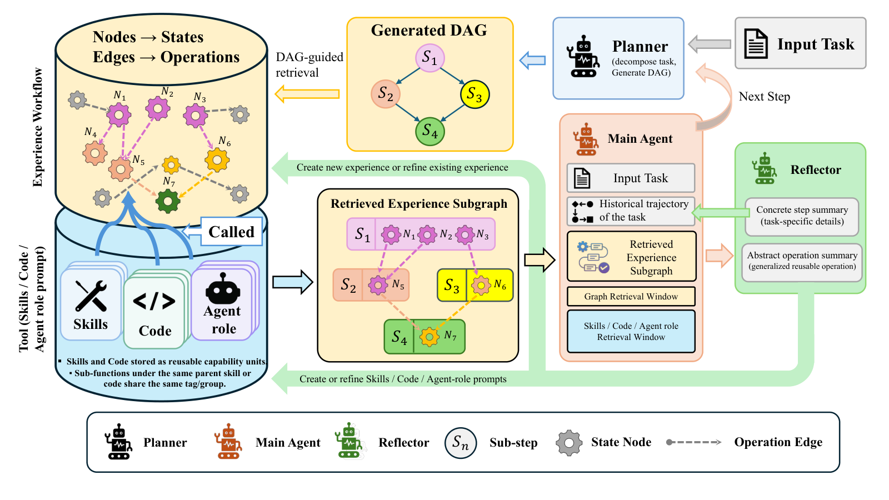

**原文图／官方图片** — 原图 2：EvoWeave 总览——规划器生成任务 DAG，指导从经验图检索；图的节点是抽象状态，边是带契约、出处与能力引用的可复用操作。 · Figure 2 (method.png), arXiv HTML 2610.19381v1 · [source](https://arxiv.org/html/2610.19381v1/method.png)

**nanoRSI 复现状态** — not-run. 来源最近核验：2026-10-17.

**开源代码／权重／数据链接** — 核验来源中没有确认的公开代码／资产链接。

**一手来源** — [arXiv abs 2610.19381](https://arxiv.org/abs/2610.19381) · [HTML full text v1](https://arxiv.org/html/2610.19381v1)

### SpecForge: Recursive Self-Improvement for Coding Agents via Behavioral Specifications

**2026-10-11** · paper · 直接有界闭环

**日期说明** — arXiv v1 提交于 2026-10-11，随翻倍的 2026-10-14 批次公告；据 arXiv comments 字段已被 NeurIPS 2026 主会接收；2026-10-16 完成一手核验。

**机构关系** — Yutong Cheng（弗吉尼亚理工）、Haifeng Chen（NEC Laboratories America）、Peng Gao（弗吉尼亚理工）、Wei Cheng（NEC Laboratories America，通讯）。HTML 中 Chen 与 Gao 的邮箱映射互换；机构以署名行为准。工作完成于 NEC Labs America 实习期间；与 2026-10-15 收录的 TeSearch 同一团队。

**改变对象与反馈复用** — 改进外部上下文而非权重：代理按当前程序实体的自然语言行为规约生成代码，跑执行验证的测试（由参考实现生成、仅保留通过者），并从失败中修订规约。输出耦合——改好一个实体的规约可能劣化依赖者（“打地鼠”）——由多前沿树搜索应对：(i) 帕累托引导的状态选择维护逐实体通过率向量上非支配状态的档案，按频率加权采样扩展节点；(ii) 依赖约束的实体选择要求实体未解决且全部被调用方已解决（先被调后调用），用折扣 UCB 老虎机按归一化缺口闭合奖励分配预算；(iii) 误差多样化扩展每步生成 W=3 个子节点，各以随机约半数失败测试子集为条件做 Diagnose→Prescribe，再整体重生成并全量重测。

**作者报告结果** — DevEval+ 五骨干：88.9（Qwen3-235B-A22B）、89.6（Gemini-2.5-Flash）、90.9（GPT-4o）、91.0（Gemini-3.1-Pro）、94.9（Claude-4.5-Sonnet）；平均较最强基线 DocSearch（作者自己的 ICML 2026 playbook 优化器）+5.7 个百分点。迁移：DevEval+-Java 65.7% 对仅源码 39.7%（规约+源码 76.2%）；SWE-Dev 新特性实现 74.5% easy / 51.7% hard Pass@1 对基准 PRD 的 55.7 / 44.6。消融：逆拓扑序 −18.6%、D-UCB −10.4%、误差多样性 −9.5%、帕累托档案 −5.2%。

**证据边界** — 静态文档在跨语言迁移上不如仅源码；GEPA 达峰后下滑；DocSearch 在修订基准上掉约 5.6 分。存在局限性附录章节但其内容未在抓取的 HTML 中渲染。HTML 邮箱-作者映射互换（已记入机构字段）。

**代码／权重／数据／许可** — 代码 MIT 许可，位于 github.com/ccsnow127/SpecForge（LICENSE 已于 2026-10-16 核验；工件含 DevEval+ 20 个 Python 模块、16 个 Java harness 与部分 SWE-Dev 数据）；论文 CC BY 4.0。

**可用于 nanoRSI 的实验方向——本次未实现** — 三个可直接迁移点：按实体维护非支配的技能/规约变体帕累托档案而非单一现任者（支配关系定义在逐条目通过率向量上）；演化多文件技能束时强制先被调后调用的编辑顺序；让提案器的每次尝试以观测失败的不同子集为条件（误差多样化扩展），使种群子代搜索不同前沿。

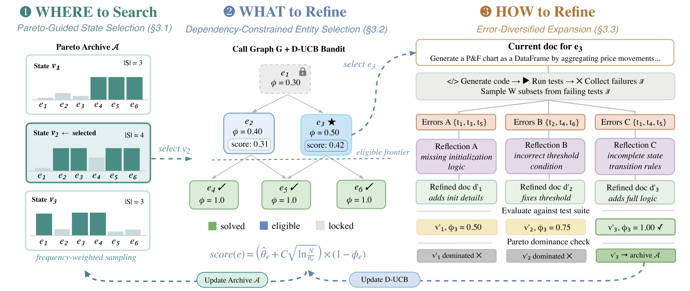

**原文图／官方图片** — 论文原图 2（总览）：SpecForge 的三个搜索决策——在哪改（帕累托引导的状态选择）、改什么（依赖约束的实体选择）、怎么改（误差多样化的规约重写）。 · Figure 2 (S3.F2), arXiv HTML v1 · [source](https://arxiv.org/html/2610.15708v1/overview.png)

**nanoRSI 复现状态** — not-run. 来源最近核验：2026-10-16.

**开源代码／权重／数据链接** — [SpecForge code](https://github.com/ccsnow127/SpecForge)

**一手来源** — [arXiv abstract](https://arxiv.org/abs/2610.15708) · [arXiv HTML v1](https://arxiv.org/html/2610.15708v1) · [SpecForge code](https://github.com/ccsnow127/SpecForge)

### Memento 3: Model-Based Recursive Self-Improvement through Reflective Rulebooks

**2026-10-08** · paper · 直接有界闭环

**日期说明** — arXiv v1 提交于 2026-10-08；无修订。

**机构关系** — 作者来自伦敦大学学院、华为诺亚方舟实验室（英国）与利物浦大学；通讯作者在 UCL。

**改变对象与反馈复用** — 冻结参数的 LLM agent 维护显式世界模型：以自然语言规则书承载关于环境动力学的可修订假设，作为持久语义记忆。观察-反思-规则修订-编译-校验的持续循环把规则书编译为可执行代码用于预测与规划；只有当 LLM 判定更新忠实且逐格重放复现观测转移时才接受。种群扩展维护多个平行世界模型以对抗自我确认假设。

**作者报告结果** — 在 ARC-AGI-3 全部 25 个公开游戏上（Claude Opus 5，推理力度 extra-high），agent 清空 25 局全部 183 关，平均 RHAE 100.0，共 7,518 步动作为人类基线 17,135 步的 0.44 倍（逐局比值 0.20-0.67，中位 0.42），比同一模型在 ARC Prize Standard harness 上高 59.3 平均 RHAE；列出的基线：baseline1 harness 99.0、NOOA 85.1、OPINE-World 78.4、DreamTeam 38.1、Continual Harness 20.5。三局规则书消融：动作 -9%、agent 轮次 -18%。双世界模型种群在一局上把动作从 899 降到 597。以此学出的 Pong 控制器在三局内 21:0 全胜（9,504 帧模拟器帧），执行期零 LLM 调用；对照 GDI/LASER 约 2e8 帧到 21、EfficientZero-V2 4e5 帧到 20.8、同一 LLM 无世界模型得 -19。

**证据边界** — 有限交互历史容许多个一致的世界模型（变体空间歧义）——重放能拒绝不一致的程序，但无法在一致候选中挑出正确规则；单一承诺假设可能自我确认；规则书忠实性是 LLM 判定的语义条件而非精确检查；ARC-AGI-3 每次运行时间与金钱成本高，消融只覆盖三局；作者注明公开集随模型变强趋于饱和，仅凭通关无法分离架构贡献。

**代码／权重／数据／许可** — 代码：arXiv 页与 HTML 正文均未找到。数据：ARC-AGI-3 公开游戏（外部基准）。许可：论文 CC BY 4.0；无代码许可可核验。

**可用于 nanoRSI 的实验方向——本次未实现** — 对 nanoRSI 技能可移植的是其接受规则：技能/世界模型编辑只有在已记录 episode 的精确重放复现观测转移时才准入——在 LLM judge 之上叠加确定性重执行检查，与既有证据账本及反事实面板兼容。世界模型种群的思想对应维护多个技能假设而非承诺单一修订技能。

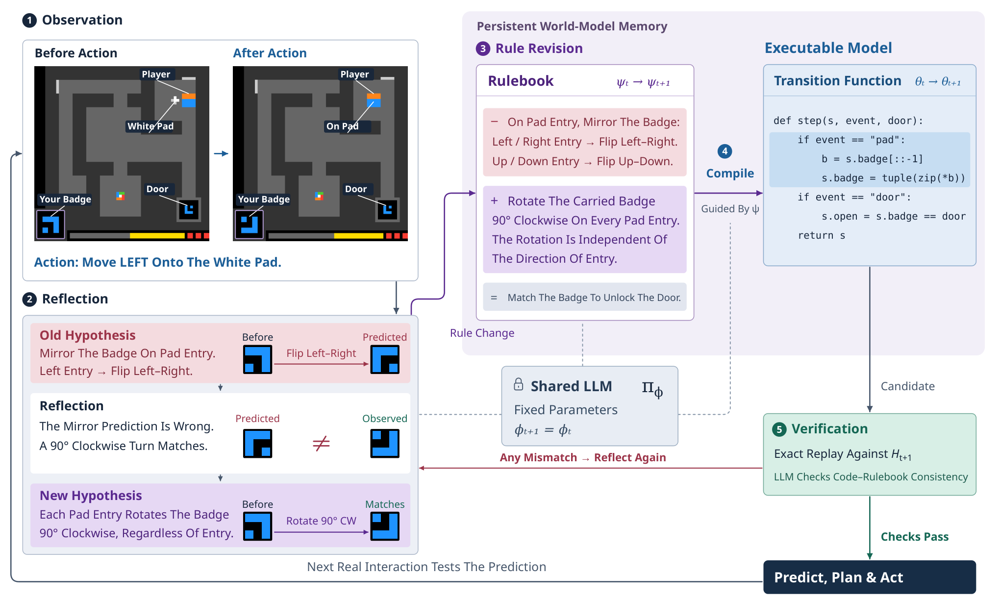

**原文图／官方图片** — 论文原图 2：冻结 LLM 的持续世界模型学习——agent 循环执行观察、反思、规则修订、编译与校验，把规则书作为持久语义记忆并编译为可执行模型。 · Figure 2 (codeasmodel-overview.png): the continual loop of observation, reflection, rule revision, compilation and verification around a frozen LLM · [source](https://arxiv.org/html/2610.11794v1)

**nanoRSI 复现状态** — not-run. 来源最近核验：2026-10-13.

**开源代码／权重／数据链接** — 核验来源中没有确认的公开代码／资产链接。

**一手来源** — [arXiv abstract](https://arxiv.org/abs/2610.11794) · [arXiv HTML v1](https://arxiv.org/html/2610.11794v1)

### EvoBelief: Falsifiable World Models for Self-Improving LLM Agents

**2026-10-08** · paper · 直接有界闭环

**日期说明** — arXiv v1 提交于 2026-10-08；无修订。部分工作在 Amazon 实习期间完成。

**机构关系** — 杜兰大学（Janet Wang、Yi Xiang、Chandan K. Reddy 等）与 Amazon（Jiang Guo 等）。

**改变对象与反馈复用** — LLM 全程冻结；自演化世界模型把环境知识编码为与证据挂钩的可证伪假设。预测失配或决策关键未知会开启证据环：从意外中形成假设，经后续观测与设计实验验证，反例收窄或废除规则；只有验证过的规则才引导之后的预测与规划，整个闭环无任何参数更新。承诺闸约束规则翻动。

**作者报告结果** — ALFWorld 无记忆设定对匹配的冻结世界模型：+23.9（Claude Haiku 4.5：66.42 对 42.54）、+31.3（GPT-5.4：76.12 对 44.78）；ScienceWorld 64.44/71.11。MiniGrid 第 20 集后静默换钥匙：EvoBelief 61.67→95.00（MG-C 族），冻结世界模型近 0-50%；留出种子 69.6% 对 1.3%；标签置换对照 80.8% 对 7.1%。DiscoveryWorld 反应器实验室（GPT-5.4）：Normal 档 83.3%、Challenge 档 58.3% 完成，所有被评基线（ReAct、WorldEvolver、Hypothesizer）均为 0%。消融：去掉实验或学到的规则成功率塌到约 0%；从未执行的影子规则 57.08%；去掉承诺闸是零效应（68.33 对 69.58）。

**证据边界** — 纯文本环境；随机场景需用统计检验替代计数阈值；昂贵或不可逆的干预需要超出当前闸的风险限制；情景记忆与信念有重叠；承诺闸消融在确定性 MiniGrid 上为零效应；Plant Nutrients 上对最强基线的完成率差置信区间含零。

**代码／权重／数据／许可** — 未发布代码、权重或数据（arXiv 页无链接）。论文按 arXiv 非独占许可。

**可用于 nanoRSI 的实验方向——本次未实现** — 反例触发的规则废除是 nanoRSI 技能库的廉价完整性清扫：每次冻结面板失败都应尝试证伪当时使用的技能，而不只蒸馏新技能；先验证后引导把 ADOPTION 第 46 项的回放验证准入从记忆编辑扩展到规则型技能。

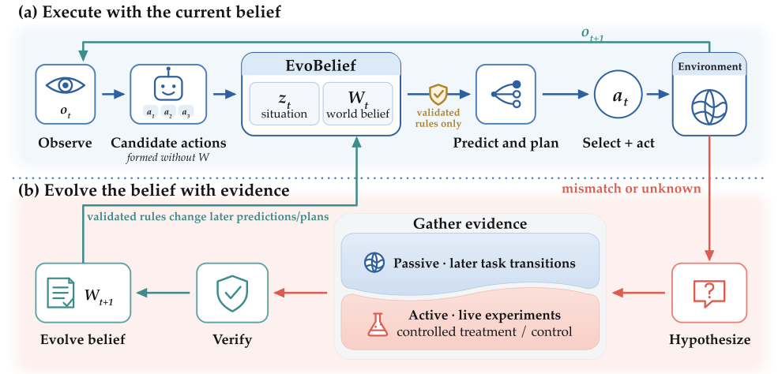

**原文图／官方图片** — 论文原图 2：EvoBelief 决策环——当前状态与世界模型预测动作后果；失配或决策关键未知开启证据环，假设经观测与实验验证后，验证过的规则才引导预测与规划。 · Figure 2 (evobelief-workflow.svg): verified belief revision closing the loop from experience to later behavior · [source](https://arxiv.org/html/2610.12789v1)

**nanoRSI 复现状态** — not-run. 来源最近核验：2026-10-14.

**开源代码／权重／数据链接** — 核验来源中没有确认的公开代码／资产链接。

**一手来源** — [arXiv abstract](https://arxiv.org/abs/2610.12789) · [arXiv HTML v1](https://arxiv.org/html/2610.12789v1)

### EvoOntology: A Self-Evolving Ontology Layer for Data Agents

**2026-09-14** · paper · 直接有界闭环

**日期说明** — arXiv v1：2026-09-14。代码仓库创建于 2026-09-15。

**机构关系** — 四位作者（Meiduo Chong、Shaolei Zhang——通讯、Ju Fan、Xiaoyong Du）均属中国人民大学信息学院；代码位于 ruc-datalab 组织下。

**改变对象与反馈复用** — 进化的对象是打包为 MCP 服务器的本体层（模式、内容、工具三层），位于数据智能体与异构数据源之间。构建智能体先从负载查询构建证据落地的初始本体；随后诊断-归因-补丁-闸门循环精炼它：轨迹失败经交互签名归因到唯一一层，类型化候选补丁只改该层，骨干条件化配对闸门只在同一骨干、同一验证集、相同解码与预算下提升至少 tau 时才接受候选；被拒绝的补丁留痕。

**作者报告结果** — 三个基准、四个分析骨干。DDR-Bench 轨迹级对 ReAct 基线：GPT-5.5 90.9（+26.7）、GPT-5.6-sol 93.5（+25.0）、Claude-Sonnet-5 81.3（+8.8）、Claude-Opus-4.8 92.3（+19.3）——平均 +17.8；对 ReAct+Memory 为 89.5 对 75.8（+13.7）。增益归因：构建器 +12.3，进化环再 +7.7（DDR-Bench）；BIRD EX 上 +5.1 再 +3.7。闸门消融损失 -11.2 轨迹级，归因 -6.3。诚实负结果：InsightBench 已饱和（均值 +0.7~+1.6），进化后本体跨骨干迁移至少掉 6.6 分。

**证据边界** — 进化依赖特定骨干（配对闸门以同骨干为验收条件）；已饱和基准近零增益；配对验证带来额外算力，作者以总成本比基线低约 20% 对冲；无专门局限性章节。

**代码／权重／数据／许可** — 代码以 MIT 发布于 github.com/ruc-datalab/EvoOntology（仓库创建于 2026-09-15，核验时 7 星）。未找到权重或数据发布；评测调用 GPT-5.5/5.6-sol 与 Claude Sonnet-5/Opus-4.8 API。

**可用于 nanoRSI 的实验方向——本次未实现** — 对 nanoRSI：把知识产物（技能库、领域笔记）当作带层级限制编辑的类型化对象，配同条件配对验收闸门与拒绝日志——与证据账本同构，应用于进化产物。

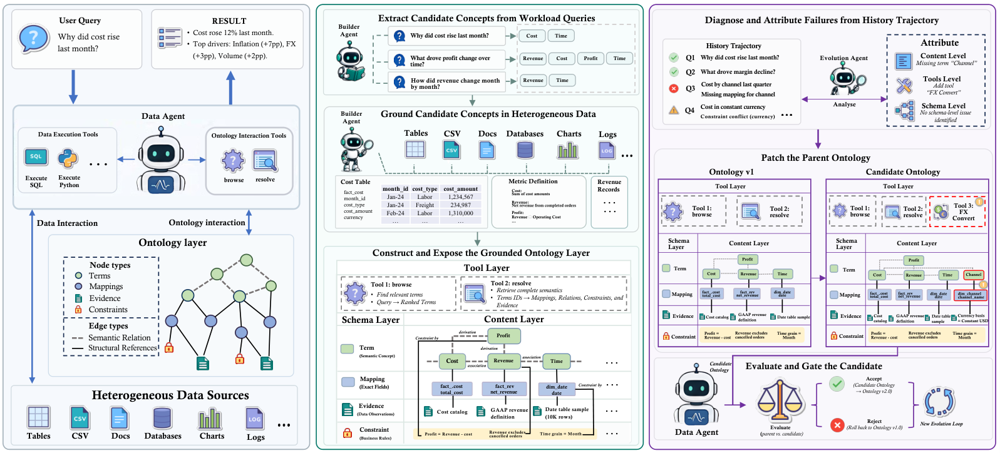

**原文图／官方图片** — 图 2：EvoOntology 总览——构建器把候选概念落地到异构数据源，三层本体以工具暴露，进化智能体对父本体执行诊断、归因、补丁与闸门。 · Figure 2 · [source](https://arxiv.org/html/2609.15779v1)

**nanoRSI 复现状态** — not-run. 来源最近核验：2026-09-16.

**开源代码／权重／数据链接** — [Code repository (MIT)](https://github.com/ruc-datalab/EvoOntology)

**一手来源** — [arXiv abstract](https://arxiv.org/abs/2609.15779) · [Paper v1 (affiliations, Figure 2, Tables, gate details)](https://arxiv.org/html/2609.15779v1) · [Code repository (MIT)](https://github.com/ruc-datalab/EvoOntology)

### SE-GoS: Self-Evolving Graph-of-Skills for Skill Library at Scale

**2026-09-08** · paper · 直接有界闭环

**日期说明** — arXiv v1：2026-09-08。核验时无更新的修订版本。

**机构关系** — 论文 v1 列明 Dawei Fu（北京大学、腾讯）、Cheng Jiang（爱丁堡大学）、Sitian Qian（西北大学）、Huainan Wang（腾讯）、郝中锴（Zhongkai Hao，清华大学）。两位作者直接受雇于腾讯。

**改变对象与反馈复用** — 对既有 Graph-of-Skills 检索图做免训练进化：真实执行轨迹驱动三类更新合并为一轮离线进化——拓扑进化（按共现诱导工作流/依赖/回避边、剪除从未使用的技能）、赫布式边权进化（强化频繁共用的路径）、节点描述进化（单轮“文本梯度”刷新面向检索的描述）。检索算法、技能内容与模型权重均不动——只有检索状态随执行改变，且进化后沿用同一检索接口。

**作者报告结果** — 在 SkillsBench、三个 LLM 上，一轮进化把平均任务奖励从 52.4% 提到 59.4%，同时相对整库加载 1,000 技能把平均输入 token 削减约三分之一。进化图可迁移到不相交的 37 任务留出集，比静态 GoS 基线 +5.4 分。收益随模型家族波动；多轮进化（表 4，每轮 n=174 次尝试）继续有效但边际递减。

**证据边界** — 进化是离线的，需要训练任务的真实运行池；指标是单一基准（SkillsBench）上计分尝试的平均；未发布代码；冷启动基座是给定的 1,000 技能库，其构建方式不在方法范围内。

**代码／权重／数据／许可** — 未找到代码或数据发布，仅论文。评测使用论文点名的三个商业 LLM API。

**可用于 nanoRSI 的实验方向——本次未实现** — 给 nanoRSI 加一道免训练的检索保养工序：每批评测后从运行日志挖掘共用与从未使用的原语，只调整检索图（边、权、描述）而不改技能内容，并在留出任务集上验证后再采用。

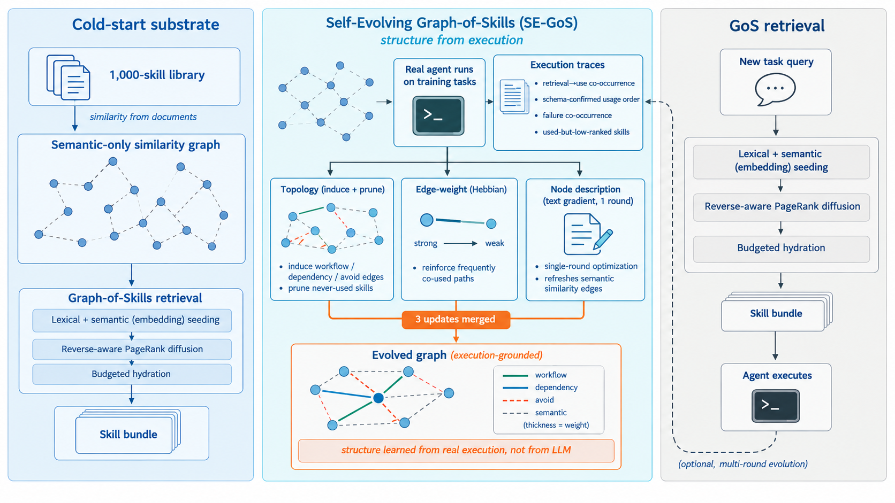

**原文图／官方图片** — 图 1：SE-GoS——真实智能体运行产生执行轨迹，驱动拓扑、边权与节点描述三类更新；进化图沿用不变的 GoS 检索接口。 · Figure 1 · [source](https://arxiv.org/html/2609.08228v1)

**nanoRSI 复现状态** — not-run. 来源最近核验：2026-09-15.

**开源代码／权重／数据链接** — 核验来源中没有确认的公开代码／资产链接。

**一手来源** — [arXiv abstract](https://arxiv.org/abs/2609.08228) · [Paper v1 (affiliations, Figure 1, Tables 2-4)](https://arxiv.org/html/2609.08228v1)

### Procedural Graphs: Self-Evolving Execution Structures for LLM Agents

**2026-09-08** · paper · 直接有界闭环

**日期说明** — arXiv v1：2026-09-08。核验时无更新的修订版本。

**机构关系** — 论文 v1 列明第一作者 Yuxing Lu 隶属 Google、佐治亚理工学院与北京大学；合作者 Yicheng Chen、Shanchan Wu、Sercan Ö. Arık 隶属 Google。企业主导、高校参与的工作。

**改变对象与反馈复用** — 程序性知识以（程序，关系，程序）三元组及边属性存储，构成类比知识图谱的“程序图”。运行时智能体定位活跃节点、抽取 2 跳子图，引导模型将其转为只引导不代做的步骤级建议。离线自进化中，LLM 精炼器对比失败与成功轨迹并提出图编辑（增/删/改）；编辑只有在留出验证性能保持或提升时才提交，被拒编辑留在“拒绝记忆”中以防重复提议。

**作者报告结果** — 在 EnterpriseArena（跨连续宏观危机的流动性管理，Gemini 3.5 Flash）上，自进化第 1 轮新增“核对现金/预测资金跑道”节点，把验证存活率从 0.0% 提到 45.0%；第 2 轮新增笔记复用，存活率提至 80.0%，且相对无引导基线每月工具调用从 17.23 降到 3.08；第 3-6 轮无任何提交（一个候选未过结构校验）——空转轮次被如实报告。在 HotpotQA、MultiChallenge 及 ALFWorld 类任务上，学到的图持平或超过手工引导与记忆基线。

**证据边界** — 自进化案例为单模型（Gemini 3.5 Flash）；未发布代码；“持平或超过手工图”依赖作者自建基线；引导质量受引导模型能力上限约束。

**代码／权重／数据／许可** — 未找到代码或数据发布，仅论文。实验使用 Gemini 3.5 Flash（商业 API）。

**可用于 nanoRSI 的实验方向——本次未实现** — 给 nanoRSI 自身改进环维护一张小程序图（提案、评测、提交），让精炼器阅读失败与成功 episode 的对比，并加显式“拒绝编辑”记忆避免重复提议；每次编辑都以冻结验证分为闸门。

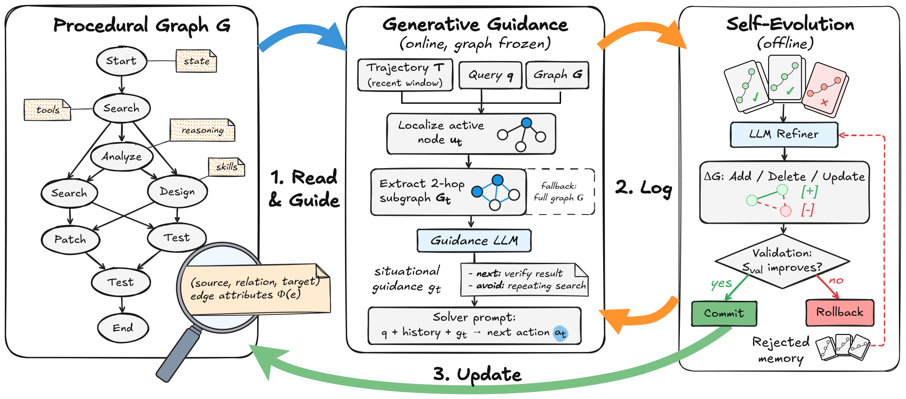

**原文图／官方图片** — 图 2：程序图框架——在线“读取并引导”，离线自进化中 LLM 精炼器的编辑只在验证提升时提交，被拒编辑进入拒绝记忆。 · Figure 2 · [source](https://arxiv.org/html/2609.09153v1)

**nanoRSI 复现状态** — not-run. 来源最近核验：2026-09-15.

**开源代码／权重／数据链接** — 核验来源中没有确认的公开代码／资产链接。

**一手来源** — [arXiv abstract](https://arxiv.org/abs/2609.09153) · [Paper v1 (affiliations, Figure 2, Section 5.4)](https://arxiv.org/html/2609.09153v1)

### Recursive Experiential-Working Memory Evolution for Long-Horizon Agent Harnesses

**2026-08-25** · paper · 直接有界闭环

**日期说明** — arXiv v1：2026-08-25（2608.24876；仓库同日创建）。系统在论文正文中名为 Recuris；arXiv 标题不含该前缀。

**机构关系** — 论文：新加坡国立（Zhaochen Yu、Shuicheng Yan）、斯坦福（Yingcheng Wu、Zhe Zhao）、牛津（Zhenfei Yin、Kaiyuan Chen）与普林斯顿（Mengdi Wang、Ling Yang）。

**改变对象与反馈复用** — 工作记忆（经验证的任务状态：待办/完成/阻塞目标，仅由观察支持的检查器谓词提交）与经验记忆（技能）耦合，由匹配当前状态的调用策略检索——结构化轨迹使失败定位率达 64.8%，对仅结果反馈的 13.0%。跨任务由固定元智能体把失败定位到四组件之一（技能、工作记忆规格、调用策略、检查器），只修补被牵连的组件，且固定验证闸门只在'修复来源任务且不伤留出开发集'时放行。基座 LLM 与外层流程冻结。

**作者报告结果** — 37 个完成的模型-基准对中 35 个提升。Tau2-Retail：GPT-5.6 Sol 58.3 -> 76.1、Claude Opus 5 72.4 -> 87.9、Doubao-2.0-Pro 58.1 -> 81.4（+23.3）、Granite-4.1-3B 9.7 -> 23.0。SkillFlow（Qwen3.6-27B）42.2 -> 58.7。留出进化：对初始记忆 +9.01~+17.44，第二轮再复利 +6.98——罕见的多轮增益。保留诚实警示：Terminal-Bench 2.1 适应效应 +2.3、p=0.774（'方向而非效应'），13 次运行未放行任何补丁。

**证据边界** — 无专门局限性章节，但论文保留了自身的噪声披露（tau2-Airline 置信区间含零；时程分析是分层再分析；记忆在单一中型部署模型上进化；留出任务缺可修复失败类型时迁移失败）。

**代码／权重／数据／许可** — 代码在 github.com/Gen-Verse/Recuris（Apache-2.0，核验时 205 星）。

**可用于 nanoRSI 的实验方向——本次未实现** — 对 nanoRSI：四组件定位（技能/记忆规格/检索策略/检查器）加'修复且不回退'闸门，是把失败归因到唯一可编辑面再提补丁的具体蓝图。

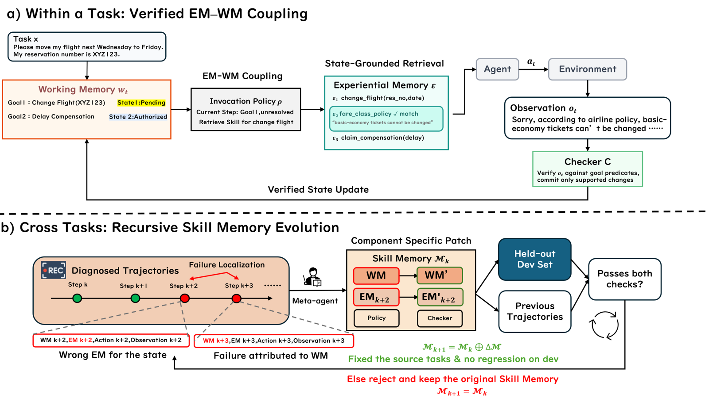

**原文图／官方图片** — 图 3：Recuris——任务内工作记忆驱动技能调用策略、检查器提交状态；跨任务固定元智能体在验证闸门后逐次修补单一被牵连组件。 · Figure 3 · [source](https://arxiv.org/html/2608.24876v1)

**nanoRSI 复现状态** — not-run. 来源最近核验：2026-09-17.

**开源代码／权重／数据链接** — [Code repository (Apache-2.0)](https://github.com/Gen-Verse/Recuris)

**一手来源** — [arXiv abstract](https://arxiv.org/abs/2608.24876) · [Paper v1 (affiliations, Figure 3, tables)](https://arxiv.org/html/2608.24876v1) · [Code repository (Apache-2.0)](https://github.com/Gen-Verse/Recuris)

### XSkill: Continual Learning from Experience and Skills in Multimodal Agents

**2026-03-12** · paper · 直接有界闭环

**日期说明** — arXiv v1：2026-03-12；v3：2026-07-01（ICML 2026；数字引自 v3）。

**机构关系** — 论文 v3：香港科技大学（Guanyu Jiang 兼浙江大学、Zhaochen Su、通讯 Yi R. Fung）与华中科技大学。

**改变对象与反馈复用** — 面向多模态智能体的免训练持续学习，双流知识：任务级 Markdown 技能（含可复用工具模板）与短条件-动作经验条目（上限 120 条，嵌入检索）。抽取做视觉落地（记录每个动作由什么视觉证据驱动），跨 rollout 批评对比成功/失败轨迹产出增改操作；测试时子任务按流各检索 top-3、适配当前图像后非指令式注入。使用历史回流支持持续精炼。

**作者报告结果** — 四个多模态基准 x 四个骨干：对仅工具基线 average@4 +2.58~+6.71；对最强基线最高 +11.13（TIR-Bench、Gemini-3-Flash：47.75 对 Agent-KB 36.62）；执行错误率从 29.9% 降到 15.3%。消融：去经验 -3.04、去技能 -3.85、去经验管理器 -4.09。从 Gemini-3-Flash 迁移的知识也提升 GPT-5-mini（20.61 -> 23.19）。

**证据边界** — 仅演示单轮'先积累后测试'（迭代精炼有架构支持但未测）；迁移知识损害 Qwen 系 average@4（Qwen3-VL-235B 11.80 -> 11.52），基座能力是关键；作者提示环内偏置传播并建议人工监督。

**代码／权重／数据／许可** — 代码在 github.com/XSkill-Agent/XSkill（268 星，核验时无许可证文件）；项目页 xskill-agent.github.io。

**可用于 nanoRSI 的实验方向——本次未实现** — 对 nanoRSI：把任务级技能与短条件-动作经验分开（各自上限与检索），并记录驱动每个动作的视觉/文本证据，让批评能对照'有依据的原因'而非原始日志。

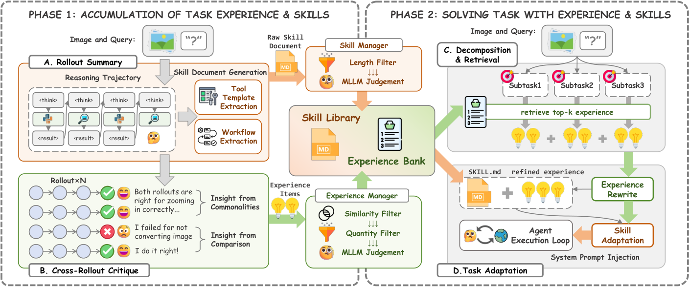

**原文图／官方图片** — 图 2：XSkill——阶段一经 rollout 摘要与跨 rollout 批评，从多路径视觉落地轨迹蒸馏技能文档与经验条目；阶段二测试时检索、适配并注入双流。 · Figure 2 · [source](https://arxiv.org/html/2603.12056v3)

**nanoRSI 复现状态** — not-run. 来源最近核验：2026-09-17.

**开源代码／权重／数据链接** — [Code repository](https://github.com/XSkill-Agent/XSkill)

**一手来源** — [arXiv abstract](https://arxiv.org/abs/2603.12056) · [Paper v3 (affiliations, Figure 2, tables)](https://arxiv.org/html/2603.12056v3) · [Code repository](https://github.com/XSkill-Agent/XSkill)

### MemSkill: Learning and Evolving Memory Skills for Self-Evolving Agents

**2026-02-02** · paper · 直接有界闭环

**日期说明** — arXiv v1：2026-02-02；v2：2026-05-24（数字引自 v2）。

**机构关系** — 论文 v2：南洋理工大学（Haozhen Zhang、Quanyu Long、Jianzhu Bao、通讯 Wenya Wang）与 UIUC（Tao Feng）、UIC（Weizhi Zhang）、清华（Haodong Yue）。

**改变对象与反馈复用** — 记忆抽取操作成为可学习的'记忆技能'，双环交织。技能选择/使用：轻量控制器（状态-技能嵌入上的 MLP，Gumbel-Top-K 采样）逐文本 span 选 Top-K 技能子集，LLM 执行器按技能更新该轨迹记忆库，控制器以下游问答表现为 PPO 奖励训练。技能进化：滑动难例缓冲记录以查询为中心的失败；每 100 步设计者 LLM 聚类难例、精炼/新增技能（每轮最多 3 次编辑），配快照回滚、早停与新技能探索偏置。

**作者报告结果** — LoCoMo（LLaMA3.3-70B）：F1 44.21 / L-J 53.82 对 MemoryOS 41.39、A-MEM 49.71；迁移到 LongMemEval（L-J 60.89）与 HotpotQA（50/100/200 文档全部最优）；ALFWorld seen/unseen 77.14/83.58 成功率（均值 80.36）胜 Mem0 与 CoN；AppWorld 26.71% 对 AWM 25.42%。消融：去控制器 L-J -5.4，去技能描述（Qwen）-17.7。成本：215 次 LLM 调用对 MemoryOS 1,288、A-MEM 1,548。

**证据边界** — 局限性在附录 F（HTML 审阅未渲染）；LongMemEval 与 Qwen 行为纯迁移（在 LoCoMo+LLaMA 上训练）；技能进化的准备成本是摊销而非免费。

**代码／权重／数据／许可** — 代码在 github.com/ViktorAxelsen/MemSkill（Apache-2.0，核验时 576 星）；项目页 viktoraxelsen.github.io/MemSkill。论文 CC BY 4.0。

**可用于 nanoRSI 的实验方向——本次未实现** — 对 nanoRSI：进化'写记忆的操作'本身（而不止记忆内容），并用快照回滚 + 早停闸门约束设计者编辑——与技能轨相同的控制，再高一层。

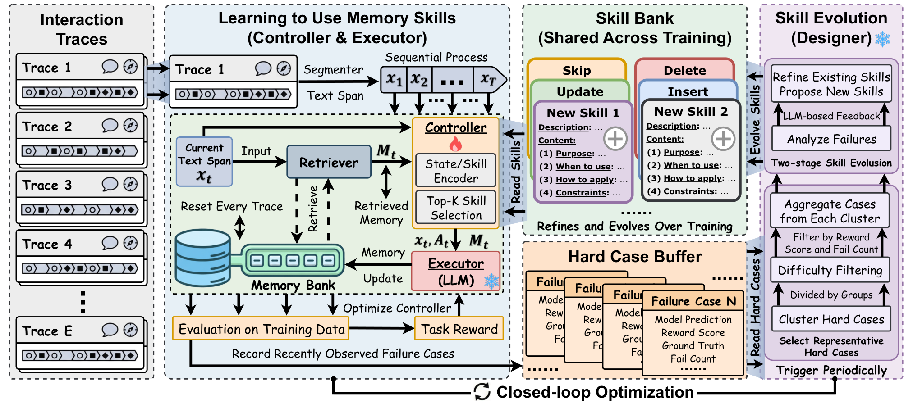

**原文图／官方图片** — 图 2：MemSkill 架构——控制器从共享库选 Top-K 记忆技能，执行器逐 span 应用，任务奖励训练控制器，失败喂给设计者驱动的技能进化环。 · Figure 2 · [source](https://arxiv.org/html/2602.02474v2)

**nanoRSI 复现状态** — not-run. 来源最近核验：2026-09-16.

**开源代码／权重／数据链接** — [Code repository (Apache-2.0)](https://github.com/ViktorAxelsen/MemSkill)

**一手来源** — [arXiv abstract](https://arxiv.org/abs/2602.02474) · [Paper v2 (affiliations, Figure 2, tables)](https://arxiv.org/html/2602.02474v2) · [Code repository (Apache-2.0)](https://github.com/ViktorAxelsen/MemSkill)

## 经验积累与回放 (12)

### Hippo: Training-Free Agent Self-Evolution via Hippocampal Replay

**2026-10-20** · paper · 直接有界闭环

**日期说明** — arXiv v1 于 2026-10-17 提交；在 2026-10-20 批次公告，以公告日为首次公开日期。无 HTML 版本，核验用 PDF。

**机构关系** — Yutong Song（UC Irvine）、Jiang Wu（独立研究者）、Yuxuan Ren（莱斯大学）、Tony Qin 与 Baoyuan Wang（Zillow Group，通讯）——依 PDF 扉页读出。

**改变对象与反馈复用** — 显式以递归自改进为动机、经外部记忆的选择性编码与重放实现免训练自我演化。通过比较同任务多次尝试识别可复用决策并精炼其适用条件（错误推理可能碰巧成功；糟糕执行可能掩盖正确策略）；惊讶驱动的情景反思选择值得编码的内容；巩固阶段合并重叠、以显式适用条件解决冲突、就地修订既有指导而非为每条教训新增条目。

**作者报告结果** — 在 SWE-bench Verified、WebArena、Mind2Web 上取得增益，且保留的经验条目远少于累积基线；增益跨不同能力的基座模型成立。无巩固的累积基线先升后降至低于无记忆基线（倒 U 型）——这是未巩固记忆库的头条负面证据。

**证据边界** — 无参数更新（能力受冻结模型限制）；教训来自同任务配对尝试，成本随刻意重试增长；在三个既有套件上评估。

**代码／权重／数据／许可** — 核验时论文未给出代码仓库；arXiv 默认非独占许可。

**可用于 nanoRSI 的实验方向——本次未实现** — 用于技能/记忆线：把只增不减的教训清单换成显式适用条件下的就地修订巩固；凡经验库无修剪增长时，以倒 U 累积曲线作为常备诚实性检查。

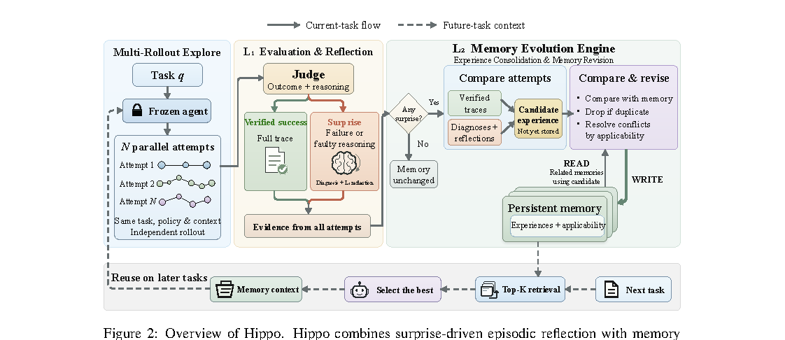

**原文图／官方图片** — 原图 2（自 PDF 渲染）：Hippo 总览——惊讶驱动的情景反思，加上受海马重放启发、以适用条件合并重叠与解决冲突的巩固，智能体策略保持冻结。 · Figure 2 cropped from PDF page 4 (no HTML version exists); gs 150dpi render, bbox (77,99,1199,585) · [source](https://arxiv.org/pdf/2610.24453)

**nanoRSI 复现状态** — not-run. 来源最近核验：2026-10-21.

**开源代码／权重／数据链接** — 核验来源中没有确认的公开代码／资产链接。

**一手来源** — [arXiv abs 2610.24453](https://arxiv.org/abs/2610.24453) · [arXiv PDF (no HTML version)](https://arxiv.org/pdf/2610.24453)

### Darwin-Claw: Environment-Adaptive Experience Consolidation for Recursively Self-Evolving Agents

**2026-10-19** · paper · 直接有界闭环

**日期说明** — arXiv v1 于 2026-10-16 提交；在 2026-10-19 批次公告（OAI-PMH datestamp 2026-10-19），以公告日为首次公开日期。

**机构关系** — Mingze Yin（浙江大学与腾讯，同等贡献）、Xiaohan Wang（腾讯，同等贡献）、Dian Li（腾讯）、Longfei Luo（浙江大学与中关村学院）、Jiahong Yan（腾讯）、Yiheng Zhu（中关村学院）、Chang-Yu Hsieh（浙江大学，通讯）——依 HTML 作者块读出。

**改变对象与反馈复用** — 层次化经验巩固系统从用户交互轨迹提取细粒度错误归因，泛化为动态更新的环境原型向量；巩固后的情境经验被两用——作为交互补丁注入以增强上下文感知，并作为显式优化信号在 Externalized 演化生命周期（因果验证与多维评分闸门）下精炼操作技能与持久记忆。理论上表述为冻结基座上的智能体执行者/演化批评者迭代协同适应。

**作者报告结果** — WildClawBench（60 条人写的长程多模态任务、六类）：较无演化基线平均 +24.1 个百分点，网页 +27.3、工具 +31.6、推理密集 +22.7、长程 +23.8；按难度从简单 +18.5 到极端 +33.2。在 RSIBench-Data 自动研究任务上（Claude Code 与 Codex 双 harness、四个 LLM），24 项中 19 项优于基座（绝对 +32.00 SWE-V、+15.28 AIME、+15.08 Terminal-Bench 2.0），且在全部六个基准上超过上下文直传式演化基线。

**证据边界** — 改进是相对作者所选基线在其基准套件上的结果；原型向量与经验池需要本地存储基础设施；核验时未放出代码，巩固管线无法独立复核。

**代码／权重／数据／许可** — 论文 HTML 中未发现仓库链接（2026-10-20 核验）；论文 CC BY-NC-SA 4.0。

**可用于 nanoRSI 的实验方向——本次未实现** — 先聚类错误归因再落盘：nanoRSI 可对每次失败尝试的归因向量分类，路由到技能文件编辑、记忆追加或丢弃——这是对“逢败必改技能”的结构化替代，可在 counterfactual 面板上检验。

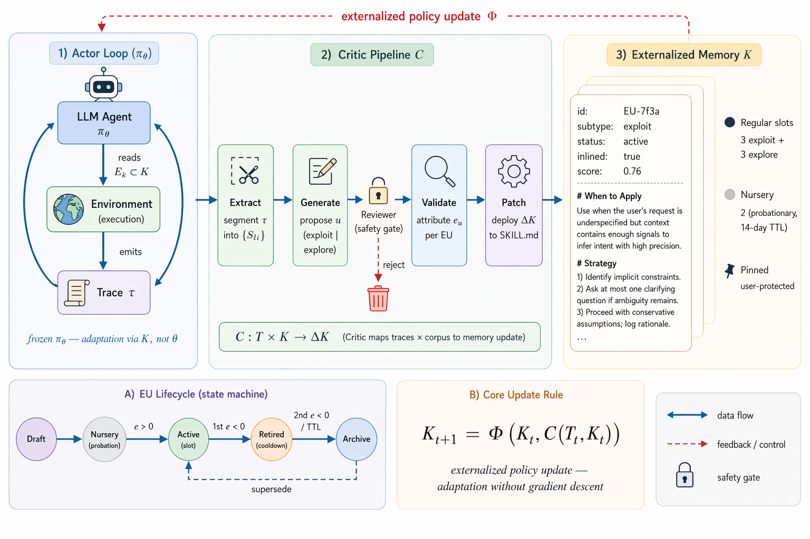

**原文图／官方图片** — 原图 1 总览：历史交互经层次化经验巩固（归因、原型向量）进入演化中的技能与记忆，再反馈到后续交互。 · Figure 1 (figures/framework.png), arXiv HTML 2610.23574v1 · [source](https://arxiv.org/html/2610.23574v1/figures/framework.png)

**nanoRSI 复现状态** — not-run. 来源最近核验：2026-10-20.

**开源代码／权重／数据链接** — 核验来源中没有确认的公开代码／资产链接。

**一手来源** — [arXiv abs 2610.23574](https://arxiv.org/abs/2610.23574) · [arXiv HTML v1](https://arxiv.org/html/2610.23574v1)

### Reflect After Failure: Brain-Inspired Self-Evolving Agents for Embodied Spatial Intelligence

**2026-10-14** · paper · 直接有界闭环

**日期说明** — arXiv 2610.20312 v1 提交于 2026-10-14，随 2026-10-15 批次公告。系统名 HiMeco 出现在摘要中；abs 标题按原样保留。

**机构关系** — Xin Li、Tianli Shi、Zhimeng Yin、Dapeng Wu、Yun Wang（香港城市大学）；Xiaohuan Gu（华东师范大学）；Yifan Wang（电子科技大学）；Shaobin Ling（香港中文大学（深圳））；Jingao Xu（香港大学，与 Xin Li 同等贡献）。

**改变对象与反馈复用** — 受脑启发的具身空间任务自进化智能体。海马-元认知反思在感知-探索-规划三轴上诊断失败——执行反馈本身很少揭示哪个环节负责，单纯堆积经验反而会强化无效策略。系统对比多次执行尝试提炼可复用策略与规避重复错误的指引，并用证据契约与基于执行的校验把交互程序抽象为参数化技能。

**作者报告结果** — 在具身空间基准上提升成功率并具泛化性（据摘要；本核验未重推逐表数字）。

**证据边界** — 本核验侧重机制、机构与配图，未逐字提取结果数字；HTML 未找到代码链接。

**代码／权重／数据／许可** — HTML 全文未找到代码或仓库链接。

**可用于 nanoRSI 的实验方向——本次未实现** — 记忆沉淀前先做感知/探索/规划三轴归因，是我们“提案问题还是评测问题”归因的具身版：只有定位到失效环节后才写反思，否则累积的技能会强化错误修复。

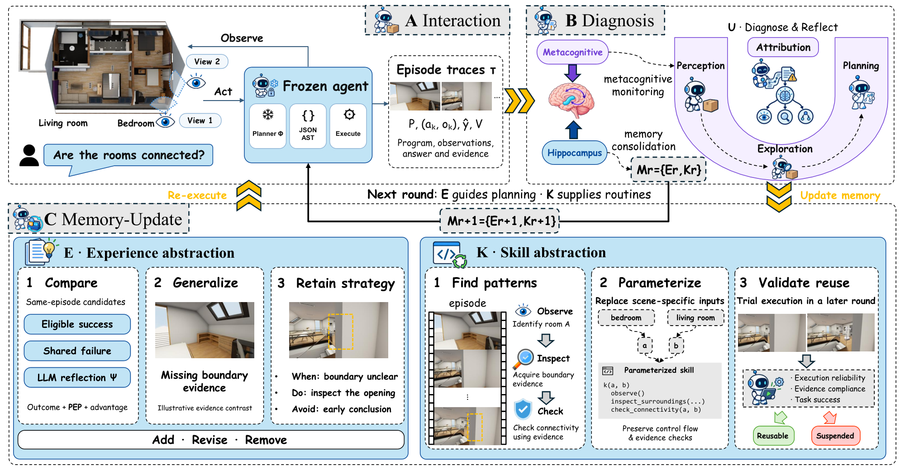

**原文图／官方图片** — 原图 2：HiMeco 总览——(A) 冻结规划器与环境交互收集证据；(B) PEP 诊断归因失败；反思提炼可复用策略；交互程序在证据契约下抽象为参数化技能。 · Figure 2 (Method.png), arXiv HTML 2610.20312v1 · [source](https://arxiv.org/html/2610.20312v1/Method.png)

**nanoRSI 复现状态** — not-run. 来源最近核验：2026-10-17.

**开源代码／权重／数据链接** — 核验来源中没有确认的公开代码／资产链接。

**一手来源** — [arXiv abs 2610.20312](https://arxiv.org/abs/2610.20312) · [HTML full text v1](https://arxiv.org/html/2610.20312v1)

### Reliable Memory from Unstable Growth: Curating Self-Written Agent Playbooks with Randomized Experiments

**2026-10-13** · paper · 直接有界闭环

**日期说明** — arXiv v1 提交于 2026-10-13，随翻倍的 2026-10-14 批次公告；2026-10-15 完成一手核验。

**机构关系** — Hoang Pham、Dong Le、Ponhvoan Srey、Anh Tuan Luu（南洋理工大学）；Cong-Duy Nguyen（VinUniversity）；Anh Tuan Luu 兼 VinUniversity（通讯）。

**改变对象与反馈复用** — 把自写手册当实验对象而非文本：经验条目嵌入后 Ward 聚类成 m=8 个主题块；练习任务上每块以 p=1/2 独立入选（二水平因子设计），对成功指示符做岭回归估计每块效应——恰等于其在随机共服务子集上的 Banzhaf 值。只有效应为正的块才被服务（按效应从高到低、40% token 预算内）；若全无正效应则不服务任何手册。RBC 长出 K=3 本手册、各自策展，再在新鲜练习局上验证 2K+1 个候选（策展集、完整手册、空集）并服务胜者。生长过程不变；策展零 LLM 调用。

**作者报告结果** — 2 个记忆系统（ACE、Dynamic Cheatsheet）×3 模型（Qwen3.8-27B、Qwen3.5-9B、Gemma-4-31B）×3 基准（AppWorld、WebShop、ALFWorld）：RBC 平均 66.9，对完整手册 55.5、无手册 54.1、agent 自选 53.8。最坏案例：Qwen 27B AppWorld（成败型反馈）上完整手册比无手册低 69.6 分（19.2 对 78.4）。ACE 上 RBC 至多比无手册低 0.8，而每个基线都至少在某处跌 5.4 以上。

**证据边界** — 块粒度固定为 m=8 个 Ward 簇；策展期间练习任务使服务成本翻倍；评测覆盖三个交互式基准与三个开源权重模型；小练习样本下块效应估计有噪（靠岭回归收缩）。

**代码／权重／数据／许可** — 匿名代码位于 anonymous.4open.science/r/rbc（评审期工件）。论文按 arXiv 非独占许可。

**可用于 nanoRSI 的实验方向——本次未实现** — RBC 是 ADOPTION 第 48 项'每技能效用账本'的可插拔因果升级：不记检索相关性效用，而是测量每技能块在冻结面板局上的随机开/关效应（Banzhaf/岭回归估计只需 nanoRSI 已记录的入选指示与结果），按符号而非感觉退役或保留技能块。69.6 分的最坏案例是对整份服务自写技能文件的常鸣警示。

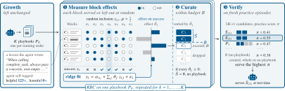

**原文图／官方图片** — 论文原图 1：自我评判（a）与事后上下文估值（b）对比随机化分块策展（c）——后者以开关练习局测量每个自写块的因果效应，只服务实测有益的块。 · Figure 1 (f_main.svg): three curation designs contrasted - (a) agent self-judgment, (b) context valuation of random subsets, (c) RBC's randomized block inclusion on practice tasks with keep-only-helpful selection · [source](https://arxiv.org/html/2610.18427v1)

**nanoRSI 复现状态** — not-run. 来源最近核验：2026-10-15.

**开源代码／权重／数据链接** — 核验来源中没有确认的公开代码／资产链接。

**一手来源** — [arXiv abstract](https://arxiv.org/abs/2610.18427) · [arXiv HTML v1](https://arxiv.org/html/2610.18427v1)

### Recurrent Harness for Agentic Continual Learning

**2026-10-08** · paper · 直接有界闭环

**日期说明** — arXiv v1 提交于 2026-10-08；无修订。第一作者的工作在 Meta MRS Research 实习期间完成。

**机构关系** — Meta MRS Research（Zhiyun Lu、Jianyu Wang、Yang Song、Qifan Wang、Bailin Wang）、MIT（Yuxin Xiao，实习于 Meta MRS Research）与耶鲁大学（Yangtian Zhang）。

**改变对象与反馈复用** — harness 状态是从历史轨迹写出的文本反思集合。常规有状态 harness 只向前传播（写反思、检索反思），一条过度泛化的反思会持续误导后续实例。ReHarness 增加反向修订 agent：每条轨迹结束后只用当次结果作反馈重写被检索的反思，任何新内容必须锚定该反思的源轨迹——防止泄漏；修订后的反思替换原件并作为写下一条反思的示范，在严格在线流式协议下闭合「向前读 / 向后改 / 向前写」的循环。

**作者报告结果** — 在 CL-Bench、MemoryBench、MemoryArena × Claude Opus 4.8、GPT-5.5、Gemini 3.7 Flash 上平均归一化增益 0.240，9 个组合中 8 个最佳或并列最佳，对照 Top-K Raw 0.168、Full Raw 0.164、GEPA-Online 0.092、Mem0 0.131、DoT 0.071、ACE 0.043、RBank 0.034；对所有基线的增益均统计显著（Wilcoxon 加 Bonferroni，如对 Top-K Raw p_adj=0.039）。CL-Bench + Claude 的 token 成本约 41.57M（254 美元），对 Full Raw 约 142.12M（314 美元）；CL-Bench 分布漂移下稳定性与可塑性最高。

**证据边界** — 在可利用的扑克任务上表现不佳——那里奖励对修订而言是噪声随机信号；仍需存原始轨迹供后续修订，带来存储开销。

**代码／权重／数据／许可** — 未发布代码或数据（arXiv 页与 HTML 均无链接）。论文按 arXiv 非独占许可。

**可用于 nanoRSI 的实验方向——本次未实现** — 锚定源轨迹的反向修订可映射到 nanoRSI 技能轨：被拒候选应修订它实际使用的那条技能，修订内容限定在失败证据内——该锚定约束与反事实面板的反捷径纪律同源；修订幅度随时间收敛（其图 4a）是证据账本可审计的收敛信号。

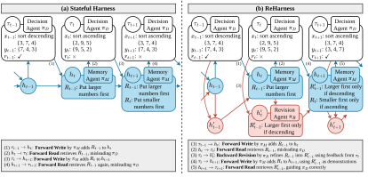

**原文图／官方图片** — 论文原图 1：(a) 传统有状态 harness 只经向前写与读传播信息，过度泛化的反思得以存续；(b) ReHarness 增加用下游反馈精化被检索反思的反向修订，阻止同一错误继续传播。 · Figure 1 (pipeline.svg): from stateful agent harnesses to ReHarness, panels (a) forward-only propagation vs (b) backward revision of retrieved reflections · [source](https://arxiv.org/html/2610.12668v1)

**nanoRSI 复现状态** — not-run. 来源最近核验：2026-10-14.

**开源代码／权重／数据链接** — 核验来源中没有确认的公开代码／资产链接。

**一手来源** — [arXiv abstract](https://arxiv.org/abs/2610.12668) · [arXiv HTML v1](https://arxiv.org/html/2610.12668v1)

### EchoPath: Execution-Level Replayable Memory for GUI Agents

**2026-09-15** · paper · 直接有界闭环

**日期说明** — arXiv v1：2026-09-15（2609.16635），已在 abs 页核验。

**机构关系** — 论文：约翰霍普金斯大学（应用数学与统计系）与 Amazon AGI。

**改变对象与反馈复用** — 经验证的 GUI 轨迹被编译为标准化、参数可控的可调用记忆（任务意图键、前置条件、参数、GUI 证据、验证出处、生命周期状态）。基于图像的目标重瞄算法在回放前把存储的 GUI 目标与当前屏幕重新匹配并校正坐标，只重绑定声明的可变输入。生命周期状态（候选、活跃、隔离、修复分支、合并、弃用）约束检索可见范围。

**作者报告结果** — OSWorld-Verified 配对两遍设计（第二遍在改变分辨率后回放）：回放保持成功率——Codex 145/159（91.2%）、Claude 92.8%、Kimi 87.3%，与 Synapse 规划增强基线（91.8%）相当。第二遍中位成本：20,370 token 与 127.5 秒，对比 Synapse 586,386 token 与 315.7 秒（中位 token 成本降逾 90%、执行时间降约 60%）；首遍构建约耗 57.2 万 token、4.5 分钟。

**证据边界** — 最适合稳定环境：视觉重瞄对工具栏重排、本地化、响应式布局、显示缩放与近重复 UI 元素仍然脆弱；界面漂移下的在线稳健性未验证；记忆获取需完整自治首遍而非用户演示。

**代码／权重／数据／许可** — 论文所列仓库 github.com/JackZhao1998/EchoPath 已在 2026-09-17 至 2026-09-19 间删除（API 404 且无重定向，非改名）；未找到迁移。论文仍公开。

**可用于 nanoRSI 的实验方向——本次未实现** — 对 nanoRSI：把执行级技能存为自带验证出处与生命周期状态的可调用记忆，检索只暴露活跃项——回放即可用十分之一 token 换取大部分收益。

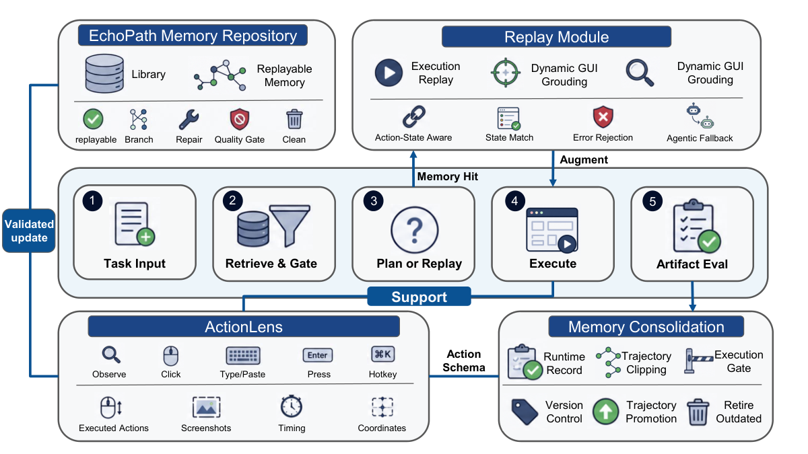

**原文图／官方图片** — EchoPath 框架：验证轨迹变为带验证出处与生命周期状态的参数可控可调用记忆，回放前重瞄当前屏幕。 · Figure 1 (S2.F1) · [source](https://arxiv.org/html/2609.16635v1)

**nanoRSI 复现状态** — not-run. 来源最近核验：2026-09-19.

**开源代码／权重／数据链接** — 核验来源中没有确认的公开代码／资产链接。

**一手来源** — [arXiv abstract](https://arxiv.org/abs/2609.16635) · [arXiv HTML v1](https://arxiv.org/html/2609.16635v1)

### Chain-of-Experience for Continual LLM Improvement

**2026-08-18** · paper · 直接有界闭环

**日期说明** — arXiv v1 为 2026 年 8 月 18 日；字节跳动 Seed 官方论文页以 2026.08.18 收录同一论文。

**机构关系** — 作者来自 UC Santa Cruz 与字节跳动 Seed（Haoqin Tu 与 Yunhao Fang 为同等贡献；资深作者 Cihang Xie、Shen Yan）。

**改变对象与反馈复用** — 测试时经验学习：模型不再单轮推理，而是在迭代解题中累积自身经验轨迹（提问、尝试、正确性或测试通过反馈），这些轨迹供后续尝试使用，形成经验链（CoE）。研究比较了反馈来源（自我反馈与环境反馈）、通道组合以及保留策略，包括刻意保留"混乱"的失败轨迹。

**作者报告结果** — 在八个 LLM（含 GPT-5、Gemini-2.5 Pro、Claude-4.5 Sonnet）的数学/代码/知识任务上，迭代经验相对无反馈基线整体提升 5.6%，同时 API 成本降低 19%；组合互补反馈通道带来额外收益，单位 token 准确率优于其他测试时方法，且对弱反馈或噪声反馈稳健。

**证据边界** — 收益属于固定模型上的有界测试时适应：无权重更新，且按字节官方页的定位是"超越零样本推理的持续改进"，而非可学习更新器的跨任务迁移。百分比为作者在自选基准集上的汇总。

**代码／权重／数据／许可** — arXiv（CC BY 4.0）；收录于字节 Seed 官方论文页。已核验来源中没有代码或数据发布链接；基准提示与轨迹未见公开。

**可用于 nanoRSI 的实验方向——本次未实现** — 建议：在 nanoRSI 的数字/编程任务上，在固定 token 预算下比较单通道执行反馈与自我+环境反馈组合，并检验保留失败轨迹（而非只留成功）是否改变隐藏集准确率。

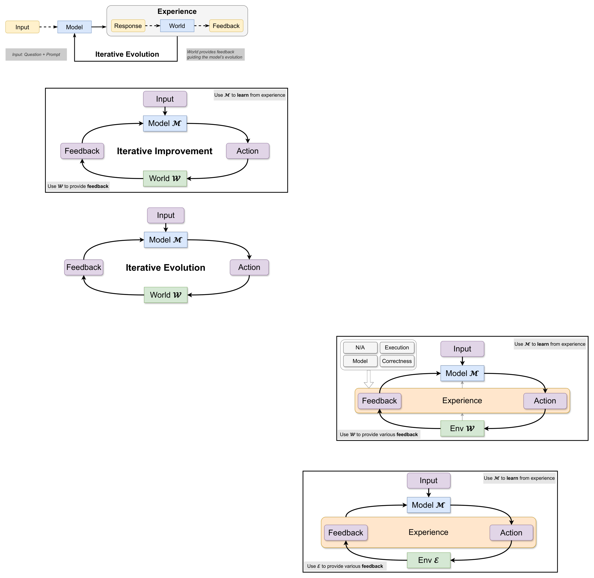

**原文图／官方图片** — 图 2：研究的问题设定演进——从依赖世界反馈的迭代改进，到迭代演化，再到以累积经验为核心的闭环（环境提供多样化反馈，模型从经验中学习）。 · Figure 2 · [source](https://arxiv.org/html/2608.18027v1)

**nanoRSI 复现状态** — not-run. 来源最近核验：2026-09-14.

**开源代码／权重／数据链接** — 核验来源中没有确认的公开代码／资产链接。

**一手来源** — [arXiv abstract (v1 date, license)](https://arxiv.org/abs/2608.18027) · [Paper HTML (loop figures, results)](https://arxiv.org/html/2608.18027v1) · [ByteDance Seed official publications page (2026.08.18)](https://seed.bytedance.com/zh/public_papers)

### Prime Agent: A Self-Improving RLM Harness

**2026-08-05** · paper · 直接有界闭环

**日期说明** — 论文明确标注首次发布于 2026 年 8 月 5 日，arXiv 首版提交于 8 月 24 日；上线博客亦确认为 8 月 5 日。

**机构关系** — Prime Intellect 发布该框架；论文列出 Prime Intellect、普林斯顿及 MIT 作者单位。

**改变对象与反馈复用** — 轨迹触发的改进修改持久化补充提示、技能、记忆和子智能体配置。磁盘持久化与回滚历史支持跨轨迹复用，基础系统提示保持不可修改。

**作者报告结果** — Sonnet 5 的七天 Factorio 运行完成了 196 项技术中的 24 项，使用 2,340 万输出 token；该案例没有匹配的关闭改进机制对照。其他框架基准收益不能全部归因于自我改进。

**证据边界** — 另一条 Factorio 轨迹将直接生成资源的作弊方式保存为技能。持久化修改可能放大规则漏洞，两类案例均未证明学习算法自身改进。

**代码／权重／数据／许可** — 已确认官方代码，MIT 许可；不需要新的模型权重，未完整审计评测轨迹、数据及各自许可。

**可用于 nanoRSI 的实验方向——本次未实现** — 建议：将不可修改的评测器及基础策略，与版本化记忆更新分离，并记录来源及支持回滚。

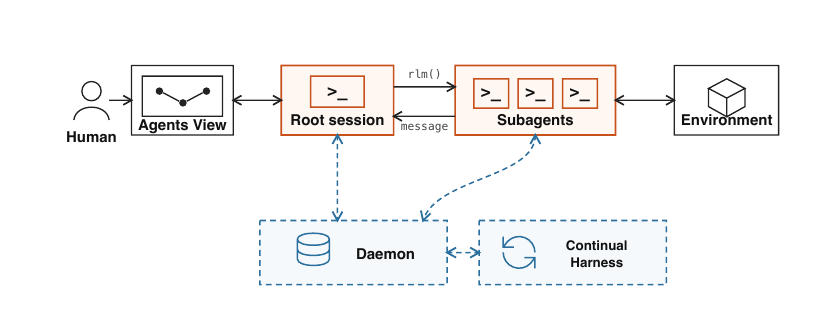

**原文图／官方图片** — 图 1：Prime Agent 将持久根会话、子智能体会话连接到守护进程和持续改进闭环。 · Figure 1, PDF p.3 · [source](https://arxiv.org/html/2608.23552v1)

**nanoRSI 复现状态** — not-run. 来源最近核验：2026-10-15.

**开源代码／权重／数据链接** — [Official code and license](https://github.com/PrimeIntellect-ai/prime-agent)

**一手来源** — [arXiv record](https://arxiv.org/abs/2608.23552) · [Paper first-publication statement and Factorio evidence](https://arxiv.org/html/2608.23552v1) · [Official launch and update mechanism](https://www.primeintellect.ai/blog/prime-agent) · [Official code and license](https://github.com/PrimeIntellect-ai/prime-agent)

### SimpleMem: Efficient Lifelong Memory for LLM Agents

**2026-01-05** · paper · 支撑技术／评测

**日期说明** — arXiv v1 2026-01-05（当前 v3 2026-01-29）；研讨会接收 2026-09-19 经 iclr.cc 核验。

**机构关系** — 学术工作（UNC-Chapel Hill，合著者含伯克利与 UCSC）。

**改变对象与反馈复用** — 终身记忆三段流水线：语义结构化压缩过滤低效用对话、在线语义合成做巩固、检索时按意图规划多视图查询——替代全文上下文或迭代过滤。

**作者报告结果** — GPT-4.1-mini 在 LoCoMo：平均 F1 43.24 vs Mem0 34.20、全文上下文 18.70，每次查询仅 531 token（约为全文/MemGPT 16,910 的 1/30）；LongMemEval-S 83.97% vs Mem0 58.51%；记忆构建 92.6s/样本 vs Mem0 1350.9s。

**证据边界** — 作者自报于长程对话基准；属支撑设施——记忆系统并不改进改进器本身；MIT 代码且社区采用已强（3.8k 星）。

**代码／权重／数据／许可** — MIT 代码位于 github.com/aiming-lab/SimpleMem（核验时 3.8k 星）。

**可用于 nanoRSI 的实验方向——本次未实现** — 先压缩再巩固的两段式是 nanoRSI 技能记忆的 token 预算杠杆：写入时过滤低效用轨迹、周期性巩固、按意图检索。

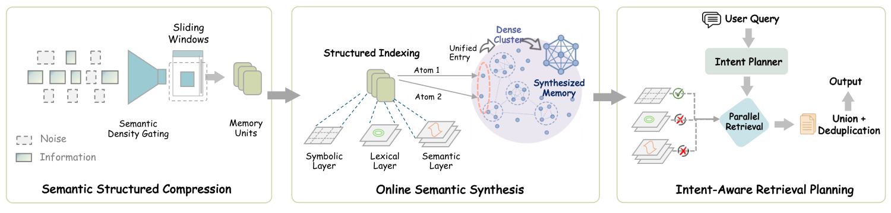

**原文图／官方图片** — SimpleMem 架构：语义结构化压缩、在线语义合成与意图规划的多视图检索。 · Figure 2 (Fig_framework_v2.png) · [source](https://arxiv.org/html/2601.02553v3)

**nanoRSI 复现状态** — not-run. 来源最近核验：2026-09-19.

**开源代码／权重／数据链接** — [Code repository](https://github.com/aiming-lab/SimpleMem)

**一手来源** — [arXiv abstract](https://arxiv.org/abs/2601.02553) · [Paper HTML (affiliations, Table 1, Figure 2)](https://arxiv.org/html/2601.02553v3) · [Code repository](https://github.com/aiming-lab/SimpleMem) · [ICLR virtual page](https://iclr.cc/virtual/2026/10018638)

### Continual Learning, Not Training: Online Adaptation for Agents

**2025-11-02** · paper · 直接有界闭环

**日期说明** — arXiv v1：2025-11-02。SDK 仓库创建于 2025-09-30。系统在论文正文中名为 ATLAS；arXiv 标题不含该前缀。

**机构关系** — 论文：Aman Jaglan 与通讯 Jarrod Barnes 均属 Arc Intelligence；评测用了微软的 ExCyTIn-Bench，但不隶属微软。

**改变对象与反馈复用** — 双智能体免梯度推理期适应：教师（GPT-5）审查学生（GPT-5-mini）的轨迹并给原则级纠正；编排器把轨迹、指引与裁判集奖励分存入持久学习记忆，蒸馏成教师手册（原则、失败模式、停止条件）与学生手册（动作模式、工具计划、防护），按任务上下文检索以调节监督力度与种子计划——全程无权重更新。

**作者报告结果** — ExCyTIn-Bench 事件 #5（n=98）：ATLAS 成功率 54.1% 对 GPT-5（High）的 48.0%（+6.1），成本低约 86%（每题 0.024 对 0.174 美元），token 较学生基线降 45%；冻结手册把新事件从 28% 提到 41%（相对 +46%），非推理 token 降 52.1%。

**证据边界** — 单基准评测（一个事件、n=98）；一条基线的 token 只记录了 47 次中的 42 次；泛化仅在另一个事件上测试；世界模型训练是假设未验证；作者自述静态基准不足、评测黑客风险仍在。

**代码／权重／数据／许可** — 代码在 github.com/Arc-Computer/atlas-sdk（17 星，核验时未检出许可证文件）；论文称以 CC BY 4.0 发布并附轨迹与手册。

**可用于 nanoRSI 的实验方向——本次未实现** — 对 nanoRSI：双层蒸馏指引（给批评者的原则层、给执行者的模式层）加监督力度调节，是单体记忆的轻量替代——且手册可干净冻结做迁移测试。

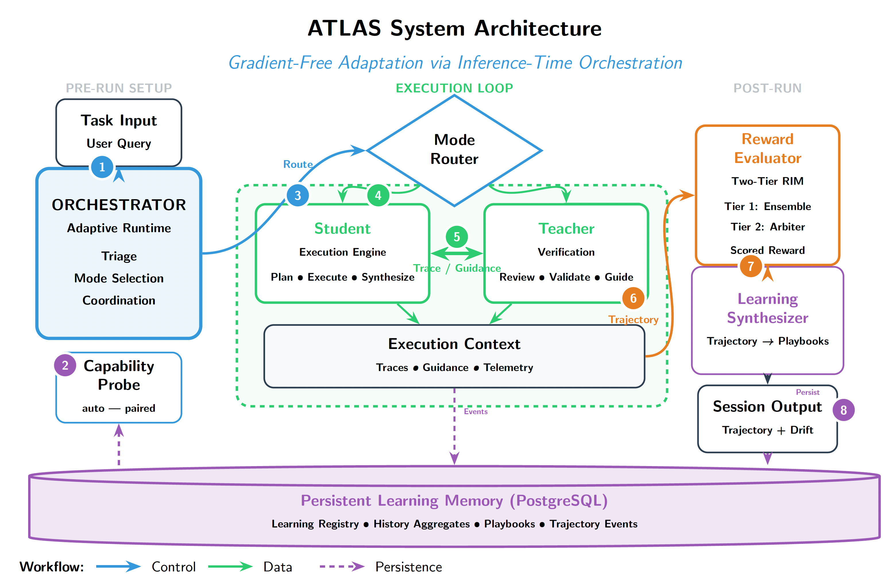

**原文图／官方图片** — 图 1：ATLAS 架构——编排器管理执行中的师生交互；学习存入持久学习记忆并蒸馏为教师/学生手册，指导后续推理期决策。 · Figure 1 · [source](https://arxiv.org/html/2511.01093v1)

**nanoRSI 复现状态** — not-run. 来源最近核验：2026-09-17.

**开源代码／权重／数据链接** — [Code repository](https://github.com/Arc-Computer/atlas-sdk)

**一手来源** — [arXiv abstract](https://arxiv.org/abs/2511.01093) · [Paper v1 (affiliations, Figure 1, results)](https://arxiv.org/html/2511.01093v1) · [Code repository](https://github.com/Arc-Computer/atlas-sdk)

### Training-Free Group Relative Policy Optimization

**2025-10-09** · paper · 直接有界闭环

**日期说明** — arXiv v1 首次提交于 2025-10-09。对应 Youtu-Agent 分支于 2025 年 10 月公布，之后合入主仓库；按论文日期纳入。

**机构关系** — 论文列出腾讯 Youtu Lab、复旦大学和厦门大学；官方实现发布在 TencentCloudADP/youtu-agent。

**改变对象与反馈复用** — 冻结的基础模型生成分组 rollout，将语义优势蒸馏到会演化的经验库和 token 先验中，再通过上下文回馈而非梯度更新。多个 epoch 共享累积经验，参数保持不变但后续输出分布发生变化。

**作者报告结果** — 在 DeepSeek-V3.1-Terminus 上，直接提示的 AIME24 从 68.6 提升到 72.6（+4.0），AIME25 从 52.9 到 54.0（+1.1）；ReAct+CI 的 AIME24 为 80.0→82.7（+2.7），AIME25 为 67.9→73.3（+5.4），论文报告成本为 18 美元。论文设置下 WebWalkerQA 为 63.2→67.8（+4.6）。

**证据边界** — 这是上下文空间的经验进化，不是参数训练：基础模型冻结，变化的是经验库。结果依赖有界分组、重试和任务特定提示；论文未展示改进器自主重设计自身算法。

**代码／权重／数据／许可** — TencentCloudADP/youtu-agent 发布 training_free_GRPO 分支和示例；LICENSE 声明 MIT，但 GitHub API 元数据为 NOASSERTION。论文使用的基础模型和基准数据仍受各自条款约束；不能因发布代码推断发生了参数更新。

**可用于 nanoRSI 的实验方向——本次未实现** — 为 nanoRSI 记忆实验增加冻结模型对照：在相同分组数量下比较无经验库、固定经验库和递归刷新经验，并记录 token 成本、过时建议和隐藏集迁移。

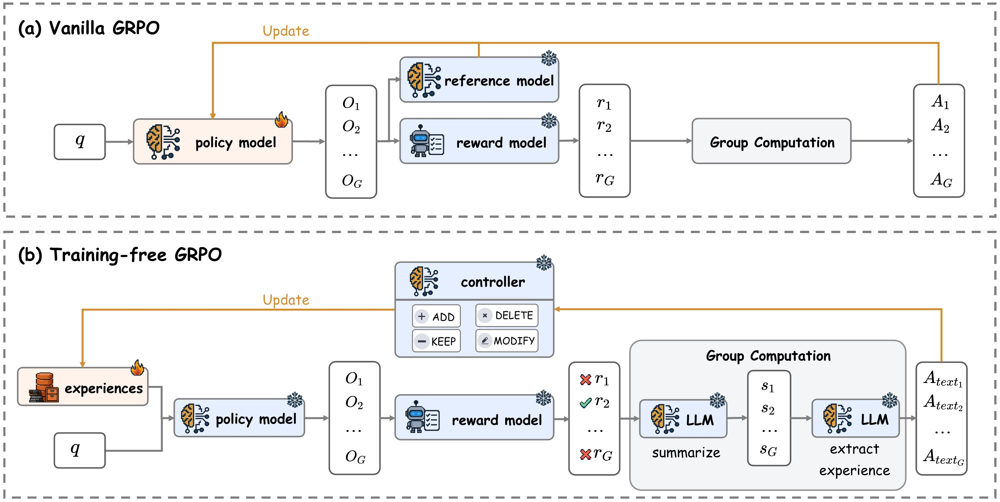

**原文图／官方图片** — 图 2：Training-Free GRPO 在冻结基础模型的同时，用分组 rollout 更新经验库。 · Figure 2, training-free_GRPO.png · [source](https://ar5iv.labs.arxiv.org/html/2510.08191/assets/figures/training-free_GRPO.png)

**nanoRSI 复现状态** — not-run. 来源最近核验：2026-09-13.

**开源代码／权重／数据链接** — [Official Youtu-Agent implementation](https://github.com/TencentCloudADP/youtu-agent/tree/training_free_GRPO) · [Youtu-Agent MIT license](https://github.com/TencentCloudADP/youtu-agent/blob/main/LICENSE)

**一手来源** — [arXiv first submission and history](https://arxiv.org/abs/2510.08191) · [Paper v1 and Training-Free GRPO figure](https://arxiv.org/html/2510.08191v1) · [Official Youtu-Agent implementation](https://github.com/TencentCloudADP/youtu-agent/tree/training_free_GRPO) · [Youtu-Agent MIT license](https://github.com/TencentCloudADP/youtu-agent/blob/main/LICENSE)

### SE-Agent: Self-Evolution Trajectory Optimization in Multi-Step Reasoning with LLM-Based Agents

**2025-08-04** · paper · 直接有界闭环

**日期说明** — arXiv v1：2025-08-04（早于 2025-09-16 窗口起点，记录位于渲染器的档案区）；v6：2025-11-03。abs 页未标注发表场所；第三方列表声称的 NeurIPS 2025 poster 未能在 arXiv 页核验。

**机构关系** — 论文 v6：十四位作者，含 Daxin Jiang（StepFun）与高校合作者；abs 页未渲染隶属，机构字段依跟踪线索（StepFun 牵头 + 高校合作）记录，做强声明前应对照 PDF 复核。

**改变对象与反馈复用** — 轨迹级自进化：智能体经三种操作迭代重访早前解轨迹——修订、重组、精炼——利用逐步搜索（MCTS 式）忽略的跨轨迹启发，把搜索空间扩到局部最优之外，并把改进策略持久化给后续问题。

**作者报告结果** — SWE-bench Verified、五个 LLM：相对改进最高 55%，v6 时开源智能体中最优（摘要口径；逐基线数字不在摘要页）。

**证据边界** — 本次审计中的头条数字为摘要口径（逐基线表未从 HTML 复核）；v1 首发日期早于滚动窗口，本条目作归档背景而非窗口内证据。

**代码／权重／数据／许可** — 代码在 github.com/JARVIS-Xs/SE-Agent。

**可用于 nanoRSI 的实验方向——本次未实现** — 对 nanoRSI：对已存轨迹做修订/重组/精炼是运行档案的廉价二次利用——生成新候选前，先挖掘过往尝试的跨轨迹重组。

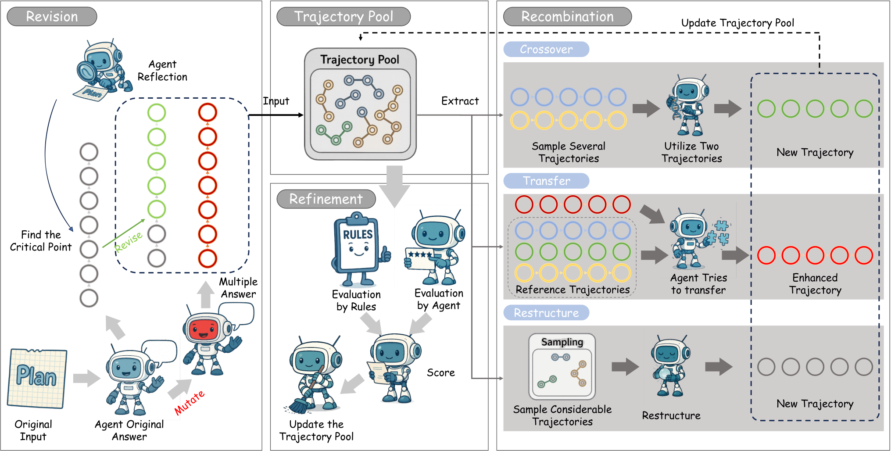

**原文图／官方图片** — 图 1：SE-Agent——经修订、重组与精炼重访多步推理轨迹，改进策略跨问题持久化。 · Figure 1 · [source](https://arxiv.org/html/2508.02085v6)

**nanoRSI 复现状态** — not-run. 来源最近核验：2026-09-17.

**开源代码／权重／数据链接** — [Code repository](https://github.com/JARVIS-Xs/SE-Agent)

**一手来源** — [arXiv abstract](https://arxiv.org/abs/2508.02085) · [Paper v6 (Figure 1, mechanism)](https://arxiv.org/html/2508.02085v6) · [Code repository](https://github.com/JARVIS-Xs/SE-Agent)

## 上下文组织策略 (5)

### RepoAtlas: Guiding Coding Agents via Evolving Multimodal Repository Views

**2026-09-15** · paper · 支撑技术／评测

**日期说明** — v1 2026-09-15；论文机构块为'1 北京航空航天大学 2 独立研究者'（通讯作者 chenyan2022@buaa.edu.cn）。

**机构关系** — 学术工作（北航牵头）；未见企业隶属。

**改变对象与反馈复用** — 免训练的选择-投影-刷新循环在代码图上维护演化的仓库视图：以固定节点预算按议题与探索状态选区、投影为互补的视觉与文本表示、状态变化致视图过期时刷新。

**作者报告结果** — SWE-bench Verified：相对最强多模态图基线解决率 +2.4 分，输入 token 少 5.8%、模型调用少 7.8%，三个模型族一致（Qwen3.6-35B-A3B、MiMo-V2.5、Kimi-K2.5）；匹配 15 节点预算下，选择阶段把 LocBench FA@3 从 0.256 提到 0.336。

**证据边界** — 增益相对图接口基线而非最强整体智能体；演化对象是仓库视图而非智能体本身。

**代码／权重／数据／许可** — arXiv 论文公开；代码在本次核验时未确认。

**可用于 nanoRSI 的实验方向——本次未实现** — 给 nanoRSI 技能配每技能'视图'（漂移即刷新的文件白名单）替代全树上下文；刷新触发器即为上下文版的契约守卫。

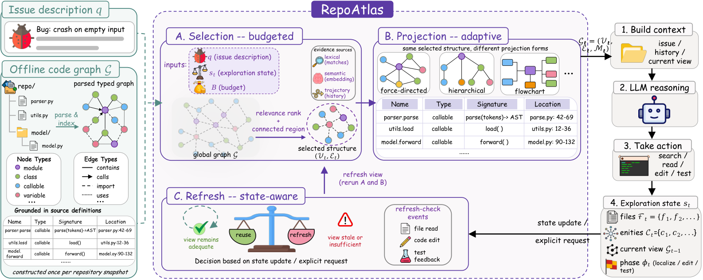

**原文图／官方图片** — RepoAtlas 概览：固定预算下选择连通的、以议题与状态为条件的结构，投影为阶段适配的视图，随探索推进复用或刷新。 · Figure 2 (fig_overview.png) · [source](https://arxiv.org/html/2609.16936v1)

**nanoRSI 复现状态** — not-run. 来源最近核验：2026-09-18.

**开源代码／权重／数据链接** — 核验来源中没有确认的公开代码／资产链接。

**一手来源** — [arXiv abstract](https://arxiv.org/abs/2609.16936) · [Paper HTML (affiliations, Figure 2, selection ablation)](https://arxiv.org/html/2609.16936v1)

### Interactive Memory Learning for Long-Term Conversations

**2026-09-15** · paper · 直接有界闭环

**日期说明** — v1 提交于 2026-09-15，公告日 2026-09-16（OAI datestamp）；核验时仅一版。与同组同日的 ThinkFlow（arXiv:2609.17010）为姊妹篇。

**机构关系** — 学术：哈尔滨工业大学（深圳）与鹏城实验室（通讯作者徐睿峰）。

**改变对象与反馈复用** — 把记忆重新表述为可学习策略而非被动存储。会话合成管线构建专家数据用于快速适配；在线强化学习让 Planner（选择性编码高价值信息）与 Trigger（决定何时检索）共同演化；延迟奖励把未来交互反馈回传到更早的存储决策。

**作者报告结果** — 在 CC/MSC/GC 上，Llama3-Instruct 1B/3B/8B 版 Icml（另有 Gemma3 主干）优于 GPT-4o 长上下文（128K）与六个记忆基线（Mem0、A-Mem、MemoryOS、MemoryBank、LD-Agent、THEANINE）：如 CC BLEU-4 2.37（3B）对 GPT-4o 长上下文 1.79；GC BertScore 40.8 对 36.57；响应质量随交互累积持续提升。消融显示去掉合成数据、Planner、Trigger 或演化各有降分。

**证据边界** — 仅 v1；未找到代码；生成代理指标而非下游任务结果；与 ThinkFlow 为同日姊妹篇，作者重叠。

**代码／权重／数据／许可** — 核验时未找到代码。

**可用于 nanoRSI 的实验方向——本次未实现** — 延迟奖励的归因方式可映射到 nanoRSI 技能保留：按下游 episode 结果而非当次闸门裁决给每个记忆/上下文提案打分。

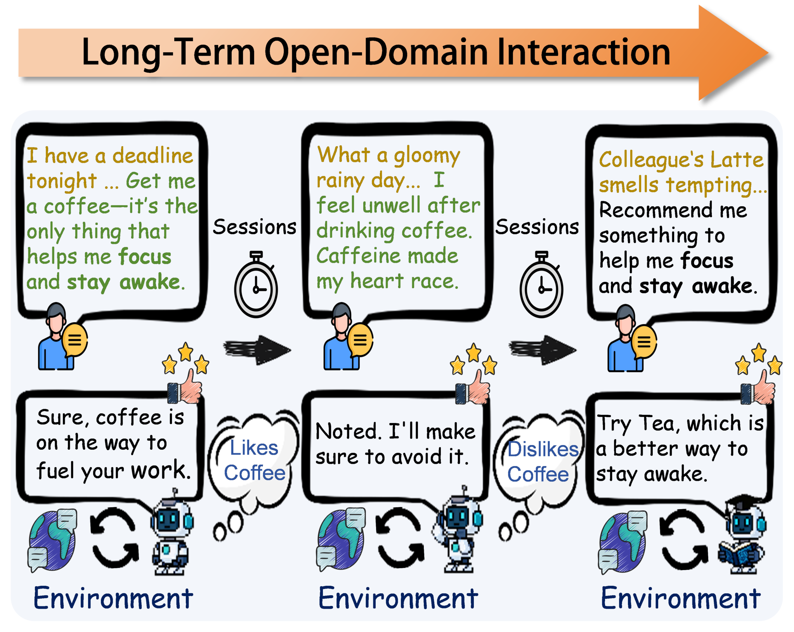

**原文图／官方图片** — Icml 框架：通过长期交互，代理利用环境反馈区分高价值记忆与噪声，实现在线自演化。 · Figure 1 (fig1-7.png) · [source](https://arxiv.org/html/2609.17088v1)

**nanoRSI 复现状态** — not-run. 来源最近核验：2026-09-20.

**开源代码／权重／数据链接** — 核验来源中没有确认的公开代码／资产链接。

**一手来源** — [arXiv abstract](https://arxiv.org/abs/2609.17088) · [arXiv HTML v1](https://arxiv.org/html/2609.17088v1)

### Agentic Context Engineering: Evolving Contexts for Self-Improving Language Models

**2025-10-06** · paper · 直接有界闭环

**日期说明** — arXiv 首版为 2025 年 10 月 6 日；仓库公告标记为 2025 年 11 月，论文修订延续至 2026 年 3 月。

**机构关系** — 论文明确列出斯坦福、SambaNova 和伯克利作者单位，属于联合研究，不能全部归功于 SambaNova。

**改变对象与反馈复用** — 生成器轨迹与执行反馈交给反思器，整理器产出局部策略手册增量；通过有益/有害计数及去重，跨任务保留可复用策略，无需更新权重。

**作者报告结果** — 所有角色均使用非思考模式 DeepSeek-V3.1 时，无标准答案的在线 ACE 在 AppWorld 四项 TGC/SGC 指标上平均为 59.5，ReAct 为 42.4，Dynamic Cheatsheet 为 51.9；差值应表述为百分点，而非相对百分比。

**证据边界** — 在线评测按顺序先预测、再用该测试任务更新。证据支持有界适应，不涉及权重学习，也不证明更新器自身改进。

**代码／权重／数据／许可** — 已确认官方实现及评测代码，Apache-2.0 许可；无新模型权重，第三方数据集仍适用各自条款，未完整审计数据再分发。

**可用于 nanoRSI 的实验方向——本次未实现** — 建议：在固定任务流上比较版本化增量记忆与整文件重写。

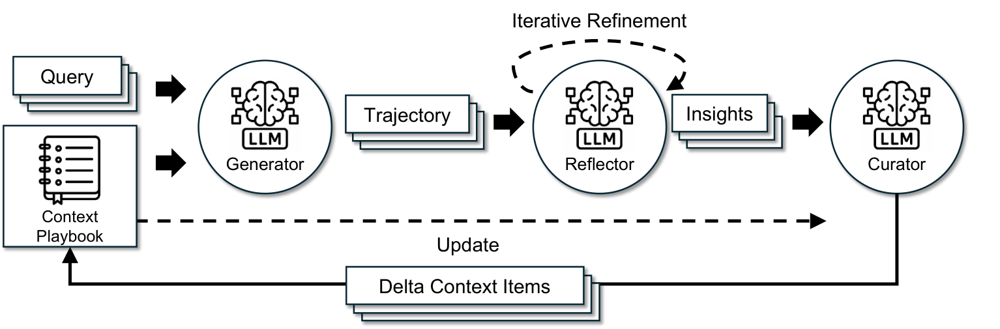

**原文图／官方图片** — 图 4：ACE 由 Generator、Reflector 和 Curator 组成，用于演化上下文 playbook。 · Figure 4 · [source](https://arxiv.org/html/2510.04618v1)

**nanoRSI 复现状态** — not-run. 来源最近核验：2026-09-13.

**开源代码／权重／数据链接** — [Official implementation](https://github.com/ace-agent/ace)

**一手来源** — [arXiv dates](https://arxiv.org/abs/2510.04618) · [Original paper affiliations, protocol and Table 1](https://arxiv.org/html/2510.04618v1) · [Official implementation](https://github.com/ace-agent/ace)

### LEGOMem: Modular Procedural Memory for Multi-agent LLM Systems for Workflow Automation

**2025-10-06** · paper · 支撑技术／评测

**日期说明** — arXiv论文首发为2025-10-06；Microsoft页面列出的AAMAS 2026/2026年1月晚于首发。

**机构关系** — Microsoft Research官方论文页面确认机构归属。

**改变对象与反馈复用** — 成功日志转为完整任务规划记忆和角色专用子任务记忆，后续任务检索复用。实验先离线建库再评价推理，并未测试持续在线记忆演化。

**作者报告结果** — OfficeBench采用148个训练任务、152个测试任务和三个随机种子：GPT-4o成功率58.44%，无记忆为45.83%；GPT-4o-mini为38.16%，无记忆为24.78%。Synapse配GPT-4o达58.11%，因此该设置中相对强基线的优势很小。

**证据边界** — 支持程序性记忆复用，未展示多轮递归自我改进；记忆筛选和外部模型依赖会影响结论。

**代码／权重／数据／许可** — 已确认公开论文；已打开来源及定向搜索未发现专用官方代码、权重、记忆库数据及其许可，相关可用性仍未核实。

**可用于 nanoRSI 的实验方向——本次未实现** — 建议实验：比较经成功筛选的程序记忆与无记忆基线，区分规划和子任务检索，并冻结测试记忆库。

**原文图／官方图片** — 图 1：LEGOMem 的协调器、任务 Agent 和模块化程序记忆。 · Figure 1 · [source](https://arxiv.org/html/2510.04851v1)

**nanoRSI 复现状态** — not-run. 来源最近核验：2026-09-13.

**开源代码／权重／数据链接** — 核验来源中没有确认的公开代码／资产链接。

**一手来源** — [Paper history](https://arxiv.org/abs/2510.04851) · [Paper v1, method and Table 1](https://arxiv.org/html/2510.04851v1) · [Microsoft Research publication](https://www.microsoft.com/en-us/research/publication/legomem-modular-procedural-memory-for-multi-agent-llm-systems-for-workflow-automation/)

### ACON: Optimizing Context Compression for Long-horizon LLM Agents

**2025-10-01** · paper · 直接有界闭环

**日期说明** — 论文首发2025-10-01，后于2025-10-17和2026-06-01修订；指标采用v1。

**机构关系** — 论文明确标注第一作者在Microsoft实习完成工作，以及Microsoft、KAIST和剑桥机构归属。

**改变对象与反馈复用** — LLM比较完整上下文成功、压缩上下文失败的配对轨迹，修改压缩指南并评价候选指南；选择结果用于后续优化轮次，基础智能体权重保持固定。

**作者报告结果** — OfficeBench采用GPT-4.1作为智能体和压缩器：效用优化的历史压缩取得74.74%准确率和4.93k峰值令牌；无压缩为76.84%/7.27k，简单提示压缩为71.58%/4.40k（v1表2）。

**证据边界** — 属于有限的离线模块优化；准确率与令牌开销的取舍不等于普遍提高准确率，也不是优化器重写自身。

**代码／权重／数据／许可** — 已确认官方代码、MIT许可及蒸馏流程；未确认公开蒸馏权重、专用数据集及其许可；外部基准和模型适用各自条款。

**可用于 nanoRSI 的实验方向——本次未实现** — 建议实验：根据配对失败优化压缩提示，保留独立验证集，同时记录成功率和上下文峰值。

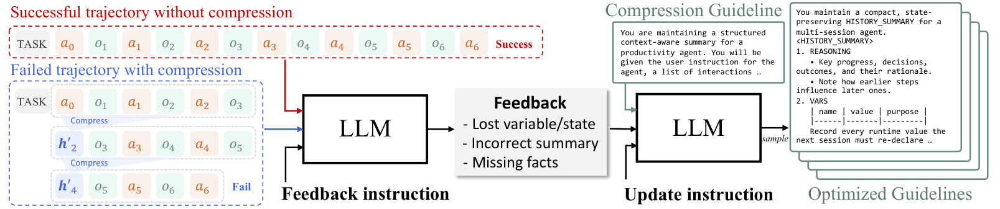

**原文图／官方图片** — 图 3：压缩指导优化使用成功与失败轨迹的对比反馈。 · Figure 3 · [source](https://arxiv.org/html/2510.00615v1)

**nanoRSI 复现状态** — not-run. 来源最近核验：2026-09-13.

**开源代码／权重／数据链接** — [Official Microsoft code](https://github.com/microsoft/acon) · [MIT licence](https://github.com/microsoft/acon/blob/main/LICENSE)

**一手来源** — [Paper history](https://arxiv.org/abs/2510.00615) · [Paper v1](https://arxiv.org/html/2510.00615v1) · [Official Microsoft code](https://github.com/microsoft/acon) · [MIT licence](https://github.com/microsoft/acon/blob/main/LICENSE)

## 探索式记忆构建 (1)

### RSIAgent: Autonomous Exploration for Recursive Self-improvement in New Environments

**2026-09-14** · paper · 直接有界闭环

**日期说明** — arXiv v1：2026-09-14。代码仓库创建于 2026-09-13，比论文挂网早一天。

**机构关系** — 论文 v1 标注 Aether AI（通讯作者 Kun Zhou）与加州大学圣迭戈分校；第一作者 Sibo Zhu 的工作完成于 Aether AI 实习期间，合作者来自 UCSD 与伊利诺伊大学芝加哥分校。

**改变对象与反馈复用** — 面向陌生环境的免训练多智能体自改进：课程、执行、验证三类智能体在无金标条件下探索。广度递归自探索（BRS）并行跑课程组织的任务组，绘制环境结构并存下按组分组的经验记忆——可复用的（动作、条件、后果）因果模式；深度递归自探索（DRS）再在目标任务上迭代，验证器裁决每次尝试，成功记忆回流到后续轮次。逐步精炼的记忆最终冻结供下游复用；全程不改模型参数。

**作者报告结果** — 以 GLM-5.3 为执行、Kimi-K3 为验证/课程：OSWorld 2.0 partial 78.98，高于 GPT-6 Astra 报告的 72.60（+6.38），binary 42.68；Agents' Last Exam partial 84.82 对 GPT-6 Astra 82.26（+2.56），binary 50.75 低于 GPT-6 Astra 的 52.24（该项 GPT-6 领先）。四任务消融：完整 RSI 74.54% 对仅 BRS 65.52%、仅 DRS 56.50%。论文同时报告 Claude Opus 5（OSWorld 70.19/34.72）。

**证据边界** — 作者自述测试时算力开销大；表现取决于探索预算、停止策略与记忆质量；模型验证器可能误判并把错误传导进后续记忆；组件贡献未完全隔离；实验在受控环境进行，不覆盖越权访问与隐私风险。GPT-6 Astra 数字引用自其报告，未复跑。

**代码／权重／数据／许可** — 代码以 Apache-2.0 发布于 github.com/AetherLabsAI/RSIAgent；仓库最新的 2026-09-16 变更是展示／媒体更新，不是新的运行时发布。项目页：aetherlabsai.github.io/RSIAgent。未找到权重或数据发布。

**可用于 nanoRSI 的实验方向——本次未实现** — 对 nanoRSI：把改进预算拆成广度测绘阶段（大量廉价探针任务沉淀因果模式）与目标任务上的深度利用阶段，随后在最终测试前冻结记忆——与 nanoRSI 的冻结纪律天然对齐的两段式调度。

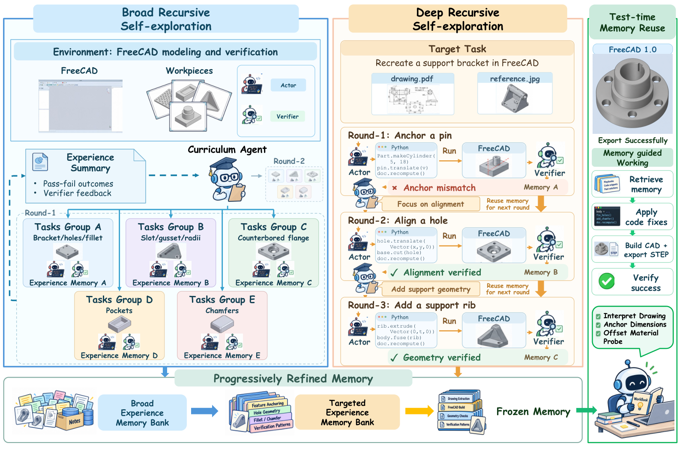

**原文图／官方图片** — 图 2：RSIAgent 方法总览——广度递归自探索按任务组沉淀经验记忆，深度递归自探索在目标任务上借验证器反馈精炼，冻结后的记忆供测试期复用。 · Figure 2 · [source](https://arxiv.org/html/2609.15364v1)

**nanoRSI 复现状态** — not-run. 来源最近核验：2026-09-29.

**开源代码／权重／数据链接** — [Code repository (Apache-2.0)](https://github.com/AetherLabsAI/RSIAgent)

**一手来源** — [arXiv abstract](https://arxiv.org/abs/2609.15364) · [Paper v1 (affiliations, Figure 2, Table 1, limitations)](https://arxiv.org/html/2609.15364v1) · [Code repository (Apache-2.0)](https://github.com/AetherLabsAI/RSIAgent)

## 记忆进化评测研究 (4)

### MemScope: Evolving Agent Memory Architectures through Localized Code Repair

**2026-10-15** · paper · 直接有界闭环

**日期说明** — arXiv v1 于 2026-10-15 提交；首行作者机构含人工智能安全全国重点实验室（中科院计算所）。

**机构关系** — Miao Su、Yucan Guo、Zixuan Li、Long Bai、Zhongni Hou（美团）、Jiafeng Guo——人工智能安全全国重点实验室、中科院计算所、中国科学院大学；机构依 HTML 作者块读出。

**改变对象与反馈复用** — 记忆按 Agent Skills 形态打包（必备 SKILL.md 与 scripts/ 下可执行 provider，激活的 provider 维护自己的运行时记忆库）。会工具使用的 Patch Agent 联合检查原始执行轨迹、运行时记忆状态、当前 provider 代码与补丁历史，定位修复目标，并在 provider 身份不变与记忆兼容约束下施加有界的就地编辑——替换部件而非重写架构；每个补丁及其后续结果被记录用于后续演化。

**作者报告结果** — GAIA 诊断性消融：轨迹+记忆联合检查 86.67%，对纯轨迹 70.00% 与纯摘要 63.33%。匹配的顺序在线评测（MemEvolve 协议）下：xBench 用 DeepSeek V3.2 由 49 提升至 55、Kimi K2.7 Code 由 50 提升至 53；GAIA 83.64%、xBench 78%，对 MemEvolve + Flash-Searcher 的 67.88%/70%（DeepSeek V3.2）；ALFWorld 未见任务 50.75%→71.64%。归档架构快照间迁移的中位代码改动比例 4.4%。

**证据边界** — 演化的记忆技能库由 12 个人工设计的 MemEvolve/EvolveLab 技能初始化，增益是在继承设计之上测得的；局部性由补丁约束强制，而非证明定位区域即真实故障；评测遵循顺序在线协议，xBench/ALFWorld 上代码跨episode持久而记忆每episode重置，属特定可比性制度。

**代码／权重／数据／许可** — 论文未链接自有代码仓库；发现的外链仅为第三方资产（langfun、xbench）（未核验自有代码存在）。

**可用于 nanoRSI 的实验方向——本次未实现** — 证据接地的定位是 nanoRSI 的提案接口纪律：让提案者同时看到执行轨迹、其产出的运行时状态、目标代码与既往补丁结果，要求附带补丁清单（定位故障、预期范围）的有界就地编辑而非整文件重写；4.4% 的中位改动比例是“局部化”应有的已发表参考点。

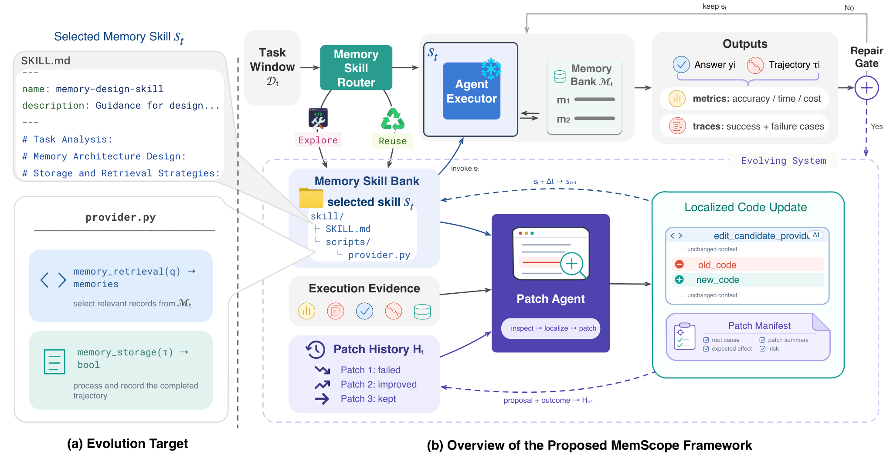

**原文图／官方图片** — 原图 2：(a) Agent Skills 形态的演化目标（SKILL.md + 可执行 provider 及其运行时记忆库）；(b) MemScope 环——Patch Agent 检查轨迹、活性记忆、provider 代码与补丁历史后施加局部就地编辑。 · Figure 2 (method.png), arXiv HTML 2610.21170v1 · [source](https://arxiv.org/html/2610.21170v1/method.png)

**nanoRSI 复现状态** — not-run. 来源最近核验：2026-10-19.

**开源代码／权重／数据链接** — 核验来源中没有确认的公开代码／资产链接。

**一手来源** — [arXiv abs 2610.21170](https://arxiv.org/abs/2610.21170) · [arXiv HTML v1](https://arxiv.org/html/2610.21170v1)

### ThinkFlow: Self-Evolving Probabilistic Latent Memory for Lifelong Conversational Agents

**2026-09-15** · paper · 直接有界闭环

**日期说明** — v1 提交于 2026-09-15，公告日 2026-09-16（OAI datestamp）；核验时仅一版。与同组同日的 Interactive Memory Learning（arXiv:2609.17088）为姊妹篇，提交晚一小时。

**机构关系** — 学术合作：鹏城实验室与哈工大（深圳）（通讯作者徐睿峰），一名作者来自中国联通大湾区创新研究院。

**改变对象与反馈复用** — 以端到端潜在记忆取代显式文本记忆：对话流被压缩为解耦的概率潜在记忆技能（连续向量），绕开文本摘要瓶颈。测试时演化分两阶段：教师引导的潜在对齐引导初始状态（冷启动），之后自监督的下一用户话语预测任务在交互中持续精炼记忆，全程无需标注。

**作者报告结果** — 在 PersonaMem（上下文至 1M token，Qwen3-8B 主干）上，ThinkFlow-8B 平均准确率 41.94，较最强可比记忆方法（MemGen 38.86）+2.36，最强任务 +15.32；论文称在该基准可与闭源及 405B 开源模型匹敌。在 CC/MSC/GC 生成任务上优于显式记忆基线（长上下文、RAG 式与 agentic memory），并对显式管线有 token 与时延节省（图 5）。

**证据边界** — 仅 v1；核验时未找到代码；生成结果为代理指标（BLEU/ROUGE/BertScore/Mauve）；PersonaMem 部分基线数字转录自 Jiang et al. (2025a) 而非重跑；与姊妹篇共享作者组与评测风格。

**代码／权重／数据／许可** — 核验时未找到代码、权重或数据；arXiv 论文为 CC BY 4.0。

**可用于 nanoRSI 的实验方向——本次未实现** — 可移植其免标注演化信号：用记忆技能对下一观测（自监督下一话语预测）的意外度降低来打分，使技能保留闸门不依赖任务标注。

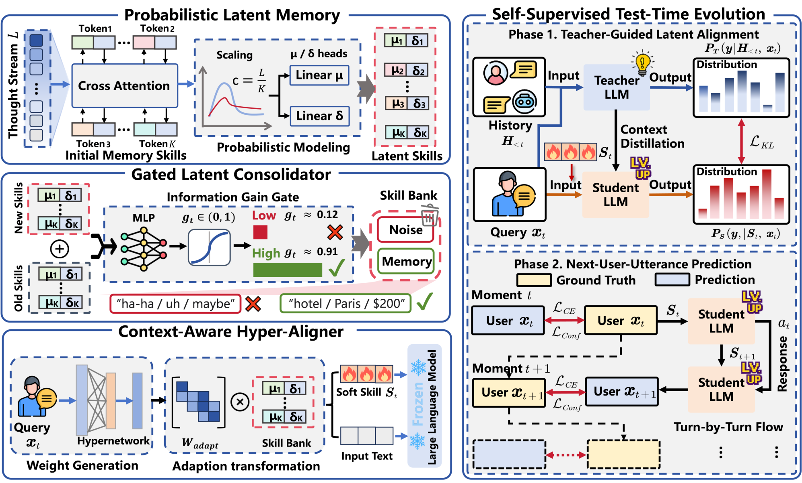

**原文图／官方图片** — ThinkFlow 架构与两阶段训练：概率潜在记忆技能、教师引导潜在对齐，随后自监督下一用户话语预测。 · Figure 2 (method.png) · [source](https://arxiv.org/html/2609.17010v1)

**nanoRSI 复现状态** — not-run. 来源最近核验：2026-09-20.

**开源代码／权重／数据链接** — 核验来源中没有确认的公开代码／资产链接。

**一手来源** — [arXiv abstract](https://arxiv.org/abs/2609.17010) · [arXiv HTML v1](https://arxiv.org/html/2609.17010v1)

### S3Gym: Can LLMs Turn Self-Testing and Self-Judging into Self-Improvement?

**2026-08-31** · paper · 直接有界闭环

**日期说明** — arXiv v1 提交于 2026-08-31，项目公告为 2026-09-01；标题采用 arXiv 可检索的 S3Gym 拼写。

**机构关系** — 论文明列 ByteDance Seed、M-A-P 和 TokenWave.AI。

**改变对象与反馈复用** — 智能体探索游戏并自评决策，在后续回合复用原始历史、按分数整理的记忆摘要或经验训练后的参数。主要探索阶段的可执行验证器奖励留在基准侧，通过更严格且隔离的评测检查继承状态是否改善行为；没有通用的收益准入门。

**作者报告结果** — 七个游戏中，自评质量与下一次严格评测提升的分块相关系数接近零：事件一致性为 −0.010，负校准误差为 −0.018。这些是相关系数而非提升百分比。不同任务适合不同上下文路径，参数训练可能产生负迁移。

**证据边界** — 证据限于特定游戏；识别成功不保证形成有效记忆或可迁移策略。

**代码／权重／数据／许可** — 论文及项目页公开；论文为 CC BY 4.0。未核验到独立基准代码、数据、训练检查点及对应资产许可的发布。

**可用于 nanoRSI 的实验方向——本次未实现** — 拟议 nanoRSI skills 消融：比较原始历史、摘要记忆与冻结状态，构建记忆时隐藏验证器分数。

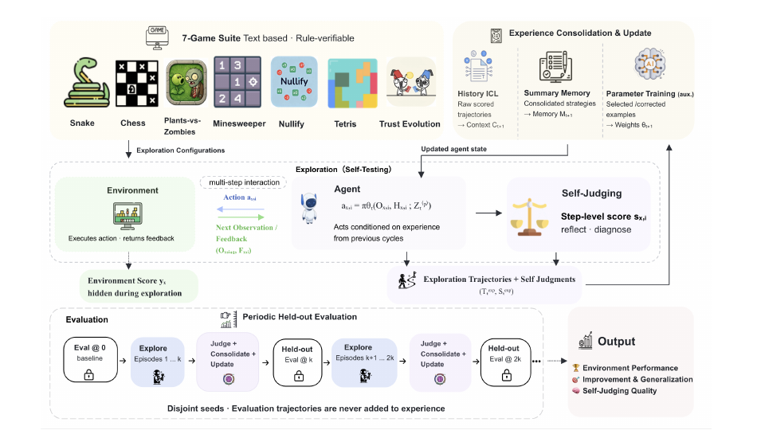

**原文图／官方图片** — 图 2：S3Gym 通过历史 ICL、摘要记忆和参数训练展示经验驱动的改进路径。 · Figure 2, PDF p.7 · [source](https://arxiv.org/html/2608.31100v1)

**nanoRSI 复现状态** — not-run. 来源最近核验：2026-09-13.

**开源代码／权重／数据链接** — 核验来源中没有确认的公开代码／资产链接。

**一手来源** — [arXiv first submission](https://arxiv.org/abs/2608.31100) · [Paper v1 methods and Table 6](https://arxiv.org/html/2608.31100v1) · [Official Self-Developing Agents project](https://self-developing-agents.github.io/)

### Evo-Memory: Benchmarking LLM Agent Test-time Learning with Self-Evolving Memory

**2025-11-25** · paper · 支撑技术／评测

**日期说明** — arXiv v1：2025-11-25；v2：2026-05-18（数字引自 v2）。

**机构关系** — 论文 v2：UIUC（Tianxin Wei 等、Jingrui He）与 Google DeepMind（Noveen Sachdeva、Benjamin Coleman、Ed H. Chi、Fernando Pereira 等）；一作工作完成于 Google DeepMind。

**改变对象与反馈复用** — 流式基准而非机制：静态数据集重组为顺序任务流，每步走'检索-综合-进化'（从记忆检索、作答、以正确性信号更新记忆）。十个数据集覆盖单轮（MMLU-Pro、GPQA、AIME 24/25、ToolBench）与多轮（AlfWorld、BabyAI、ScienceWorld、PDDL）；对比 10+ 记忆模块（Mem0、A-MEM、MemOS、AWM、Dynamic Cheatsheet 等）并新增 ExpRAG 与 ReMem（动作-思考-记忆精炼）基线。

**作者报告结果** — 自进化记忆稳定有效，多轮场景增益最大（Claude 3.7 Sonnet：ReMem 平均成功率 0.78 对 History 0.49）；增益与数据集内任务相似度相关（Pearson r=0.717/0.563）；难->易迁移优于易->难（均值 0.94/0.97）；存失败经验让多个基线退化而 ReMem 稳健；简单 ExpRAG'胜过若干更复杂设计'；AlfWorld 步数从 22.6 降到 11.5。

**证据边界** — 代码'接收后发布'（核验时未找到）；反馈信号仅正确性；基准测的是给定更新规则下的记忆，而非记忆与策略联合进化。

**代码／权重／数据／许可** — 核验时无代码 URL（'接收后以宽松开源许可发布'）。论文 CC BY 4.0。

**可用于 nanoRSI 的实验方向——本次未实现** — 对 nanoRSI：难->易优于易->难是实验设计规则——记忆流先难后易排课；'简单胜复杂'（ExpRAG）是加记忆机制前的反复警告。

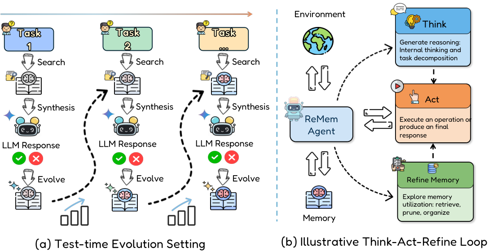

**原文图／官方图片** — 图 2：Evo-Memory 流上的 ReMem 智能体——测试期进化，跨顺序任务迭代地检索、综合并进化记忆。 · Figure 2 · [source](https://arxiv.org/html/2511.20857v2)

**nanoRSI 复现状态** — not-run. 来源最近核验：2026-09-17.

**开源代码／权重／数据链接** — 核验来源中没有确认的公开代码／资产链接。

**一手来源** — [arXiv abstract](https://arxiv.org/abs/2511.20857) · [Paper v2 (affiliations, Figure 2, results)](https://arxiv.org/html/2511.20857v2)
