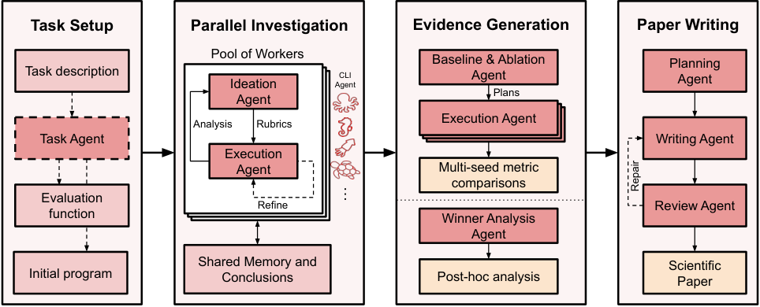

# The Agentic Scientist: Orchestrating Coding Agents for Automated Scientific (Co-)Discovery

> Sakana AI · 2026-10-13 · paper · **闭环** · [论文](https://arxiv.org/abs/2610.18933) · [仓库](https://github.com/SakanaAI/AI-Scientist-v3)
> 机制族：AI 科学家系统 · 来源核验 2026-10-17 · 复现状态 not-run

## Pipeline

供人类研究者与现代编码智能体并肩做计算的端到端分布式流水线。研究被分解为任务起草、想法生成、规划、沙箱实验、结果汇总、基线与消融构建、事后分析、有据论文写作（证据暂存与规划、稿件生成、验证与评审），外加生成概念图的 autoillustrate。每一阶段由新一代编码智能体驱动并带智能体自验证；元控制器管理并行研究智能体并在每阶段强制执行 rubric 校验；搜索是 CLI 智能体上的束搜索，并显式提供人类共科学家选项。出发点：全自主研究智能体的想法半径有限且易陷入短视爬山。

*图源：Figure 1 (conceptual.png), arXiv HTML 2610.18933v1*
## 结果（作者报告，非本地复现）

谱系表（表 1）：AI Scientist-v1（主题特定、线性 Aider）→ v2（领域通用、树搜索 AIDE、并行实验）→ Agentic Scientist（领域通用、CLI 智能体束搜索、并行 + rubric 校验 + 共科学家选项），评价级别从 workshop 提升到会议。系统开发版自动化了 Error Diffusion（Fujita 2026；Kaneko 2000）研究的部分流程，用系统构建的一篇论文被 ALIFE 2026 接收。作为论文质量代理的 AI 评审经 ICLR 接收决定验证（含训练数据截止后的 2025 队列）；作者明确评审分只是“评审感知质量”的代理、非正确性真值。

## 证据边界

设计上就是人在环的共发现，不是闭环自主 RSI；评审分明确是代理指标；88 页系统报告的任务级对比未由本次核验重推。HTML 中未找到系统本身的专属仓库（只链接了前代 SakanaAI/AI-Scientist-v3 仓库）。

## 对 nanoRSI 的输入

元控制器在每阶段强制 rubric 校验，是证据账本阶段闸门的外部模板；“想法半径有限/短视爬山”的诊断与我们的种群多样性关切（ADOPTION 38/45）吻合；autoillustrate 把智能体自验证延伸到插图生成，是报告质量审计的廉价附加项。

## 来源

[arXiv abs 2610.18933](https://arxiv.org/abs/2610.18933) · [Predecessor: AI-Scientist-v3 code](https://github.com/SakanaAI/AI-Scientist-v3)
