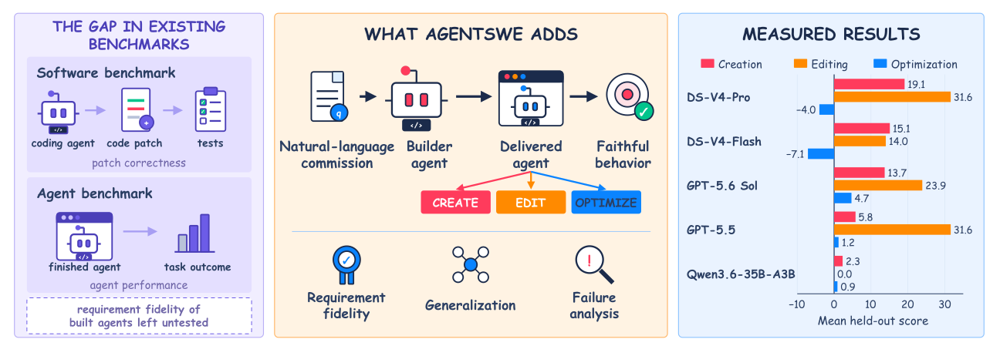

# AgentSWE: Can Coding Agents Build the Agent You Actually Want?

> Beijing Academy of Artificial Intelligence / Institute of Automation, Chinese Academy of Sciences / Renmin University of China · 2026-10-09 · paper · **支撑·无闭环** · [论文](https://arxiv.org/abs/2610.13361) · [仓库](https://github.com/VectorSpaceLab/AgentSWE)
> 机制族：分析与审计 · 来源核验 2026-10-14 · 复现状态 not-run

## Pipeline

面向「造 agent 的 agent」的委托式基准：25 个任务覆盖三个生命周期阶段——从自然语言需求从零创建完整 agent（10）、编辑 Aider/OpenHands/Codex 等生产级 agent 代码库（10）、朝 BrowseComp 与 OSWorld 等可测目标优化（5）。构建者只能对照示例开发用例迭代；冻结交付物在覆盖完整需求的留出用例上评分，使用从需求导出的评分细则与通过/失败闸，交付选择发生在构建期、先于留出用例运行。

*图源：Figure 1 (fig1-agentswe-overview.svg): AgentSWE at a glance - patch-grading vs commission-based delivery evaluation*
## 结果（作者报告，非本地复现）

跨模型与 harness，没有一个接近交付需求：50 次 Creation 运行平均 11.2/100，其中 20 次得零分；「演示水平-交付水平」差距是常态而非例外。反复出现的失败模式：对可见开发用例过拟合、看似完整的代码背后是空壳运行时、无依据的完成声明（代码质量对留出 Result 分预测力很低）。

## 证据边界

25 个任务采用评分细则打分；Editing 与 Optimization 阶段只覆盖固定的生产代码库与目标集合；留出评估成本高（每个冻结交付物都要实际运行）。

## 对 nanoRSI 的输入

「演示水平-交付水平」差距是 nanoRSI 冻结面板纪律的外部印证：构建者看得到开发用例，冻结交付物面对留出评分——与 nanorsi baseline/freeze/final-test 同构。其「代码质量几乎预测不了留出 Result 分」的发现支持证据账本报告行为级证据（而非 diff 美观度）；其无依据完成声明的失败模式正是 verify 命令要抓的东西。

## 来源

[arXiv abstract](https://arxiv.org/abs/2610.13361) · [arXiv HTML v1](https://arxiv.org/html/2610.13361v1) · [GitHub repository (Apache-2.0)](https://github.com/VectorSpaceLab/AgentSWE)
