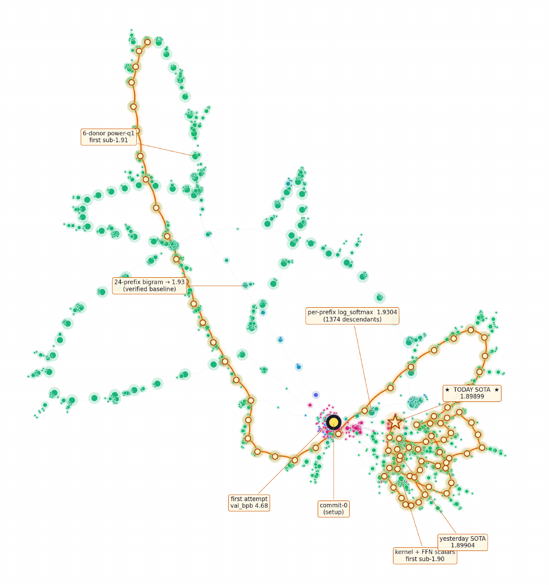

# Agora: Git as Shared Memory for Collective AutoResearch

> NVIDIA · 2026-09-16 · paper · **闭环** · [论文](https://arxiv.org/abs/2609.18094)
> 机制族：AI 科学家系统 · 来源核验 2026-09-18 · 复现状态 not-run

## Pipeline

自主研究会话把主张、结果与验证记录为只追加的 Git DAG；带多样性感知选择的前沿索引让后续会话在先前工作之上推进而非重启，独立复现是一等贡献类型。

*图源：Research-DAG topology figure*
## 结果（作者报告，非本地复现）

12 天运行、13 个未指派 LM 工作者针对一个冻结的 1.196 亿参数 attention-SSM 混合体做权重迁移：1,703 项贡献，评测器 3.39 → 1.899 bits/byte，闭合与训练版 GPT-2 124M 差距的 62%，165 次独立复现全部通过。

## 证据边界

单一任务族上的一次集体运行；验证者即评测器指标本身；由基础设施构建方自报。

## 对 nanoRSI 的输入

把 nanoRSI 的提案谱系建为同样的 DAG——每个候选存主张+证据、选择偏向前沿+多样性、独立重滚动作为复现节点入库。

## 来源

[arXiv abstract](https://arxiv.org/abs/2609.18094) · [Paper HTML (affiliations, figures)](https://arxiv.org/html/2609.18094v1)
