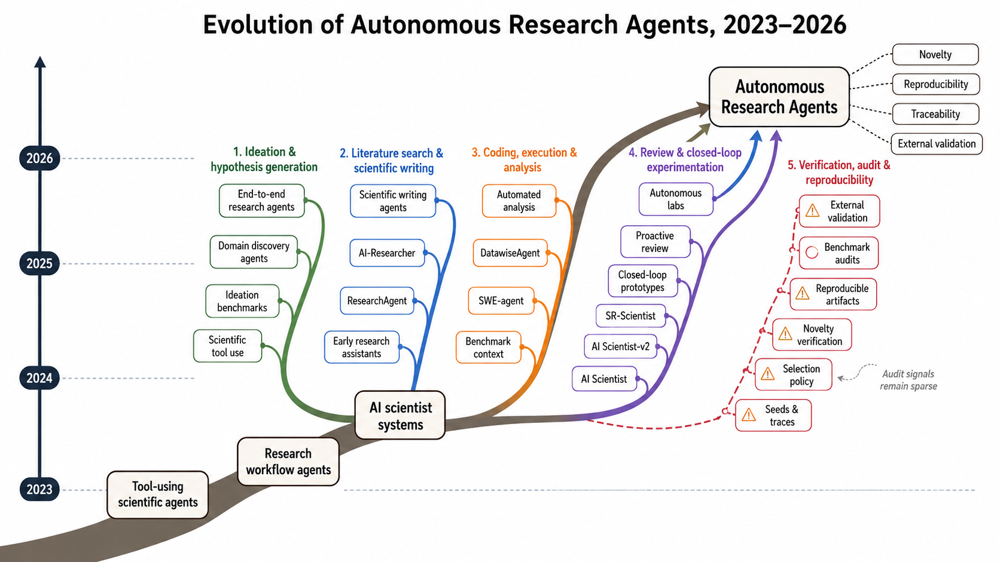

# Autonomous Research Agents: A Survey of AI Scientists and the Verification Gap

> Johns Hopkins University (per author page; affiliations not stated in the audited HTML) · 2026-06-29 · paper · **支撑·无闭环** · [论文](https://arxiv.org/abs/2608.05179)
> 机制族：分析与审计 · 来源核验 2026-09-16 · 复现状态 not-run

## Pipeline

审计而非系统：从 arXiv/Semantic Scholar/OpenReview 取 144 条记录（2023-2026.6），去重得 125、筛入 35，对 24 个可运行的 AI 科学家系统按七维全文编码：生命周期阶段、自主层级、评测方法、发布工件、人环介入点、新颖性验证方法、结果选择披露。第二编码者对工件一致性 90%，但对自主性/新颖性/选择仅 50-65%。

*图源：Figure 1*
## 结果（作者报告，非本地复现）

24 个可运行系统中：83% 发布代码、71% 发布提示，但仅 38% 发布种子/执行轨迹、38% 报告任何新颖性验证方法、67% 披露结果选择策略；88% 保留人环介入点。九个 L4 闭环系统中：七个闭环仅是机械的、一个作者自称但无外部核验、一个经外部验证——而那个（CAMEO）早于 LLM 智能体：零个 LLM 时代闭环系统拥有经外部验证的环内 oracle。

## 证据边界

全文编码为单人，判断密集维度上第二编码者一致性中等；审计无法实际运行这些系统；表 10 的报告清单是建议而非标准。

## 对 nanoRSI 的输入

对 nanoRSI：该清单与证据账本直接对应——种子/轨迹、选择披露与新颖性验证正是审计发现 62% 缺失的字段；发布它们本身就是差异化优势。

## 来源

[arXiv abstract](https://arxiv.org/abs/2608.05179) · [Paper v1 (methodology, Figure 1, audit statistics)](https://arxiv.org/html/2608.05179v1)
