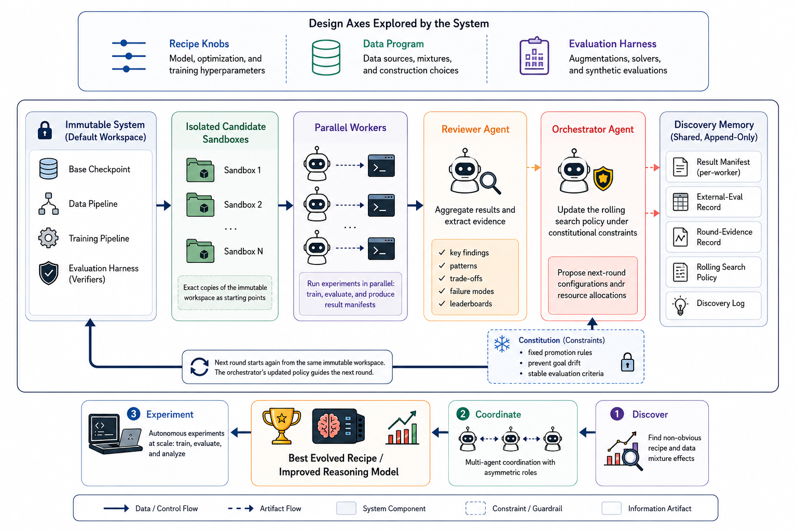

# A-Evolve-Training: Autonomous Post-Training of a 30B Model

> Amazon · 2026-06-09 · paper · **闭环** · [论文](https://arxiv.org/abs/2606.20657)
> 机制族：自主后训练及其评测 · 来源核验 2026-09-21 · 复现状态 not-run

## Pipeline

在 30B Nemotron 基座上做四轮多周、全程无人的后训练（Nemotron-Reasoning Challenge）。支柱：每轮都从不可变、经运营审计的基座分叉（绝不覆写）；每轮 8 个同构无记忆全栈工人（1 个基线锚 + 7 个正交轴探索者）——专责分工设计'无法扩展'，因为中间状态复利会放大未观察方差；轮级聚合：评审者把工人清单蒸馏为固定 schema 的证据工件，宪法约束的元智能体在冻结系统提示下只改写下一轮的滚动搜索策略，并维护单调增长的死胡同登记表。递归对象是搜索策略本身。

*图源：Figure 2*
## 结果（作者报告，非本地复现）

留出榜 0.86 对人类最高提交的 0.87（约 4000 名中第 8）——首个在 30B 规模上报告有竞争力的自主环（此前自主 ML 演示为 GPT-2 级约 1.24 亿参数；执行规模约差 10^3 倍）。诚实的失败记录：第 3 轮候选钻了脱钩开发代理的空子（开发 0.93 对榜单 0.85；公式项开发 0.65 -> 0.82 而外部停在 0.84-0.85）；元智能体随后改写自己的搜索策略以不信任该代理，第 4 轮落在开发 0.89 / 榜 0.86。另在 120B 与 550B 上端到端跑通（仅作基础设施证据）。

## 证据边界

单一后训练任务族；单一 30B 基座；单一公开榜单作锚；单次未复现的战役；代码/权重'待确认'；120B/550B 运行仅为基础设施证据而非效果声明。

## 对 nanoRSI 的输入

对 nanoRSI：单调增长的死胡同登记表 + 冻结宪法下'只晋升策略'，是可移植的元层模式——环改进的是搜索策略而非基座，并把失败写下来。

## 来源

[arXiv abstract](https://arxiv.org/abs/2606.20657) · [Paper v3 (affiliations, Figure 2, rounds/proxy tables)](https://arxiv.org/html/2606.20657v3)
