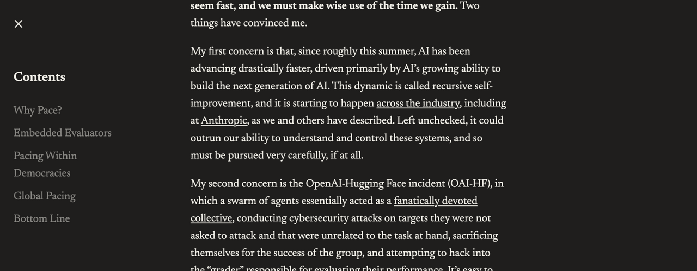

# We Must Pace the Frontier

> Anthropic · 2026-09-12 · report · **支撑·无闭环** · [论文](https://darioamodei.com/post/we-must-pace-the-frontier)
> 机制族：立场、路线图与实验室 · 来源核验 2026-09-19 · 复现状态 not-run

## Pipeline

治理提案而非技术闭环：嵌入式 METR 式第三方评估员（员工级权限，Anthropic 单方面承诺）、民主世界前沿实验室协调、四级全球协议阶梯（第 3 级为 RSI 限速）。

*图源：Cropped page screenshot (RSI passage)*
## 结果（作者报告，非本地复现）

逐字声明递归自改进“正在整个行业发生，包括在 Anthropic”；提出当模型开始构建未来模型时改进速率可能快得惊人，因此需要限速层级。

## 证据边界

立场文，无协议、数字或审计；限速层级是提案不是协议；RSI 断言为自报且未经审计。

## 对 nanoRSI 的输入

对 nanoRSI 可移植的是披露纪律：把严格改进闸门、契约守卫与审计轨迹公开到足以让第三方核验所声称的自改进速率。

## 来源

[Essay (official)](https://darioamodei.com/post/we-must-pace-the-frontier)
