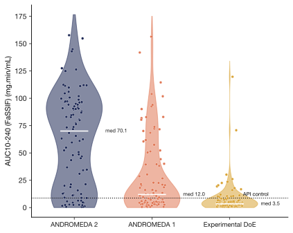

# Evidence-Grounded Agentic Formulation Development in an Autonomous Laboratory

> Intrepid Labs (Toronto) · 2026-09-16 · paper · **支撑·无闭环** · [论文](https://arxiv.org/abs/2609.19099)
> 机制族：AI 科学家系统 · 来源核验 2026-09-18 · 复现状态 not-run

## Pipeline

闭环自主实验室智能体设计与执行连续的药物制剂数批，每次迭代都锚定在结构化积累的内部实验证据库上，而非从零开始优化。

*图源：Figure 1 (fig0_first_page_takeaway.svg)*
## 结果（作者报告，非本地复现）

匹配实验预算下，高性能命中率 50%，对照 Andromeda 1 为 17%、DoE 为 2%；满足全部目标产品概况的制剂数 12 对 6 对 0；消融中去掉证据访问平均 AUC 降 34%。

## 证据边界

单一制剂 campaign（紫杉醇增溶）；物理实验室时间尺度；平台构建方自报。

## 对 nanoRSI 的输入

结构化证据库是 nanoRSI 证据账本的非 LLM 类比：每次新运行都对照累积证据表选择，而不只看上一代面板。

## 来源

[arXiv abstract](https://arxiv.org/abs/2609.19099) · [Paper HTML (affiliation, Figure 1)](https://arxiv.org/html/2609.19099v1)
