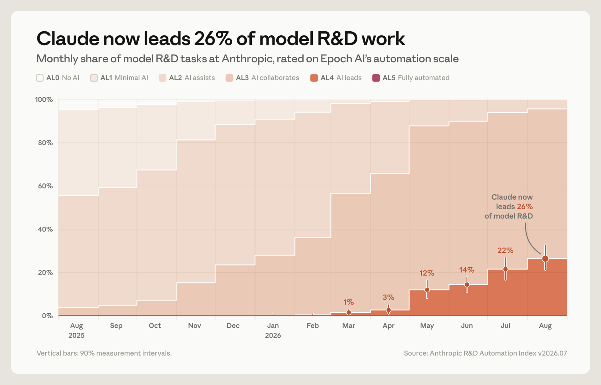

# Measurements for understanding the pace of AI development inside frontier labs

> Anthropic · 2026-09-17 · report · **人在环上** · [论文](https://www.anthropic.com/institute/measuring-pace-of-ai-development)
> 机制族：公司研发遥测 · 来源核验 2026-09-20 · 复现状态 not-run

## Pipeline

一套 RSI 节奏度量原型：R&D 自动化指数盘点全部研发任务类型，按 Epoch AI 的 AL0–AL5 分级并按人力时间加权；对内部代理平台的监督指标；以及安全占用 AI 研发算力份额的算力指标。每节都呼吁任何 AI 开发者以公开方法学与第三方核验发布同类度量。

*图源：Article chart: Claude now leads 26% of model R&D tasks (www-cdn.anthropic.com image)*
## 结果（作者报告，非本地复现）

R&D 自动化指数（2026 年 8 月）：Claude 以领导级（AL4+）承担 Anthropic 26% 的 AI 研发工作，自 2026 年 2 月的不足 1% 上升；达到 AI 协作级以上的工作超过 90%；无任何子集完全自主。监督：最常用内部平台约 30,000 个并发研发/工程代理；8 月分析了超过 10 亿次代理决策，在线监督器拦截 0.002%（约 1/47,000），覆盖率 100%，被拦动作一周内有人复核；离线监督器每周标记约 100,000 份转写、约 50 份升级人工。算力：约 6% 的 AI 研发算力与约 12% 的 AI 驱动 AI 研发算力用于安全（保守取一周）。RSI 被定义为完全自主构建后继者的模型。

## 证据边界

单公司自报遥测，方法学内部掌握；指数为原型；算力快照仅取刻意保守的一周；尚无跨实验室可比性（文章自述其障碍）；数字未经独立核验。

## 对 nanoRSI 的输入

可借鉴的是披露模式而非数字：随任何 nanoRSI 结果发布自身管线的自动化等级构成、监督拦截率、以及用于抓捷径的评测预算占比——即该文要求前沿实验室公布的三类遥测。

## 来源

[Anthropic Institute article](https://www.anthropic.com/institute/measuring-pace-of-ai-development) · [Hacker News submission (date anchor)](https://hn.algolia.com/api/v1/search?query=Measurements%20for%20understanding%20the%20pace%20of%20AI%20development&tags=story)
