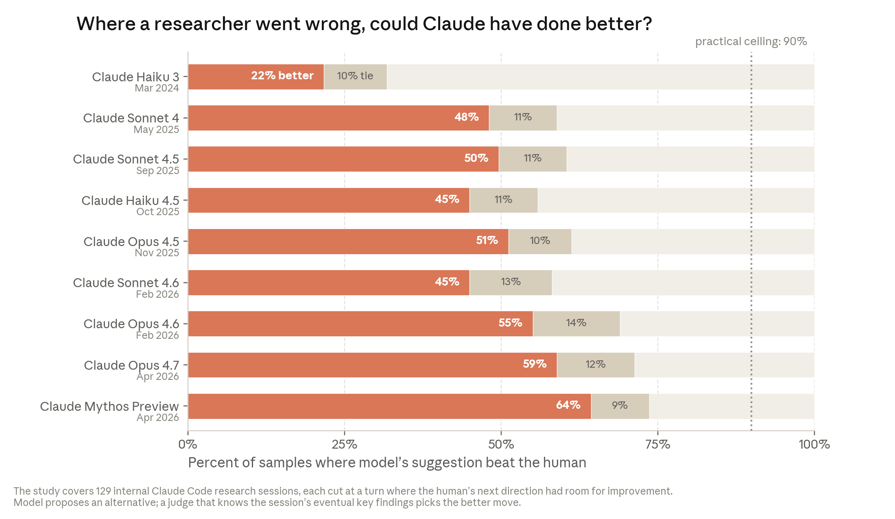

# When AI builds itself

> Anthropic / The Anthropic Institute · 2026-06 · report · **人在环上** · [论文](https://www.anthropic.com/institute/recursive-self-improvement)
> 机制族：公司研发遥测 · 来源核验 2026-09-22 · 复现状态 not-run

## Pipeline

该文把公开基准与 Anthropic 内部遥测合成为一篇论述：Claude 正在自动化 Anthropic 自身的编码与研究；文中给出三种未来（能力平台期、人类主导的复利式自动化、完全递归自改进），按现有证据判断复利式自动化最可能，并主张建设可验证的减速机制。

*图源：In-essay chart 'Can the model pick a better next step than the human?'*
## 结果（作者报告，非本地复现）

作者自报内部数据：Anthropic 合入代码中超过 80% 由 Claude 编写（2026-05）；工程师日均交付代码量约为 2024 年的 8×；代码优化加速任务从约 3×（Claude Opus 4，2025-05）升至约 52×（Mythos Preview，2026-04），人类 4-8 小时约 4×；智能体在 800 算力小时（约 1.8 万美元）内恢复弱到强监督差距的 97%，两名人类一周仅恢复约 23%；最难开放式任务成功率 76%（2026-05，六个月提高 50 个百分点）；下一步判断在 2026-04 以 64% 胜过人类选择（2025-11 为 51%）。

## 证据边界

自报立场文章、无外部审计；作者自附保留（代码行数高估真实增益、约 4× 产出民意估计预计偏高）；时域/加速数字混合了不同任务族。

## 对 nanoRSI 的输入

把'下一步判断对决人类'作为 nanoRSI 面板上与能力分数并列的'研究品味'读数——在决策点上配对施测成本很低。

## 来源

[Anthropic Institute essay](https://www.anthropic.com/institute/recursive-self-improvement)
