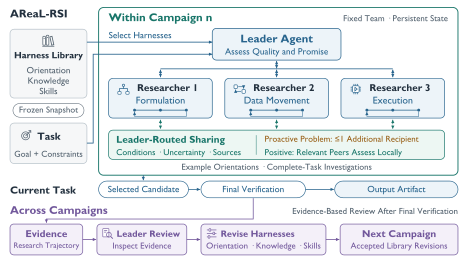

# AReaL-RSI: Adaptive Scaling and Coordination of Recursive Self-Improvement

> Ant Group / Zhejiang University / HKUST · 2026-10-13 · paper · **闭环** · [论文](https://arxiv.org/abs/2610.18083)
> 机制族：AI 科学家系统 · 来源核验 2026-10-16 · 复现状态 not-run

## Pipeline

在不触碰骨干权重、工具权限与编排的前提下，围绕任务条件化的 harness 库 h = (p, K, S)——研究方向、可复用知识、可重复技能——组织一个持久的研究团队。领导者代理分配 harness、区分工件质量与研究潜力并路由记忆。条件化记忆共享给每条经验记录附带观测结果、解释、已测条件、剩余不确定性与 κ 标签（problem / positive）：未解决问题最多路由给一名额外研究者，正向发现可广泛共享，改标签需要新的支撑引用；接收方先本地测试再采纳。每个战役结束后，领导者运行独立的循证评审会话，从可检索记录提出 harness 修订而不做新实验；被接受且版本一致的修订替换库条目供后续战役使用。

*图源：Figure 1 (S1.F1), arXiv HTML v1*
## 结果（作者报告，非本地复现）

在报告的资源分配下对比 Codex-Goal：Terminal Bench 2.1 每骨干 +2.2 个百分点（Luna 75.3→77.5%、Astra 85.4→87.6%）；KernelBench 平均加速 +32.2–36.8%（Luna 1.74×→2.30×、Astra 6.28×→8.59×）。扩展研究（表 2，4 个 KernelBench 任务 × 2 骨干）：经验共享加专职研究者角色比独立探索低 1.9–27.5% 内核延迟、比仅共享低 1.3–33.9%，覆盖全部七个可比任务-骨干对（Astra L3P10：独立/共享/共享+角色 = 8.815 / 7.379 / 6.395 ms）。

## 证据边界

作者声明结果未建立等算力效率，比较为描述性、无重复运行不确定度。仅共享在 Luna L1P63（11.944→15.633 ms，+30.9%）与 L2P71（+13.4%）上退化；Luna L3P10 在全部配置下失败；Astra 越狱任务增益极小（+0.119）。机制效应未分离、多样性未测量。防泄漏指令（可复用资产不得含任务答案或隐藏测试信息）是语义性要求而非形式化保证。

## 对 nanoRSI 的输入

战役级评审是可直接移植的结构：在 nanoRSI 世代之间设检查点评审会话，从证据账本改写方向/知识/技能条目而不消耗 episode，以版本一致性为闸门。条件化共享（problem/positive 标签、最多一名路由接收者、采纳前本地重测、改标签需新证据）是种群候选间路由经验、避免广播式堆积的具体策略。

## 来源

[arXiv abstract](https://arxiv.org/abs/2610.18083) · [arXiv HTML v1](https://arxiv.org/html/2610.18083v1)
