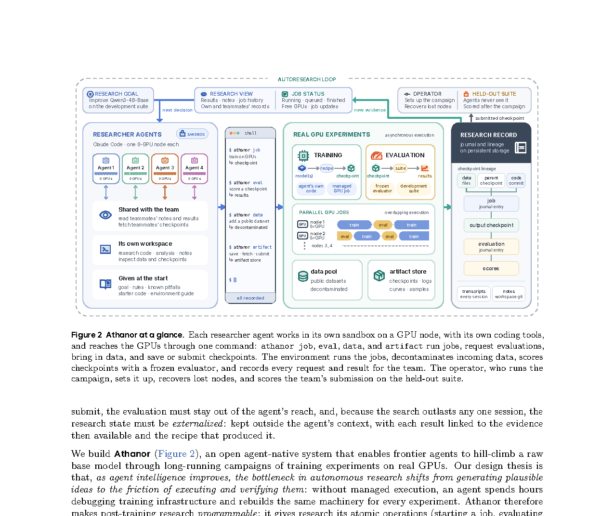

# Athanor: An Agent-Native System for Autonomous Post-Training Research

> ByteDance / Duke University / The University of Chicago / Virginia Tech · 2026-10-15 · paper · **闭环** · [论文](https://arxiv.org/abs/2610.21055)
> 机制族：自主后训练及其评测 · 来源核验 2026-10-17 · 复现状态 not-run

## Pipeline

在真实 GPU 上做自主后训练研究（AutoPostTrain）的开放智能体原生系统。智能体获得完全研究自主权、低摩擦工程工具与高效起始代码：在沙箱内读数据集与评测结果、构建训练数据、编写并修改训练算法、调超参、分析结果决定下一步，且不能使用外部教师模型。Athanor 服务侧提供冻结评测、托管作业、去污染数据、持久研究记录，以及智能体不知情的留出测试套件。

*图源：Figure 2 "Athanor at a glance", PDF page 3 (150 dpi render, cropped; no HTML full text available)*
## 结果（作者报告，非本地复现）

在 104 小时的战役中，四个 Claude Opus 5.5 智能体（各占一个八卡节点、无任何研究建议）把 Qwen3-4B-Base 从六任务开发套件 15.9 分提升到 67.3、留出套件从 9.2 提升到 48.2，对照官方 Qwen3-4B-Instruct-2507 的 66.5 与 47.9。路径为 SFT + RL + 跨智能体权重合并 + 自蒸馏。作者称这是前沿智能体自主把裸基座模型后训练成跨域对话模型的首个演示。

## 证据边界

abs/HTML 未见代码 URL（系统自称开放但本核验未找到仓库）；战役是单次 104 小时运行（摘要未报告重复种子方差）；前沿智能体（Claude Opus 5.5）是外部且冻结的——递归发生在研究工作流层而非模型自改；评测套件为作者自选。

## 对 nanoRSI 的输入

可移植的是服务侧教义：冻结评测、去污染数据、持久研究记录、改进者不知情的留出套件，正是我们 freeze/final-test 协议维护的实验隔离保证——现在有了权重规模的外部演示：这些约束能支撑自主后训练战役。

## 来源

[arXiv abs 2610.21055](https://arxiv.org/abs/2610.21055) · [PDF full text v1](https://arxiv.org/pdf/2610.21055)
