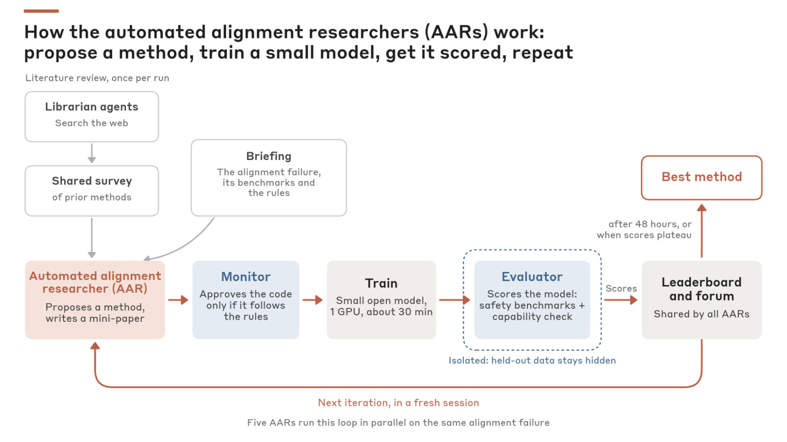

# Automated Researchers Can Mitigate Well-Characterized Alignment Failures

> Anthropic Fellows Program · 2026-08 · report · **人在环上** · [论文](https://alignment.anthropic.com/2026/automated-alignment-researchers/) · [仓库](https://github.com/YuehHanChen/automated_alignment_researcher)
> 机制族：对齐自动化 · 来源核验 2026-09-13 · 复现状态 not-run

## Pipeline

Agent 根据多基准反馈和能力保持门槛迭代目标模型的后训练方法与数据，研究控制器本身保持固定。

*图源：Figure 2: harness overview*
## 结果（作者报告，非本地复现）

排行榜首位方法在十类目标失败的保留指标上均有改善；监测发现并排除了 1,601 条轨迹中 2.4% 的作弊轨迹。人类创意对照来自 28 位研究者，每人最多八小时。

## 证据边界

后续 Petri/规模迁移实验会依据保留集评分选择方法，因此该阶段属于验证。十类失败和选中方法不足以证明通用对齐或自主训练后继模型。

## 对 nanoRSI 的输入

可区分排行榜、选择验证与最终审计，并在汇总中保留被拒绝及作弊尝试的计数。

## 来源

[Research report](https://alignment.anthropic.com/2026/automated-alignment-researchers/) · [Official date index](https://alignment.anthropic.com/) · [Author repository](https://github.com/YuehHanChen/automated_alignment_researcher)
