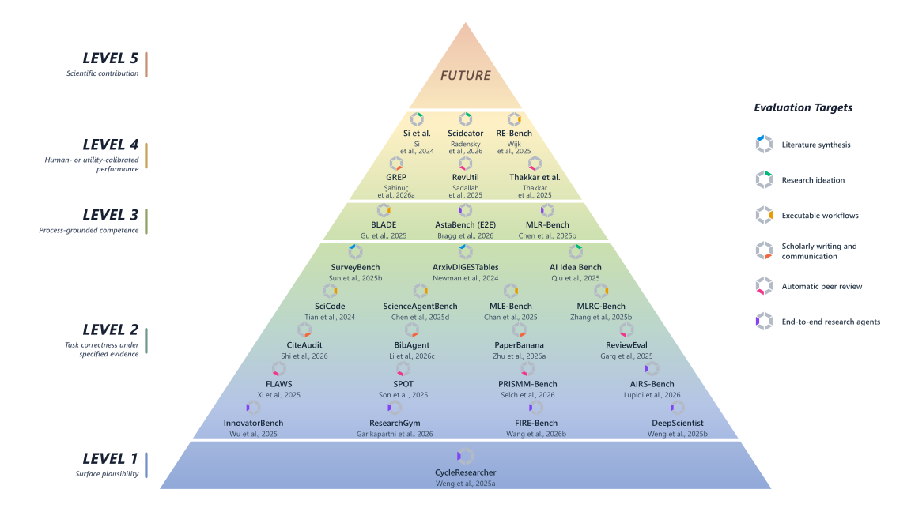

# How Is Automated Research Evaluated? A Survey of Benchmarks and Evaluation Practices

> University of Macau · 2026-10-08 · paper · **支撑·无闭环** · [论文](https://arxiv.org/abs/2610.11877)
> 机制族：分析与审计 · 来源核验 2026-10-12 · 复现状态 not-run

## Pipeline

综述自动化研究系统在六个目标上的评测方式——文献综合、研究构思、可执行工作流、学术写作与传播、自动同行评审、端到端研究——比较任务构造、证据来源、评测者与打分流程，并按声明强度组织代表性工作。

*图源：Figure 1 (claim_strength_pyramid_2026-09-28_final3.svg): representative works by claim strength, hexagon segments marking primary evaluation targets*
## 结果（作者报告，非本地复现）

三条反复出现的经验：输出检查、过程检查与人类研究提供互补信息；评测者校准依赖于被评属性本身；资源预算与尝试选择是解读性能对比的内在组成部分。综述识别出诊断性评测设计、支持证据的已记录缺口，并给出报告与审计建议。

## 证据边界

综述性质：无新实验；覆盖范围为所述六个目标与纳入的基准集合；个别工作的声明强度归置属作者判断；论文 CC BY 4.0 许可，但无配套代码或数据集。

## 对 nanoRSI 的输入

把其声明强度阶梯用作 nanoRSI 效果研究的自查模板：写明哪些结论只依赖输出检查、哪些附加过程证据、哪些带预算与尝试选择记账——把综述第三条经验对齐到证据账本既有的预算字段。

## 来源

[arXiv abstract](https://arxiv.org/abs/2610.11877) · [arXiv HTML v1](https://arxiv.org/html/2610.11877v1)
