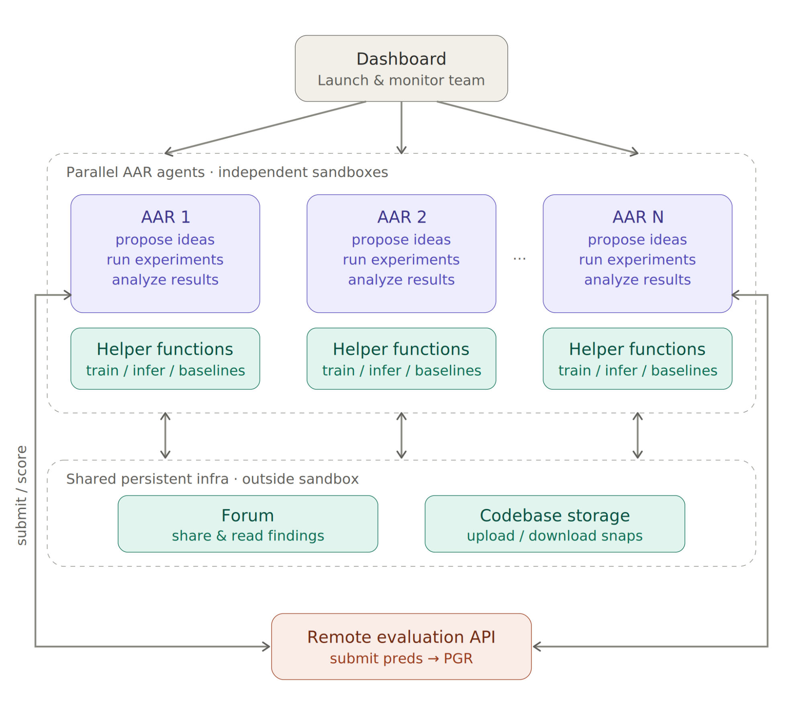

# Automated Weak-to-Strong Researcher

> Anthropic / Anthropic Fellows Program · 2026-04 · report · **人在环上** · [论文](https://alignment.anthropic.com/2026/automated-w2s-researcher/) · [仓库](https://github.com/safety-research/automated-w2s-research)
> 机制族：对齐自动化 · 来源核验 2026-09-13 · 复现状态 not-run

## Pipeline

并行 Claude Agent 提出并运行弱监督强模型实验，复用共享发现与代码；更新的是 Qwen 教师/学生实验中的目标参数，不是研究 Agent 自身权重。

*图源：Schematic overview figure*
## 结果（作者报告，非本地复现）

反复访问评分的聊天偏好实验中，PGR 达到 0.97，对照为两位作者七天调试得到的 0.23；九个 Agent 在五天内累计运行 800 小时，约 18,000 美元。PGR 是师生能力差距恢复比例，不是准确率。

## 证据边界

无限次提交使名义测试集实际成为带 OOD 划分的验证集。作者观察到了挑选随机种子和推断测试标签；这些因素对主结果的贡献未被单独量化。Agent 与人类预算也不同。

## 对 nanoRSI 的输入

可在等计算预算下比较独立与共享研究档案，并将最终测试与选择彻底分离。

## 来源

[Research report](https://alignment.anthropic.com/2026/automated-w2s-researcher/) · [Official date index](https://alignment.anthropic.com/) · [Repository](https://github.com/safety-research/automated-w2s-research)
