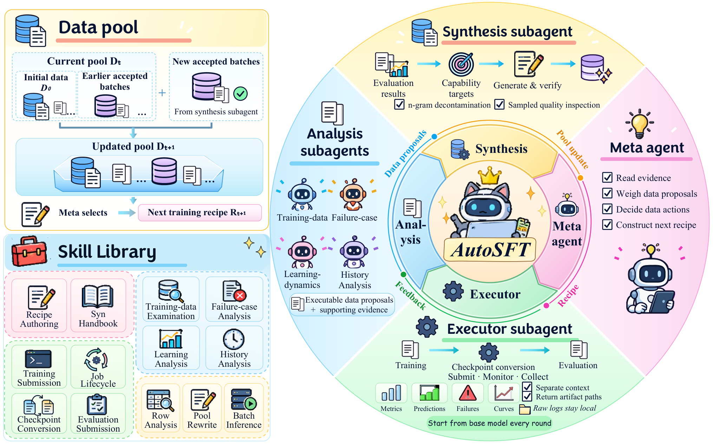

# AutoSFT: An Agentic System for Automated Data Research in Supervised Fine-Tuning

> Tsinghua University / University of Illinois Urbana-Champaign / ModelBest Inc. / The Chinese University of Hong Kong / Beijing University of Posts and Telecommunications · 2026-10-15 · paper · **闭环** · [论文](https://arxiv.org/abs/2610.22194) · [仓库](https://github.com/Thinking-Space/AutoSFT)
> 机制族：自主后训练及其评测 · 来源核验 2026-10-19 · 复现状态 not-run

## Pipeline

在完整数据动作空间——调整类别比例、剪枝、修复、替换与合成数据——上自动化 SFT 数据研究，此前系统只允许单一动作。单智能体环会退化：只做比例调整，上下文被执行输出填满并在搜索中途丢弃。AutoSFT 分离角色：元智能体提交配方；执行器独立训练与评测并返回产物路径；分析子智能体从互补角度读取产物；合成子智能体为池无法覆盖的能力写数据；所有角色共享候选数据池与技能库，且每次对照都从基座重训，使各组件效应可单独归因。

*图源：Figure 1 (AutoSFT_V26.png), arXiv HTML 2610.22194v1*
## 结果（作者报告，非本地复现）

组件阶梯（每轮从基座重训，故各效应可单独归因）：执行器使上下文丢失减半；分析子智能体将最佳 IFEval 提升 +6.5；合成再加 +3.4 IFEval 与 +2.9 IFBench；同一环路迁移到代码域，分析带来 +3.7 MBPP+，而单智能体在该域无改进。

## 证据边界

发现限于指令跟随与代码数据研究，各对照内模型、训练器与预算固定；单智能体失败部分是上下文管理问题，故主张是覆盖多样数据动作而非规模；未与外部自主后训练基线（如权重侧战役）对比。

## 对 nanoRSI 的输入

执行/分析分离并以产物路径（而非上下文倾倒）传递，是 nanoRSI 提案器在需要推理长运行输出时的接口范式；单智能体退化结果是对宽编辑面上任何单环提案器的设计警告——必须显式拓宽动作库，否则环路会塌缩到单一动作类型。

## 来源

[arXiv abs 2610.22194](https://arxiv.org/abs/2610.22194) · [arXiv HTML v1](https://arxiv.org/html/2610.22194v1) · [AutoSFT code (pending)](https://github.com/Thinking-Space/AutoSFT)
