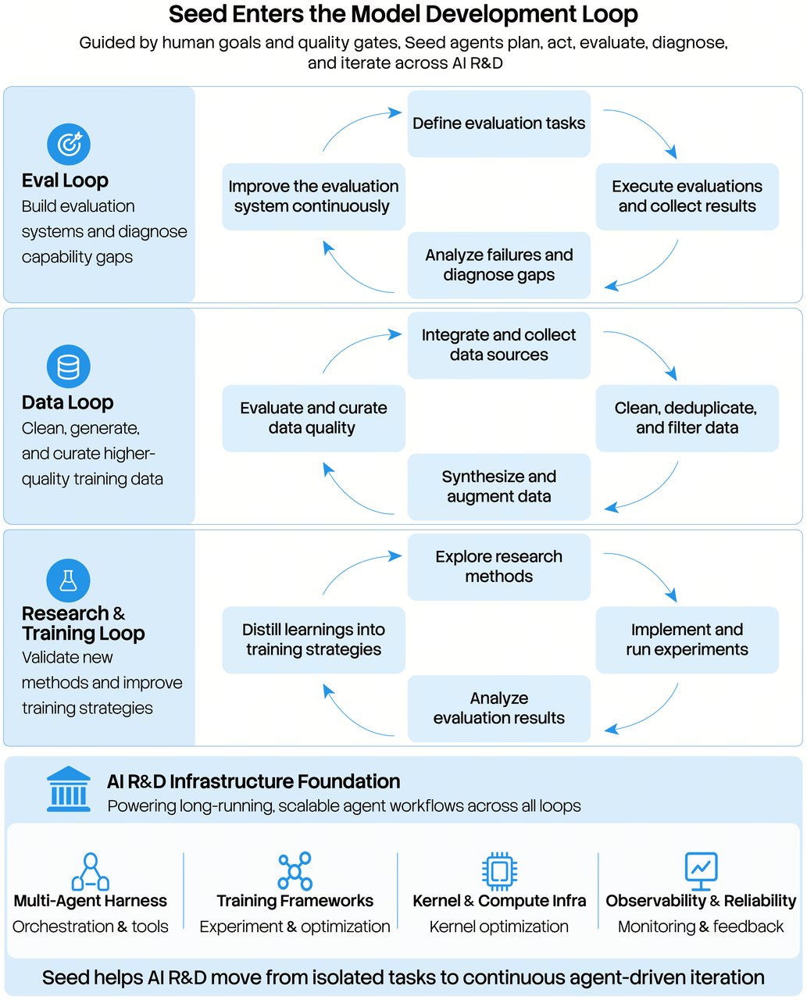

# Seed2.1 Officially Released: Advancing AI Productivity

> ByteDance Seed · 2026-06-23 · report · **人在环上** · [论文](https://seed.bytedance.com/en/blog/seed2-1-officially-released-advancing-ai-productivity)
> 机制族：立场、路线图与实验室 · 来源核验 2026-09-19 · 复现状态 not-run

## Pipeline

Seed-for-Seed 计划：Seed2.1 以 agent 身份参与自身开发管线的关键阶段——评测、数据、训练、研究与基建——承担评测系统开发、能力诊断、SFT 数据合成与 RL 框架优化，并以执行/评测/诊断/优化多角色分解形成跨小时到数周的闭环研发工作流。

*图源：Seed for Seed R&D workflow diagram*
## 结果（作者报告，非本地复现）

已披露方向与做法描述，非可测量闭环：博文称模型参与真实研发任务并反过来加速模型迭代，并把深化该整合、启用自主研究列为下一步。

## 证据边界

博客级披露，无量化研发加速证据或外部审计；路线图为期望性表述；未发布逐任务工件。

## 对 nanoRSI 的输入

分阶段自我参与阶梯（评测→数据→训练）是范围控制模板：nanoRSI 可先让自身循环维护评测 harness，再触碰任何训练环节。

## 来源

[Official blog (EN)](https://seed.bytedance.com/en/blog/seed2-1-officially-released-advancing-ai-productivity) · [Official blog (ZH)](https://seed.bytedance.com/zh/blog/seed2-1-officially-released-advancing-ai-productivity)
