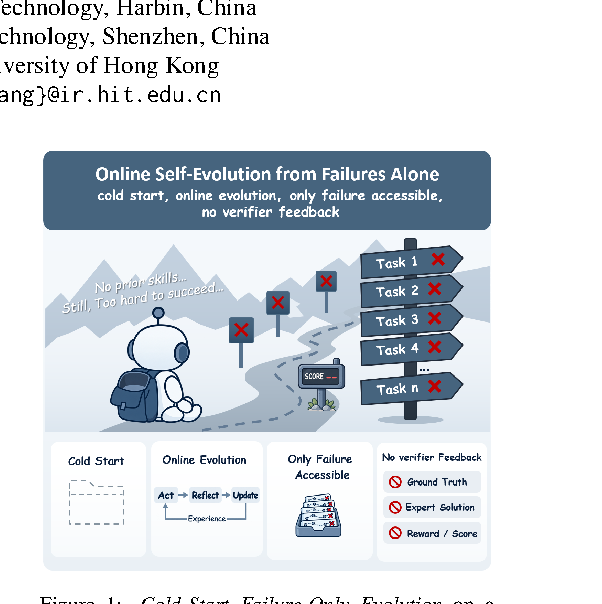

# Self-Evolving Agents Can Repair Failures but Struggle to Generalize from Them

> Harbin Institute of Technology / The Chinese University of Hong Kong · 2026-10-19 · paper · **支撑·无闭环** · [论文](https://arxiv.org/abs/2610.22984)
> 机制族：分析与审计 · 来源核验 2026-10-20 · 复现状态 not-run

## Pipeline

审计设定“冷启动仅失败演化”（CFOE）：智能体从空外部状态出发，只从失败的在线交互中学习——无既有经验、无标准答案、无专家解、无验证器反馈。审计在四个交互环境（ALFWorld、tau2-Bench-Verified、WebArena-Verified、WebShop）与多个 LLM 骨干上运行三种既有自演化范式（ReasoningBank 式记忆累积、SkillOpt 式技能编辑、Evo-Harness 式 harness 修改），并用人雇标注者研究经验更新如何出错。

*图源：Figure 1 cropped from PDF page 1 (LaTeXML image missing in HTML); gs 150dpi render, bbox (598,308,1200,912)*
## 结果（作者报告，非本地复现）

一致的修复-泛化鸿沟：失败来源的经验能提高先前失败任务的复原率，却很少在未见留出任务上带来持续增益，跨全部范式、骨干与环境成立。标注者识别出反复出现的经验畸变——假阳性成功归因、误判或幻觉式失败归因、失真巩固与有害规则形成；即便验证正确的经验也难以迁移。放宽 CFOE：验证器反馈与更多交互收益有限，而成功轨迹的引入显著改善迁移。

## 证据边界

是对既有框架的观察性审计而非新方法；骨干为中等规模开源模型；失败分类学来自小型雇佣标注组；各范式的绝对基线分数在论文图中，此处未复述。

## 对 nanoRSI 的输入

给 nanoRSI 证据账本加一个直接指标：把每次闸门决定拆成修复效应（编辑修好的失败任务）与迁移效应（留出任务），两者并报；把只修不复迁的失败派生编辑视为 counterfactual 面板的上下文拐杖候选——论文预测在缺乏成功信号时这类编辑占主导。

## 来源

[arXiv abs 2610.22984](https://arxiv.org/abs/2610.22984) · [arXiv HTML v1](https://arxiv.org/html/2610.22984v1)
