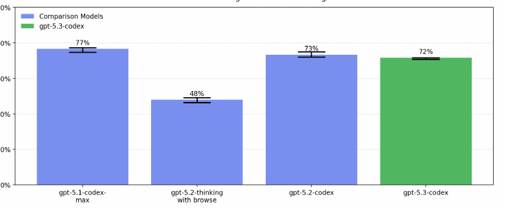

# How we used Codex to train and deploy GPT-5.3-Codex

> OpenAI · 2026-02-05 · report · **人在环上** · [论文](https://openai.com/index/introducing-gpt-5-3-codex/)
> 机制族：公司研发遥测 · 来源核验 2026-09-13 · 复现状态 not-run

## Pipeline

早期版本协助工程师调试训练、分析评测并改进部署执行器；人类团队将代码与发现用于后续版本。

*图源：Cover page, PDF p.1*
## 结果（作者报告，非本地复现）

有具体内部应用案例，但没有通过受控实验量化模型对自身改进的独立贡献。

## 证据边界

属于人类主导的研发辅助。同日系统卡称其未达到 OpenAI 的 AI 自改进 High 阈值；该阈值也不是 RSI 的统一定义。

## 对 nanoRSI 的输入

可记录研发建议、代码改动与实测结果之间的对应关系，衡量辅助研发贡献。

## 来源

[Development report](https://openai.com/index/introducing-gpt-5-3-codex/) · [System card](https://openai.com/index/gpt-5-3-codex-system-card/)
