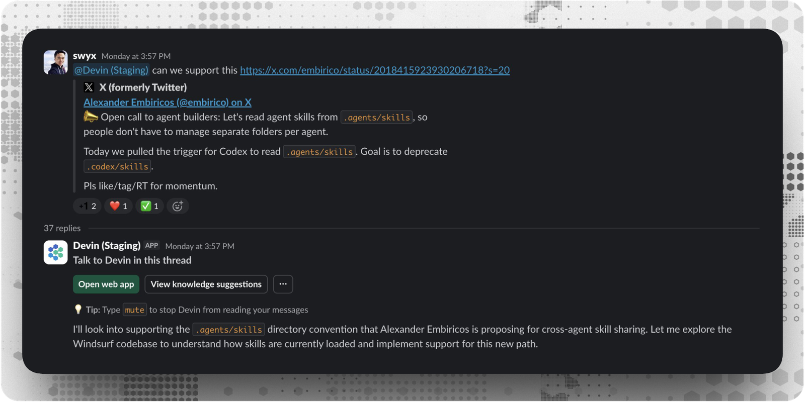

# How Cognition Uses Devin to Build Devin

> Cognition · 2026-02-27 · report · **人在环上** · [论文](https://cognition.com/blog/how-cognition-uses-devin-to-build-devin)
> 机制族：公司研发遥测 · 来源核验 2026-09-13 · 复现状态 not-run

## Pipeline

Devin 编写产品补丁，评审意见及 CI/lint 结果触发进一步修改，由人类评审最终 PR。操作手册和会话洞察提示将经验带入后续会话，合并代码成为产品组成部分。

*图源：Official report hero image*
## 结果（作者报告，非本地复现）

公司报告此前一周有 659 个 Devin PR 合并进入自身代码库，而 2025 年表现最好的一周为 154 个。这是内部 PR 吞吐量，不是受控的能力、质量或自我改进因果评测。

## 证据边界

任务选择和合并决策仍由人类负责；改进 AI 产品软件不等于自主训练后继模型。

## 对 nanoRSI 的输入

建议：由评测失败触发有界修复迭代，同时保留补丁来源与可读验证证据。

## 来源

[Official internal-use report](https://cognition.com/blog/how-cognition-uses-devin-to-build-devin) · [Official feedback-loop release](https://cognition.com/blog/closing-the-agent-loop-devin-autofixes-review-comments)
