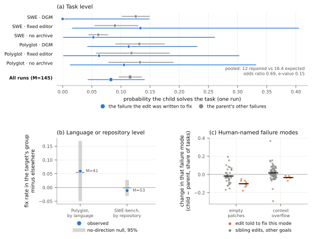

# Does Failure Feedback Direct Agent Self-Modification?

> Independent (no affiliation stated) · 2026-10-10 · paper · **支撑·无闭环** · [论文](https://arxiv.org/abs/2610.14662)
> 机制族：分析与审计 · 来源核验 2026-10-16 · 复现状态 not-run

## Pipeline

度量失败反馈是否真的引导自修改：在同一子代修改内部，比较随机抽取的目标失败的修复与父代其余失败的修复。研究一审计六条公开 Darwin Gödel Machine 运行日志（SWE-bench Verified 与 Polyglot 上的 DGM / 固定编辑器 / 无档案）：145 处合格的任务条目修改（子代可用且目标被评测）；鞅 e 值检验（Ville 不等式，E≥20 才算 5% 证据）加 z 统计量与 Poisson-二项参照。研究二对小开源模型（Qwen3-4B、Phi-4-mini）做受控指令修订实验，带预注册分析计划、留出测试切分与植入辅助 bug 的工具型代理。

*图源：Figure 2 (S3.F2; asset file named fig1_directedness.svg), arXiv HTML v1*
## 结果（作者报告，非本地复现）

公开 DGM 日志中无可检出的目标特异优势：修复目标 12 处对期望 16.4（e 值 0.15、优势比 0.69）——失败反馈未将修复引向目标，与随机无异。受控研究：对 Qwen3-4B，自身失败反馈较匹配的同类别反馈使目标修复 +20.0 个百分点（CI +8.5 至 +31.8，Holm p=0.003）；Phi-4-mini +6.7 个百分点不显著（CI −0.6 至 +14.0，p=0.17）。目标修复不必然带来留出改进；留出收益集中在具有可识别、可修复失败机制的设置（植入错误、自然工具接口失败）。八步修订环与 GEPA 终点平均留出精度相当（植入规则 Qwen 父代上 +14.5 对 +14.4）。

## 证据边界

研究一为公开日志的观察性研究、受合格性约束；研究二覆盖两个小开源模型、指令修订与植入 bug 设置，模型与领域普适性未测；DGM 发现关乎日志中可测的方向性，而非 DGM 整体是否有提升。单作者、无机构署名、无会议信息。

## 对 nanoRSI 的输入

nanoRSI 应按修改采纳三个报告轴：目标修复（被引用的失败是否真被修复）、向相关失败的迁移、留出净变化——目前证据账本只记面板增量，不记被反馈的失败是否就是被修复的那个。DGM 无方向性发现警示不要假设失败条件化的提案具有针对性；真实收益集中于可识别/可修复机制，支持反馈结构化失败类别而非原始轨迹。

## 来源

[arXiv abstract](https://arxiv.org/abs/2610.14662) · [arXiv HTML v1](https://arxiv.org/html/2610.14662v1)
