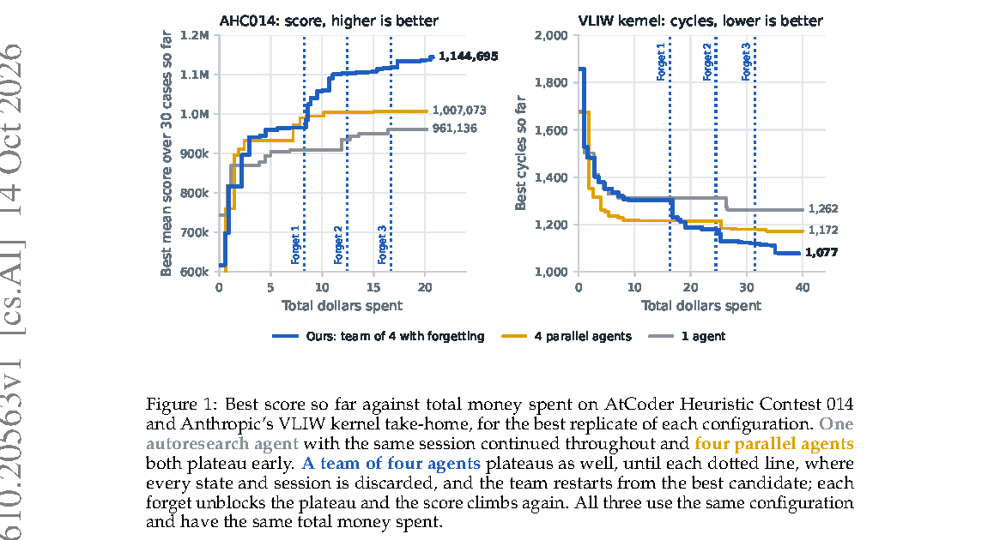

# Scaling Discovery Requires Forgetting

> UC Berkeley / Stanford University / Bespoke Labs · 2026-10-14 · paper · **支撑·无闭环** · [论文](https://arxiv.org/abs/2610.20563)
> 机制族：AI 科学家系统 · 来源核验 2026-10-16 · 复现状态 not-run

## Pipeline

研究为何扩展 LLM 代理的自动化研究——更长迭代、更多并行代理、可通信的代理团队——会平台化：代理锚定自己过去的尝试，随历史累积做出越来越少、越来越小的编辑。解法是周期性遗忘：丢弃累积的搜索状态、从迄今最优候选重启搜索，只留现任者不留历史。任务是带打分验证器的程序/内核/设置迭代精修（OpenEvolve 式）——启发式编程、内核优化与模型训练共四项，以总花费美元计量。

*图源：Figure 1, PDF page 1 (no HTML full text available); 150 dpi render, cropped*
## 结果（作者报告，非本地复现）

在可通信的代理团队中，周期性遗忘较不遗忘的并行代理最多提升 15%、较单代理最多 39%；在 AtCoder 启发式竞赛 014 与 VLIW 内核任务上，按花费美元计，遗忘重启明显解除分数停滞（图 1）。

## 证据边界

四项带打分验证器的任务（启发式编程、内核优化、模型训练）；“遗忘”指丢弃搜索状态而非记忆或技能；增益以跨任务-配置的至多 15%/39% 报告，摘要未给逐任务方差；Comments 无代码链接。

## 对 nanoRSI 的输入

可作 nanoRSI 选择器研究的种群级对照：周期性清空被拒/入围历史（rejected_recent、谱系权重）但保留现任者与冻结测试面板，使提案器条件化不锚定累积的拒绝历史——用现有多种子编排器即可直接作为一条选择器臂验证（等 episode 预算下对比全保留 vs 周期重置）。

## 来源

[arXiv abstract](https://arxiv.org/abs/2610.20563) · [arXiv PDF v1 (no HTML full text)](https://arxiv.org/pdf/2610.20563)
