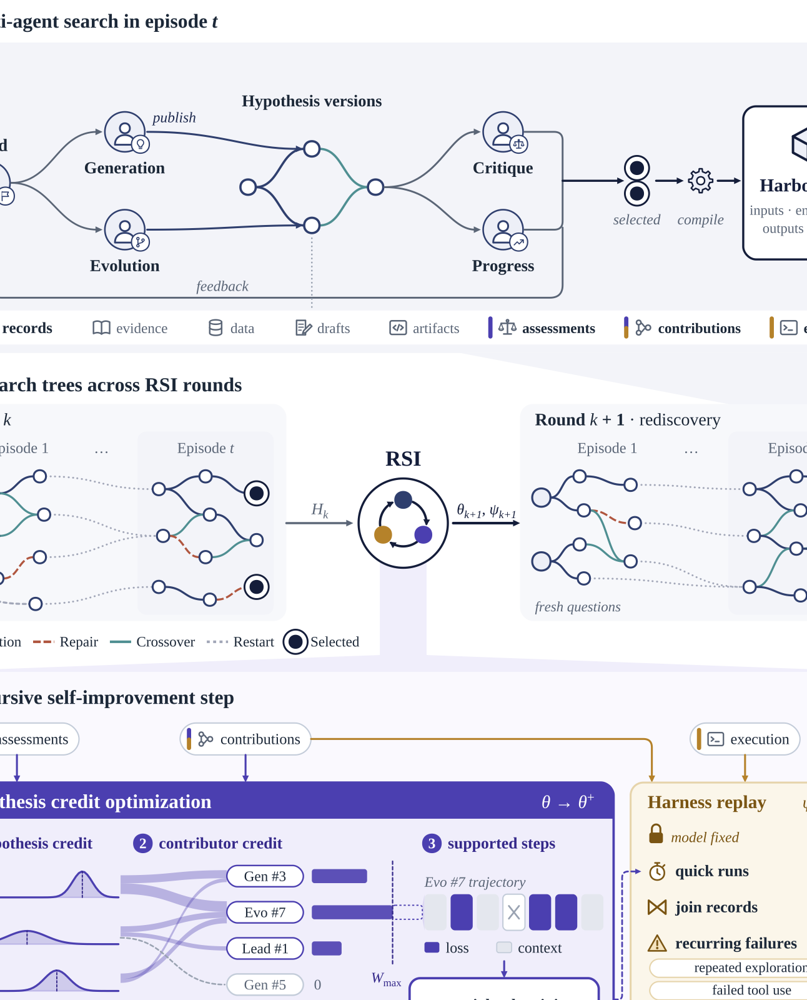

# DiscoveryRSI: Recursively Learning to Discover Valuable Hypotheses

> PhAI Labs / The Chinese University of Hong Kong / University of Michigan / National University of Singapore / Fudan University 等 · 2026-10-19 · paper · **闭环** · [论文](https://arxiv.org/abs/2610.23839) · [仓库](https://github.com/Gen-Verse/DiscoveryRSI)
> 机制族：AI 科学家系统 · 来源核验 2026-10-20 · 复现状态 not-run

## Pipeline

多智能体演化搜索发展可检验假设的研究树，选中的计算调查被编译为携带输入、环境、必需输出与验证检查的可执行 Harbor 任务。三个耦合的递归机制复用保留的研究历史：假设信用优化把质量评估归因到有据可查的贡献并训练模型（DiscoveryRSI-27B）；harness 重放从同一历史挖掘有效策略与反复失败，精炼协调、证据访问与资源分配；再发现把已接受的模型与 harness 更新应用到新调查，产生进一步经验。

*图源：Teaser figure (fig1_final.svg, rendered to PNG), arXiv HTML 2610.23839v1*
## 结果（作者报告，非本地复现）

提出 DFM-Bench（假设、修订、发展路径、研究运行四层）。四个生命科学域上，自动假设质量从基座的 4.86 经两轮自改进升至 5.39，可证伪性与数据可解性增益最大；演化/修复动作占比从 77.5% 升至 91.7%。对 292 份提案的盲评（三位资深导师下的临床医生与生物科学博士生）中，DiscoveryRSI-27B 在重要性与证据有界的可信度上高于 GPT-6 Luna；其假设与模型截止后发表研究的对应率为 6.3%，GPT-6 为 2.5%、Claude Opus 5 为 2.3%；另设电池域检验生命科学之外的迁移。

## 证据边界

截止后假设对应率只是新颖性的部分代理；专家评估被作者自述为初步；改进在生命科学加电池设定上仅测两轮自改进；DFM-Bench 自动分与人工评分互补而非可互换。

## 对 nanoRSI 的输入

可移植的是 harness 重放：在 nanoRSI 证据账本上的派生视图，每 N 次运行后聚合跨尝试的反复失败模式，提出环路级改动（评测顺序、反馈格式）而非任务级编辑——可在既有工作区协议里作为二阶代测量。

## 来源

[arXiv abs 2610.23839](https://arxiv.org/abs/2610.23839) · [arXiv HTML v1](https://arxiv.org/html/2610.23839v1) · [Gen-Verse/DiscoveryRSI (Apache-2.0)](https://github.com/Gen-Verse/DiscoveryRSI) · [DiscoveryRSI LICENSE (Apache-2.0)](https://raw.githubusercontent.com/Gen-Verse/DiscoveryRSI/main/LICENSE) · [Hugging Face collection](https://huggingface.co/collections/Gen-Verse/discoveryrsi)
