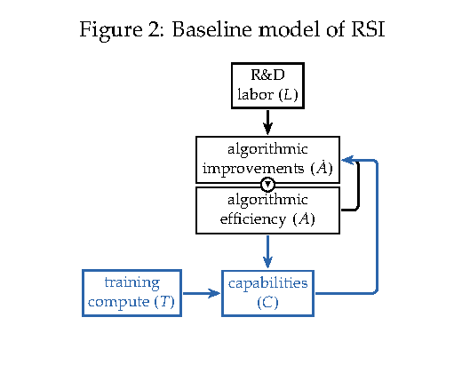

# The Economics of Recursive Self-Improvement

> METR / Stanford University / University of Virginia / Carnegie Mellon University / Columbia University 等 · 2026-09-14 · paper · **支撑·无闭环** · [论文](https://arxiv.org/abs/2609.15802)
> 机制族：分析与审计 · 来源核验 2026-09-16 · 复现状态 not-run

## Pipeline

非工作闭环：把 RSI 形式化为有向反馈环图的经济学模型。逐步加细的进展模型在 Jones 式自反馈之上引入 AI 能力存量 C 与核心环 A -> C -> A-hat（算法效率提升能力，能力反哺算法工作）；加速要求环上弹性乘积足够强，形式化为总弹性大于一；论文随后梳理哪些弹性可实际测量，并倡议 AI 公司公开这些量。

*图源：Figure 2, PDF page 8*
## 结果（作者报告，非本地复现）

校准而非基准：自持加速大致要求单位 AI 能力提升带来 15% 以上的 AI 研发生产率回报；按已报告的 AI 工程师增益估算，编码智能体问世以来观察值约 9%。结论原文：'feedback loops are not currently strong enough to generate a self-sustaining acceleration, though they appear to be strengthening.' 模型不排除近期加速，并警告基准收益未必转化为宽谱经济价值。

## 证据边界

纯理论与校准、无实验；9% 为作者自述的粗估；能力测度（Epoch Capabilities Index）承认不完备；结论针对总体反馈环，不针对任何具体系统。

## 对 nanoRSI 的输入

对 nanoRSI：把环弹性框架落成报告指标——测量每轮相对对照的边际回报（每改进轮的分数增量），让递归声明可量化而非口头断言；与既有相对对照实验规则一致。

## 来源

[arXiv abstract](https://arxiv.org/abs/2609.15802) · [Paper v1 PDF (Figure 2, Section 2.2, calibration)](https://arxiv.org/pdf/2609.15802)
