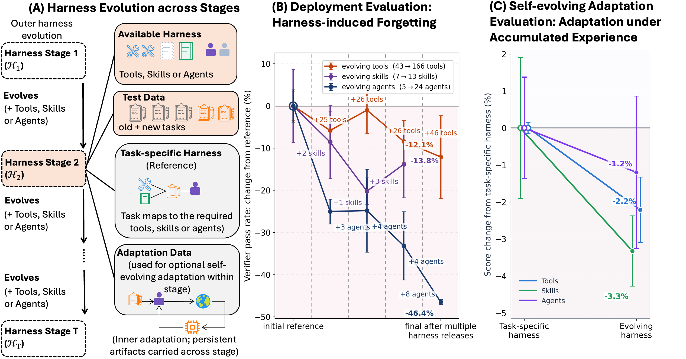

# EvoHarnessBench: Can Your Agents Keep Pace with an Evolving Harness?

> Salesforce Research / University of North Carolina at Chapel Hill / University of Wisconsin–Madison · 2026-09-03 · paper · **支撑·无闭环** · [论文](https://arxiv.org/abs/2609.04280)
> 机制族：分析与审计 · 来源核验 2026-09-20 · 复现状态 not-run

## Pipeline

把非平稳性放进 harness 而非任务流的基准：17 条由带验证器的基准确定性构建的多阶段 harness 流（802 任务、520 工具、42 技能、62 代理）沿工具、技能、代理三个能力轴演化。两种评测模式分别隔离先前能力保持（部署评测）与积累经验效用（自进化适配），用相对前向/后向转移度量。

*图源：Figure 1 (figs/framework.png)*
## 结果（作者报告，非本地复现）

仅扩展 harness 就会损害已解任务——harness 诱发遗忘，相对 BWT 为 −5.3%（工具）、−4.0%（技能）、−34.7%（代理，部署版 Codex，ALE 环境，为观测最强）。最佳适配增益：+27.8%（MemToolAgent，工具）、+27.5%（GEPA，技能）、+110.2%（Meta-Harness，代理）。保持与适配会冲突：保住旧能力不保证更好适配新能力。

## 证据边界

harness 流由既有带验证器基准确定性合成，而非真实产品 harness 演化史；结果是特定代理的分轴快照；核验时无 GitHub 仓库（项目页链接 Colab 笔记本、在线演示与 Hugging Face 数据集）。

## 对 nanoRSI 的输入

为 nanoRSI 增加 harness 扩展回归测试：新工具/技能/代理进入冻结循环后，重跑全部先前任务并随前向增益一并报告后向转移，让破坏旧能力的新增能力可见。

## 来源

[arXiv abstract](https://arxiv.org/abs/2609.04280) · [arXiv HTML v2](https://arxiv.org/html/2609.04280v2) · [Project page](https://mas-orchestra.salesforceresearch.ai/evoharness/)
