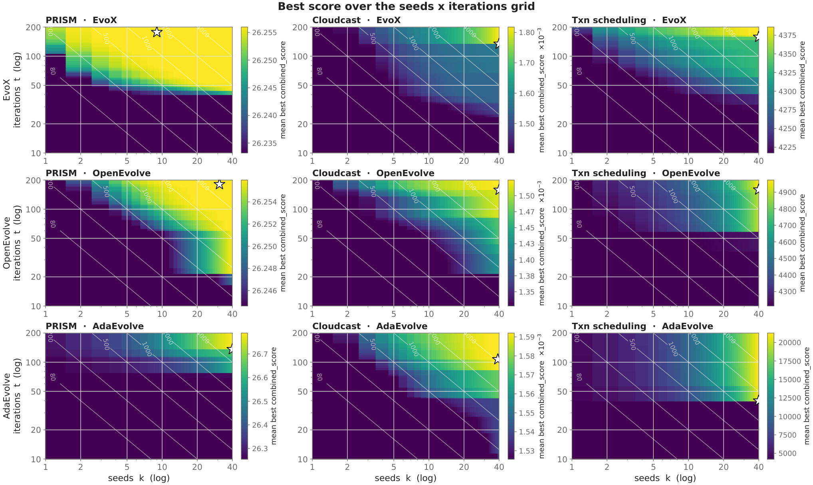

# Evolution or Illusion? Rethinking Evaluation in LLM Evolutionary Search

> IBM Research · 2026-09-17 · paper · **支撑·无闭环** · [论文](https://arxiv.org/abs/2609.19799)
> 机制族：分析与审计 · 来源核验 2026-09-20 · 复现状态 not-run

## Pipeline

面向 LLM 进化搜索的测量协议：不以领域惯用的单一预算配置（通常单种子固定迭代数）报告，而是跑满种子（宽度）×迭代（深度）网格，报告种子-迭代前沿，用等预算线使宽深权衡显式化。

*图源：Figure 2 (harness_heatmap.png)*
## 结果（作者报告，非本地复现）

在三种进化搜索策略（EvoX、OpenEvolve、AdaEvolve）与五个优化任务上：最优宽深拆分随策略、任务与总预算变化；策略排名随预算改变——某策略单种子最差、四十种子时最佳；另一任务的理想迭代数低于惯用值，追加深度浪费了本可由更多种子转化为分数的预算。

## 证据边界

五个任务取自该领域常报集合；三种策略；未找到代码；仅一版；结论关乎测量实践而非新搜索方法。

## 对 nanoRSI 的输入

把前沿报告立为 nanoRSI 报告规则：进化对基线的比较先声明总预算，给出种子×迭代网格（或至少三个预算点），任何排名结论不得出自单一单元。

## 来源

[arXiv abstract](https://arxiv.org/abs/2609.19799) · [arXiv HTML v1](https://arxiv.org/html/2609.19799v1)
