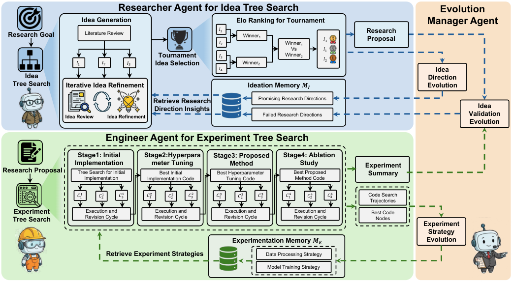

# EvoScientist: Towards Multi-Agent Evolving AI Scientists for End-to-End Scientific Discovery

> Huawei Technologies / Vrije Universiteit Amsterdam · 2026-03 · paper · **闭环** · [论文](https://arxiv.org/abs/2603.08127) · [仓库](https://github.com/EvoScientist/EvoScientist)
> 机制族：AI 科学家系统 · 来源核验 2026-10-12 · 复现状态 not-run

## Pipeline

三智能体 + 双持久记忆：研究员智能体做树结构'提案-评审-精炼'想法搜索（最多 21 个候选、Elo 循环赛、留前 3）；工程师智能体检索执行策略并在四阶段上做实验树搜索（含失败诊断与代码修订）；进化管理者智能体以三种自进化机制把交互历史蒸馏为可复用知识——想法方向进化、想法验证进化（记录失败方向）、实验策略进化——记忆逐任务更新，后续任务可检索既往成败。

*图源：Figure 1*
## 结果（作者报告，非本地复现）

想法生成（Gemini-3-flash 裁判）：对 AI Scientist-v2 平均差 +29.17、AI-Researcher +87.50、InternAgent +83.33；人工评估确认（对 AI Scientist-v2 +34.16；新颖性胜率 82.50%）。实验执行成功率进化后 34.39% -> 44.56%。端到端：6/6 篇论文被 ICAIS 2025 接收（赛道接收率 31.71%），一最佳论文奖 + 一 AI 评审嘉许奖；LLM-人工一致率 90.0%。

## 证据边界

评测聚焦计算研究；物理实验泛化未解；评审指出缺理论形式化；第 3 阶段执行成功率仍低（约 21.57%）。

## 对 nanoRSI 的输入

对 nanoRSI：把'想法记忆'与'执行策略记忆'分开，并显式记录失败方向——阻止提案者重复开采死矿的负知识与正技能同样有价值。

## 来源

[arXiv abstract](https://arxiv.org/abs/2603.08127) · [Paper v1 (affiliations, Figure 1, results)](https://arxiv.org/html/2603.08127v1) · [Code repository (Apache-2.0)](https://github.com/EvoScientist/EvoScientist)
