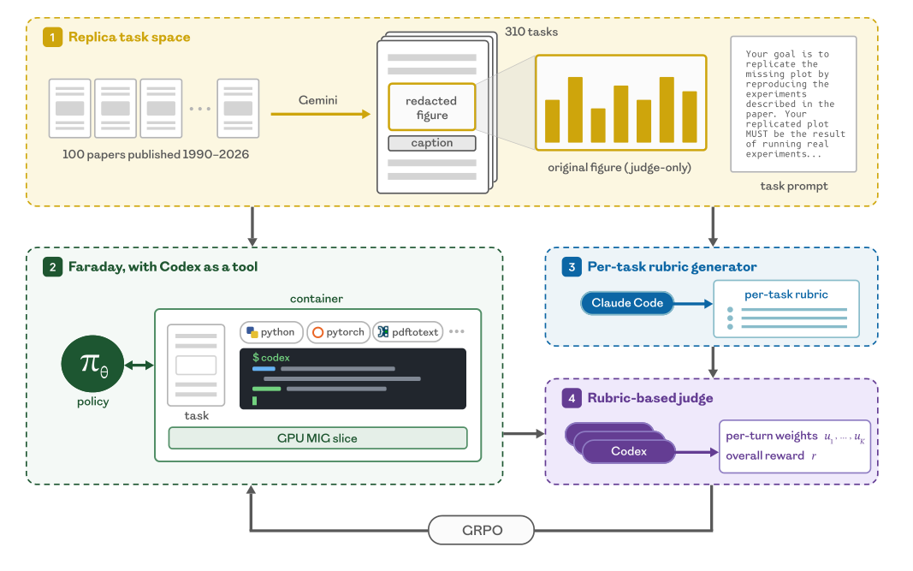

# Training AI Scientists to Replicate Research

> Inherent Laboratories · 2026-08-13 · paper · **闭环** · [论文](https://arxiv.org/abs/2608.13331)
> 机制族：AI 科学家系统 · 来源核验 2026-09-21 · 复现状态 not-run

## Pipeline

Replica：从 100 篇 ML/AI-for-science 论文自动构造 310 个复现任务（Gemini 2.5 Pro 把结果图抠成任务；每个任务 = 60 分钟内、1/7 张 H200 上复现一张图）。评分规则裁判：Claude Opus 4.7 自动生成五维 rubric（视觉匹配、论断支撑、忠实实现、算力使用、科学诚信）；Codex GPT-5.5 带工作区探索地评判 rollout，三采样平均并输出轮次级信用权重。Faraday：对 Qwen3.6-27B 做 GRPO 后训练（LoRA r128），以五工具 harness 运行并把 Codex GPT-5.5 当工具用（小模型指挥大得多的编码智能体）。

*图源：Figure 1*
## 结果（作者报告，非本地复现）

Faraday 在 73% 的分布内 ML 任务与 60% 的留出 AI-for-science 任务上胜过 Claude Opus 4.8 与 GPT-5.5（测试集上比 Claude +6%、比 Codex +8%）；提示优化过的 Codex'没有实质提升'；裁判 Kendall-tau 自一致性 0.66（人类 0.30）；人工在 41 个被检 rollout 中偏好 Faraday 29 次。

## 证据边界

小 GPU 切片上的短时程；20 个'想象任务'结果缺裁判验证；人工偏好研究只覆盖 Faraday 已领先的 rollout（作者自述'不能据此下结论'）；Faraday 在若干严谨论文上失败；污染仅在附录讨论；语料含作者或相识者的论文。

## 对 nanoRSI 的输入

对 nanoRSI：自动生成 rubric 裁判 + 轮次级信用权重，是缺精确答案长时程任务可复用的验收信号——且其自一致性（0.66）应随每个分数一并报告。

## 来源

[arXiv abstract](https://arxiv.org/abs/2608.13331) · [Paper v1 (affiliations, Figure 1, results)](https://arxiv.org/html/2608.13331v1)
