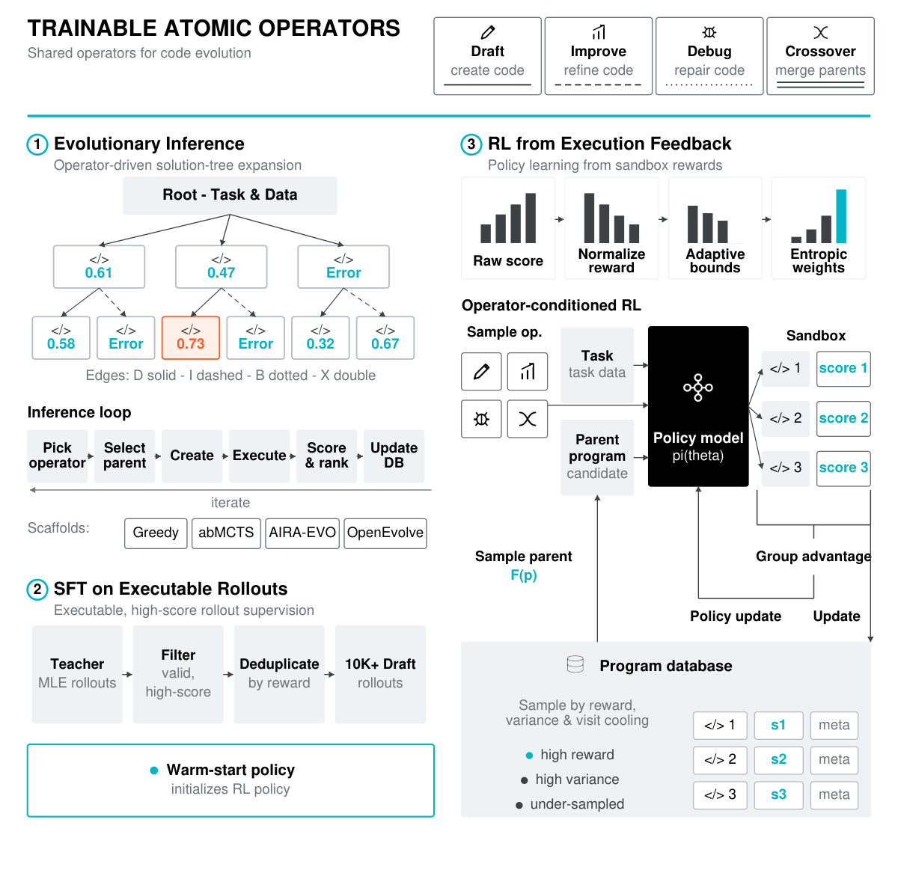

# Frontis-MA1: Training an AI4AI Model towards Recursive Self-Improvement in Machine Learning Engineering

> Frontis.AI — Horizon Research / Tsinghua University · 2026-07-30 · paper · **闭环** · [论文](https://arxiv.org/abs/2607.28568) · [仓库](https://github.com/FrontisAI/OpenRSI)
> 机制族：AI 科学家系统 · 来源核验 2026-09-13 · 复现状态 not-run

## Pipeline

SFT/RL 训练 Draft、Improve、Debug、Crossover 算子；搜索修改可执行机器学习程序，环境评分后保留种群及父代历史，再复用执行经验卡片与所选父代。改进者模型训练与搜索框架是不同的改进层。

*图源：Figure 5*
## 结果（作者报告，非本地复现）

作者报告：固定 OpenMLE-Evo，将基础 35B 模型换为 Frontis-MA1 后，MLE-Bench Lite 平均获牌率从 39.39% 升至 60.61%；每任务 12 小时、单张 RTX 4090、显存上限 12 GB。Evo-Max 达到 71.21%，但同时改变搜索系统。

## 证据边界

属于受限 MLE 领域的元进化；没有证明通用 RSI。模型与框架的联合成绩不能证明连续自主产生多代后继模型。

## 对 nanoRSI 的输入

拟议 nanoRSI program/learner 实验：为谱系节点附加不可变执行卡片，对比父代选择与固定父代搜索。

## 来源

[arXiv first submission](https://arxiv.org/abs/2607.28568) · [Paper v1](https://arxiv.org/html/2607.28568v1) · [OpenRSI release and repository](https://github.com/FrontisAI/OpenRSI) · [Official 35B model and license](https://huggingface.co/FrontisAI/Frontis-MA1-35B) · [OpenMLE Tasks and mixed licensing](https://huggingface.co/datasets/FrontisAI/OpenMLE-Tasks) · [OpenMLE SFT Traces](https://huggingface.co/datasets/FrontisAI/OpenMLE-SFT-Traces)
