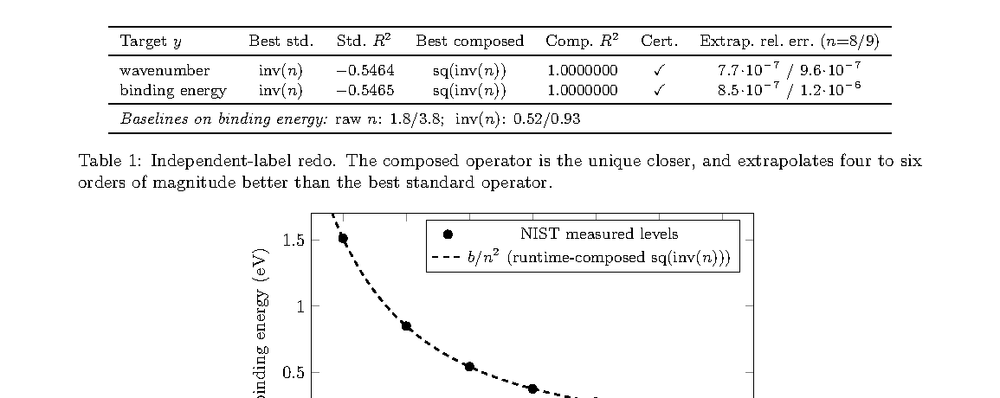

# Pre-Registered Genesis Accounting for Recursive Self-Improvement: First Audited Operator-Genesis Events in a Physics-Discovery Runtime

> HoomanBio AI Lab, Huaman Biotechnology (Beijing) · 2026-10-10 · paper · **支撑·无闭环** · [论文](https://arxiv.org/abs/2610.14843)
> 机制族：分析与审计 · 来源核验 2026-10-16 · 复现状态 not-run

## Pipeline

面向 RSI 主张的两级预注册记账：M1 统计设计者词表内生成的结构实例（四个谱系族）；M2 统计机器自著的算子类型——运行时自行组合并注册进自身词表的新算子，仅在留出验证证书下准入（组合 R² 须在留出数据上跨过 τ = 0.999）。首次经审计的 M2 事件：对 NIST 氢巴尔末系深度受限组合搜索合成出 sq(inv(n)) = 1/n²（里德伯形式），任何标准单一变换都无法表达。预注册审计抓到 v1 协议缺陷——自变量 n 由反演被测定律重构，R² = 1 沦为代数往返——并以独立标签协议（n 取自 NIST 组态标签）修复；在 n≤7 拟合、外推 n=8,9 以约 1e-6 相对误差成立，He II 复现，第二事件从 JPL 星历恢复 sqrt(inv(a))（开普勒速度律）。对十二个数据集 / 34 个变量对的盲式去策划创生考试如实返回零。

*图源：Figure 1, PDF page 3 (HTML figure is inline-only); 150 dpi render, cropped*
## 结果（作者报告，非本地复现）

最佳标准库变换 inv(n)：留出 R² −0.546；组合出的 1/n² 在修复后的独立标签协议下为 1.0000000。向未见过层级外推：n=8,9 相对误差约 1e-6 至 1e-7，基线为 0.35–3.8（四到六个数量级）。拟合系数 b ≈ 13.6 eV（氢结合能）。领域级复利通道：1.109× 精度比（MAE 0.0797 对 0.0883，NDBC 浮标数据，54.6% 胜率）——首个创生算子复利的领域级测量。阴性对照被否：cos(sqrt(·)) R² 0.919 对获准的 sqrt 的 0.838。

## 证据边界

作者自列：考试数据集由知晓教科书答案的代理策划；创生触发是手动的（“M2 度量的是被著类型，不是自主性”）；文法、原语、深度与裁判均为观察者注入，“发明”只是给定原语上的组合而非新数学；复利通道窄且未证明创生特异效用；样本小（氢 7 层、He II 4 层）；M2 成为目标后有 Goodhart 风险。摘要明言事件展示的是“创作能力，尚非自主创生”。无代码发布；可复现性依托公开 NIST ASD 数据与所述规则。

## 对 nanoRSI 的输入

M1/M2 两分可直接采纳为 nanoRSI 证据账本词汇：分开统计（M1）起始模板设计者词表内生成的变体——提示/技能/参数编辑——与（M2）循环自著、运行时词表原本不包含的机制，后者仅在留出验证证书下准入；跑前预注册准入规则是诚实性升级。其被抓的协议缺陷（反演被测定律构造自变量）是任何由系统自行合成的评测器都要检查的一类具体泄漏。

## 来源

[arXiv abstract](https://arxiv.org/abs/2610.14843) · [arXiv HTML v1](https://arxiv.org/html/2610.14843v1)
