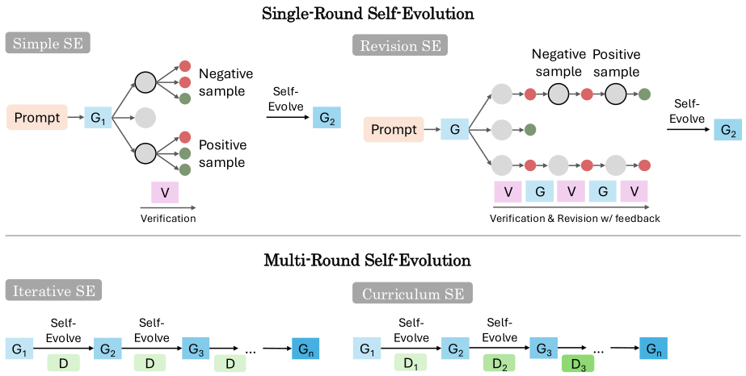

# On the Generalization Gap in Self-Evolving Language Model Reasoning

> Google Research / Harvard University / Virginia Tech · 2026-06 · paper · **支撑·无闭环** · [论文](https://arxiv.org/abs/2606.01075)
> 机制族：分析与审计 · 来源核验 2026-09-16 · 复现状态 not-run

## Pipeline

受控研究而非新系统：同一指令微调模型经提示在确定性'骑士与骗子'任务（难度参数化）上同时扮演生成器与验证器；对验证器通过做阈值多数投票构造偏好对，离线训练 DPO。统一框架下对比四种自进化策略（SimpleSE、多轮 RevisionSE、迭代 SE、课程 SE）与 oracle 监督 DPO，并做验证器阈值、数据规模、Pass@1-vs-Pass@k 消融与跨家族复现（Qwen2.5-7B）。

*图源：Figure 1*
## 结果（作者报告，非本地复现）

Gemma 3 4B：自进化把 Pass@1 从 31.0% 提到 44.8%（课程式），但仍比 oracle DPO（53.3%）低 8-13 分；Pass@32 几乎不动（78.0% -> 78.8%），支持'锐化而非新授'假设——自进化放大既有解题模式而非新增能力。补一轮 oracle 即跳到 53.2%。扩大验证器通过数优于扩大生成；12B 时 RevisionSE 达 oracle 的 98.5%。开放式任务：增益温和且有时为负（MATH500 +1.6%，4 万样本时退化）。

## 证据边界

严格表述下的结论：内部反馈不能替代可验证奖励；确定性任务族与仅用 DPO 限制了范围；作者自述结论是缩小'有意义的比例'而非消除 oracle 差距。

## 对 nanoRSI 的输入

对 nanoRSI：每个自改进声明同时报告 Pass@1 与 Pass@k——若 Pass@1 升而 Pass@k 平，说明环在'锐化'而非'学习'；这一区分应进入证据账本。

## 来源

[arXiv abstract](https://arxiv.org/abs/2606.01075) · [Paper v1 (affiliations, Figure 1, findings)](https://arxiv.org/html/2606.01075v1)
