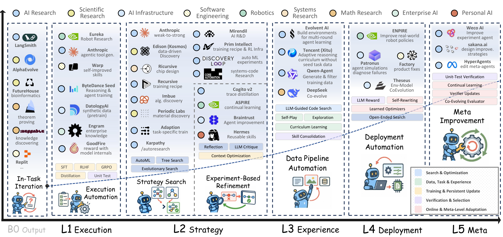

# The Last AI Built by Humans: Toward Genuine Recursive Self-Improvement

> Shanghai Jiao Tong University / Theseus Labs / Tsinghua University / ByteDance / Shanghai AI Lab 等 · 2026-09-10 · paper · **支撑·无闭环** · [论文](https://arxiv.org/abs/2609.11873)
> 机制族：立场、路线图与实验室 · 来源核验 2026-09-18 · 复现状态 not-run

## Pipeline

这是一篇立场/路线图论文而非可运行闭环：用 Headroom-Closed Index（HCI）诊断现有 LLM，然后把 RSI 系统排到五级自主性阶梯——L1 执行、L2 策略选择、L3 经验获取、L4 环境/部署适应、L5 递归元改进——并按此阶梯梳理产业系统（AlphaEvolve、字节 Seed 推理训练、Hermes 可复用技能、ASPIRE、Prime Intellect、Theseus 环境-数据-模型协同进化、Sakana 与 Meta 超级智能体等）。

*图源：Figure 1*
## 结果（作者报告，非本地复现）

无新的系统级基准结果。报告证据包括：对 2023–2026 年模型在十个领域的 HCI 诊断、案例研究及来自产业实践的"初步实证"；论文明确把真正的 RSI 定位为未完成目标。

## 证据边界

仅为综述与路线图：HCI 指标的构造与产业案例均为作者报告、未经独立核验；五级阶梯是作者自己的分类，L4–L5 被明确定位为愿景。

## 对 nanoRSI 的输入

建议：把 L1–L5 自主性阶梯作为 nanoRSI 实验报告的附加标注维度，并在声称递归收益时引入 HCI 式"余量"检查作为对照指标。

## 来源

[arXiv abstract (v1 date, license)](https://arxiv.org/abs/2609.11873) · [Paper HTML (Figure 1 landscape, affiliations)](https://arxiv.org/html/2609.11873v1) · [Project page](https://theseus-labs-rsi.github.io/)
