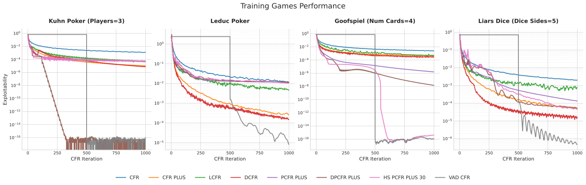

# Discovering Multiagent Learning Algorithms with Large Language Models

> Google DeepMind · 2026-02-18 · paper · **人在环上** · [论文](https://arxiv.org/abs/2602.16928)
> 机制族：公司研发遥测 · 来源核验 2026-09-13 · 复现状态 not-run

## Pipeline

Gemini 2.5 Pro修改CFR/PSRO代码，以代理游戏中的可利用度评价候选；有效变体进入种群并按适应度参与父代选择。变化的是被设计的算法，Gemini并未重新训练自身。

*图源：Figure 1*
## 结果（作者报告，非本地复现）

VAD-CFR在1000轮评估下于11个游戏中10个达到或超过基线；SHOR-PSRO在100轮下为8/11，采用精确可利用度和精确最佳响应预言机。四个游戏用于发现，更大变体测试迁移。

## 证据边界

属于固定时域、小型游戏上的AI辅助研发，未证明通用RSI。

## 对 nanoRSI 的输入

建议实验：修改小型学习规则函数，缓存评分候选，并在保留游戏评价前冻结选择。

## 来源

[Paper history](https://arxiv.org/abs/2602.16928) · [Paper v1, results and source appendix](https://arxiv.org/html/2602.16928v1) · [Original AlphaEvolve date](https://deepmind.google/blog/alphaevolve-a-gemini-powered-coding-agent-for-designing-advanced-algorithms/)
