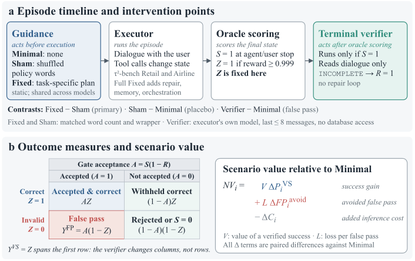

# How Do Agent Harnesses Create Value? Planning Information and Release Control in Stateful LLM Agents

> The Chinese University of Hong Kong, Shenzhen / University of Edinburgh · 2026-09-17 · paper · **支撑·无闭环** · [论文](https://arxiv.org/abs/2609.20474)
> 机制族：分析与审计 · 来源核验 2026-09-20 · 复现状态 not-run

## Pipeline

把 agent harness 的价值分解为规划引导、执行组织与完成检查，并在 τ²-bench 上用安慰剂式对照逐项度量：Fixed（预写的任务专属计划）对 Sham（词数与外壳匹配的打乱策略文本），差异即分离引导内容价值与单纯 token 量；另配只读终端验证器做放行控制。

*图源：Figure 1 (framework_final.svg)*
## 结果（作者报告，非本地复现）

在 265 个匹配单元上，Fixed 较 Sham 提升 oracle 验证成功率 7.17 个百分点（90% 任务聚类自助区间 1.15–13.36），集中于更高复杂度任务。只读验证器拒绝 61% 的 Retail oracle 无效 episode、误扣 17% 的正确 episode，每例成本不足一美分；单独的验证器以零头成本捕获完整规划+验证栈几乎全部的误放行收益。哪个组件占优取决于误接受的损失权重。

## 证据边界

仅 τ²-bench 上两组 Retail 实验与一组 Airline 试点；未找到代码；仅一版；规划效应在单元级置信区间较宽。

## 对 nanoRSI 的输入

把安慰剂对照制度化：任何 nanoRSI harness 或技能改进都必须胜过词数匹配的打乱文本安慰剂，而不只是无引导基线；并保留只读验证器作为廉价放行控制层，同时报告其误扣率。

## 来源

[arXiv abstract](https://arxiv.org/abs/2609.20474) · [arXiv HTML v1](https://arxiv.org/html/2609.20474v1)
