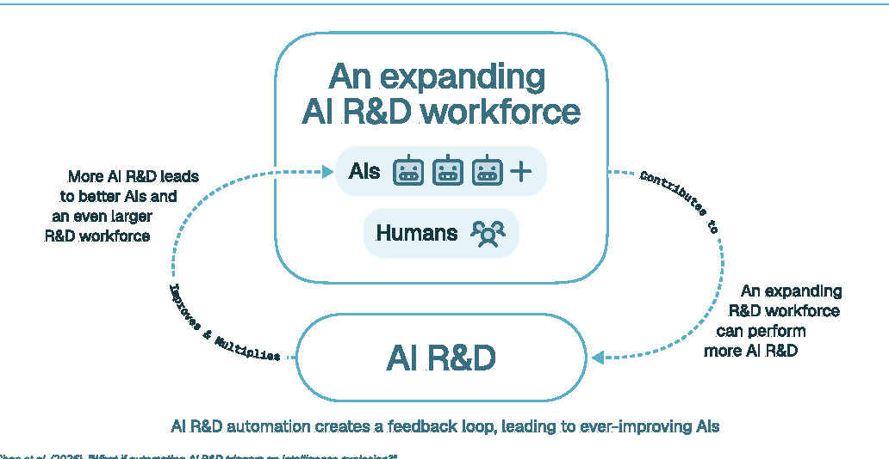

# What if automating AI R&D triggers an intelligence explosion?

> GovAI / CASP / University of Cambridge / Institute for Law & AI / University of Massachusetts Amherst 等 · 2026-09-30 · paper · **支撑·无闭环** · [论文](https://arxiv.org/abs/2609.36054)
> 机制族：立场、路线图与实验室 · 来源核验 2026-10-20 · 复现状态 not-run

## Pipeline

联盟立场与证据评估而非系统：综述“自动化 AI 研发管线可能触发软件驱动的智能爆炸”的初步证据（AI 扩充有效研发人力、反馈环加速进展），分析影响（能力增长超出社会消化速度、对超人类系统失控、州/公司/政府部门间制衡被侵蚀）并提出政策回应（对 AI 研发自动化建立可见性、发展引导与约束手段、为社会适应做准备）。

*图源：Figure 2 cropped from PDF page 4 (no HTML version exists); gs 150dpi render, bbox (104,134,1136,668)*
## 结果（作者报告，非本地复现）

为作者论断而非基准结果：AI 系统数年内有望自动化大部分 AI 研发工作、甚至全部；初步证据提示智能爆炸可能把数年进展压缩到数月或更短；论文主张即便存在不确定性，高风险也足以要求政策制定者紧急关注。

## 证据边界

立场论文：预测基于趋势外推与作者判断，无新实验；作者联盟横跨前沿实验室、高校与政策组织，论文自述观点属作者个人；对爆炸可行性与时点的不确定性有明确承认。

## 对 nanoRSI 的输入

其“可见性”诉求可翻译为度量：nanoRSI 的请求/token 预算账本正是论文希望政策侧获得的“AI 研发自动化可见性”原语——从既有证据管线发布每次运行的自动化遥测（episodes、尝试、接受编辑数）是直接且低成本的对接。

## 来源

[arXiv abs 2609.36054](https://arxiv.org/abs/2609.36054) · [arXiv PDF](https://arxiv.org/pdf/2609.36054)
