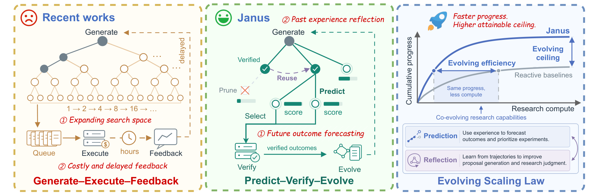

# Janus: Enhancing Long-Horizon Autonomous Research with Co-Evolving World Models

> Institute of Computing Technology, CAS (State Key Laboratory of AI Safety) / University of Chinese Academy of Sciences · 2026-10-09 · paper · **闭环** · [论文](https://arxiv.org/abs/2610.13194) · [仓库](https://github.com/bilemond/JANUS)
> 机制族：AI 科学家系统 · 来源核验 2026-10-15 · 复现状态 not-run

## Pipeline

把自动研究 agent 的反应式 Generate-Execute-Feedback 循环替换为在演化研究 DAG 上的 Predict-Verify-Evolve，建模为预算约束 POMDP 搜索。LLM 世界模型在执行前以稀疏两两锦标赛（软 Bradley-Terry 拟合）按价值改进、信息增益、探索效用三准则（自适应权重）为候选打分，先剪枝、选择或辩论精炼再进入昂贵执行。反馈蒸馏进三条共同演化的技能流：研究 agent 的任务内/跨任务技能、世界模型自身的预测/探索技能、以及双方辩论协议的协调技能。

*图源：Figure 1 (Janus_Intro.png): Generate-Execute-Feedback (left) contrasted with JANUS's Predict-Verify-Evolve loop over an evolving research DAG and its efficiency/ceiling scaling (right)*
## 结果（作者报告，非本地复现）

MLS-Bench-Lite（30 任务、5 小时预算）：DeepSeek-V4 Flash 下 JANUS 全面胜出（Test 41.07 对最强基线 Codex 38.91；Beat-All 43.3%）；换 GPT-5.6 solver 后 Beat-All 56.7%；Codex 骨干下峰值 Test 49.78、Beat-All 63.3%。三个真实任务（nanoGPT BPB、MinGPT 核加速、G2P 宏 Pearson）平均采样效率加速：对 MLEvolve 13.78 倍、Arbor 9.43 倍、AIBuildAI 7.67 倍、Codex 3.74 倍（nanoGPT 上最高 43 倍）。消融显示移除世界模型或任一演化流均降性能。

## 证据边界

代码仓库无 LICENSE 文件（2026-10-15 核验）——按保留所有权利对待，只借鉴思想。加速主张是三个任务上的采样效率；MLS-Bench-Lite 对比按配置混合骨干（Flash solver、GPT-5.6 solver、Codex）分别报告。

## 对 nanoRSI 的输入

执行前锦标赛正是 ADOPTION 第 39 项选型研究需要的廉价预排序臂：世界模型在任何 episode 花费前按预期面板增益给候选排序，其排序质量对实际闸门结果的命中本身可测。JANUS 的另一面——预测器自身技能流也在演化——是'改进改进器'探针：追踪同预算下选型准确率是否随轮次提升。

## 来源

[arXiv abstract](https://arxiv.org/abs/2610.13194) · [arXiv HTML v1](https://arxiv.org/html/2610.13194v1) · [bilemond/JANUS (no license)](https://github.com/bilemond/JANUS)
