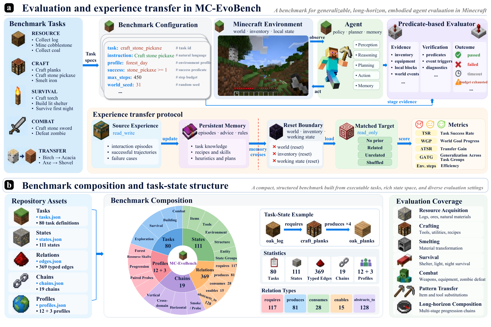

# MC-EvoBench: Auditing Experience-Driven Self-Improvement in Minecraft Agents

> Shanghai Jiao Tong University / University of the Chinese Academy of Sciences / South China University of Technology / Huazhong University of Science and Technology / Beihang University 等 · 2026-10-09 · paper · **支撑·无闭环** · [论文](https://arxiv.org/abs/2610.13829) · [仓库](https://github.com/xzw-ustc/mc-bench-open-source)
> 机制族：分析与审计 · 来源核验 2026-10-14 · 复现状态 not-run

## Pipeline

一个把真实能力变化与携带资源、曝光与运气隔离的受控基准：配对评估先跑源交互，冻结声明的 agent 工件（记忆、提示、检查点），重置目标世界与物品栏，只允许该工件跨边界。三个图对齐探针族（木种合成、木器与石器迁移）在匹配预算与五个种子下比较无先验、相关、无关与打乱源四种条件，报告带出处的 TSR、WGP、VMP；目录含 80 任务、111 状态节点、369 条类型化边，组成 19 条注册演化链。

*图源：Figure 2 (overview.png): benchmark design - panel (a) paired evaluation from source interaction and artifact formation to reset target and verification; panel (b) task/state/relation/chain catalog organization*
## 结果（作者报告，非本地复现）

未发现稳定迁移：石器探针上相关条件 TSR/WGP/VMP 为 0.050/0.021/0.200，低于无先验的 0.150/0.082/0.533（相关反而更差）；唯一正向对比是木种 WGP deltaR +0.040，其 GATG 均值 +0.050 系于单一种子（+1.0，去掉后 -0.19）；全部 95% 置信区间含零。相关源消耗更多资源（源 TSR 0.100-0.150，唯一非零条件；LLM 调用 24.8 对 16.4/16.0）却无目标增益。控制器型优于规划器型（STEVE-1 平均 TSR/WGP/VMP 8.4/6.4/25.5；no-op 与 GPT 规划的 JARVIS-1 约 1.5/0.6/0）；早期执行瓶颈使后段能力无法被观测（42 次尝试中约 20-23 到达木板合成，<=2 到达工作台）。

## 证据边界

结论限于被测 agent、探针、五个配对种子（置信区间宽）、预算与公开实例；不排除其他 agent、工件、任务分布或源预算下有增益；不作真实世界安全或能力声明。

## 对 nanoRSI 的输入

只允许声明工件跨界的「源交互 → 重置目标」配对协议是 nanoRSI 训练/验证/冻结切分的具身对应物；其单种子依赖（+0.050 去掉后 -0.19）正量化了雷达为何要求种子分散的证据才相信迁移声明；其无先验/相关/无关/打乱四条件是任何 nanoRSI 技能迁移研究的现成对照网格。

## 来源

[arXiv abstract](https://arxiv.org/abs/2610.13829) · [arXiv HTML v1](https://arxiv.org/html/2610.13829v1) · [GitHub repository (MIT)](https://github.com/xzw-ustc/mc-bench-open-source)
