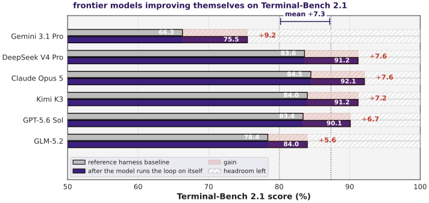

# MetaRSI / RSI2: A Meta-Recursive Self-Improving System for Recursive Self-Improving Systems Themselves

> CosmosMind · 2026-09-06 · paper · **闭环** · [论文](https://arxiv.org/abs/2609.06396) · [仓库](https://github.com/CosmosMind-ai/RSI-Harness)
> 机制族：自主后训练及其评测 · 来源核验 2026-09-17 · 复现状态 not-run

## Pipeline

三个类型化算子共享同一循环内核：Data-RSI 从自身执行轨迹合成经核验的训练记录（对抗式生成加输入隔离 Anchor 角色的盲重推导）；Harness-RSI 对五槽脚手架（系统提示、记忆、内置工具、技能、MCP 工具）打类型化补丁；Model-RSI 从固定基座以有界 LoRA 式训练把数据内化进参数。双轴优化器（横向算子排序、纵向在可变/动作/受保护契约下改写提案策略）调度三者，元智能体每个改进项修订一次调度器。

*图源：Figure 10 (S5.F10, results_frontier.svg)*
## 结果（作者报告，非本地复现）

目标 Qwen3.5-35B-A3B、五种子均值：MetaRSI-v1 相对冻结系统平均 +10.9——Terminal-Bench 2.1 +8.3、SWE-bench Pro +9.2（解决率 10.3→19.5）、AIME +13.3、GPQA-D-hard100 +12.6。消融：组合比最佳单算子（Harness-RSI 单独 +6.6）多 4.3 点，比手工固定与静态路由管线高 3.6 点。

## 证据边界

作者自己的普查：RSI 几乎只在验证可机器判定的领域得到验证（45 个被调查系统的 69%，包括他们自己），因此增益只证明"受限的、基准绑定的能力"；Data-RSI 的盲重解无法对模型自身缺乏的知识证明正确性。

## 对 nanoRSI 的输入

对 nanoRSI：把每次变更类型化为写数据、写脚手架或写参数，共用同一循环内核，并学习算子调度本身——比手工固定管线高出的 3.6 点就是调度的可测价值。

## 来源

[arXiv abstract](https://arxiv.org/abs/2609.06396) · [arXiv HTML v2](https://arxiv.org/html/2609.06396v2) · [GitHub repository](https://github.com/CosmosMind-ai/RSI-Harness)
