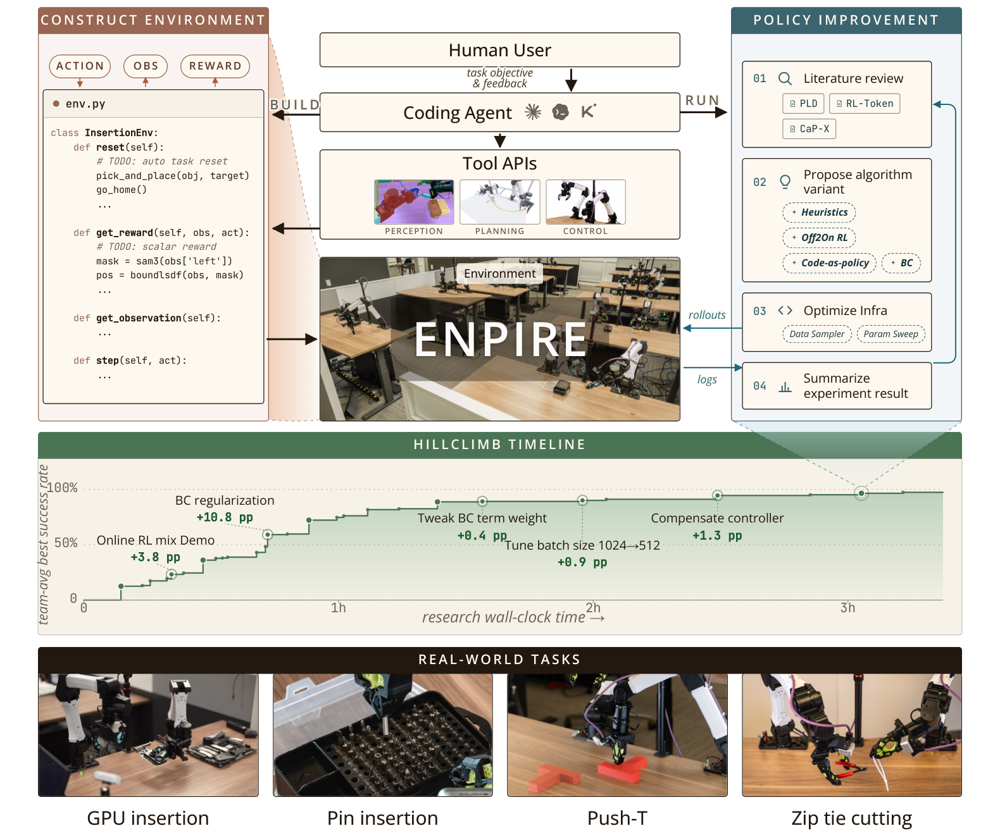

# ENPIRE: Agentic Robot Policy Self-Improvement in the Real World

> NVIDIA / Carnegie Mellon University / UC Berkeley · 2026-06 · paper · **闭环** · [论文](https://arxiv.org/abs/2606.19980)
> 机制族：AI 科学家系统 · 来源核验 2026-09-21 · 复现状态 not-run

## Pipeline

在物理机器人上做自主研究：EN——智能体自建环境，含自动二元奖励验证（几分钟成败演示学得、150ms 内校验）与自动复位（SAM3/BundleSDF/cuRobo 工具调用），以不可变 Gym API 暴露；PI——智能体读文献、提假设、在真实验证信号引导下改训练代码；R——单/多机器人策略评估；E——8 台双臂 YAM 机器人上的去中心化智能体团队异步测试假设，经 Git 分支 cherry-pick/merge 协同。新增 MRU/MTU 利用率指标跟踪机器人/GPU/token 效率。

*图源：Figure 2*
## 结果（作者报告，非本地复现）

Push-T：Claude Code 与 Codex 约 2 小时内达 95% 成功（Kimi Code 翻倍）；插针收敛到连续 50 次成功，扩队列把时间从 >1.5 小时缩到约 40 分钟；摘要口径 PushT、钉盒整理与扎带切割 99% 成功；仿真 RoboCasa365 胜 GR00T 与 CaP-X。诚实成本核算：token 成本随队列规模超线性增长（4 个智能体内近线性、8 个时陡升）；智能体读日志写代码时机器人在闲置。

## 证据边界

智能体读日志写代码时机器人闲置（队列越大 MRU 越低）；token 成本随队列规模超线性；物理任务限于有界灵巧技能而非开放科学。

## 对 nanoRSI 的输入

对 nanoRSI：智能体自建奖励验证环境（从演示学得的二元检查 + 不可变 API）是冻结评估器不变量的物理世界对应物；利用率指标（闲置时间、单位结果 token）在任何环上都可报告。

## 来源

[arXiv abstract](https://arxiv.org/abs/2606.19980) · [Paper v1 (Figure 2, fleet results)](https://arxiv.org/html/2606.19980v1) · [Project page](https://research.nvidia.com/labs/gear/enpire)
