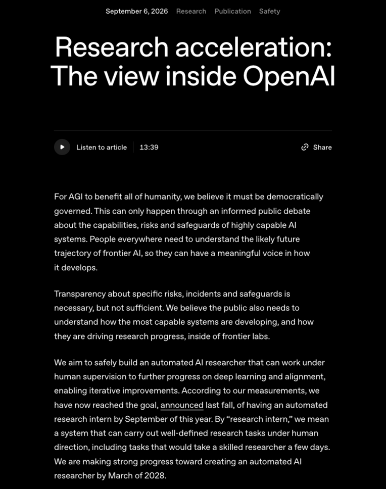

# Research acceleration: The view inside OpenAI

> OpenAI · 2026-09-06 · report · **人在环上** · [论文](https://openai.com/index/research-acceleration-view-inside-openai/)
> 机制族：公司研发遥测 · 来源核验 2026-09-22 · 复现状态 not-run

## Pipeline

OpenAI 宣布达成 2025 年秋设定的"2026 年 9 月前拥有自动研究实习生"目标——即在人类指导下完成明确定义、需数天的研究任务的系统；并给出组织级遥测：8 月中旬研究员中位日推理用量超 600 美元（前 10% 超 7,000 美元）、研究组织整体每 1 个人工工作日配合 3.1 个 agent 工作日、并发 agent 工作流上升、人均实验数创纪录、更长程任务委托增加。同时报告了节奏控制：Hugging Face 事件后暂停了面向部署模型的 RL 训练以加固研究环境。

*图源：Article opening (date, title, first paragraphs)*
## 结果（作者报告，非本地复现）

明确瞄准"2028 年 3 月前的自动 AI 研究员"，把工作定位为迈向 RSI 的进展，同时声明"我们尚不知道如何安全地走完对齐、完整 RSI 的全程"，并提醒整体研究提速"很可能跟不上"agent 用量指标。

## 证据边界

自报的内部遥测：方法虽随文公开但未经独立审计；用量支出、实验数与 agent 工作日都是代理指标，OpenAI 自己也提醒这些与端到端研究进展可能脱节。外部无法复现。

## 对 nanoRSI 的输入

建议：在 nanoRSI 实验日志中引入 agent 工作日核算口径（每个改进阶段的人工/agent 计算比），让递归收益的声明带有明确的劳动力替代分母。

## 来源

[Official research post (opened via browser)](https://openai.com/index/research-acceleration-view-inside-openai/) · [An Alien Mind (essay)](https://openai.com/index/an-alien-mind/)
