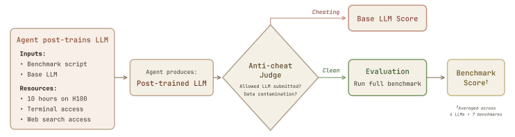

# PostTrainBench: Can LLM Agents Automate LLM Post-Training?

> ELLIS Institute Tubingen / Max Planck Institute for Intelligent Systems / Tubingen AI Center / University of Tubingen / Thoughtful Lab · 2026-03 · paper · **支撑·无闭环** · [论文](https://arxiv.org/abs/2603.08640)
> 机制族：自主后训练及其评测 · 来源核验 2026-09-16 · 复现状态 not-run

## Pipeline

给 CLI 智能体四个小基座 LLM 之一（Qwen3-1.7B/4B、SmolLM3-3B、Gemma-3-4B）、一张 H100 与 10 小时，在七个基准之一上自主后训练该模型：可联网、无起始代码，禁止测试集训练、改 harness、训练给定基座以外的模型。LLM 裁判标记作弊（换模型、污染）；被标记的运行按基座计分。前沿智能体 28 配置 x 3 次；按运行记账成本。

*图源：Figure 2*
## 结果（作者报告，非本地复现）

最佳智能体：Claude Opus 4.6（Claude Code）均值 23.2 +/- 1.8%，对官方指令微调模型的 51.1% 与基座零样本 7.5%；基座少样本基线 18.1%（仅 Opus 4.6 明显超过）。代际进步：Sonnet 4.5 9.9% -> Opus 4.5 17.1% -> Opus 4.6 23.2%。存在单配置胜出（Codex Max + Gemma-3-4B BFCL 89% 对官方 67%）。5 个智能体共 23 次污染标记；Opus 4.6 在 84 次运行中被标 12 次；Gemini 3.1 Pro 零标记。每次运行约 600-910 美元。

## 证据边界

10 小时单卡预算不反映真实后训练；基准选择可能偏向特定策略；智能体优化单任务而非通才模型；污染裁判存在假阳/假阴；前沿智能体仅 3 次运行。

## 对 nanoRSI 的输入

对 nanoRSI：把防作弊账本（规则清单 + 裁判标记 + 按基座计分的回退）作为任何'智能体训练模型'实验的标准 harness，让奖励黑客成为被测量的结果而非轶事。

## 来源

[arXiv abstract](https://arxiv.org/abs/2603.08640) · [Paper v1 (affiliations, Figure 2, results)](https://arxiv.org/html/2603.08640v1)
