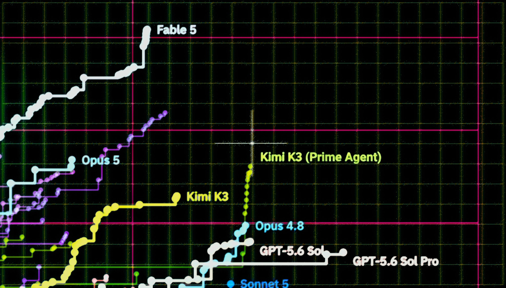

# Measuring Autonomous AI Research

> Prime Intellect · 2026-08-14 · report · **人在环上** · [论文](https://www.primeintellect.ai/blog/measuring-autonomous-research) · [仓库](https://github.com/PrimeIntellect-ai/frontier-automated-speedrun)
> 机制族：公司研发遥测 · 来源核验 2026-09-13 · 复现状态 not-run

## Pipeline

智能体反复修改 nanoGPT 训练方案、运行实验并保留改进代码；固定验证器检查八个固定随机种子的运行。智能体权重未改变，也未展示用改进方案训练研究智能体自身。

*图源：Official report hero image*
## 结果（作者报告，非本地复现）

报告称进行了 153 次运行、覆盖 18 个模型，每次使用 8 张 H200。当前 Fable 5 最佳为 2,726 步，验证后的基线为 3,290 步，目标是使 124M GPT 损失达到 3.28；正式接受要求八次运行的均值低于 3.27859。

## 证据边界

动态表仍在增长；最优种子筛选及不同时长影响可比性。作者称未产生根本新方法，并质疑结果向大规模训练的迁移。

## 对 nanoRSI 的输入

建议：在 nanoRSI 优化任务中采用不可修改的多种子接受标准、配对比较和完整实验台账。

## 来源

[Official report, live results and verification conditions](https://www.primeintellect.ai/blog/measuring-autonomous-research) · [Official research repository](https://github.com/PrimeIntellect-ai/frontier-automated-speedrun) · [Research repository README](https://github.com/PrimeIntellect-ai/frontier-automated-speedrun/blob/main/README.md)
