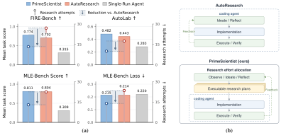

# PrimeScientist: Strategic Allocation of Research Effort in Autonomous Research

> UC San Diego / Johns Hopkins University · 2026-09-15 · paper · **支撑·无闭环** · [论文](https://arxiv.org/abs/2609.17846)
> 机制族：AI 科学家系统 · 来源核验 2026-09-18 · 复现状态 not-run

## Pipeline

自主研究智能体同时决定方向与资源投入：可执行计划树编码有前景但未探索的方向，自适应 MCTS 随结果到达重新分配剩余 token 预算，而非执行固定计划。

*图源：Figure 1 (fig1_grid.svg)*
## 结果（作者报告，非本地复现）

在 12 个 AI 研究任务、预算匹配下，平均奖励 +10.3%，尝试次数比 AutoResearch 少 50.6%。

## 证据边界

作者自报；在 AI 研究任务模拟器上评测，非湿实验或生产科研；单智能体设定。

## 对 nanoRSI 的输入

nanoRSI 的步进器每代花费固定回合预算；把候选机制编成计划树并自适应重分配剩余预算，是同一分配问题的微缩版。

## 来源

[arXiv abstract](https://arxiv.org/abs/2609.17846) · [Paper HTML (affiliations, Figure 1)](https://arxiv.org/html/2609.17846v1)
