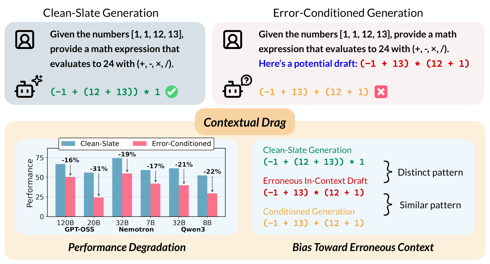

# Contextual Drag: How Errors in the Context Affect LLM Reasoning

> Princeton Language and Intelligence, Princeton University · 2026-02-04 · paper · **支撑·无闭环** · [论文](https://arxiv.org/abs/2602.04288) · [仓库](https://github.com/princeton-pli/contextual-drag)
> 机制族：分析与审计 · 来源核验 2026-09-16 · 复现状态 not-run

## Pipeline

失败模式研究而非系统：在 11 个模型、8 个推理任务上比较干净生成与'条件于 1-2 个错误草稿'的生成（草稿取自强锚模型），每题 16 次生成、符号化答案校验；用树编辑距离量化结构性偏置；检验缓解手段（上下文去噪、定向 SFT）以及外部错误标签或正确的自我验证能否消除拖累。

*图源：Figure 1*
## 结果（作者报告，非本地复现）

上下文拖累造成 10-20% 的普遍性能下降；GPT-OSS-20B AIME24 一个错误草稿即 51.88 -> 17.50（-34.4），HMMT25 -38.1；Qwen3-32B 二十四点 78.48 -> 25.47（-53.0）。GPT-5 几乎免疫（88.75 -> 88.13）。外部'此草稿有错'标签不能消除拖累（GPT-OSS-120B 照样掉到 25.0）；SFT 缓解恢复 +23.1 分但仍低于干净生成，且以减少利用正确上下文为代价。GPT-OSS-20B 在迭代精炼中'塌缩为自我退化'，而多数投票在改善。

## 证据边界

失败模式研究：缓解不彻底（SFT 恢复不满全额且降低正确上下文的利用率）；模型覆盖广但任务以推理为中心；拖累机制（结构性偏置）被量化而未被解决。

## 对 nanoRSI 的输入

对 nanoRSI：任何把自身草稿回喂上下文的环，都必须测'拖累对照'（同一任务带与不带自身中间输出）；缺此对照的自改进声明可能测的是自我伤害。

## 来源

[arXiv abstract](https://arxiv.org/abs/2602.04288) · [Paper v1 (affiliations, Figure 1, findings)](https://arxiv.org/html/2602.04288v1) · [Code repository](https://github.com/princeton-pli/contextual-drag)
