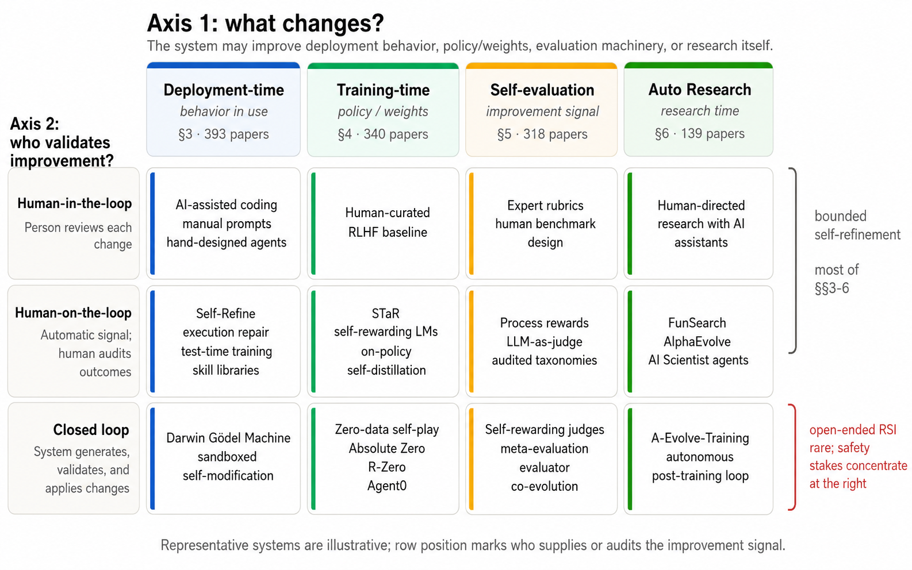

# Recursive Self-Improvement in AI: From Bounded Self-Refinement to Autonomous Research Loops

> DeepGrounding / AlphaAvatar / Illinois Institute of Technology · 2026-07-08 · paper · **支撑·无闭环** · [论文](https://arxiv.org/abs/2607.07663)
> 机制族：分析与审计 · 来源核验 2026-09-17 · 复现状态 not-run

## Pipeline

覆盖 1,250 篇论文（2024-2026，74% 为 2026 年）的综述，两轴组织：改进对象（部署时自进化、训练时自迭代、自评估、自动研究）x 闭环程度（人在环内、人在环上、闭环）。承重贡献是四级验证层级——形式验证器 > 执行反馈 > 学习型裁判 > 内在信号——且已证实的自改进强度随层级递减。

*图源：Figure 1*
## 结果（作者报告，非本地复现）

无基准；发现：成功案例集中在高层级（FunSearch、AlphaEvolve），'AI 科学家缺口正是用三级工具去解四级问题'；无锚定的自我批评信息量跨迭代递减 55%；生成器与评估器共享权重时偏置相关（自我确认环）；新颖性是'闭环会耗尽的可消耗资源'；第四种失败模式'框架锁定'——优化一个已不再值得优化的目标。其点名的空白生态位：治理级的自改进度量。

## 证据边界

作者元数据薄弱（隶属稀疏、邮箱通讯）；两轴切割与层级是作者的综合而非实验；1250 篇语料来自 arXiv 采集（871 种子 + 379 补充）。

## 对 nanoRSI 的输入

对 nanoRSI：把'验证层级'作为每个验收闸门的必填标签——nanoRSI 的冻结评估器是第 2 级（执行反馈），任何学习型裁判闸门都必须言明并度量自身漂移。

## 来源

[arXiv abstract](https://arxiv.org/abs/2607.07663) · [Paper v2 (taxonomy, Figure 1, hierarchy)](https://arxiv.org/html/2607.07663v2)
