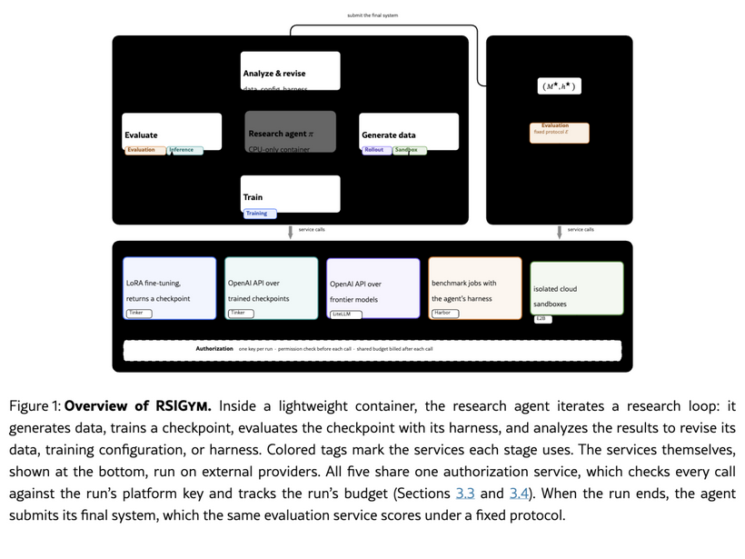

# RSIGym: A Flexible Environment for Recursive Self-Improvement

> Evolvent AI / National University of Singapore · 2026-10-07 · paper · **支撑·无闭环** · [论文](https://arxiv.org/abs/2610.10310) · [仓库](https://github.com/evolvent-ai/RSIGym)
> 机制族：分析与审计 · 来源核验 2026-10-12 · 复现状态 not-run

## Pipeline

一个代理原生的'一切即服务'研究环境：训练、推理、采样、评测与沙箱执行以服务形式暴露，共享权限与预算记账。研究代理在三种轨道——数据、harness 或联合——下对目标系统迭代'生成数据-训练检查点-评测-分析修订'循环，并提交选定的模型加 harness 接受官方评测。RSI-Index 把一次运行记为五个基准域上闭合剩余性能差距的平均比例。

*图源：Figure 1 (inline TikZ SVG, captured from the arXiv HTML rendering): the research agent's loop over EaaS services inside a lightweight container*
## 结果（作者报告，非本地复现）

六个前沿研究模型在每基准运行 500 美元平台服务预算的独立联合轨道下，Opus 5 取得最高 RSI-Index 0.4809，其提交系统把 SWE-bench Verified 从 17.67% 提到 50.33%、AIME 从 31.67% 提到 97.78%。附加实验覆盖 DSH（数据设定与 harness）精炼、预算翻倍（500 到 1,000 美元）与受限网络；没有任何代理在所有域上最佳。

## 证据边界

RSI-Index 是该基准自有指标，且初始系统在部分面板很弱（SWE-bench Verified 起点 17.67%），'闭合剩余差距比例'会奖励低起点的大跳变；全部数字为作者在自有服务记账下运行；论文'开源'声明对应的仓库无许可证文件，按本库惯例视同保留所有权利（只取思想，不复用代码）；各代理除预算标题外的花费未独立审计。

## 对 nanoRSI 的输入

值得借鉴的报告纪律是预算归一化改进：逐面板写明初始与提交分数及每次运行消耗的服务预算，使 nanoRSI 实验报告单位成本增益而非仅增益；'没有代理处处最佳'的发现也支持任何冻结选择器研究都做分域拆解。

## 来源

[arXiv abstract](https://arxiv.org/abs/2610.10310) · [arXiv HTML v1](https://arxiv.org/html/2610.10310v1) · [RSIGym repository](https://github.com/evolvent-ai/RSIGym)
