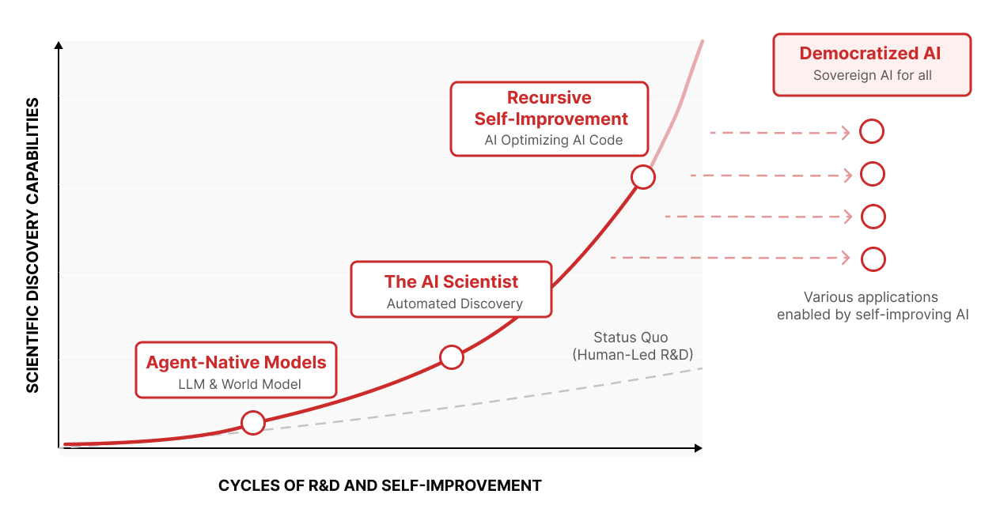

# Introducing Sakana AI's Recursive Self-Improvement (RSI) Lab

> Sakana AI · 2026-06-05 · report · **闭环** · [论文](https://sakana.ai/rsi-lab/)
> 机制族：立场、路线图与实验室 · 来源核验 2026-09-19 · 复现状态 not-run

## Pipeline

组织级承诺而非新机制：设立专门研究组，任务是'用 AI 重新设计 AI 研发流程本身'，从'静态的人类主导研发'走向'自主的自改进智能引擎'。页面固定了两条设计约束——样本效率（'不做最耗算力的自改进引擎，而做样本效率最高的'）与责任（'负责任的 RSI 不是能力的约束，而是能力可持续的前提'），并把实验室放在一条公开路线上：Agent 原生模型 -> AI Scientist -> 递归自改进 -> 民主化 AI。

*图源：RSI trajectory diagram (rsi-trajectory.png)*
## 结果（作者报告，非本地复现）

无新基准；页面引用该团队既往成果作为路线证据：LLM-Squared 的 DiscoPOP（2024，与牛津/剑桥）、Darwin Godel Machine（SWE-bench 约 2 倍、绝对 +30；2025，与 UBC）、ShinkaEvolve（约 150 样本解题；2025）、ALE-Agent（AtCoder 启发式竞赛 058 804 名人类选手中第一）、Digital Red Queen（2026，与 MIT）与 The AI Scientist（Nature 刊发，2026 年 3 月 26 日）。

## 证据边界

属于使命宣言页：无新系统、新基准或人事细节；页面无日期，日期依赖第三方提交元数据；所引成果均早于公告，已单独收录或可独立核验。

## 对 nanoRSI 的输入

把该实验室的产出列为样本高效自改进机制的高优先级来源；其'样本效率优先于算力'的立场与 nanoRSI 的最小预算最小任务纪律同向。

## 来源

[RSI Lab announcement page (undated)](https://sakana.ai/rsi-lab/)
