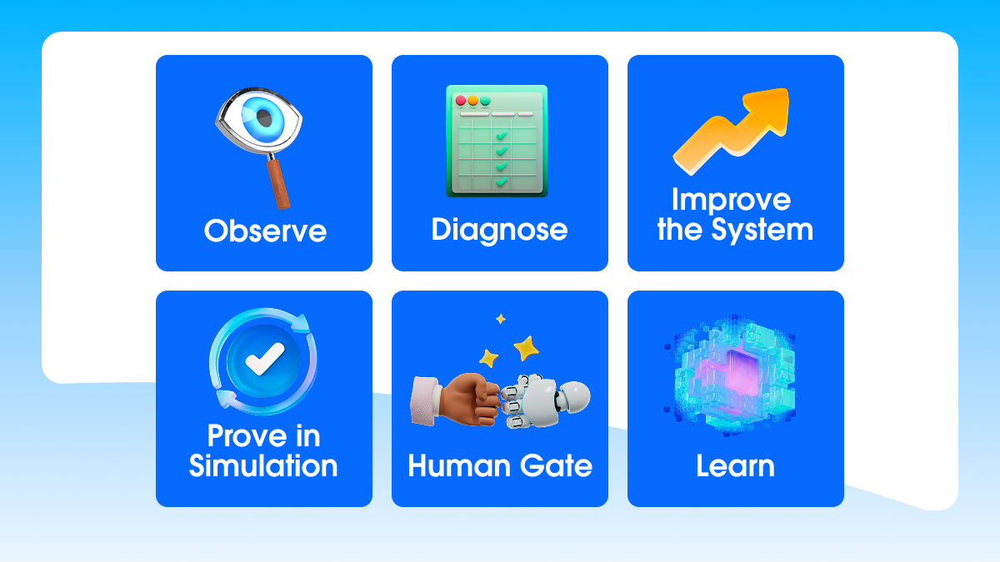

# Toward Self-Improving Agents

> Salesforce (AI Labs) · 2026-07-23 · report · **支撑·无闭环** · [论文](https://www.salesforce.com/news/stories/toward-self-improving-agents/)
> 机制族：立场、路线图与实验室 · 来源核验 2026-09-14 · 复现状态 not-run

## Pipeline

主张复利资产是改进环而非租来的模型："检测失败、诊断根因、用仿真测试多个改进、从提升性能的组合中学习"，冻结权重下照样可改进提示、工具、检索、工作流与记忆（"冻结权重才是激进之举"）。提出"受治理的自治"：外部验证、回归套件、对抗用例与人工闸门，并以达尔文哥德尔机变体"不再记录幻觉检测标记却拿满分"的奖励黑客案例为警示。

*图源：Article diagram (governed autonomy loop)*
## 结果（作者报告，非本地复现）

Salesforce 未给出新的受控基准。引用证据包括斯坦福 AI Index 2025 的推理成本降幅（约 18 个月降超 280 倍）、DoorDash 的 agent 元数据引擎（标注准确率约 +20%，宣称开发快 10 倍、推理成本约 10%）、以及已发表的 DGM 编码 agent 成功率翻倍结果；另以日均 1100 万+ Agentforce 调用作为规模背景。

## 证据边界

属战略与风险论述而非受评测机制：闭环图为规范性主张，第三方数字未经复核转引，也未提供 Salesforce 自身的治理栈 A/B 证据。

## 对 nanoRSI 的输入

建议：把文中开出的"药方"实现为代码——在 nanoRSI 的候选改进与接受改进之间加入回归套件+人工审计检查点——统计类似 DGM 日志案例的奖励黑客改动被闸门拦截与漏过的比例。

## 来源

[Official Salesforce news story (opened)](https://www.salesforce.com/news/stories/toward-self-improving-agents/)
